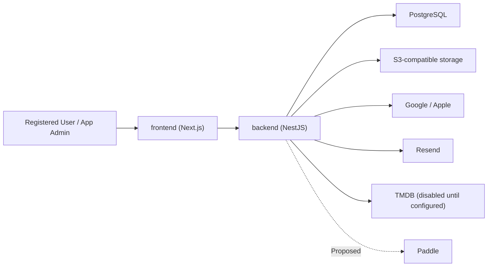
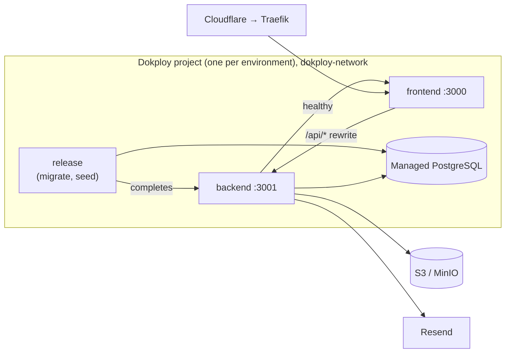
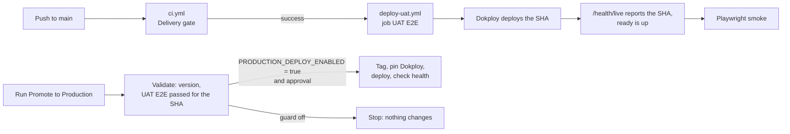

# PickFlick — Architecture

> How the system is built and where it is going. Product scope lives in [ROADMAP.md](ROADMAP.md),
> UX in [DESIGN.md](DESIGN.md), and decision rationale in the [ADR registry](_docs/decisions/README.md).
> Code and deployed configuration are the final word on current state.

| Owner     | Last reviewed | Verified against                                     |
| --------- | ------------- | ---------------------------------------------------- |
| Developer | 2026-09-26    | ADR-001–ADR-014 and branch `PF-32_verify-phases-1-5` |

**States:** `Active` — implemented and verified; `Partial` — some exists, the gap is named;
`Proposed` — accepted direction, not built. An accepted ADR does not make anything `Active`.

## 1. System overview

PickFlick coordinates private Club movie nights and keeps shared and personal film history.

- **Actors:** registered User, Club Admin/Moderator/Member, App Admin, external providers.
- **Constraints:** registered members only; one blocking Session per Club; idempotent automatic
  transitions; personal data under GDPR; a bespoke responsive UI; early-stage scale and budget.
- **Non-goals:** microservices, event sourcing, anonymous access, dedicated search, offline
  conflict resolution, multi-region runtime, AI inference.



| Concern    | Direction                                                                               | State                                                                                                    | ADR               |
| ---------- | --------------------------------------------------------------------------------------- | -------------------------------------------------------------------------------------------------------- | ----------------- |
| Shape      | pnpm monorepo, two entrypoints (frontend, backend) plus a one-shot release job.         | Active                                                                                                   | ADR-014           |
| Frontend   | Next.js App Router, server components and server actions, UI kit on unstyled Mantine.   | Partial — public site, login, Club onboarding, Hub overview, and settings; other product routes Proposed | ADR-013           |
| Backend    | NestJS feature modules, zod-validated REST, Better Auth database sessions.              | Partial — auth, Clubs, Contact, health; other product modules Proposed                                   | ADR-002, 010, 011 |
| Validation | zod request schemas in `@pickflick/contracts`, shared by backend and forms.             | Active                                                                                                   | ADR-012           |
| Data       | PostgreSQL through reviewed Prisma migrations; SQL constraints for invariants.          | Partial — Users, auth, Clubs, Session skeleton, cached Movies; other entities Proposed                   | ADR-003           |
| Objects    | S3-compatible storage for avatars and exports.                                          | Partial — Club avatars                                                                                   | —                 |
| Background | None until the first job; its phase chooses the queue (outbox + BullMQ is the default). | Proposed                                                                                                 | ADR-014           |
| Real-time  | SSE from the API for Session progress.                                                  | Proposed                                                                                                 | —                 |
| Delivery   | Dokploy UAT and production, source-built Compose, UAT-proven SemVer promotion.          | Partial — repository-verified; live production not provisioned                                           | ADR-007, 008      |

## 2. Repository

```text
apps/
  frontend/   Next.js routes, UI kit, server-side API client
  backend/    NestJS REST API, Better Auth, feature modules
packages/
  contracts/  zod request schemas and response interfaces shared by both apps
  database/   Prisma schema, migrations, client, fixtures, seed/reset CLIs
  config/     environment schema and TypeScript presets
  eslint-config/ dev-only ESLint presets and plugins
assets/brand/ production brand imagery (imported as @brand/…)
tests/        Playwright: ui-preview (local build + mock API) and uat (deployed smoke)
_docs/        guides, decisions, design prototypes
```

A package exists only while something consumes it. When a second entrypoint needs server-side
domain code, extract a focused package instead of importing one app from another.

### Backend

`AppModule` composes infrastructure and feature modules. Runtime environment, `PrismaService`, and
storage come from global modules; feature modules are non-global and export only what another
module uses. A global `AuthGuard` protects every route unless it is marked `@Public()`.

| Module                                                                           | Owns                                                                                                                | State                                                                        |
| -------------------------------------------------------------------------------- | ------------------------------------------------------------------------------------------------------------------- | ---------------------------------------------------------------------------- |
| auth                                                                             | Better Auth (Google, Apple behind a gate), database sessions, suspension, App roles.                                | Partial — Apple not activated                                                |
| clubs                                                                            | Club creation, Hub projection, members, settings, avatar, roles, removal, archive/reactivate, leave, delete, audit. | Active                                                                       |
| contact                                                                          | `POST /contact`, rate-limited, sent directly through the email module.                                              | Active                                                                       |
| email                                                                            | Resend client; a logging stub when delivery is disabled.                                                            | Active                                                                       |
| storage                                                                          | S3 put/get/delete/ping (AWS SDK).                                                                                   | Active                                                                       |
| health                                                                           | `/health/live` (revision) and `/health/ready` (database, object storage).                                           | Active                                                                       |
| movies                                                                           | TMDB adapter, canonical Movie upserts, search snapshots, explicit freshness and provider failure states.            | Partial — internal catalog service; refresh worker and public routes pending |
| Sessions, Library, Achievements, Notifications, Billing, Privacy, Administration | See the Roadmap phases.                                                                                             | Proposed                                                                     |

Copy `apps/backend/src/modules/contact` for a new module; [apps/backend/AGENTS.md](apps/backend/AGENTS.md)
holds the conventions.

### Frontend

Route groups `(marketing)`, `(auth)`, `(product)`, and `(internal)` hold the routes; a route keeps
its `page.module.scss`, `actions.ts`, and `_components/`. `src/components/ui/<Name>/` is the UI kit.
Server code calls the backend only through `src/api/<area>.server.ts`, which forwards the session cookie
and client address. Forms use `@mantine/form` and call a server action that returns `TFormResult`.
[apps/frontend/AGENTS.md](apps/frontend/AGENTS.md) holds the conventions.

### How a request flows


Pages read data the same way: a server component calls `src/api/<area>.server.ts` during render.
The browser itself calls the backend only for sign-in (`/api/auth/*`), which the frontend proxies
to the backend. [Add a feature end to end](_docs/adding-a-feature.md) walks through each layer.

## 3. Data

| Store                 | Holds                                                  | State                                                   |
| --------------------- | ------------------------------------------------------ | ------------------------------------------------------- |
| PostgreSQL            | All domain state, sessions, audit.                     | Partial — local and CI; managed UAT/production Proposed |
| S3-compatible storage | Club avatars under private opaque keys; later exports. | Partial — Club avatars                                  |
| Bundled assets        | Brand imagery, versioned with the frontend build.      | Active                                                  |

The schema (`packages/database/prisma/schema.prisma`, twelve migrations) holds `User`,
`ProviderAccount`, `AuthSession`, `AuthVerification`, `AuthRateLimit`, `Club`, `Membership`,
`ClubAuditEvent`, `ClubInvite`, `Session`, `Movie`, and `MovieSearchCache`. Database-enforced invariants:

- one active Membership per User and Club, and at most one active Admin per Club;
- at most one Nomination/Selection/Watching Session per Club;
- Club score scale bounds and lifecycle consistency.
- unique invitation token digests, expiry order, and consistent response attribution.

Club invitations store only a SHA-256 digest of 32 random bytes. A raw token is returned once at
creation and sent back only in POST bodies. Admin/Moderator creation and revocation are
membership-scoped. Acceptance locks the Club row before re-checking expiry, revocation, target,
Club lifecycle, current Membership, and member limit; the Membership, audit event, and invitation
response commit together. Historical departed Memberships remain intact. Links expire after seven
days and one User can accept or decline each link. Unsafe states omit Club data; preview is available
only to authenticated Users. The invitation page and API responses are private and uncached.
Manager lists include the 20 most recent records and every live pending invitation, so older links
remain reachable for revocation. The creation action preserves its returned token if a subsequent
list refresh fails; the UI shows the link and a separate refresh warning.

The eleventh migration adds `MEMBERSHIP_REMOVED` to the audit enum. `POST
/clubs/:clubId/members/:membershipId/remove` validates typed `REMOVE` confirmation, locks the Club,
and re-reads actor and target roles. Admins remove non-Admins; Moderators remove Members. Self-removal
uses Leave Club. A repeated removal creates no extra event. Leave and role changes share the Club lock
with invitations and lifecycle writes; the historical Membership and Session rows remain intact.

`GET /club-invitations/pending` returns only eligible, recipient-targeted invitations in a
repeatable-read snapshot. Responses contain IDs and minimal preview fields, without tokens or digests.
`POST /club-invitations/:inviteId/respond` resolves the invitation only for its target User and shares
the token response's locked eligibility check and Membership transaction. Shareable links cannot be
listed for a recipient. Existing unsafe-state privacy rules apply to both flows.

Hub and Manage Club projections carry `IClubAccess` (`adminless`, `newWorkAllowed`, and restriction
`reasons`) and role permissions. Manage Club also identifies the caller's Membership. The access
resolver currently uses lifecycle, active administration, member count, and fixture plan limits.
Phase 20 can replace entitlement input without making browser state an authorization boundary.
`MEMBER_LIMIT` means excess roster size: history and existing participation stay available, and removal
and leaving can restore capacity. At exact capacity, the invitation API still rejects new links.
The unresolved choice among excess administered Clubs is not implemented.

Remaining entities in the [Roadmap domain model](ROADMAP.md#5-domain-model) are Proposed.

## 4. Interfaces

| Interface     | Path                                         | Contract                                                                      | State                                                          |
| ------------- | -------------------------------------------- | ----------------------------------------------------------------------------- | -------------------------------------------------------------- |
| Browser → API | Browser → Next server (actions, pages) → API | JSON REST; zod request schemas, typed responses                               | Partial — Contact, Clubs, Hub overview                         |
| Errors        | API → callers                                | `{ error: { code, message, requestId, reason? } }`                            | Active                                                         |
| OAuth         | Browser ↔ API ↔ Google/Apple                 | Better Auth routes behind an allowlist                                        | Partial — Apple dormant                                        |
| Email         | API → Resend                                 | Plain text; environment-specific senders (ADR-009)                            | Partial — Contact only                                         |
| Club avatar   | Next → API → S3                              | Raw image ≤512 KiB, PNG/JPEG/WebP signature checked                           | Active                                                         |
| Live progress | Frontend → API                               | SSE, re-fetch after gaps                                                      | Proposed                                                       |
| TMDB          | Backend → provider                           | Fixed HTTPS adapter; validated search, details, credits, and trailer mapping. | Active — disabled until configured; live provider not verified |
| Paddle        | API → provider; provider → API webhook       | Signed, idempotent webhooks                                                   | Proposed                                                       |
| CSV           | Frontend ↔ API                               | Versioned CSV schema                                                          | Proposed                                                       |

Planned flows (Proposed): a Session submission serializes on the Session row, persists, evaluates
completion, and transitions at most once in one transaction; deadlines are enforced by a scheduled
job that reloads and re-checks the Session, with reconciliation for missed deadlines; Paddle events
are verified, stored by provider ID, and applied idempotently; account deletion anonymizes shared
history and revokes every session.

## 5. Cross-cutting contracts

- **Movie catalog:** `MoviesService` is the internal boundary for later search/detail routes.
  PostgreSQL `Movie.tmdbId` is unique; transactional SQL upserts preserve the canonical UUID
  under concurrent search/detail ingestion and reject older payloads overwriting newer ones.
  Summary and detail freshness are independent, so search cannot make incomplete credits or
  media appear fresh. Exact normalized query/page snapshots live in `MovieSearchCache`.
  Cached payloads are validated when read. Provider removal invalidates detail and search
  snapshots while preserving the Movie identity. Restoring availability requires a detail request
  started strictly after removal; an equal timestamp preserves the tombstone. — Active for the internal service
- **Provider fallback:** callers receive `fresh`, `stale`, or `unavailable`. Stale data requires
  explicit opt-in, a validated complete payload within `TMDB_STALE_HOURS`, and a timeout,
  rate limit, or transient unavailability. Invalid payloads, authentication failures, disabled
  configuration, and removal never use stale fallback. A process-local cooldown honors
  the longest `Retry-After` deadline from overlapping responses; request timeouts cover the
  response body too. Interrupted body transport is transient unavailability; malformed JSON
  and invalid mapped payloads are invalid responses. The adapter validates both provider and
  canonical payloads before returning them. No provider error text is logged.
  — Active; worker/queue approval pending [ADR-016](_docs/decisions/README.md#adr-016--use-a-postgresql-queue-for-movie-refresh)

- **Authentication:** Better Auth in the backend; identities keyed by provider subject; implicit
  linking disabled and explicit linking deferred; opaque database sessions (seven days, refreshed
  daily) in a host-only `__Host-` cookie; provider tokens never stored; suspension revokes every
  session. Next.js renders and redirects but never authorizes. See
  [Authentication and sessions](_docs/authentication.md). — Partial (Apple dormant)
- **Authorization:** deny by default. App roles User and App Admin; Club roles Admin, Moderator,
  Member re-read from the database on every command. A Club the caller cannot see answers `404`;
  App Admin does not inherit Club rights. — Active for built routes
- **Club Hub:** `GET /clubs/:clubId/hub` reads one current Membership and its Club counts and
  Sessions in a repeatable-read transaction. The API marks the response private and no-store;
  Next.js fetches it without a cache. Active Rating lookup is independent of the recent-activity
  limit. Direct visits and Club switches save the last-Club cookie only after API Hub authorization;
  a switch that loses Membership returns to `/app`. `/app` checks current Memberships before using
  the cookie. — Active for Overview. Members and Manage Club use the repeatable-read settings
  projection with the same access contract.
- **Validation:** every body, query, file, and provider payload is checked at the boundary; output
  is encoded for its context. — Active for built routes
- **Rate limits:** `@nestjs/throttler` (120/min globally, 5 per 10 minutes for Contact) keyed by the
  visitor address Express resolves by trusting two proxy hops (the Next.js rewrite and the
  Cloudflare entry); Better Auth limits its own routes to 60 a minute (10 for social sign-in). —
  Active
- **Observability:** nestjs-pino structured logs with a request ID; health endpoints. Error
  telemetry and alerts are Proposed.
- **Privacy:** minimal collection, private storage, export and deletion that anonymizes shared
  history. — Proposed
- **Security headers:** every page gets a per-request nonce CSP from `proxy.ts` (scripts only with
  the nonce, no framing, no plugins); every frontend response adds HSTS, `nosniff`, a referrer
  policy, a permissions policy, and a same-origin opener policy; the backend sends its own
  restrictive headers because Next.js does not add headers to proxied responses. See
  [ADR-015](_docs/decisions/README.md#adr-015--send-a-nonce-based-csp-and-security-headers-from-each-runtime)
  and [Security](_docs/security.md). — Active
- **Security baseline:** treat browser, provider, upload, and webhook input as untrusted; keep
  secrets server-side only and out of logs; render user text as text; hash invitation tokens; audit
  high-impact actions.

## 6. Runtime and delivery

| Environment | Topology                                                                                                                    | Data                           |
| ----------- | --------------------------------------------------------------------------------------------------------------------------- | ------------------------------ |
| Local       | Frontend and backend run natively; PostgreSQL and MinIO in Docker.                                                          | Synthetic seed; email disabled |
| CI          | Audit, lint, knip, types, unit, integration, images; PRs run UI smoke, main/manual run full contract and visual regression. | Ephemeral services             |
| UAT         | Dokploy Compose (`release`, `backend`, `frontend`) + managed data.                                                          | Synthetic; test-inbox email    |
| Production  | Same shape, pinned to a SemVer tag.                                                                                         | Real users; live providers     |



- **Configuration:** one zod schema in `@pickflick/config`; startup fails on invalid values.
  [\_docs/environment.md](_docs/environment.md) lists every variable. Secrets live only in the
  platform's secret store.



- **Deployment:** after CI passes on `main`, including Linux visual regression,
  `deploy-uat.yml` deploys that exact revision, waits
  until `/health/live` reports it with every dependency ready, and runs the Playwright UAT smoke.
  `promote-production.yml` requires a successful `UAT E2E` check for the release revision, tags it,
  pins Dokploy to the tag, and deploys — only when `PRODUCTION_DEPLOY_ENABLED=true`. See the
  [UAT](_docs/uat-operations.md) and [production](_docs/production-operations.md) guides.
- **Migrations:** reviewed Prisma migrations applied by the release job before the backend starts.
- **Rollback:** redeploy a previous tag when the schema is compatible; otherwise fix forward.
- **Backups and restore drills:** Proposed, required before launch.

## 7. Decisions

| ADR | Direction                                                        |
| --- | ---------------------------------------------------------------- |
| 002 | Authentication and sessions live at the API boundary.            |
| 003 | PostgreSQL with reviewed Prisma migrations.                      |
| 007 | Proportional Dokploy baseline with source-built Compose.         |
| 008 | Promote UAT-proven revisions to production as SemVer tags.       |
| 009 | One public contact address; environment-specific Resend senders. |
| 010 | Better Auth inside the API.                                      |
| 011 | Feature modules; global infrastructure modules.                  |
| 012 | Shared zod schemas at every boundary.                            |
| 013 | UI kit in the frontend on unstyled Mantine.                      |
| 014 | Two entrypoints until the first background job.                  |

Superseded: ADR-001, 004, 005, 006. Update this document whenever a deployable, module, data owner,
interface, integration, environment, or guarantee changes.
