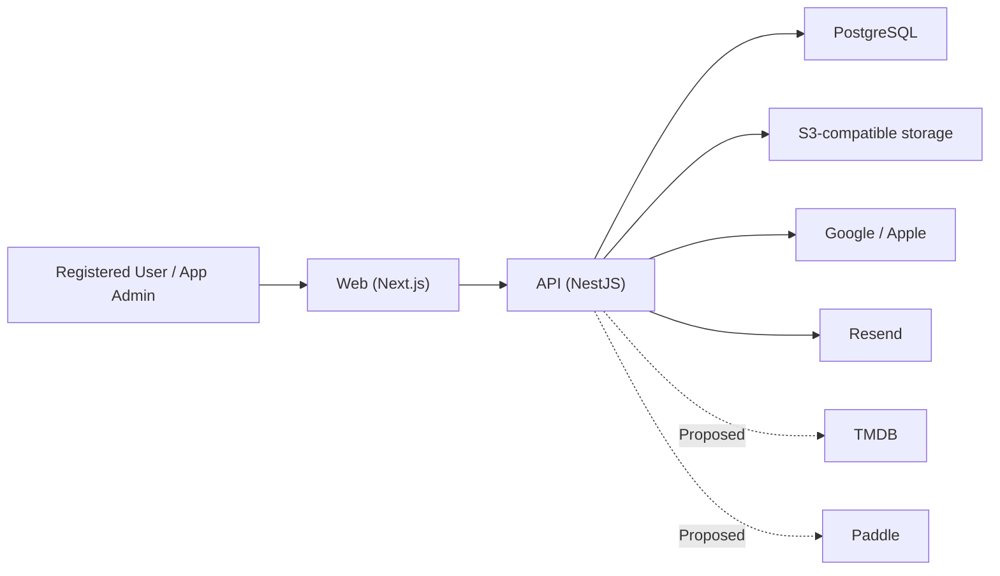

# PickFlick — Architecture

> How the system is built and where it is going. Product scope lives in [ROADMAP.md](ROADMAP.md),
> UX in [DESIGN.md](DESIGN.md), and decision rationale in the [ADR registry](_docs/decisions/README.md).
> Code and deployed configuration are the final word on current state.

| Owner     | Last reviewed | Verified against                                     |
| --------- | ------------- | ---------------------------------------------------- |
| Developer | 2026-09-26    | ADR-001–ADR-014 and branch `PF-32_verify-phases-1-5` |

**States:** `Active` — implemented and verified; `Partial` — some exists, the gap is named;
`Proposed` — accepted direction, not built. An accepted ADR does not make anything `Active`.

## 1. System overview

PickFlick coordinates private Club movie nights and keeps shared and personal film history.

- **Actors:** registered User, Club Admin/Moderator/Member, App Admin, external providers.
- **Constraints:** registered members only; one blocking Session per Club; idempotent automatic
  transitions; personal data under GDPR; a bespoke responsive UI; early-stage scale and budget.
- **Non-goals:** microservices, event sourcing, anonymous access, dedicated search, offline
  conflict resolution, multi-region runtime, AI inference.



| Concern    | Direction                                                                               | State                                                                                     | ADR               |
| ---------- | --------------------------------------------------------------------------------------- | ----------------------------------------------------------------------------------------- | ----------------- |
| Shape      | pnpm monorepo, two entrypoints (web, API) plus a one-shot release job.                  | Active                                                                                    | ADR-014           |
| Frontend   | Next.js App Router, server components and server actions, UI kit on unstyled Mantine.   | Partial — public site, login, Club onboarding and settings; other product routes Proposed | ADR-013           |
| Backend    | NestJS feature modules, zod-validated REST, Better Auth database sessions.              | Partial — auth, Clubs, Contact, health; other product modules Proposed                    | ADR-002, 010, 011 |
| Validation | zod request schemas in `@pickflick/contracts`, shared by API and forms.                 | Active                                                                                    | ADR-012           |
| Data       | PostgreSQL through reviewed Prisma migrations; SQL constraints for invariants.          | Partial — Users, auth, Clubs, Session skeleton; other entities Proposed                   | ADR-003           |
| Objects    | S3-compatible storage for avatars and exports.                                          | Partial — Club avatars                                                                    | —                 |
| Background | None until the first job; its phase chooses the queue (outbox + BullMQ is the default). | Proposed                                                                                  | ADR-014           |
| Real-time  | SSE from the API for Session progress.                                                  | Proposed                                                                                  | —                 |
| Delivery   | Dokploy UAT and production, source-built Compose, UAT-proven SemVer promotion.          | Partial — repository-verified; live production not provisioned                            | ADR-007, 008      |

## 2. Repository

```text
apps/
  web/        Next.js routes, UI kit, server-side API client
  api/        NestJS REST API, Better Auth, feature modules
packages/
  contracts/  zod request schemas and response interfaces shared by API and web
  database/   Prisma schema, migrations, client, fixtures, seed/reset CLIs
  config/     environment schema, TypeScript and ESLint presets
assets/brand/ production brand imagery (imported as @brand/…)
tests/        Playwright: ui-preview (local build + mock API) and uat (deployed smoke)
_docs/        guides, decisions, design prototypes
```

A package exists only while something consumes it. When a second entrypoint needs server-side
domain code, extract a focused package rather than importing one app from another.

### API

`AppModule` composes infrastructure and feature modules. Runtime environment, `PrismaService`, and
storage come from global modules; feature modules are non-global and export only what another
module uses. A global `AuthGuard` protects every route unless it is marked `@Public()`.

| Module                                                                                   | Owns                                                                                 | State                         |
| ---------------------------------------------------------------------------------------- | ------------------------------------------------------------------------------------ | ----------------------------- |
| auth                                                                                     | Better Auth (Google, Apple behind a gate), database sessions, suspension, App roles. | Partial — Apple not activated |
| clubs                                                                                    | Club creation, settings, avatar, roles, archive/reactivate, leave, delete, audit.    | Active                        |
| contact                                                                                  | `POST /contact`, rate-limited, sent directly through the email module.               | Active                        |
| email                                                                                    | Resend client; a logging stub when delivery is disabled.                             | Active                        |
| storage                                                                                  | S3 put/get/delete/ping (AWS SDK).                                                    | Active                        |
| health                                                                                   | `/health/live` (revision) and `/health/ready` (database, object storage).            | Active                        |
| Sessions, Movies, Library, Achievements, Notifications, Billing, Privacy, Administration | See the Roadmap phases.                                                              | Proposed                      |

Copy `apps/backend/src/modules/contact` for a new module; [apps/backend/AGENTS.md](apps/backend/AGENTS.md)
holds the conventions.

### Web

Route groups `(marketing)`, `(auth)`, `(product)`, and `(internal)` hold the routes; a route keeps
its `page.module.scss`, `actions.ts`, and `_components/`. `src/components/ui/<Name>/` is the UI kit.
Server code calls the API only through `src/api/<area>.server.ts`, which forwards the session cookie
and client address. Forms use `@mantine/form` and call a server action that returns `TFormResult`.
[apps/frontend/AGENTS.md](apps/frontend/AGENTS.md) holds the conventions.

## 3. Data

| Store                 | Holds                                                  | State                                                   |
| --------------------- | ------------------------------------------------------ | ------------------------------------------------------- |
| PostgreSQL            | All domain state, sessions, audit.                     | Partial — local and CI; managed UAT/production Proposed |
| S3-compatible storage | Club avatars under private opaque keys; later exports. | Partial — Club avatars                                  |
| Bundled assets        | Brand imagery, versioned with the web build.           | Active                                                  |

The schema (`packages/database/prisma/schema.prisma`, nine reviewed migrations) holds `User`,
`ProviderAccount`, `AuthSession`, `AuthVerification`, `AuthRateLimit`, `Club`, `Membership`,
`ClubAuditEvent`, and `Session`. Database-enforced invariants:

- one active Membership per User and Club, and at most one active Admin per Club;
- at most one Nomination/Selection/Watching Session per Club;
- Club score scale bounds and lifecycle consistency.

Remaining entities in the [Roadmap domain model](ROADMAP.md#domain-model) are Proposed.

## 4. Interfaces

| Interface     | Path                                         | Contract                                            | State                    |
| ------------- | -------------------------------------------- | --------------------------------------------------- | ------------------------ |
| Browser → API | Browser → Next server (actions, pages) → API | JSON REST; zod request schemas, typed responses     | Partial — Contact, Clubs |
| Errors        | API → callers                                | `{ error: { code, message, requestId, reason? } }`  | Active                   |
| OAuth         | Browser ↔ API ↔ Google/Apple                 | Better Auth routes behind an allowlist              | Partial — Apple dormant  |
| Email         | API → Resend                                 | Plain text; environment-specific senders (ADR-009)  | Partial — Contact only   |
| Club avatar   | Next → API → S3                              | Raw image ≤512 KiB, PNG/JPEG/WebP signature checked | Active                   |
| Live progress | Web → API                                    | SSE, re-fetch after gaps                            | Proposed                 |
| TMDB, Paddle  | API → provider; Paddle → API webhook         | Adapters; signed, idempotent webhooks               | Proposed                 |
| CSV           | Web ↔ API                                    | Versioned CSV schema                                | Proposed                 |

Planned flows (Proposed): a Session submission serializes on the Session row, persists, evaluates
completion, and transitions at most once in one transaction; deadlines are enforced by a scheduled
job that reloads and re-checks the Session, with reconciliation for missed deadlines; Paddle events
are verified, stored by provider ID, and applied idempotently; account deletion anonymizes shared
history and revokes every session.

## 5. Cross-cutting contracts

- **Authentication:** Better Auth in the API; identities keyed by provider subject; implicit
  linking disabled and explicit linking deferred; opaque database sessions in host-only secure
  cookies; revocation on suspension. Next.js renders and redirects but never authorizes. — Partial
- **Sessions:** seven-day rolling expiry refreshed daily; production cookie
  `__Host-pickflick.session_token` (`Secure`, `HttpOnly`, `SameSite=Lax`, `Path=/`, no `Domain`);
  OAuth state stored in the database; provider tokens encrypted and never sent to the browser;
  only Google/Apple sign-in scopes (`openid email profile`); email/password disabled. A new User is
  created only from a verified provider email, and a signed-out email match returns
  `account_not_linked` instead of merging.
- **Authorization:** deny by default. App roles User and App Admin; Club roles Admin, Moderator,
  Member re-read from the database on every command. A Club the caller cannot see answers `404`;
  App Admin does not inherit Club rights. — Active for built routes
- **Validation:** every body, query, file, and provider payload is checked at the boundary; output
  is encoded for its context. — Active for built routes
- **Rate limits:** `@nestjs/throttler` (120/min globally, 5 per 10 minutes for Contact) keyed by the
  visitor address Express resolves by trusting two proxy hops (the Next.js rewrite and the
  Cloudflare entry); Better Auth limits its own routes. — Active
- **Observability:** nestjs-pino structured logs with a request ID; health endpoints. Error
  telemetry and alerts are Proposed.
- **Privacy:** minimal collection, private storage, export and deletion that anonymizes shared
  history. — Proposed
- **Security baseline:** treat browser, provider, upload, and webhook input as untrusted; keep
  secrets server-side only and out of logs; render user text as text; hash invitation tokens; audit
  high-impact actions.

## 6. Runtime and delivery

| Environment | Topology                                                           | Data                           |
| ----------- | ------------------------------------------------------------------ | ------------------------------ |
| Local       | Web and API run natively; PostgreSQL and MinIO in Docker.          | Synthetic seed; email disabled |
| CI          | Lint, types, unit, integration (real PostgreSQL), UI, images.      | Ephemeral services             |
| UAT         | Dokploy Compose (`release`, `api`, `web`) + managed data services. | Synthetic; preview email       |
| Production  | Same shape, pinned to a SemVer tag.                                | Real users; live providers     |

- **Configuration:** one zod schema in `@pickflick/config`; startup fails on invalid values.
  [\_docs/environment.md](_docs/environment.md) lists every variable. Secrets live only in the
  platform's secret store.
- **Deployment:** after CI passes on `main`, `deploy-uat.yml` deploys that exact revision, waits
  until `/health/live` reports it with every dependency ready, and runs the Playwright UAT smoke.
  `promote-production.yml` requires a successful `UAT E2E` check for the release revision, tags it,
  pins Dokploy to the tag, and deploys — only when `PRODUCTION_DEPLOY_ENABLED=true`. See the
  [UAT](_docs/uat-operations.md) and [production](_docs/production-operations.md) guides.
- **Migrations:** reviewed Prisma migrations applied by the release job before the API starts.
- **Rollback:** redeploy a previous tag when the schema is compatible; otherwise fix forward.
- **Backups and restore drills:** Proposed, required before launch.

## 7. Decisions

| ADR | Direction                                                        |
| --- | ---------------------------------------------------------------- |
| 002 | Authentication and sessions live at the API boundary.            |
| 003 | PostgreSQL with reviewed Prisma migrations.                      |
| 007 | Proportional Dokploy baseline with source-built Compose.         |
| 008 | Promote UAT-proven revisions to production as SemVer tags.       |
| 009 | One public contact address; environment-specific Resend senders. |
| 010 | Better Auth inside the API.                                      |
| 011 | Feature modules; global infrastructure modules.                  |
| 012 | Shared zod schemas at every boundary.                            |
| 013 | UI kit in the web app on unstyled Mantine.                       |
| 014 | Two entrypoints until the first background job.                  |

Superseded: ADR-001, 004, 005, 006. Update this document whenever a deployable, module, data owner,
interface, integration, environment, or guarantee changes.
