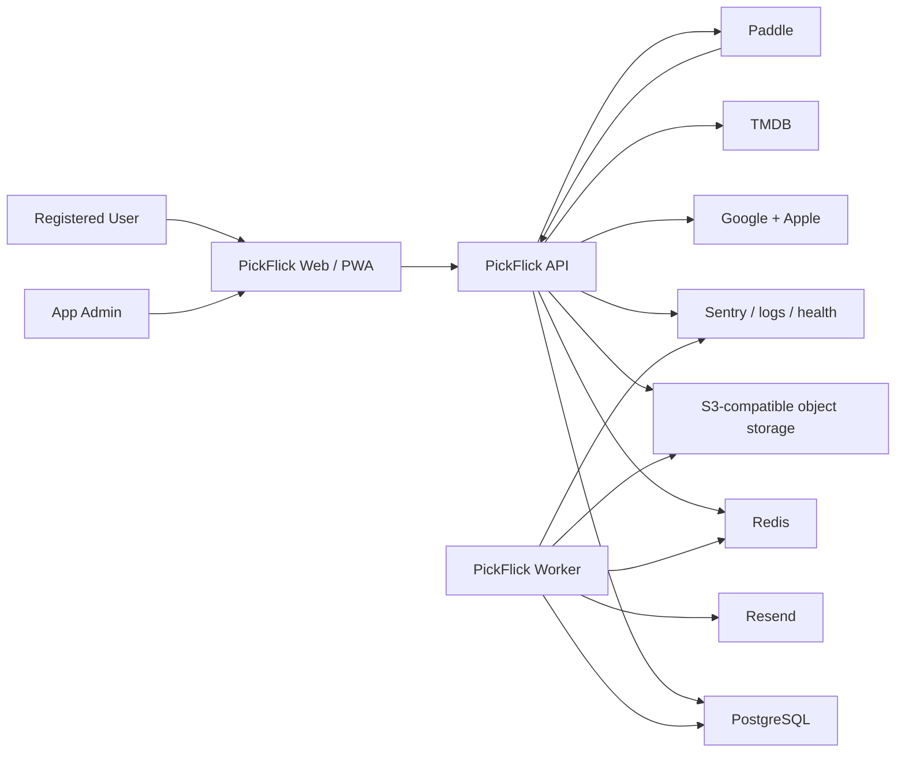

# PickFlick — Architecture Reference

> Accepted technical direction for the greenfield system. The repository/runtime scaffold is
> implemented; the local data/configuration foundation is active, while product, provider, and
> deployment behavior remains Partial.
> Product scope lives in the Roadmap, UX lives in the Design reference, and accepted technical rationale lives in ADRs.

| Document owner | Last reviewed | Verified against |
| --- | --- | --- |
| Developer | 2026-09-11 | ADR-001 through ADR-008, issues #10–#16 repository/runtime evidence, and issue #112 deployment comparison |

## 1. Architecture Contract & Sources

- **This document owns:** proposed system structure, module/deployable boundaries, data ownership, interfaces, runtime flows, infrastructure, and operational contracts.
- **[ROADMAP.md](ROADMAP.md) owns:** product scope, rules, routes, phases, and deferred work.
- **[DESIGN.md](DESIGN.md) owns:** UI/UX direction, screens, components, responsive behavior, and design status.
- **Schema/API references own:** exact database and HTTP contracts as their phases create them.
- **[_docs/decisions/README.md](_docs/decisions/README.md) owns:** accepted/rejected/superseded rationale for significant technical decisions.
- **Code and deployed configuration own:** the latest verifiable implementation state.

An accepted ADR makes a technical direction current. It does not make code, configuration, or
infrastructure `Active`; each affected row remains `Proposed` until implementation and named
verification evidence exist.

### Architecture sources

| Source | Location | Authoritative for | Limitations / notes |
| --- | --- | --- | --- |
| Product roadmap | [ROADMAP.md](ROADMAP.md) | MVP scope, domain vocabulary, business invariants, routes, and phases. | Technical stack is Proposed. |
| Design/UX contract | [DESIGN.md](DESIGN.md) | Required surfaces, interaction behavior, responsive/accessibility needs. | Static prototype code is not production architecture. |
| Canonical prototype package | [_docs/design/prototypes/index.html](_docs/design/prototypes/index.html) | Screen families, state examples, data needs, and cross-screen flows. | Fixture content is clarified in Design/Roadmap. |
| Official Next.js docs | [App Router](https://nextjs.org/docs/app/getting-started) and [self-hosting](https://nextjs.org/docs/app/guides/self-hosting) | Current framework and container/self-hosting capabilities. | Exact version remains a Phase 1 choice. |
| Official pnpm docs | [Workspaces](https://pnpm.io/workspaces) | Workspace and local-package resolution behavior. | Exact version remains a Phase 1 choice. |
| Official NestJS docs | [Task scheduling](https://docs.nestjs.com/techniques/task-scheduling), [queues](https://docs.nestjs.com/techniques/queues), and [SSE](https://docs.nestjs.com/techniques/server-sent-events) | Current framework patterns for API, scheduled/queued work, and server push. | Does not choose the project’s exact queue topology by itself. |
| Official Mantine guide | [Next.js guide](https://mantine.dev/guides/next/) | Current integration baseline for selective UI primitives. | Bespoke Projector Noir styling remains project-owned. |
| Official Prisma docs | [Prisma Migrate](https://www.prisma.io/docs/orm/prisma-migrate) | Migration and PostgreSQL ORM baseline. | Manual SQL may be required for advanced constraints. |
| BullMQ docs | [Idempotent jobs](https://docs.bullmq.io/patterns/idempotent-jobs) | Retry-safe job design. | Does not provide exactly-once external side effects. |
| Better Auth and OWASP guidance | [Better Auth documentation](https://better-auth.com/docs), [session management](https://cheatsheetseries.owasp.org/cheatsheets/Session_Management_Cheat_Sheet.html), and [CSRF prevention](https://cheatsheetseries.owasp.org/cheatsheets/Cross-Site_Request_Forgery_Prevention_Cheat_Sheet.html) | API-owned OAuth/session implementation plus browser session and CSRF security baselines. | ADR-010 selects Better Auth; issues #26–#28 implement Google, the gated Apple flow, and deny-by-default protected-boundary authorization. Apple remains unregistered by default. |
| Dokploy and Cloudflare docs | [Isolated deployments](https://docs.dokploy.com/docs/core/docker-compose/utilities), [Compose domains](https://docs.dokploy.com/docs/core/docker-compose/domains), and [Cloudflare proxy](https://developers.cloudflare.com/fundamentals/concepts/how-cloudflare-works/) | Deployment-network and public-ingress capabilities. | Production behavior must still be proven in UAT. |

### State legend

| State | Meaning |
| --- | --- |
| `Proposed` | Intended direction not yet verified in code/runtime. |
| `Partial` | Some exists; the state must name the missing portion. |
| `Active` | Implemented and verified against a named revision/environment. |
| `Deprecated` | Still present but scheduled for replacement/removal. |

## 2. System Overview

### Purpose and constraints

- **System purpose:** Coordinate private Club movie-night lifecycles and preserve shared/personal film history across web clients.
- **Primary actors:** Registered User, Club Admin, Club Moderator, Club Member, App Admin, deadline/notification worker, and external providers.
- **Key constraints:** One blocking Session per Club; unlimited Rating Sessions; registered Club members only; automatic idempotent transitions; personal/GDPR data; provider webhooks; highly custom responsive UI; ordinary early-stage scale and budget.
- **Architecture non-goals:** Microservices, event sourcing, anonymous access, dedicated search infrastructure, offline conflict resolution, multi-region active-active runtime, and AI inference infrastructure.

### Context diagram



### Architecture summary

| Concern | Accepted direction | Implementation state | Rationale / ADR |
| --- | --- | --- | --- |
| Application style | Modular client/API/worker monolith in one pnpm monorepo. | Active — issue #10 workspace check, builds, and startup probes | Atomic cross-layer changes with separate runtime failure boundaries; [ADR-001](_docs/decisions/README.md#adr-001--use-a-pnpm-modular-monorepo-with-three-runtime-entrypoints). |
| Frontend | Next.js App Router + TypeScript; Server Components for public/shell data where useful, Client Components for rich workflows; project tokens/CSS Modules with wrapped selective Mantine primitives; TanStack Query for API state. | Partial — runnable App Router scaffold, Projector Noir tokens, semantic brand assets, branded Mantine wrappers for select, tabs, menu, and modal behavior, native semantic primitives, the component preview, its Playwright QA harness, and safe branded not-found/application-error recovery are active; remaining product routes, state, and product-route QA coverage remain Proposed | Public SEO, self-hosting, bespoke design ownership, and accessible complex controls; [ADR-006](_docs/decisions/README.md#adr-006--own-projector-noir-and-use-mantine-selectively). |
| Client state | URL/server state first; local React state second; Zustand only after a demonstrated shared-client-state need. | Proposed | Avoid a global state layer before real requirements exist. |
| Backend | NestJS modular REST API, generated OpenAPI, API-owned Better Auth OAuth/database sessions, and SSE for live Club/Session progress. | Partial — runnable NestJS foundations, Google OAuth, database sessions, linking safeguards, and deny-by-default protected-boundary authorization are active locally; Apple is implemented but unregistered behind a default-off gate; remaining product modules, OpenAPI, and product SSE streams remain Proposed | One same-origin server authorization boundary; [ADR-002](_docs/decisions/README.md#adr-002--keep-authentication-and-sessions-at-the-api-boundary) and [ADR-010](_docs/decisions/README.md#adr-010--use-better-auth-at-the-api-boundary). |
| Primary data store | PostgreSQL through reviewed Prisma migrations/client; explicit SQL for high-risk constraints. | Partial — issue #11 implements the local service, initial User/Club/Membership/Session schema, and high-risk Club/Session constraints; remaining entities and production operations are Proposed | Relational invariants, transactions, reporting, and auditability; [ADR-003](_docs/decisions/README.md#adr-003--use-postgresql-and-reviewed-prisma-migrations). |
| Async work | Redis + BullMQ worker with idempotent jobs, a transactional outbox, and reconciliation. | Partial — runnable worker, startup readiness, correlated job-execution wrapper, and local Redis are active; BullMQ, outbox, and product jobs remain Proposed | PostgreSQL retains durable intent across database/queue failure windows; [ADR-004](_docs/decisions/README.md#adr-004--use-bullmq-with-a-transactional-outbox). |
| Object storage | S3-compatible storage for avatars and time-limited exports. | Partial — local MinIO service, bucket initialization, typed configuration, and connectivity check are active; product storage behavior remains Proposed | Keeps binary/user-generated objects outside application/database containers. |
| Real-time | SSE from API; durable truth remains PostgreSQL, Redis distributes invalidation/events. | Proposed | One-way progress updates fit the product; WebSockets are unnecessary for MVP. |
| Deployment | Separate Dokploy UAT/production projects with managed PostgreSQL/Redis and one application Compose resource for web/API/worker/release; native Compose release gating starts API/worker only after migrations and required seed work succeed, while web waits for API health. UAT accepts current `main` only when the Dokploy record and live API report its exact revision; manual production promotion requires that successful UAT run and pins Dokploy to an immutable SemVer tag. | Partial — issues #113 and #114 verify the four-service source-build topology and static contract; issue #15 proves serialized exact-revision UAT delivery and smoke; issue #16 implements guarded production validation and promotion. Live production resources, routing, migration, deployment, and rollback evidence remains Proposed. | Proportional controls, explicit activation triggers, and a disabled production gate; [ADR-007](_docs/decisions/README.md#adr-007--use-a-proportional-dokploy-deployment-baseline) and [ADR-008](_docs/decisions/README.md#adr-008--promote-source-built-production-from-uat-proven-semver-tags). |

## 3. Building Blocks & Boundaries

### Repository and deployables

```text
PickFlick/
  apps/
    web/              # Next.js public site, authenticated PWA, admin UI
    api/              # NestJS HTTP API, OAuth/session callbacks, SSE, webhooks
    worker/           # BullMQ consumers, deadline scheduler, delivery/export/refresh work
  packages/
    contracts/        # Generated API client/types and shared stable value objects
    database/         # Prisma schema, migrations, client, seeds/test fixtures
    observability/    # Structured logs, correlation context, and dependency probes
    ui/               # Projector Noir tokens and reusable production components
    config/           # Shared lint, TypeScript, test, and environment schemas
  assets/brand/       # Production-ready bundled brand imagery
  _docs/              # Durable guidance, design prototypes, decisions, future guides
```

The issue #10 scaffold implements this layout. Product capabilities inside each boundary remain
Proposed unless the table says otherwise. Keep only packages with an immediate command or consumer.
When API and worker first need the same server-side behavior, extract a focused domain/application
package rather than importing one app from another or creating a generic `shared` package.

| Deployable / package | Responsibility | Owns | Depends on | State |
| --- | --- | --- | --- | --- |
| `apps/web` | Render public/private/admin experiences and manage browser interaction. | Routes, presentation, browser/PWA shell. | API contract, UI package, brand assets. | Partial — public Landing, Pricing, Contact, and provisional legal-entry routes plus shared previews/shells are active. Canonical/social metadata, robots/sitemap output, default noindex metadata, and response-header boundaries protect non-public routes; remaining product routes are Proposed. |
| `apps/api` | Authenticate/authorize, execute synchronous domain commands/queries, expose REST/SSE/webhooks. | HTTP boundary, session boundary, domain orchestration. | Database, Redis, providers, contracts. | Partial — runtime foundations, the public Contact command, API-owned Google OAuth, database sessions, explicit linking safeguards, the dormant Apple implementation, and shared authorization enforcement are active locally; remaining product APIs are Proposed. |
| `apps/worker` | Execute delayed/retryable/background work. | Queue consumers, deadline reconciliation, email/export/refresh jobs. | Database, Redis, object storage, providers. | Partial — runtime foundations and Contact delivery reconciliation with bounded Resend retry are active; BullMQ consumers remain Proposed. |
| `packages/contracts` | Prevent handwritten client/server contract drift. | Generated client/types and stable enums/value objects. | API OpenAPI generation. | Partial — initial runtime identity contract; generation remains Proposed. |
| `packages/database` | Own schema/migrations/client and database test helpers. | Relational schema and database constraints. | PostgreSQL, Prisma. | Partial — the initial domain schema, ContactMessage, auth/session records, five reviewed migrations, synthetic fixtures, guarded seed/reset, and integration checks are active; remaining product entities are Proposed. |
| `packages/observability` | Share server runtime diagnostics without coupling deployables. | Structured Pino logger, correlation context, dependency probes, and readiness aggregation. | Runtime configuration and stable contracts. | Active — issue #12 unit, build, and HTTP smoke evidence. |
| `packages/ui` | Implement canonical design tokens and shared UI behavior. | Tokens, Mantine adapter, primitives, shared shell/components. | React, selective Mantine primitives. | Partial — issue #17 tokens, semantic brand registry, native semantic primitives, and branded Mantine-backed select, tabs, menu, and dialog wrappers are active. The issue #18 Playwright harness verifies the component preview; shells remain Proposed. Feature code imports only `@pickflick/ui`, never `@mantine/*`. |
| `packages/config` | Share tool configuration and typed environment schemas. | Build/test/lint/TS/env-validation baselines. | Toolchain. | Active — lint, TypeScript, and typed API/worker/data-service startup configuration are verified locally. |

### Internal modules

API and worker use the same domain/module vocabulary; direct cross-module table manipulation is forbidden outside database migrations/reporting projections.

| Module / area | Responsibility | Public interface | Data ownership | State |
| --- | --- | --- | --- | --- |
| Identity | Better Auth OAuth identities and database sessions, profile, suspension, app role, explicit account linking, and revocation. | The reviewed auth-route allowlist exposes enabled-provider sign-in/callbacks, session read/sign-out, a filtered local account projection, fresh explicit linking, and last-provider-safe unlinking. One shared resolver reads the exact database session, current User status, and App role from one authorization snapshot. Nest handlers are protected by default; public access and `APP_ADMIN` access require explicit metadata. Apple routes and registration are absent while its gate is false. | User, provider account, server session, bounded Apple profile handoff, and bounded auth/link intent state. | Partial — Google sign-in, dormant Apple first-return handling, normalized email/name conflicts, one-time link state, bounded request bodies, database sessions, current-session and revoke-all behavior, suspension, current global roles, and REST/SSE/file authorization guards are active locally; owner Apple activation and provider evidence remain pending. |
| Clubs | Club lifecycle, membership roles, settings, limits, invites, adminless state. | The authenticated `GET /clubs/:clubId/policy` projection exposes only the current active member's role, lifecycle, explicit action booleans, and fixture entitlements. Transactional role changes and Admin transfer serialize per Club, re-authorize current state, deduplicate by operation ID, and write the audit event atomically. Creation, public mutation handlers, settings, lifecycle, and invites remain Proposed. | Club, Membership, ClubAuditEvent; ClubInvite remains Proposed. | Partial — active Membership and single-Admin constraints, adminless state, Free/Pro fixture entitlement projections, private role policies, idempotent role transitions, and audit records are active locally. |
| Sessions | Session roster, phases, deadlines, nominations, ballots, ratings, completion/cancellation. | Session commands/queries and transition service. | Session, participant, invite, nomination, ballot/score, SessionRating. | Proposed |
| Movies | TMDB search/cache/refresh, credits/media, related-title projection. | Movie search/detail/refresh interface. | Movie/provider cache. | Proposed |
| Library | Personal Rating, Watchlist, personal aggregates/import/export. | Library commands/queries. | PersonalMovieRating, WatchlistItem. | Proposed |
| Achievements | Versioned definitions, progress evaluation, awards. | Evaluate/query achievement projections. | Definition/Award and progress projection. | Proposed |
| Notifications | Event-to-notification mapping, preferences, inbox, email delivery. | Publish/list/read/preferences/delivery jobs. | Notification, preferences, delivery attempts. | Proposed |
| Billing | Paddle customer/subscription/webhook state and entitlement projection. | Checkout/portal/webhook/entitlement interface. | Subscription, BillingEvent. | Proposed |
| Privacy | CSV/GDPR exports, deletion/anonymization, retention work. | Export/delete/retention jobs and status. | DataExportJob and deletion audit references. | Proposed |
| Administration | App Admin queries/actions, application settings, operational audit. | Admin-only API and settings. | AdminAuditEvent, application settings. | Proposed |
| Contact | Validate/store/deliver public contact requests. | `POST /contact`, worker delivery reconciliation. | ContactMessage. | Active — five-per-ten-minute keyed-source limiting resolves visitors through the fixed ingress proxy chain; UUID duplicate handling, privacy-safe delivery state, and bounded Resend retry are verified locally. |

### Primary execution paths

#### Phase submission and automatic transition

```text
Browser mutation
  -> API session + Club role authorization
  -> validate current phase, roster, uniqueness, and scale
  -> serialize on Session row inside PostgreSQL transaction
  -> persist submission
  -> evaluate N/N and transition at most once
  -> write outbox events in same transaction
  -> response with authoritative phase/version
  -> worker dispatches notifications; SSE clients revalidate
```

#### Deadline

```text
Session created/updated with deadline
  -> transaction writes delayed-job request/outbox event
  -> worker schedules durable delayed BullMQ job
  -> job locks/reloads Session and compares phase + deadline + version
  -> no-op if stale/already transitioned
  -> zero/one/many nomination rule applied transactionally
  -> outbox notifications delivered with retries
```

The database, not queue timing, is authoritative. A periodic reconciliation job finds missed overdue deadlines so lost/delayed queue messages cannot leave Sessions stuck indefinitely.

#### Paddle webhook

```text
Paddle webhook
  -> raw-body signature verification
  -> store provider event ID idempotently
  -> acknowledge valid receipt quickly
  -> worker applies subscription transition in provider sequence/context
  -> entitlement projection changes
  -> user notification + audit event
```

#### Personal deletion

```text
Confirmed deletion request
  -> re-authentication and authorization
  -> cancel/mark billing
  -> durable privacy job
  -> anonymize shared Club/Session attribution
  -> delete private Library/profile artifacts per approved policy
  -> make former-admin Clubs adminless and notify remaining members
  -> revoke every session and finalize audit-safe completion record
```

## 4. Data & Interfaces

### Data stores and ownership

| Store | Purpose | Owner | Source of truth for | Lifecycle / backup | State |
| --- | --- | --- | --- | --- | --- |
| PostgreSQL | Transactional domain data, entitlements, notifications, audits, job/outbox intent. | API/worker modules via database package. | Users, Clubs, Sessions, history, subscription projection, durable workflow state. | Local persistent service and initial schema are active; separate Dokploy-managed UAT/production instances, encrypted backups, and restore remain Proposed. | Partial |
| Redis | BullMQ, delayed/retry state, rate-limit counters, short-lived distributed events/cache. | Worker/platform boundary. | Never the sole source for domain state. | Local persistent service and connectivity check are active; separate Dokploy-managed UAT/production instances and queue policy remain Proposed. | Partial |
| S3-compatible object storage | Avatars and generated export archives. | Identity/Clubs/Privacy modules. | Binary objects referenced by PostgreSQL. | Local persistent MinIO bucket is active; private product objects, expiry, and production backup remain Proposed. | Partial |
| Bundled static assets | Logo/mascot PWA and UI artwork. | Web build. | Versioned application brand imagery. | Source controlled and deployed immutably. | Proposed |

The schema under `packages/database` implements `User`, `Club`, `Membership`, `ClubAuditEvent`,
`Session`, and `ContactMessage`. Contact content remains only while delivery can be retried. Successful delivery
and terminal failure clear the message, name, and email while retaining keyed hashes and operational
delivery metadata.
Remaining product-level entities listed in [ROADMAP.md](ROADMAP.md#domain-model) remain Proposed.

| Entity / state machine | Owner | Key invariant or lifecycle | Canonical source |
| --- | --- | --- | --- |
| Club Membership | Clubs | A partial unique index permits Membership history but only one active row per User/Club; another partial unique index permits no more than one active Admin and allows zero. Status/departure consistency and serialized, audited role transitions are database-enforced. | [Roadmap identity rules](ROADMAP.md#identity-and-access) |
| Session | Sessions | Partial unique PostgreSQL constraint prevents more than one Nomination/Selection/Watching Session per Club. | [Roadmap Session invariants](ROADMAP.md#club-and-session-invariants) |
| Session transition | Sessions | Monotonic state machine; serialized/idempotent automatic and manual transitions. | [Roadmap state machine](ROADMAP.md#session-state-machine) |
| Ballot/score | Sessions | One immutable Ballot per participant; exactly one score per nomination; score within snapshotted range. | [Roadmap result rules](ROADMAP.md#selection-and-result-rules) |
| Session vs Personal Rating | Sessions / Library | Historical Session Rating never changes due to Personal Rating edits. | [Roadmap domain model](ROADMAP.md#domain-model) |
| Provider webhook | Billing | Provider event ID unique; signature verified; replay is safe. | Billing module contract. |
| Outbox event | Owning module / Notifications | Created in the same transaction as domain change; delivery is at least once and consumers idempotent. | Worker contract. |

### Interfaces

Default API workflow: implement validated NestJS DTO/controller contracts, generate OpenAPI in the same change, then regenerate the typed web client. Database workflow: change Prisma schema/manual migration first, migrate/test, then update code.

| Interface | Direction | Protocol | Contract source / workflow | Auth / trust boundary | Failure behavior | State |
| --- | --- | --- | --- | --- | --- | --- |
| Browser API | Browser -> Next Server Action -> API | Same-origin Server Action, then internal HTTPS/HTTP JSON REST | Reusable web form-action state plus shared typed contracts; future APIs add generated OpenAPI/client | Public Contact uses no session; the Server Action validates input and preserves the proxy-derived source for API rate limiting. Authenticated routes still require the proposed session/CSRF boundary. | Structured safe action results; Contact UUID makes retries idempotent and conflicts explicit. | Partial — Contact command active; authenticated API contract generation remains Proposed. |
| Live progress | Web -> API | HTTPS SSE | Versioned event envelope generated with API contract | Authenticated, Club/Session-authorized stream. | Reconnect with last event/version; re-fetch authoritative projection after gaps. | Proposed |
| OAuth | API/browser -> Google and, after activation, Apple | OIDC/OAuth over HTTPS | API-owned Better Auth handler plus PickFlick Identity policies from ADR-010 | Database state is consumed atomically before code exchange; nonce/PKCE bind the callback; callback and return targets use exact allowlists; link intent is single-use and requires a session issued within 15 minutes. Apple's form POST uses a server-side profile handoff, so its browser redirect contains no first-return profile. | Deny with a stable safe error, retain an already validated invitation continuation, and never auto-link by email or expose provider subjects, tokens, profile payloads, or account existence to browser storage, callback URLs, or logs. | Partial — Google sign-in and linking safeguards are locally verified. Apple is locally verified behind a default-off gate; owner activation and sandbox/UAT evidence remain pending. |
| TMDB | API/worker -> TMDB | HTTPS API | Provider adapter with integration tests | Server-held API credential; provider data untrusted. | Timeout, bounded retry, cached stale detail where safe, explicit unavailable state. | Proposed |
| Paddle checkout/portal | Web/API -> Paddle | Hosted provider flow | Billing adapter and return-state contract | Authenticated Admin; server creates provider session. | Safe cancel/failure return and server-side entitlement recheck. | Proposed |
| Paddle webhook | Paddle -> API | Signed HTTPS webhook | Raw-body verification + versioned handler | Public endpoint, signature/timestamp/replay validation. | Fast reject invalid; store valid idempotently; async processing/retry. | Proposed |
| Email | Worker -> Resend | HTTPS API | Contact plain-text adapter plus future notification template registry and [ADR-009](_docs/decisions/README.md#adr-009--use-one-public-contact-and-environment-specific-resend-senders) | Environment-specific, domain-restricted server credential; minimum personal data. | Provider idempotency, timeout, bounded retry/backoff, durable status, persistent-failure signal; never fall back across environments or to personal SMTP. | Partial — Contact delivery active; notification templates, bounce/suppression handling, and BullMQ dispatch remain Proposed. |
| Upload | Web -> object storage via API policy | Presigned HTTPS | Upload intent + completion contract | Authenticated owner; MIME/size/key allowlist. | Reject unsafe files, verify object, clean abandoned uploads. | Proposed |
| CSV import/export | Web and API/worker | Multipart upload / signed download | Versioned CSV schema and export manifest | Requesting User only; formula-injection and parser limits. | Row-level validation summary; no partial silent import; expiring private download. | Proposed |

### External integrations

| Integration | Purpose | Data exchanged | Failure / rate-limit strategy | Config owner | State |
| --- | --- | --- | --- | --- | --- |
| Google Identity | OAuth registration/sign-in and explicit provider linking. | Fixed `openid`, `email`, and `profile` scopes; provider subject and verified profile fields needed for account. Issue #26 requests online access and discards Google credentials after callback verification. | Ignore caller-supplied scopes and authorization parameters; preserve validated retry intent after a safe failure; no implicit email linking or retained provider token. | API-only typed Identity env schema; deployed rate limits key the Cloudflare-provided client address instead of the multi-hop forwarded chain. | Partial — registration/sign-in and explicit linking pass deterministic integration checks; owner sandbox/UAT evidence remains pending. |
| Apple Sign in | OAuth registration/sign-in and explicit provider linking after approved activation. | Provider subject, relay/verified email, and bounded normalized initial name when supplied; provider tokens are discarded. | Default-off server gate omits provider registration, routes, credentials, and UI. When enabled, generate a five-minute ES256 client secret per exchange, hand first-return profile data across the POST callback server-side, allow relay/different email only in explicit linking, and never overwrite the User email or reassign an identity. | API-only typed credentials plus a non-secret API/web-server gate. | Partial — implementation and deterministic security checks are active, but the provider is dormant. Owner Apple Developer Program approval, sandbox configuration, UAT evidence, and enabled-state visual review are required before activation. |
| TMDB | Film discovery/metadata/images/credits/related titles. | Search text and provider IDs; cached public movie metadata. | Debounce, cache with refresh age, respect rate limits, stale-safe details, observable refresh queue. | Movies env/app settings. | Proposed |
| Paddle | Merchant of record and subscription lifecycle. | Admin identity/customer reference, plan/checkout data, signed billing events. | Idempotent webhook ledger, provider-state reconciliation, alert failed processing. | Billing env schema. | Proposed |
| Google Workspace Mail | Receive public Contact, legal, and direct sender replies at the owner-controlled PickFlick mailbox. | Sender address, recipient alias, headers, and message content supplied by the correspondent. | Keep `hello@pick-flick.app` stable while private routing changes; provider failure never redirects mail to a published personal address. | Alex-owned Google Workspace and Cloudflare DNS. | Active — owner confirmed root-domain inbound mail; live mailbox delivery was not exercised in issue #20. |
| Resend | Send transactional and opted-in application email as `PickFlick <notifications@pick-flick.app>` in production and `PickFlick UAT <notifications@uat.pick-flick.app>` in UAT. Production replies go to `hello@pick-flick.app`. | Recipient address and minimum rendered event content. | Separate domain-restricted keys; exact UAT/production sender validation at startup; explicit no-delivery modes for local/test and the synthetic preview; idempotent bounded retry; delivery audit without full-body logging; no cross-environment or personal-SMTP fallback. | Alex-owned Resend account; shared typed email/Contact environment schema. | Partial — Contact plain-text delivery is active; live provider evidence, bounce/suppression handling, and notification delivery remain Proposed. |
| S3-compatible storage | Avatar/export objects. | User-uploaded image or generated private archive. | Signed URLs, validation, cleanup jobs, availability error. | Storage env schema. | Proposed |
| Sentry | Errors/performance. | Sanitized error/trace context; no secrets or unnecessary personal content. | Sampling and scrubbing; app remains functional if telemetry fails. | Observability env schema. | Proposed |
| IMDb/Wikipedia | Optional outbound film references. | Browser navigation to trusted ID-derived URL. | Omit link when trusted identifier is unavailable. | Movies module. | Proposed |

## 5. Cross-Cutting Contracts

| Concern | System contract | Canonical source | State |
| --- | --- | --- | --- |
| Authentication | Better Auth inside the NestJS API; Google/Apple identities keyed by provider subject; explicit fresh-session linking; PostgreSQL-backed opaque sessions in host-only secure cookies; explicit CSRF/Origin defense; immediate revocation on suspension/deletion. Next.js renders and initiates flows but is not session or authorization authority. | [ADR-002](_docs/decisions/README.md#adr-002--keep-authentication-and-sessions-at-the-api-boundary), [ADR-010](_docs/decisions/README.md#adr-010--use-better-auth-at-the-api-boundary), and the active [Phase 4 plan](_docs/phase-4-authentication-account-onboarding.md). | Partial — Google sign-in, session behavior, linking safeguards, suspension, administrative revoke-all, current global roles, and protected-boundary authorization are active and locally verified. Apple is implemented but dormant behind its default-off gate; owner Apple activation and provider evidence plus account-deletion revocation remain Proposed. |
| Authorization | Deny by default; App Admin/User globally, Admin/Moderator/Member per Club; every query/mutation/SSE/file URL is server/data-boundary authorized. | [Roadmap identity rules](ROADMAP.md#identity-and-access) | Partial — deny-by-default authentication and current App Admin/User enforcement are active across implemented REST, SSE, file, and background-sensitive boundaries. Established SSE streams revalidate the same session, User, and required App role at most every 30 seconds. The Club policy projection re-reads User status and active Membership, ignores caller role claims, keeps archived Clubs read-only, and does not let App Admin status inherit Club Admin rights. Future product boundaries remain Proposed. |
| Validation and errors | Validate path/query/body/file/provider input at entry; use stable machine code + safe user message + request ID; encode user/provider output contextually. | `packages/contracts` error codes and API exception filter; future generated API contract. | Partial — safe envelope and HTTP failure mapping are active; route-specific input validation remains Proposed. |
| Security | TLS, reverse proxy, secure headers/cookies, CSRF/CORS strategy, rate limits, webhook signatures, upload allowlists, secret isolation, dependency/scanner gates. | Phase 1 baseline with Phase 23 hardening/release review. | Proposed |
| Privacy and retention | Minimize collection; separate shared/personal data; private storage; user CSV/GDPR export; deletion anonymizes shared history; policy timing approved before launch. | [Roadmap account deletion](ROADMAP.md#account-deletion-and-shared-history) | Proposed |
| Observability | Structured Pino logs, request/job IDs, health/readiness, error/performance telemetry, queue/deadline/webhook/delivery metrics and alerts; scrub personal data. | [Environment reference](_docs/environment.md#runtime-health-errors-and-logs) plus future operations guide. | Partial — structured logs, correlation, API health/readiness, worker startup readiness, and sensitive-field redaction are active; telemetry, metrics, and alerts remain Proposed. |
| Reliability | Idempotency for transitions/webhooks/jobs; transaction + outbox; bounded retry; stale-job checks; deadline reconciliation; provider timeouts/circuit behavior. | Execution paths above. | Partial — Club role and Admin-transfer operations serialize per Club, deduplicate by operation ID, and atomically persist their audit record; broader transitions, outbox delivery, jobs, and provider recovery remain Proposed. |
| Performance and scaling | Ordinary MVP baseline; paginate/search server-side, bound list sizes, index authorization/query paths, measure before horizontal scaling. | Phase acceptance evidence. | Proposed |
| Caching | TMDB data uses explicit freshness/refresh state; user/Club dynamic responses are private/no-store unless proven safe; Redis cache is disposable and invalidated by domain events. | Movies/API implementation. | Proposed |

### Minimum web security baseline

- Treat browser input, user-generated content, provider payloads, CSV files, image uploads, OAuth callbacks, and webhooks as untrusted.
- Store provider secrets, OAuth tokens, signing secrets, database URLs, and storage credentials only in server-side secret/config mechanisms; never in docs, logs, or client bundles.
- Prefer secure, HTTP-only, SameSite cookies for browser sessions; document the chosen CSRF model before auth implementation.
- Verify identity and resource authorization again when issuing SSE streams, exports, upload/download URLs, admin actions, and Club/Session projections.
- Hash invitation tokens at rest where practical, use high entropy, enforce expiry/revocation, and avoid logging raw tokens or URLs.
- Render user comments/names/topic/notes as text by default; sanitize any future rich text with a reviewed allowlist.
- Rate-limit public contact/auth/invite checks and sensitive mutations; add abuse monitoring without tracking ordinary browsing.
- Record high-impact admin, billing, ownership, suspension, privacy, and destructive actions with safe metadata.

## 6. Runtime & Delivery

### Environments

| Environment | Purpose | Runtime topology | Data / dependencies | Access boundary |
| --- | --- | --- | --- | --- |
| Local | Developer iteration and focused tests. | Native web/API/worker; containerized PostgreSQL, Redis, and MinIO-compatible storage. | Seeded/synthetic only; disabled or stubbed external providers. | Local developer. |
| CI/Test | Reproducible quality gates and integration/E2E. | Ephemeral build/test processes and service containers. | Isolated database/Redis; mocked or sandbox providers; no production secrets. | CI identity and approved maintainers. |
| UAT | Production-like acceptance, provider sandbox, migration/restore rehearsal. | Docker topology matching production shape at smaller scale. | Sanitized/synthetic data; sandbox billing/email/OAuth credentials. | Product/developer testers. |
| Production | Real registered users and billing. | Reverse proxy + web/API/worker containers + managed/self-hosted dependencies according to approved deployment ADR. | Production PostgreSQL/Redis/object storage and live providers. | Public web/API edges; operator-only infrastructure. |

### Configuration and secrets

- The [environment reference](_docs/environment.md), `.env.example`, and `packages/config` own the
  active API/worker/database and local-service inventory. Later provider issues extend all three in
  the same change.
- Fail startup on missing/invalid required configuration. Distinguish build-time public values from runtime secrets.
- Store production secrets in the deployment platform’s secret mechanism and scope them by deployable/provider.
- Rotate webhook/OAuth/email/storage secrets through documented procedures without committing values.
- Keep `hello@pick-flick.app` as the only public contact. Cloudflare DNS, Google Workspace, and
  Resend remain under Alex's administrative control. Use separate domain-restricted Resend keys and
  sender identities for UAT and production as defined by
  [ADR-009](_docs/decisions/README.md#adr-009--use-one-public-contact-and-environment-specific-resend-senders).

### Delivery and operations

| Concern | Contract / approach | Canonical source | State |
| --- | --- | --- | --- |
| Local development | pnpm workspace; app commands run natively, dependencies through containers. | [README](README.md#run-locally), [environment reference](_docs/environment.md), and [AGENTS command map](AGENTS.md#command-map). | Active — PostgreSQL, Redis, and MinIO run on loopback; local Resend configuration is disabled until an email use case supplies an adapter. |
| Runtime probes and diagnostics | API liveness/readiness endpoints; worker startup readiness; structured request/job logs and safe API errors. | [Environment reference](_docs/environment.md#runtime-health-errors-and-logs). | Active — issue #12 focused tests and failure smoke evidence. |
| CI quality gates | Locked install, generated-artifact drift, lint, type-check, unit, UI accessibility/interaction/viewport/visual regression, dependency integration, migration, build, deployment-contract validation, built-runtime E2E smoke, image builds, and secret scanning. | [CI workflow](.github/workflows/ci.yml) + [environment reference](_docs/environment.md#continuous-integration) + [UI quality guide](_docs/ui-quality.md). | Active — isolated static, UI, integration, image, and secret-scan jobs feed one delivery-blocking terminal gate. UI failures retain browser evidence for review. |
| Deployment | Separate Dokploy UAT/production projects use managed PostgreSQL/Redis and one application Compose resource; a staged release step must succeed before application convergence, and Cloudflare-proxied DNS reaches Traefik only. UAT verifies the selected full `main` revision against both Dokploy's cloned commit and the live API. Manual production promotion requires that exact successful UAT evidence, creates or reuses an immutable SemVer tag for the revision, and asks Dokploy to build the tag only when the current fail-closed production guard remains enabled after approval. | [ADR-007](_docs/decisions/README.md#adr-007--use-a-proportional-dokploy-deployment-baseline), [ADR-008](_docs/decisions/README.md#adr-008--promote-source-built-production-from-uat-proven-semver-tags), [environment reference](_docs/environment.md#deployment-images-and-compose), [UAT operations guide](_docs/uat-operations.md), and [production operations guide](_docs/production-operations.md). | Partial — the shared Compose topology, static UAT/production contract, exact-revision UAT controller, and guard-disabled production workflow are repository-verified. Live production resources, configuration, ports, routes, deployment, and rollback remain Proposed and require owner execution. |
| Database migrations | Committed, reviewed Prisma/manual SQL migrations; `migrate deploy` release gate; pre-deploy compatibility check; no destructive production change without backup/rollback plan. | [ADR-003](_docs/decisions/README.md#adr-003--use-postgresql-and-reviewed-prisma-migrations) + [environment reference](_docs/environment.md). | Partial — local fresh/upgrade migrations, compatibility statement, seed, guarded reset, and ordered one-shot release gating are active; deployed migration and rollback drills remain Proposed. |
| Rollback | Redeploy a previously verified immutable SemVer tag only when the applied database schema remains compatible; use a forward fix for incompatible data/schema changes. | [Production operations guide](_docs/production-operations.md#roll-back-an-application-release). | Partial — procedure documented; no production rollback is authorized or exercised. |
| Backup and restore | Automated PostgreSQL backups, durable avatar backup, documented retention, and restore drill before launch; exports are regenerable/expiring. | Future backup runbook. | Proposed |
| Scheduled/background work | BullMQ delayed/repeatable jobs with stable IDs, idempotent handlers, retry/dead-letter visibility, and deadline reconciliation. Contact uses its PostgreSQL row as durable intent plus a fenced Prisma claim until the shared BullMQ/outbox substrate arrives; reconciliation remains as repair after queue dispatch is added. | Worker implementation/runbook. | Partial — Contact reconciliation active; shared BullMQ/outbox execution remains Proposed. |

### Initial operational signals

- API request rate/error/latency and authorization-denial anomalies.
- SSE connection/reconnect/gap rate.
- Queue depth, oldest-job age, retries/failures, delayed deadline lag, and reconciliation repairs.
- Automatic/manual transition counts and failed invariant attempts.
- OAuth success/failure by provider without sensitive payloads.
- TMDB latency/cache hit/refresh failure and rate-limit responses.
- Paddle webhook receipt/processing lag/failure and entitlement mismatch reconciliation.
- Email accepted/bounced/suppressed/final failure.
- Export/deletion job age/failure and object cleanup.
- Database health/connections/query latency/storage and backup/restore status.

## 7. Architecture Decisions

The developer accepted the compatible Phase 1 baseline on 2026-09-05, superseded its deployment
mechanics with ADR-007 on 2026-09-07, amended production promotion through ADR-008 on 2026-09-11,
fixed the production email identity through ADR-009 on 2026-09-13, and selected the API-owned auth
engine through ADR-010 on 2026-09-16. The decisions are current direction; every implementation
row above remains `Proposed` until the owning issue supplies its named evidence.

| ADR | Accepted direction | Implementation gate |
| --- | --- | --- |
| [ADR-001](_docs/decisions/README.md#adr-001--use-a-pnpm-modular-monorepo-with-three-runtime-entrypoints) | pnpm modular monorepo with web, API, and worker entrypoints. | Issue #10 scaffold and command evidence. |
| [ADR-002](_docs/decisions/README.md#adr-002--keep-authentication-and-sessions-at-the-api-boundary) | Same-origin API-owned opaque server sessions; ADR-010 supplies the selected implementation. | Issues #25–#28 auth/session evidence. |
| [ADR-003](_docs/decisions/README.md#adr-003--use-postgresql-and-reviewed-prisma-migrations) | PostgreSQL with committed, reviewed Prisma/manual SQL migrations. | Issue #11 migration and constraint evidence. |
| [ADR-004](_docs/decisions/README.md#adr-004--use-bullmq-with-a-transactional-outbox) | BullMQ/Redis execution with PostgreSQL outbox, idempotency, and reconciliation. | Worker/domain failure-injection evidence. |
| [ADR-005](_docs/decisions/README.md#adr-005--deploy-immutable-images-through-isolated-dokploy-environments) | Superseded immutable-image and in-Compose data-service baseline. | Preserved as history; ADR-007 owns current deployment direction. |
| [ADR-006](_docs/decisions/README.md#adr-006--own-projector-noir-and-use-mantine-selectively) | Project-owned CSS tokens/components with wrapped selective Mantine primitives. | Issues #17–#19 design-system and accessibility evidence. |
| [ADR-007](_docs/decisions/README.md#adr-007--use-a-proportional-dokploy-deployment-baseline) | Dokploy-managed remote data, source-built application Compose, proportional hardening, and a narrow Compose contract. | Issues #113–#114 and #15–#16 deployment evidence. |
| [ADR-008](_docs/decisions/README.md#adr-008--promote-source-built-production-from-uat-proven-semver-tags) | Promote the UAT-proven `main` revision to production as an immutable SemVer tag, guarded off by default; defer digest publication until it protects a concrete boundary. | Issue #16 workflow/guard/runbook evidence; issue #115 on its revised activation trigger. |
| [ADR-009](_docs/decisions/README.md#adr-009--use-one-public-contact-and-environment-specific-resend-senders) | Keep one public contact mailbox and distinct environment-specific Resend sender identities. | Issue #20 repository evidence plus owner-run provider validation. |
| [ADR-010](_docs/decisions/README.md#adr-010--use-better-auth-at-the-api-boundary) | Run Better Auth inside the NestJS API with database sessions, provider-subject identity, explicit linking, and immediate revocation. | Issue #25 contract approval; issues #26–#28 implementation and security evidence. |

Create an ADR only when a concrete option is accepted or rejected; do not populate the registry with template decisions.

## 8. Verification & Maintenance

| Check | Evidence | Status |
| --- | --- | --- |
| Repository/deployable map matches code | `pnpm check:workspace`, production builds, and bounded startup probes on issue #10 branch. | Verified locally |
| Runtime/deployment topology matches configuration | Local services match `compose.local.yaml`; issues #113 and #114 verify the ADR-007 four-service remote Compose and its focused UAT/production static contract. Provisioned Dokploy environments and platform behavior remain Proposed. | Partial |
| Data ownership and schemas match migrations | Initial domain, Contact, Google/Apple identity, provider-profile, session, verification, rate-limit, Club membership-history, and Club audit records match six reviewed migrations; remaining Roadmap entities remain Proposed. | Partial |
| Interfaces match API/event contracts | No OpenAPI/event contract exists. | Not implemented |
| Auth and trust boundaries are enforced server-side | Google/Apple OAuth, opaque sessions, callback validation and bounded handoff persistence, explicit linking, serialized unlinking, safe conflict handling, filtered account listings, the default-off Apple gate, shared protected-boundary authorization, serialized session issuance/revocation, and database-backed auth abuse limits are enforced at the API boundary. | Partial |
| Failure and recovery paths are exercised | Missing/invalid configuration, unsafe seed/reset targets, unavailable runtime dependencies, and unsafe API failures are rejected or reported safely; broader product and deployment failures remain Proposed. | Partial |
| Operational docs and environment inventory resolve | Local/runtime variables, image builds, release order, Compose isolation, shutdown, exact UAT delivery, dormant production promotion, migration compatibility, and rollback are documented; live production provisioning and provider additions remain later work. | Partial |

Update this document whenever a deployable, module/data owner, interface, integration, environment, security boundary, job model, deployment shape, or operational guarantee changes. Promote a row to `Active` only with named code/runtime evidence.
