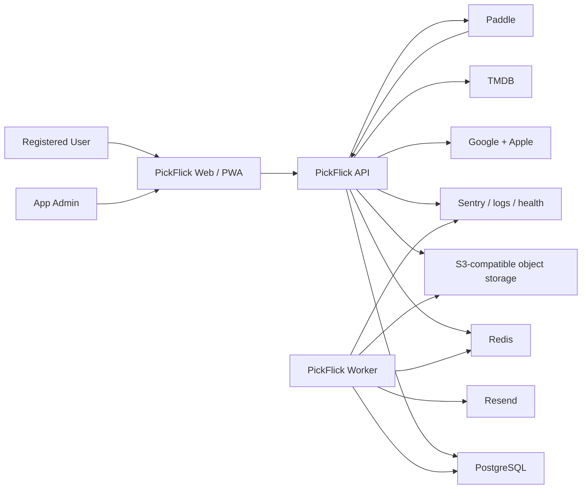

# PickFlick — Architecture Reference

> Accepted technical direction for the greenfield system; implementation remains Proposed.
> Product scope lives in the Roadmap, UX lives in the Design reference, and accepted technical rationale lives in ADRs.

| Document owner | Last reviewed | Verified against |
| --- | --- | --- |
| Developer | 2026-09-05 | ADR-001 through ADR-006 accepted; no application implementation exists |

## 1. Architecture Contract & Sources

- **This document owns:** proposed system structure, module/deployable boundaries, data ownership, interfaces, runtime flows, infrastructure, and operational contracts.
- **[ROADMAP.md](ROADMAP.md) owns:** product scope, rules, routes, phases, and deferred work.
- **[DESIGN.md](DESIGN.md) owns:** UI/UX direction, screens, components, responsive behavior, and design status.
- **Future schema/API references will own:** exact database and HTTP contracts after Phase 1 creates them.
- **[_docs/decisions/README.md](_docs/decisions/README.md) owns:** accepted/rejected/superseded rationale for significant technical decisions.
- **Future code and deployed configuration will own:** the latest verifiable implementation state.

An accepted ADR makes a technical direction current. It does not make code, configuration, or
infrastructure `Active`; each affected row remains `Proposed` until implementation and named
verification evidence exist.

### Architecture sources

| Source | Location | Authoritative for | Limitations / notes |
| --- | --- | --- | --- |
| Product roadmap | [ROADMAP.md](ROADMAP.md) | MVP scope, domain vocabulary, business invariants, routes, and phases. | Technical stack is Proposed. |
| Design/UX contract | [DESIGN.md](DESIGN.md) | Required surfaces, interaction behavior, responsive/accessibility needs. | Static prototype code is not production architecture. |
| Canonical prototype package | [_docs/design/prototypes/index.html](_docs/design/prototypes/index.html) | Screen families, state examples, data needs, and cross-screen flows. | Fixture content is clarified in Design/Roadmap. |
| Official Next.js docs | [App Router](https://nextjs.org/docs/app/getting-started) and [self-hosting](https://nextjs.org/docs/app/guides/self-hosting) | Current framework and container/self-hosting capabilities. | Exact version remains a Phase 1 choice. |
| Official pnpm docs | [Workspaces](https://pnpm.io/workspaces) | Workspace and local-package resolution behavior. | Exact version remains a Phase 1 choice. |
| Official NestJS docs | [Task scheduling](https://docs.nestjs.com/techniques/task-scheduling), [queues](https://docs.nestjs.com/techniques/queues), and [SSE](https://docs.nestjs.com/techniques/server-sent-events) | Current framework patterns for API, scheduled/queued work, and server push. | Does not choose the project’s exact queue topology by itself. |
| Official Mantine guide | [Next.js guide](https://mantine.dev/guides/next/) | Current integration baseline for selective UI primitives. | Bespoke Projector Noir styling remains project-owned. |
| Official Prisma docs | [Prisma Migrate](https://www.prisma.io/docs/orm/prisma-migrate) | Migration and PostgreSQL ORM baseline. | Manual SQL may be required for advanced constraints. |
| BullMQ docs | [Idempotent jobs](https://docs.bullmq.io/patterns/idempotent-jobs) | Retry-safe job design. | Does not provide exactly-once external side effects. |
| OWASP cheat sheets | [Session management](https://cheatsheetseries.owasp.org/cheatsheets/Session_Management_Cheat_Sheet.html) and [CSRF prevention](https://cheatsheetseries.owasp.org/cheatsheets/Cross-Site_Request_Forgery_Prevention_Cheat_Sheet.html) | Browser session and CSRF security baseline. | The concrete auth/session library remains a Phase 4 decision. |
| Dokploy and Cloudflare docs | [Isolated deployments](https://docs.dokploy.com/docs/core/docker-compose/utilities), [Compose domains](https://docs.dokploy.com/docs/core/docker-compose/domains), and [Cloudflare proxy](https://developers.cloudflare.com/fundamentals/concepts/how-cloudflare-works/) | Deployment-network and public-ingress capabilities. | Production behavior must still be proven in UAT. |

### State legend

| State | Meaning |
| --- | --- |
| `Proposed` | Intended direction not yet verified in code/runtime. |
| `Partial` | Some exists; the state must name the missing portion. |
| `Active` | Implemented and verified against a named revision/environment. |
| `Deprecated` | Still present but scheduled for replacement/removal. |

## 2. System Overview

### Purpose and constraints

- **System purpose:** Coordinate private Club movie-night lifecycles and preserve shared/personal film history across web clients.
- **Primary actors:** Registered User, Club Admin, Club Moderator, Club Member, App Admin, deadline/notification worker, and external providers.
- **Key constraints:** One blocking Session per Club; unlimited Rating Sessions; registered Club members only; automatic idempotent transitions; personal/GDPR data; provider webhooks; highly custom responsive UI; ordinary early-stage scale and budget.
- **Architecture non-goals:** Microservices, event sourcing, anonymous access, dedicated search infrastructure, offline conflict resolution, multi-region active-active runtime, and AI inference infrastructure.

### Context diagram



### Architecture summary

| Concern | Accepted direction | Implementation state | Rationale / ADR |
| --- | --- | --- | --- |
| Application style | Modular client/API/worker monolith in one pnpm monorepo. | Proposed | Atomic cross-layer changes with separate runtime failure boundaries; [ADR-001](_docs/decisions/README.md#adr-001--use-a-pnpm-modular-monorepo-with-three-runtime-entrypoints). |
| Frontend | Next.js App Router + TypeScript; Server Components for public/shell data where useful, Client Components for rich workflows; project tokens/CSS Modules with wrapped selective Mantine primitives; TanStack Query for API state. | Proposed | Public SEO, self-hosting, bespoke design ownership, and accessible complex controls; [ADR-006](_docs/decisions/README.md#adr-006--own-projector-noir-and-use-mantine-selectively). |
| Client state | URL/server state first; local React state second; Zustand only after a demonstrated shared-client-state need. | Proposed | Avoid a global state layer before real requirements exist. |
| Backend | NestJS modular REST API, generated OpenAPI, API-owned opaque server sessions, and SSE for live Club/Session progress. | Proposed | One same-origin server authorization boundary; [ADR-002](_docs/decisions/README.md#adr-002--keep-authentication-and-sessions-at-the-api-boundary). |
| Primary data store | PostgreSQL through reviewed Prisma migrations/client; explicit SQL for high-risk constraints. | Proposed | Relational invariants, transactions, reporting, and auditability; [ADR-003](_docs/decisions/README.md#adr-003--use-postgresql-and-reviewed-prisma-migrations). |
| Async work | Redis + BullMQ worker with idempotent jobs, a transactional outbox, and reconciliation. | Proposed | PostgreSQL retains durable intent across database/queue failure windows; [ADR-004](_docs/decisions/README.md#adr-004--use-bullmq-with-a-transactional-outbox). |
| Object storage | S3-compatible storage for avatars and time-limited exports. | Proposed | Keeps binary/user-generated objects outside application/database containers. |
| Real-time | SSE from API; durable truth remains PostgreSQL, Redis distributes invalidation/events. | Proposed | One-way progress updates fit the product; WebSockets are unnecessary for MVP. |
| Deployment | Immutable web/API/worker/release images promoted by digest through isolated Dokploy UAT/production environments behind Cloudflare and Traefik. | Proposed | Tested-artifact promotion, private service networks, and a disabled production gate; [ADR-005](_docs/decisions/README.md#adr-005--deploy-immutable-images-through-isolated-dokploy-environments). |

## 3. Building Blocks & Boundaries

### Proposed repository and deployables

```text
PickFlick/
  apps/
    web/              # Next.js public site, authenticated PWA, admin UI
    api/              # NestJS HTTP API, OAuth/session callbacks, SSE, webhooks
    worker/           # BullMQ consumers, deadline scheduler, delivery/export/refresh work
  packages/
    contracts/        # Generated API client/types and shared stable value objects
    database/         # Prisma schema, migrations, client, seeds/test fixtures
    ui/               # Projector Noir tokens and reusable production components
    config/           # Shared lint, TypeScript, test, and environment schemas
  assets/brand/       # Production-ready bundled brand imagery
  _docs/              # Durable guidance, design prototypes, decisions, future guides
```

The layout is the accepted scaffold target, not implemented state. Keep only packages with an
immediate consumer. When API and worker first need the same server-side behavior, extract a focused
domain/application package rather than importing one app from another or creating a generic
`shared` package.

| Deployable / package | Responsibility | Owns | Depends on | State |
| --- | --- | --- | --- | --- |
| `apps/web` | Render public/private/admin experiences and manage browser interaction. | Routes, presentation, browser/PWA shell. | API contract, UI package, brand assets. | Proposed |
| `apps/api` | Authenticate/authorize, execute synchronous domain commands/queries, expose REST/SSE/webhooks. | HTTP boundary, session boundary, domain orchestration. | Database, Redis, providers, contracts. | Proposed |
| `apps/worker` | Execute delayed/retryable/background work. | Queue consumers, deadline reconciliation, email/export/refresh jobs. | Database, Redis, object storage, providers. | Proposed |
| `packages/contracts` | Prevent handwritten client/server contract drift. | Generated client/types and stable enums/value objects. | API OpenAPI generation. | Proposed |
| `packages/database` | Own schema/migrations/client and database test helpers. | Relational schema and database constraints. | PostgreSQL, Prisma. | Proposed |
| `packages/ui` | Implement canonical design tokens and shared UI behavior. | Tokens, primitives, shared shell/components. | React, selective Mantine primitives. | Proposed |
| `packages/config` | Share tool configuration and typed environment schemas. | Build/test/lint/TS/env-validation baselines. | Toolchain. | Proposed |

### Internal modules

API and worker use the same domain/module vocabulary; direct cross-module table manipulation is forbidden outside database migrations/reporting projections.

| Module / area | Responsibility | Public interface | Data ownership | State |
| --- | --- | --- | --- | --- |
| Identity | OAuth identities, sessions, profile, suspension, app role. | Auth/session/profile commands and guards. | User, OAuthAccount, server sessions. | Proposed |
| Clubs | Club lifecycle, membership roles, settings, limits, invites, adminless state. | Club/membership/invite commands and policies. | Club, Membership, ClubInvite. | Proposed |
| Sessions | Session roster, phases, deadlines, nominations, ballots, ratings, completion/cancellation. | Session commands/queries and transition service. | Session, participant, invite, nomination, ballot/score, SessionRating. | Proposed |
| Movies | TMDB search/cache/refresh, credits/media, related-title projection. | Movie search/detail/refresh interface. | Movie/provider cache. | Proposed |
| Library | Personal Rating, Watchlist, personal aggregates/import/export. | Library commands/queries. | PersonalMovieRating, WatchlistItem. | Proposed |
| Achievements | Versioned definitions, progress evaluation, awards. | Evaluate/query achievement projections. | Definition/Award and progress projection. | Proposed |
| Notifications | Event-to-notification mapping, preferences, inbox, email delivery. | Publish/list/read/preferences/delivery jobs. | Notification, preferences, delivery attempts. | Proposed |
| Billing | Paddle customer/subscription/webhook state and entitlement projection. | Checkout/portal/webhook/entitlement interface. | Subscription, BillingEvent. | Proposed |
| Privacy | CSV/GDPR exports, deletion/anonymization, retention work. | Export/delete/retention jobs and status. | DataExportJob and deletion audit references. | Proposed |
| Administration | App Admin queries/actions, application settings, operational audit. | Admin-only API and settings. | AdminAuditEvent, application settings. | Proposed |
| Contact | Validate/store/deliver public contact requests. | Public rate-limited command. | ContactMessage. | Proposed |

### Primary execution paths

#### Phase submission and automatic transition

```text
Browser mutation
  -> API session + Club role authorization
  -> validate current phase, roster, uniqueness, and scale
  -> serialize on Session row inside PostgreSQL transaction
  -> persist submission
  -> evaluate N/N and transition at most once
  -> write outbox events in same transaction
  -> response with authoritative phase/version
  -> worker dispatches notifications; SSE clients revalidate
```

#### Deadline

```text
Session created/updated with deadline
  -> transaction writes delayed-job request/outbox event
  -> worker schedules durable delayed BullMQ job
  -> job locks/reloads Session and compares phase + deadline + version
  -> no-op if stale/already transitioned
  -> zero/one/many nomination rule applied transactionally
  -> outbox notifications delivered with retries
```

The database, not queue timing, is authoritative. A periodic reconciliation job finds missed overdue deadlines so lost/delayed queue messages cannot leave Sessions stuck indefinitely.

#### Paddle webhook

```text
Paddle webhook
  -> raw-body signature verification
  -> store provider event ID idempotently
  -> acknowledge valid receipt quickly
  -> worker applies subscription transition in provider sequence/context
  -> entitlement projection changes
  -> user notification + audit event
```

#### Personal deletion

```text
Confirmed deletion request
  -> re-authentication and authorization
  -> cancel/mark billing
  -> durable privacy job
  -> anonymize shared Club/Session attribution
  -> delete private Library/profile artifacts per approved policy
  -> make former-admin Clubs adminless and notify remaining members
  -> revoke every session and finalize audit-safe completion record
```

## 4. Data & Interfaces

### Data stores and ownership

| Store | Purpose | Owner | Source of truth for | Lifecycle / backup | State |
| --- | --- | --- | --- | --- | --- |
| PostgreSQL | Transactional domain data, entitlements, notifications, audits, job/outbox intent. | API/worker modules via database package. | Users, Clubs, Sessions, history, subscription projection, durable workflow state. | Encrypted transport/storage as platform supports; automated backups and tested restore required. | Proposed |
| Redis | BullMQ, delayed/retry state, rate-limit counters, short-lived distributed events/cache. | Worker/platform boundary. | Never the sole source for domain state. | Rebuildable except queue state; persistence/backup policy chosen for production. | Proposed |
| S3-compatible object storage | Avatars and generated export archives. | Identity/Clubs/Privacy modules. | Binary objects referenced by PostgreSQL. | Private by default; signed URLs; export expiry; backup policy for durable avatars. | Proposed |
| Bundled static assets | Logo/mascot PWA and UI artwork. | Web build. | Versioned application brand imagery. | Source controlled and deployed immutably. | Proposed |

The canonical schema will be created under `packages/database` in Phase 1. Product-level entities are listed in [ROADMAP.md](ROADMAP.md#domain-model).

| Entity / state machine | Owner | Key invariant or lifecycle | Canonical source |
| --- | --- | --- | --- |
| Club Membership | Clubs | One active Membership per User/Club; no more than one Admin; zero Admin temporarily allowed. | [Roadmap identity rules](ROADMAP.md#identity-and-access) |
| Session | Sessions | Partial unique PostgreSQL constraint prevents more than one Nomination/Selection/Watching Session per Club. | [Roadmap Session invariants](ROADMAP.md#club-and-session-invariants) |
| Session transition | Sessions | Monotonic state machine; serialized/idempotent automatic and manual transitions. | [Roadmap state machine](ROADMAP.md#session-state-machine) |
| Ballot/score | Sessions | One immutable Ballot per participant; exactly one score per nomination; score within snapshotted range. | [Roadmap result rules](ROADMAP.md#selection-and-result-rules) |
| Session vs Personal Rating | Sessions / Library | Historical Session Rating never changes due to Personal Rating edits. | [Roadmap domain model](ROADMAP.md#domain-model) |
| Provider webhook | Billing | Provider event ID unique; signature verified; replay is safe. | Billing module contract. |
| Outbox event | Owning module / Notifications | Created in the same transaction as domain change; delivery is at least once and consumers idempotent. | Worker contract. |

### Interfaces

Default API workflow: implement validated NestJS DTO/controller contracts, generate OpenAPI in the same change, then regenerate the typed web client. Database workflow: change Prisma schema/manual migration first, migrate/test, then update code.

| Interface | Direction | Protocol | Contract source / workflow | Auth / trust boundary | Failure behavior | State |
| --- | --- | --- | --- | --- | --- | --- |
| Browser API | Web -> API | Same-origin HTTPS JSON REST under `/api/*` | Nest DTOs -> generated OpenAPI/client | Host-only opaque secure session; explicit CSRF/Origin checks; Club/App server authorization. | Structured safe errors; no silent fallback; idempotency key for sensitive retries. | Proposed |
| Live progress | Web -> API | HTTPS SSE | Versioned event envelope generated with API contract | Authenticated, Club/Session-authorized stream. | Reconnect with last event/version; re-fetch authoritative projection after gaps. | Proposed |
| OAuth | API/browser -> Google/Apple | OIDC/OAuth over HTTPS | API-owned provider adapter; library selected in issue #25 | State/nonce/PKCE as applicable; callback allowlist; server-held provider tokens. | Deny and return to safe login state; never expose provider tokens to browser storage or logs. | Proposed |
| TMDB | API/worker -> TMDB | HTTPS API | Provider adapter with integration tests | Server-held API credential; provider data untrusted. | Timeout, bounded retry, cached stale detail where safe, explicit unavailable state. | Proposed |
| Paddle checkout/portal | Web/API -> Paddle | Hosted provider flow | Billing adapter and return-state contract | Authenticated Admin; server creates provider session. | Safe cancel/failure return and server-side entitlement recheck. | Proposed |
| Paddle webhook | Paddle -> API | Signed HTTPS webhook | Raw-body verification + versioned handler | Public endpoint, signature/timestamp/replay validation. | Fast reject invalid; store valid idempotently; async processing/retry. | Proposed |
| Email | Worker -> Resend | HTTPS API | Notification template registry | Server credential; minimum personal data. | Bounded retry/backoff, delivery status, alert persistent failure. | Proposed |
| Upload | Web -> object storage via API policy | Presigned HTTPS | Upload intent + completion contract | Authenticated owner; MIME/size/key allowlist. | Reject unsafe files, verify object, clean abandoned uploads. | Proposed |
| CSV import/export | Web and API/worker | Multipart upload / signed download | Versioned CSV schema and export manifest | Requesting User only; formula-injection and parser limits. | Row-level validation summary; no partial silent import; expiring private download. | Proposed |

### External integrations

| Integration | Purpose | Data exchanged | Failure / rate-limit strategy | Config owner | State |
| --- | --- | --- | --- | --- | --- |
| Google Identity | OAuth registration/sign-in. | Provider subject, verified email/profile fields needed for account. | Safe auth failure; account-link rules; no provider token in browser storage. | Identity env schema. | Proposed |
| Apple Sign in | OAuth registration/sign-in. | Provider subject, relay/verified email, initial profile when supplied. | Persist first-return fields safely; safe auth failure; account-link policy. | Identity env schema. | Proposed |
| TMDB | Film discovery/metadata/images/credits/related titles. | Search text and provider IDs; cached public movie metadata. | Debounce, cache with refresh age, respect rate limits, stale-safe details, observable refresh queue. | Movies env/app settings. | Proposed |
| Paddle | Merchant of record and subscription lifecycle. | Admin identity/customer reference, plan/checkout data, signed billing events. | Idempotent webhook ledger, provider-state reconciliation, alert failed processing. | Billing env schema. | Proposed |
| Resend | Transactional and opted-in emails. | Recipient address and minimum rendered event content. | Queue retry/backoff; suppression/bounce handling; delivery audit without full-body logging. | Notifications env schema. | Proposed |
| S3-compatible storage | Avatar/export objects. | User-uploaded image or generated private archive. | Signed URLs, validation, cleanup jobs, availability error. | Storage env schema. | Proposed |
| Sentry | Errors/performance. | Sanitized error/trace context; no secrets or unnecessary personal content. | Sampling and scrubbing; app remains functional if telemetry fails. | Observability env schema. | Proposed |
| IMDb/Wikipedia | Optional outbound film references. | Browser navigation to trusted ID-derived URL. | Omit link when trusted identifier is unavailable. | Movies module. | Proposed |

## 5. Cross-Cutting Contracts

| Concern | System contract | Canonical source | State |
| --- | --- | --- | --- |
| Authentication | Registered Google/Apple identities; same-origin API-owned opaque server sessions in host-only secure cookies; explicit CSRF/Origin defense; revoke all sessions on suspension/deletion; exact library chosen by issue #25. | [ADR-002](_docs/decisions/README.md#adr-002--keep-authentication-and-sessions-at-the-api-boundary) + future security guide. | Proposed |
| Authorization | Deny by default; App Admin/User globally, Admin/Moderator/Member per Club; every query/mutation/SSE/file URL is server/data-boundary authorized. | [Roadmap identity rules](ROADMAP.md#identity-and-access) | Proposed |
| Validation and errors | Validate path/query/body/file/provider input at entry; use stable machine code + safe user message + request ID; encode user/provider output contextually. | Future API contract. | Proposed |
| Security | TLS, reverse proxy, secure headers/cookies, CSRF/CORS strategy, rate limits, webhook signatures, upload allowlists, secret isolation, dependency/scanner gates. | Phase 1 baseline with Phase 23 hardening/release review. | Proposed |
| Privacy and retention | Minimize collection; separate shared/personal data; private storage; user CSV/GDPR export; deletion anonymizes shared history; policy timing approved before launch. | [Roadmap account deletion](ROADMAP.md#account-deletion-and-shared-history) | Proposed |
| Observability | Structured Pino logs, request/job IDs, health/readiness, error/performance telemetry, queue/deadline/webhook/delivery metrics and alerts; scrub personal data. | Future operations guide. | Proposed |
| Reliability | Idempotency for transitions/webhooks/jobs; transaction + outbox; bounded retry; stale-job checks; deadline reconciliation; provider timeouts/circuit behavior. | Execution paths above. | Proposed |
| Performance and scaling | Ordinary MVP baseline; paginate/search server-side, bound list sizes, index authorization/query paths, measure before horizontal scaling. | Phase acceptance evidence. | Proposed |
| Caching | TMDB data uses explicit freshness/refresh state; user/Club dynamic responses are private/no-store unless proven safe; Redis cache is disposable and invalidated by domain events. | Movies/API implementation. | Proposed |

### Minimum web security baseline

- Treat browser input, user-generated content, provider payloads, CSV files, image uploads, OAuth callbacks, and webhooks as untrusted.
- Store provider secrets, OAuth tokens, signing secrets, database URLs, and storage credentials only in server-side secret/config mechanisms; never in docs, logs, or client bundles.
- Prefer secure, HTTP-only, SameSite cookies for browser sessions; document the chosen CSRF model before auth implementation.
- Verify identity and resource authorization again when issuing SSE streams, exports, upload/download URLs, admin actions, and Club/Session projections.
- Hash invitation tokens at rest where practical, use high entropy, enforce expiry/revocation, and avoid logging raw tokens or URLs.
- Render user comments/names/topic/notes as text by default; sanitize any future rich text with a reviewed allowlist.
- Rate-limit public contact/auth/invite checks and sensitive mutations; add abuse monitoring without tracking ordinary browsing.
- Record high-impact admin, billing, ownership, suspension, privacy, and destructive actions with safe metadata.

## 6. Runtime & Delivery

### Environments

| Environment | Purpose | Runtime topology | Data / dependencies | Access boundary |
| --- | --- | --- | --- | --- |
| Local | Developer iteration and focused tests. | Native web/API/worker; containerized PostgreSQL, Redis, MinIO-compatible storage, mail catcher as useful. | Seeded/synthetic only; provider sandboxes or adapters. | Local developer. |
| CI/Test | Reproducible quality gates and integration/E2E. | Ephemeral build/test processes and service containers. | Isolated database/Redis; mocked or sandbox providers; no production secrets. | CI identity and approved maintainers. |
| UAT | Production-like acceptance, provider sandbox, migration/restore rehearsal. | Docker topology matching production shape at smaller scale. | Sanitized/synthetic data; sandbox billing/email/OAuth credentials. | Product/developer testers. |
| Production | Real registered users and billing. | Reverse proxy + web/API/worker containers + managed/self-hosted dependencies according to approved deployment ADR. | Production PostgreSQL/Redis/object storage and live providers. | Public web/API edges; operator-only infrastructure. |

### Configuration and secrets

- Phase 1 creates the canonical variable inventory, `.env.example`, and typed startup schemas; no executable inventory exists yet.
- Fail startup on missing/invalid required configuration. Distinguish build-time public values from runtime secrets.
- Store production secrets in the deployment platform’s secret mechanism and scope them by deployable/provider.
- Rotate webhook/OAuth/email/storage secrets through documented procedures without committing values.

### Delivery and operations

| Concern | Contract / approach | Canonical source | State |
| --- | --- | --- | --- |
| Local development | pnpm workspace; app commands run natively, dependencies through containers where helpful; real command map added after scaffolding. | Future getting-started guide and AGENTS command map. | Proposed |
| CI quality gates | Locked install, generated-artifact drift, lint, type-check, unit, integration, migration, build, E2E smoke, accessibility, and security checks. | Future CI workflows. | Proposed |
| Deployment | Immutable Docker images promoted by digest through separate Dokploy UAT/production projects and default separate deployment servers; Cloudflare-proxied DNS reaches Traefik only; production promotion remains disabled. | [ADR-005](_docs/decisions/README.md#adr-005--deploy-immutable-images-through-isolated-dokploy-environments) + future deployment guide/config. | Proposed |
| Database migrations | Committed, reviewed Prisma/manual SQL migrations; `migrate deploy` release gate; pre-deploy compatibility check; no destructive production change without backup/rollback plan. | [ADR-003](_docs/decisions/README.md#adr-003--use-postgresql-and-reviewed-prisma-migrations) + future migration guide. | Proposed |
| Rollback | Roll back images only when database compatibility permits; use forward fix for non-reversible data changes; document each risky migration. | Future release runbook. | Proposed |
| Backup and restore | Automated PostgreSQL backups, durable avatar backup, documented retention, and restore drill before launch; exports are regenerable/expiring. | Future backup runbook. | Proposed |
| Scheduled/background work | BullMQ delayed/repeatable jobs with stable IDs, idempotent handlers, retry/dead-letter visibility, and deadline reconciliation. | Worker implementation/runbook. | Proposed |

### Initial operational signals

- API request rate/error/latency and authorization-denial anomalies.
- SSE connection/reconnect/gap rate.
- Queue depth, oldest-job age, retries/failures, delayed deadline lag, and reconciliation repairs.
- Automatic/manual transition counts and failed invariant attempts.
- OAuth success/failure by provider without sensitive payloads.
- TMDB latency/cache hit/refresh failure and rate-limit responses.
- Paddle webhook receipt/processing lag/failure and entitlement mismatch reconciliation.
- Email accepted/bounced/suppressed/final failure.
- Export/deletion job age/failure and object cleanup.
- Database health/connections/query latency/storage and backup/restore status.

## 7. Architecture Decisions

The developer accepted the compatible Phase 1 baseline on 2026-09-05. The decisions are current
direction; every implementation row above remains `Proposed` until the owning issue supplies its
named evidence.

| ADR | Accepted direction | Implementation gate |
| --- | --- | --- |
| [ADR-001](_docs/decisions/README.md#adr-001--use-a-pnpm-modular-monorepo-with-three-runtime-entrypoints) | pnpm modular monorepo with web, API, and worker entrypoints. | Issue #10 scaffold and command evidence. |
| [ADR-002](_docs/decisions/README.md#adr-002--keep-authentication-and-sessions-at-the-api-boundary) | Same-origin API-owned opaque server sessions; library deferred to issue #25. | Issues #25–#28 auth/session evidence. |
| [ADR-003](_docs/decisions/README.md#adr-003--use-postgresql-and-reviewed-prisma-migrations) | PostgreSQL with committed, reviewed Prisma/manual SQL migrations. | Issue #11 migration and constraint evidence. |
| [ADR-004](_docs/decisions/README.md#adr-004--use-bullmq-with-a-transactional-outbox) | BullMQ/Redis execution with PostgreSQL outbox, idempotency, and reconciliation. | Worker/domain failure-injection evidence. |
| [ADR-005](_docs/decisions/README.md#adr-005--deploy-immutable-images-through-isolated-dokploy-environments) | Immutable images, isolated Dokploy environments, Cloudflare/Traefik ingress, disabled production gate. | Issues #13–#16 UAT and deployment evidence. |
| [ADR-006](_docs/decisions/README.md#adr-006--own-projector-noir-and-use-mantine-selectively) | Project-owned CSS tokens/components with wrapped selective Mantine primitives. | Issues #17–#19 design-system and accessibility evidence. |

Create an ADR only when a concrete option is accepted or rejected; do not populate the registry with template decisions.

## 8. Verification & Maintenance

| Check | Evidence | Status |
| --- | --- | --- |
| Repository/deployable map matches code | No app/package manifests exist. | Not implemented |
| Runtime/deployment topology matches configuration | No runtime/deploy configuration exists. | Not implemented |
| Data ownership and schemas match migrations | No schema/migrations exist. | Not implemented |
| Interfaces match API/event contracts | No OpenAPI/event contract exists. | Not implemented |
| Auth and trust boundaries are enforced server-side | No auth/policy implementation exists. | Not implemented |
| Failure and recovery paths are exercised | Planning acceptance cases exist in Roadmap; no tests/runbooks exist. | Not implemented |
| Operational docs and environment inventory resolve | Must be created in Phase 1 and expanded through launch phases. | Not implemented |

Update this document whenever a deployable, module/data owner, interface, integration, environment, security boundary, job model, deployment shape, or operational guarantee changes. Promote a row to `Active` only with named code/runtime evidence.
