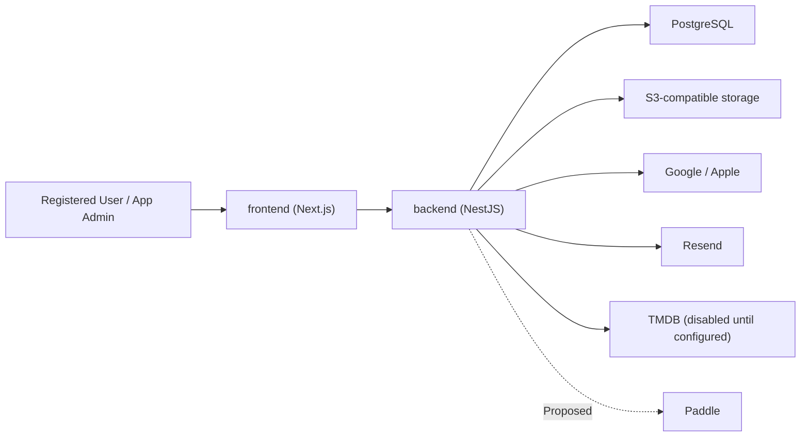
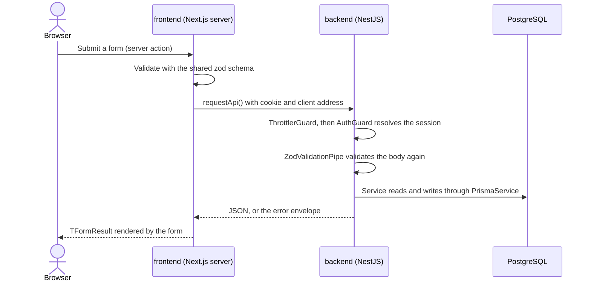
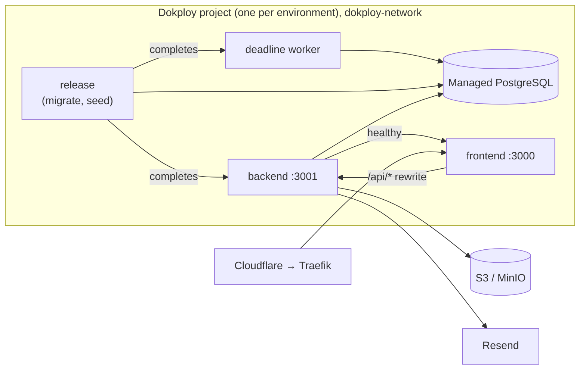
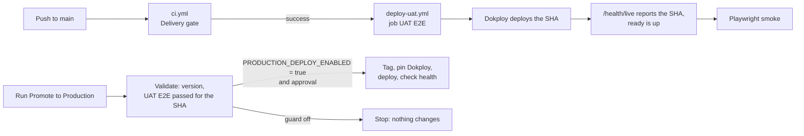

# PickFlick — Architecture

> How the system is built and where it is going. Product scope lives in [ROADMAP.md](ROADMAP.md),
> UX in [DESIGN.md](DESIGN.md), and decision rationale in the [ADR registry](_docs/decisions/README.md).
> Code and deployed configuration are the final word on current state.

| Owner     | Last reviewed | Verified against                                     |
| --------- | ------------- | ---------------------------------------------------- |
| Developer | 2026-09-26    | ADR-001–ADR-014 and branch `PF-32_verify-phases-1-5` |

**States:** `Active` — implemented and verified; `Partial` — some exists, the gap is named;
`Proposed` — accepted direction, not built. An accepted ADR does not make anything `Active`.

## 1. System overview

PickFlick coordinates private Club movie nights and keeps shared and personal film history.

- **Actors:** registered User, Club Admin/Moderator/Member, App Admin, external providers.
- **Constraints:** registered members only; one blocking Session per Club; idempotent automatic
  transitions; personal data under GDPR; a bespoke responsive UI; early-stage scale and budget.
- **Non-goals:** microservices, event sourcing, anonymous access, dedicated search, offline
  conflict resolution, multi-region runtime, AI inference.



| Concern    | Direction                                                                             | State                                                                                                    | ADR               |
| ---------- | ------------------------------------------------------------------------------------- | -------------------------------------------------------------------------------------------------------- | ----------------- |
| Shape      | pnpm monorepo, frontend, backend, deadline worker plus a one-shot release job.        | Active                                                                                                   | ADR-014           |
| Frontend   | Next.js App Router, server components and server actions, UI kit on unstyled Mantine. | Partial — public site, login, Club onboarding, Hub overview, and settings; other product routes Proposed | ADR-013           |
| Backend    | NestJS feature modules, zod-validated REST, Better Auth database sessions.            | Partial — auth, Clubs, Contact, health; other product modules Proposed                                   | ADR-002, 010, 011 |
| Validation | zod request schemas in `@pickflick/contracts`, shared by backend and forms.           | Active                                                                                                   | ADR-012           |
| Data       | PostgreSQL through reviewed Prisma migrations; SQL constraints for invariants.        | Partial — Users, auth, Clubs, Session skeleton, cached Movies; other entities Proposed                   | ADR-003           |
| Objects    | S3-compatible storage for avatars, catalog images and exports.                        | Partial — Club avatars and catalog images                                                                | —                 |
| Background | Nomination-specific PostgreSQL jobs and a backend worker; no queue dependency.        | Active                                                                                                   | ADR-018           |
| Real-time  | Session progress versions polled from the API every five seconds.                     | Active                                                                                                   | —                 |
| Delivery   | Dokploy UAT and production, source-built Compose, UAT-proven SemVer promotion.        | Partial — repository-verified; live production not provisioned                                           | ADR-007, 008      |

## 2. Repository

```text
apps/
  frontend/   Next.js routes, UI kit, server-side API client
  backend/    NestJS REST API, Better Auth, feature modules, deadline worker entrypoint
packages/
  contracts/  zod request schemas and response interfaces shared by both apps
  database/   Prisma schema, migrations, client, fixtures, seed/reset CLIs
  config/     environment schema and TypeScript presets
  eslint-config/ dev-only ESLint presets and plugins
assets/brand/ production brand imagery (imported as #brand/…)
tests/        Playwright: ui (local build + typed mock API), journeys (real API) and uat (deployed smoke)
_docs/        guides, decisions, design prototypes
```

A package exists only while something consumes it. When a second entrypoint needs server-side
domain code, extract a focused package instead of importing one app from another.

### Backend

`AppModule` composes infrastructure and feature modules. Runtime environment, `PrismaService`, and
storage come from global modules; feature modules are non-global and export only what another
module uses. A global `AuthGuard` protects every route unless it is marked `@Public()`.

| Module                                                                 | Owns                                                                                                                                                                       | State                                                                                    |
| ---------------------------------------------------------------------- | -------------------------------------------------------------------------------------------------------------------------------------------------------------------------- | ---------------------------------------------------------------------------------------- |
| auth                                                                   | Better Auth (Google, Apple behind a gate), database sessions, suspension, App roles.                                                                                       | Partial — Apple not activated                                                            |
| clubs                                                                  | Club creation, Hub projection, members, settings, avatar, roles, removal, archive/reactivate, leave, delete, audit.                                                        | Active                                                                                   |
| contact                                                                | `POST /contact`, rate-limited, sent directly through the email module.                                                                                                     | Active                                                                                   |
| email                                                                  | Resend client; a logging stub when delivery is disabled.                                                                                                                   | Active                                                                                   |
| storage                                                                | S3 put/get/delete/ping (AWS SDK).                                                                                                                                          | Active                                                                                   |
| health                                                                 | `/health/live` (revision) and `/health/ready` (database, object storage).                                                                                                  | Active                                                                                   |
| movies                                                                 | Configurable catalog adapters, canonical UUID/external-ID resolution, one cached projection per search and Movie, and explicit failure states.                             | Partial — authenticated search/details and stored catalog images; refresh worker pending |
| sessions                                                               | Live Session creation, detail, versioned edits, cancellation, member-only self-join and shared links, roster, nominations, personal suggestions, early closure, and audit. | Active — Nomination automatic transitions; later phases pending                          |
| Library, Achievements, Notifications, Billing, Privacy, Administration | See the Roadmap phases.                                                                                                                                                    | Proposed                                                                                 |

Copy `apps/backend/src/modules/contact` for a new module; [apps/backend/AGENTS.md](apps/backend/AGENTS.md)
holds the conventions.

### Frontend

Route groups `(marketing)`, `(auth)`, `(product)`, and `(internal)` hold the routes; a route keeps
its `page.module.scss`, `actions.ts`, and `_components/`. `src/components/ui/<Name>/` is the UI kit.
Server code calls the backend only through `src/api/<area>.server.ts`, which forwards the session cookie
and client address. Forms use `@mantine/form` and call a server action that returns `TFormResult`.
[apps/frontend/AGENTS.md](apps/frontend/AGENTS.md) holds the conventions.

### How a request flows



Pages read data the same way: a server component calls `src/api/<area>.server.ts` during render.
The browser itself calls the backend only for sign-in (`/api/auth/*`), which the frontend proxies
to the backend. [Add a feature end to end](_docs/adding-a-feature.md) walks through each layer.

## 3. Data

| Store                 | Holds                                                                     | State                                                   |
| --------------------- | ------------------------------------------------------------------------- | ------------------------------------------------------- |
| PostgreSQL            | All domain state, sessions, audit.                                        | Partial — local and CI; managed UAT/production Proposed |
| S3-compatible storage | Club avatars and catalog images under private opaque keys; later exports. | Partial — Club avatars and catalog images               |
| Bundled assets        | Brand imagery, versioned with the frontend build.                         | Active                                                  |

The schema (`packages/database/prisma/schema.prisma`, twenty-four migrations) holds `User`,
`ProviderAccount`, `AuthSession`, `AuthVerification`, `AuthRateLimit`, `Club`, `Membership`,
`ClubAuditEvent`, `ClubInvite`, `Session`, `SessionParticipant`, `SessionInvite`, `Nomination`, `SelectionBallot`, `SelectionScore`, `Movie`, `MovieExternalId`, `MovieDetailsCache`, and `MovieSearchCache`. Database-enforced invariants:

- one active Membership per User and Club, and at most one active Admin per Club;
- at most one Nomination/Selection/Watching Session per Club;
- one Nomination per participant with same-Session linkage;
- one SelectionBallot per participant and one SelectionScore per ballot/nomination, with
  same-Session foreign keys and integer scores bounded by 0–10;
- Club score scale bounds and lifecycle consistency.
- unique invitation token digests, expiry order, and consistent response attribution.

Club invitations store only a SHA-256 digest of 32 random bytes. A raw token is returned once at
creation and sent back only in POST bodies. Admin/Moderator creation and revocation are
membership-scoped. Acceptance locks the Club row before re-checking expiry, revocation, target,
Club lifecycle, current Membership, and member limit; the Membership, audit event, and invitation
response commit together. Historical departed Memberships remain intact. Links expire after seven
days and one User can accept or decline each link. Unsafe states omit Club data; preview is available
only to authenticated Users. The invitation page and API responses are private and uncached.
Manager lists include the 20 most recent records and every live pending invitation, so older links
remain reachable for revocation. The creation action preserves its returned token if a subsequent
list refresh fails; the UI shows the link and a separate refresh warning.

The reusable Session link is its canonical `/sessions/:sessionId` URL. Any active Club member may
read it and call `POST /sessions/:sessionId/participation` with `accept` or `decline`; this never creates
Club Membership. Club → Session locks serialize participation, phase completion and audit writes.
Repeated acceptance is idempotent; accepted participants use typed Leave instead of Decline, and
operator-removed participants cannot self-join. The roster projects `canJoin` from the same current
membership, lifecycle, phase and participant rules. No new token table or migration is required.
`GET /session-invitations/pending` derives unanswered invitations from open Club Sessions and uses
Session IDs for their decisions. These rows have no separate expiry; closed Sessions disappear.

Existing personalized Session invitations use separate digest-only tokens and target a Membership through a
SessionParticipant. One rule governs every Session roster control (invite, revoke, remove): an
Admin or Moderator in an active Club that has an Admin and is within its member limit;
participants can always leave. `POST /sessions/:sessionId/invitations` returns the raw token once; preview and
response tokens travel only in POST bodies. Existing token responses by invitation ID use the same locked
eligibility check. Private, uncached preview/response APIs return a single detail-free `unavailable`
state for invalid, expired, revoked, wrong-target, departed, archived, and closed access. Responses
and roster changes lock Club → Session before writing. Roster projections use a repeatable-read snapshot. Club departure updates open
Session participants and revokes their pending links in its membership transaction, preserving
completed history. Migration 16 adds five Session invitation/participant audit actions without
changing existing data. No worker or automatic phase transition is added.

The eleventh migration adds `MEMBERSHIP_REMOVED` to the audit enum. `POST
/clubs/:clubId/members/:membershipId/remove` validates typed `REMOVE` confirmation, locks the Club,
and re-reads actor and target roles. Admins remove non-Admins; Moderators remove Members. Self-removal
uses Leave Club. A repeated removal creates no extra event. Leave and role changes share the Club lock
with invitations and lifecycle writes; the historical Membership and Session rows remain intact.

`GET /club-invitations/pending` returns only eligible, recipient-targeted invitations in a
repeatable-read snapshot. Responses contain IDs and minimal preview fields, without tokens or digests.
`POST /club-invitations/:inviteId/respond` resolves the invitation only for its target User and shares
the token response's locked eligibility check and Membership transaction. Shareable links cannot be
listed for a recipient. Existing unsafe-state privacy rules apply to both flows.

Hub and Manage Club projections carry `IClubAccess` (`adminless`, `newWorkAllowed`, and restriction
`reasons`) and role permissions. Manage Club also identifies the caller's Membership. The access
resolver currently uses lifecycle, active administration, member count, and fixture plan limits.
Phase 20 can replace entitlement input without making browser state an authorization boundary.
`MEMBER_LIMIT` means excess roster size: history and existing participation stay available, and removal
and leaving can restore capacity. At exact capacity, the invitation API still rejects new links.
The unresolved choice among excess administered Clubs is not implemented.

Session persistence, live creation, detail, editing, and cancellation are Active. Invitations and
phase workflows remain Proposed.
Each new Session requires its own score bounds and five visibility/media flags. The internal
`snapshotSessionSettings` helper locks the Club and reads those fields; creation must call it
inside the same transaction as the Session insert. Club settings edits do not change saved Session
fields. Migration 14 backfills skeleton Sessions from current Club settings because their original
settings were not stored; it preserves phase, version, details, and history.

`SessionParticipant` references a historical Membership, with invited, accepted, declined, left,
and removed states plus nullable attendance. Composite foreign keys require the Session and
Membership to share a Club. `SessionInvite` references that participant and a same-Club inviter
Membership, stores only a unique SHA-256 digest, and checks expiry and response consistency. These
storage constraints do not authorize a request: the member-only preview, active Membership checks,
operator authorization, token generation, and invitation/leave/removal flows belong to #40/#41.

The existing partial unique index still enforces one Nomination/Selection/Watching Session per
Club; Rating is outside it. A trigger keeps participant identity from moving between Sessions,
Memberships, or Clubs (migration 20). Phase decisions lock the Session and count accepted
participants inside that transaction, keeping the lock through the decision. Workflow writes take the Club lock before the Session lock and before
participant writes. #41 must update participant state on Club departure before checking completion;
no automatic transition or membership-departure propagation is implemented by this foundation.

`POST /clubs/:clubId/sessions` validates live modes, date, location, optional topic/notes/deadline,
and a canonical Movie UUID for pre-selected Sessions. Full-cycle starts in Nomination;
pre-selected starts in Watching. The server assigns the Session ID. A repeated request after a
lost response meets the one-blocking-Session rule and returns `BLOCKING_SESSION`, which the web
form explains with a link back to the Club Hub. Creation locks the Club and checks current operator role, access,
the blocking slot, and Movie existence before saving settings and audit together.

`GET /sessions/:sessionId` requires current Club Membership and returns a private/no-store detail
projection. `PATCH /sessions/:sessionId` and `POST /sessions/:sessionId/cancel` lock Club then
Session and re-read Membership/access. Edits change only date, location, topic, notes, and the
nomination deadline; type, Movie and settings snapshots stay fixed. `detailsVersion` rejects stale
writes; an identical edit is a no-op. Cancellation requires typed `CANCEL`, increments both
versions, revokes pending invitations, retains history and releases the blocking slot. Repeated
cancellation creates no extra audit event. Completed and Cancelled Sessions cannot be edited.
Archived, adminless and over-limit Clubs follow the existing manage-Sessions restriction.

A Session row carries four counters; each guards one kind of change:

| Counter           | Increments when                                   | Used for                                                                                 |
| ----------------- | ------------------------------------------------- | ---------------------------------------------------------------------------------------- |
| `detailsVersion`  | An edit, a cancellation, or any phase change      | Optimistic concurrency for edits and cancellation; the API calls it `version`.           |
| `phaseVersion`    | Any phase change                                  | Early Nomination close sends it, so a close never applies to a phase already left.       |
| `progressVersion` | Any roster, nomination, or phase change           | Clients poll `GET /sessions/:id/progress` and reload the detail when it moves.           |
| `deadlineVersion` | The nomination deadline is set, changed, or ended | The worker records one deadline decision per version, so a changed deadline is new work. |

Migration 15 adds the nullable Movie relation, details version, and Session references/actions in
Club audit events. Legacy skeleton Sessions keep nullable details and Movies; no history is invented.
Later phase-transition implementations must increment `detailsVersion` alongside `phaseVersion`
so an operator must review the current Session before cancelling it.
Hub responses include every open Rating Session and the twenty latest Completed/Cancelled rows,
independently of recent activity. Detail and Hub reads use repeatable-read snapshots. Session creation makes no provider calls. The deadline worker below reuses the
backend package and adds no dependency or environment variable.

Remaining entities in the [Roadmap domain model](ROADMAP.md#5-domain-model) are Proposed.

## 4. Interfaces

| Interface         | Path                                         | Contract                                                                       | State                                                          |
| ----------------- | -------------------------------------------- | ------------------------------------------------------------------------------ | -------------------------------------------------------------- |
| Browser → API     | Browser → Next server (actions, pages) → API | JSON REST; zod request schemas, typed responses                                | Partial — Contact, Clubs, Hub overview                         |
| Errors            | API → callers                                | `{ error: { code, message, requestId, reason? } }`                             | Active                                                         |
| OAuth             | Browser ↔ API ↔ Google/Apple                 | Better Auth routes behind an allowlist                                         | Partial — Apple dormant                                        |
| Email             | API → Resend                                 | Plain text; environment-specific senders (ADR-009)                             | Partial — Contact only                                         |
| Club avatar       | Next → API → S3                              | Raw image ≤512 KiB, PNG/JPEG/WebP signature checked                            | Active                                                         |
| Live progress     | Frontend → API                               | Authenticated version polling, re-fetch on change                              | Active                                                         |
| Catalog providers | Backend → provider                           | PoiskKino + TheTVDB or TMDB; verified IDs, normalized metadata and safe media. | Active — disabled until configured; live provider not verified |
| Paddle            | API → provider; provider → API webhook       | Signed, idempotent webhooks                                                    | Proposed                                                       |
| CSV               | Frontend ↔ API                               | Versioned CSV schema                                                           | Proposed                                                       |

Active Session flows serialize Club → Session updates, persist submissions, evaluate completion
and transition at most once in one transaction. The deadline worker reads due Sessions directly and
rechecks each one under its locks. Proposed Paddle flows verify events, store provider
IDs and apply changes idempotently; proposed account deletion anonymizes shared history and revokes
every authentication session.

## 5. Cross-cutting contracts

- **Movie catalog:** `MoviesService` accepts canonical Movie UUIDs and exposes normalized PickFlick
  DTOs. `MOVIE_PROVIDER` selects TMDB or one composite PoiskKino + TheTVDB adapter. The composite
  fetches and merges both sources; the service owns the single freshness rule.
  `CATALOG_ENABLED` and `CATALOG_TIMEOUT_MS` apply to every source in the selected adapter.
  Display titles prefer English, then the available source alternative/local title; missing English
  descriptions remain null. Search never enriches every result through additional provider calls.
  The module keeps service and persistence in its root; `providers/` contains the shared
  contract, composite, three API clients and their common HTTP transport. Source clients return
  normalized snapshots directly; only the selected adapter builds the unified provider result.
  Verified external-ID mappings
  deduplicate concurrent ingestion; title/year never establishes identity. Movie UUIDs survive
  source changes. Public links and future Session/Library relationships use those UUIDs.
  [ADR-017](_docs/decisions/README.md#adr-017--keep-movie-identity-independent-of-catalog-sources)
  defines matching, section precedence and missing English metadata behavior. The merged details
  projection is the only details cache; search cannot renew details. Projection/search keys hash
  a merge-policy version, the configured provider and locale; source-normalization changes refetch
  caches without changing Movie UUIDs. `Movie.title`/`releaseYear` hold nomination summaries.
  — Active internal service
- **Provider fallback:** callers receive `fresh`, `partial`, `stale` or `unavailable`. Cached data
  younger than `CATALOG_REFRESH_HOURS` is served as is, including `partial` details. Source
  failures stay in provenance; a single-source NOT_FOUND preserves Movie identity and other-source
  data. Stale fallback requires opt-in, a cache younger than `CATALOG_STALE_HOURS` and a transient
  error; invalid payloads, authentication, disabled configuration and NOT_FOUND never reuse it.
  Adapters cap response bodies, reject redirects, apply timeouts and retain the longest bounded
  Retry-After cooldown. Images use allowlisted HTTPS CDN URLs; trailers remain safe YouTube links.
  Detail posters prefer TheTVDB's image, then the available PoiskKino image. Verified Yandex
  mirror paths normalize to the already allowlisted canonical host. Displayed posters are copied
  to private `movie-images/<sha256-of-source-url>` objects. Source URLs stay in internal caches;
  detail responses use authenticated `/api/movies/images/:key` paths. Search returns lazy
  `/api/movies/:movieId/poster` paths without image I/O. That authenticated endpoint resolves the
  latest validated search poster for the active source, ingests it through the same bounded image
  service and redirects only to the same-origin stored-image path. It makes no catalog API calls.
  Backdrops and cast portraits remain null. Image
  downloads reject redirects and enforce five-second, 5 MiB and raster-signature limits. Failed
  downloads return missing media; storage failures propagate. Existing objects are reused.
  Details expose `links.imdb`, built on the backend, without external identifiers. The frontend
  detail transport allows 100 seconds for three provider requests (each configured up to 30 seconds),
  a five-second poster download and response overhead; other API calls retain ten seconds.
  Authenticated `POST /movies/search` validates the shared search schema and opts into bounded
  stale cache use. Responses are private/no-store; the existing global auth guard and a
  60-request/minute endpoint limit apply. The header calls it through a server action and
  `requestApi`, keeping credentials and provider calls on the server. Debounced queries discard
  obsolete responses and render text through React. Links use `/movies/[movieId]` with canonical
  UUIDs. Authenticated `GET /movies/:movieId` validates the UUID and returns normalized
  detail state with backend-built outbound links; it has the same private/no-store and rate-limit
  boundary. Movie Details validates the response and opts into the existing bounded stale policy.
  A separate streamed section resolves up to six deduplicated related UUIDs through the same
  endpoint. TMDB appends similar-title identifiers; the canonical repository resolves them.
  Posters load from the authenticated stored-image endpoint without Next.js image optimization;
  trailers remain outbound links. No background refresh, migration or new configuration is added.
  Live source completeness and the ADR-016 refresh worker remain unverified.
- **Authentication:** Better Auth in the backend; identities keyed by provider subject; implicit
  linking disabled and explicit linking deferred; opaque database sessions (seven days, refreshed
  daily) in a host-only `__Host-` cookie; provider tokens never stored; suspension revokes every
  session. Next.js renders and redirects but never authorizes. See
  [Authentication and sessions](_docs/authentication.md). — Partial (Apple dormant)
- **Authorization:** deny by default. App roles User and App Admin; Club roles Admin, Moderator,
  Member re-read from the database on every command. A Club the caller cannot see answers `404`;
  App Admin does not inherit Club rights. — Active for built routes
- **Club Hub:** `GET /clubs/:clubId/hub` reads one current Membership and its Club counts and
  Sessions in a repeatable-read transaction. The API marks the response private and no-store;
  Next.js fetches it without a cache. Active Rating lookup is independent of the recent-activity
  limit. Direct visits and Club switches save the last-Club cookie only after API Hub authorization;
  a switch that loses Membership returns to `/app`. `/app` checks current Memberships before using
  the cookie. — Active for Overview. Members and Manage Club use the repeatable-read settings
  projection with the same access contract.
- **Validation:** every body, query, file, and provider payload is checked at the boundary; output
  is encoded for its context. — Active for built routes
- **Rate limits:** `@nestjs/throttler` (120/min globally, 5 per 10 minutes for Contact, 600/min for
  Session progress polling) keyed by the visitor address Express resolves by trusting two proxy
  hops (the Next.js rewrite and the Cloudflare entry); Better Auth limits its own routes to 60 a
  minute (10 for social sign-in). — Active
- **Observability:** nestjs-pino structured logs with a request ID; health endpoints. Error
  telemetry and alerts are Proposed.
- **Privacy:** minimal collection, private storage, export and deletion that anonymizes shared
  history. — Proposed
- **Security headers:** every page gets a per-request nonce CSP from `proxy.ts` (scripts only with
  the nonce, no framing, no plugins); every frontend response adds HSTS, `nosniff`, a referrer
  policy, a permissions policy, and a same-origin opener policy; the backend sends its own
  restrictive headers because Next.js does not add headers to proxied responses. See
  [ADR-015](_docs/decisions/README.md#adr-015--send-a-nonce-based-csp-and-security-headers-from-each-runtime)
  and [Security](_docs/security.md). — Active
- **Security baseline:** treat browser, provider, upload, and webhook input as untrusted; keep
  secrets server-side only and out of logs; render user text as text; hash invitation tokens; audit
  high-impact actions.

## 6. Runtime and delivery

| Environment | Topology                                                                                                                                      | Data                           |
| ----------- | --------------------------------------------------------------------------------------------------------------------------------------------- | ------------------------------ |
| Local       | Frontend, backend and deadline worker run natively; PostgreSQL and MinIO in Docker.                                                           | Synthetic seed; email disabled |
| CI          | Audit, lint, knip, types, unit, integration, browser journeys, images; PRs run UI smoke, main/manual run full contract and visual regression. | Ephemeral services             |
| UAT         | Dokploy Compose (`release`, `backend`, `worker`, `frontend`) + managed data.                                                                  | Synthetic; test-inbox email    |
| Production  | Same shape, pinned to a SemVer tag.                                                                                                           | Real users; live providers     |



- **Configuration:** one zod schema in `@pickflick/config`; startup fails on invalid values.
  [\_docs/environment.md](_docs/environment.md) lists every variable. Secrets live only in the
  platform's secret store.



- **Deployment:** after CI passes on `main`, including Linux visual regression,
  `deploy-uat.yml` deploys that exact revision, waits
  until `/health/live` reports it with every dependency ready, and runs the Playwright UAT smoke.
  `promote-production.yml` requires a successful `UAT E2E` check for the release revision, tags it,
  pins Dokploy to the tag, and deploys — only when `PRODUCTION_DEPLOY_ENABLED=true`. See the
  [UAT](_docs/uat-operations.md) and [production](_docs/production-operations.md) guides.
- **Migrations:** reviewed Prisma migrations applied by the release job before the backend and worker start.
- **Rollback:** redeploy a previous tag when the schema is compatible; otherwise fix forward.
- **Backups and restore drills:** Proposed, required before launch.

## 7. Decisions

| ADR | Direction                                                        |
| --- | ---------------------------------------------------------------- |
| 002 | Authentication and sessions live at the API boundary.            |
| 003 | PostgreSQL with reviewed Prisma migrations.                      |
| 007 | Proportional Dokploy baseline with source-built Compose.         |
| 008 | Promote UAT-proven revisions to production as SemVer tags.       |
| 009 | One public contact address; environment-specific Resend senders. |
| 010 | Better Auth inside the API.                                      |
| 011 | Feature modules; global infrastructure modules.                  |
| 012 | Shared zod schemas at every boundary.                            |
| 013 | UI kit in the frontend on unstyled Mantine.                      |
| 014 | Two entrypoints until the first background job.                  |
| 018 | PostgreSQL intent and worker for Nomination deadlines.           |

Superseded: ADR-001, 004, 005, 006. Update this document whenever a deployable, module, data owner,
interface, integration, environment, or guarantee changes.

### Nomination submissions and projection

Active Nomination storage links a canonical Movie to one SessionParticipant in the same Session.
A compound unique key enforces one submission per participant; a composite foreign key prevents
cross-Session linkage. Submission and operator early closure reuse Club → Session locking. Closure
updates phase/details versions and records `SESSION_NOMINATION_CLOSED` atomically.

`GET /sessions/:sessionId` includes nested nomination data while Nomination is open. Session
`version` represents `detailsVersion`; `phaseVersion` is a separate concurrency token.
`POST /sessions/:sessionId/nominations` submits the caller's nomination;
`POST /sessions/:sessionId/nominations/close` accepts `phaseVersion` and `CLOSE`
confirmation. Responses are private and uncached. The server filters hidden films and author names
using the Session snapshot, exposes aggregate accepted/nominated counts, and derives up to twelve
personal suggestions from earlier same-Club losing nominations with a resolved winner. Movie titles
and years come from the Movies boundary's cache-only summaries. Validated details and source caches
take precedence; validated search caches supply metadata for Movies nominated without opening their
details. Unavailable metadata is explicit.
Nomination mutations return no projection. Refresh and successful mutations revalidate the Session
page, which fetches the authoritative Session detail once; the client keeps no projection copy.
No saved-film entity or provider request on submission is added. Completion on submission and live
progress version signals are Active under #44.

### Nomination deadlines

Active deadline automation follows [ADR-018](_docs/decisions/README.md#adr-018--persist-nomination-deadline-jobs-in-postgresql).
Migration 18 adds Session `deadlineVersion`, `NominationDeadlineDecision` audit records without a
human actor, and recipient-specific `NominationDeadlineNotification` intent. Migration 22 removed
the separate `NominationDeadlineJob` scheduling table: the Session row is the schedule. Notification
delivery remains Proposed for the later notification phase; these rows do not send messages.

Edits increment `deadlineVersion` when the deadline changes. A Session is due when it is in
Nomination in an active Club, its `deadlineAt` has passed, and no decision exists for its current
`deadlineVersion`. Migration 23 indexes `Session (phase, deadlineAt)` for that poll, and the worker
reads only each candidate's newest decision. It locks Club → Session and rechecks the conditions. Zero accepted
nominations leave Nomination open and record one operator-alert decision per deadline version.
One selects that Movie for Watching; two or more nominations, including repeated Movies, open
Selection. Transitions clear the deadline and increment phase/details/deadline versions. The
decision, recipient intent and transition commit atomically.

`apps/backend/src/deadline-worker.ts` runs independently of the API. Every five seconds it selects
due Sessions and decides each in its own transaction; crashes and restarts leave nothing to repair.
Archived Clubs pause until reactivation. Structured events record each cycle's due count,
outcomes, stale work, safe failure reasons and lateness without user text or database error
details. Pending work retries on the next poll after failure or process restart. SIGTERM/SIGINT
stop accepting candidates, finish the current transaction and disconnect Prisma. A private heartbeat
file marks completed cycles; Compose checks its freshness. No Redis, queue library or generic job
framework is introduced. Production activation remains unauthorized.

### Automatic Nomination completion and live progress

Migration 19 adds Session `progressVersion` and `SessionProgressEvent`, a Session-specific
transactional outbox keyed by `(sessionId, version)`. Nomination, roster, details, cancellation,
manual closure and deadline transitions persist their new version with an event. Events retain
phase, phase/details versions, accepted/nominated counts and accepted Membership recipients
for later notification work. `AUTOMATIC` records the machine decision without a human actor.
Notification delivery and retention policy remain later phases; no dispatcher or message broker is
introduced. Nothing reads these rows yet: the outbox is kept by owner decision (#172) as the source
for the notification phase, an explicit exception to the no-speculative-code rule. Existing rows start at version 1 without invented events or retrospective transitions.

Submission and roster changes evaluate accepted participants under Club → Session locks. Positive
N/N completion selects a sole Movie for Watching or opens Selection with two or more nominations;
repeated Movies count separately. Session/Club departure and removal update participation first.
Archived Clubs publish progress without advancing; reactivation checks the current roster.
The shared transition clears the deadline and increments phase/details versions exactly once.
Outbox failure rolls back the state change and submission. Deadline decision/recipient records remain
independent, preserving ADR-018's empty-deadline operator intent.

Session detail and roster expose their snapshot's `progressVersion` separately from editing,
phase and roster concurrency tokens.
`GET /sessions/:sessionId/progress` returns only `{ version }` to current Club members. The Session
page polls it every five seconds while visible, and on focus and when the browser comes online.
SSE was removed in #172: the stream itself polled the database every five seconds per connection,
so a client poll gives the same latency with no long-lived connections or proxy buffering rules.

The frontend compares the version to the older of the rendered Session detail and roster progress
versions and refreshes authoritative server components after newer versions. Recovery stays mounted
when either page read fails transiently; without a rendered version, an unchanged version also
retries the page. A failed poll shows feedback; losing access reloads once and stops polling.
Manual refresh remains available. The client owns no film/progress projection copy. No dependencies, runtime variables or topology changes
are required. Apply migration 19 before releasing the API and worker images.

### Selection ballots

Active ballot submission uses `POST /sessions/:sessionId/selection` with one integer score per
eligible Nomination ID. A PostgreSQL phase trigger marks accepted participants' nominations as
`isInSelection` when a Session enters Selection, including writes from an earlier API or worker
during rollout. This set stays fixed through Selection even when a participant departs. The
Session's inclusive scale snapshot supplies the bounds. The API locks Club → Session, checks
current Membership, accepted participation, phase and Club lifecycle, validates completeness,
and inserts the ballot, scores and progress version/event in one transaction. Database unique
keys prevent duplicate ballots and scores; composite foreign keys prevent cross-Session scores.
There is no ballot update endpoint. Duplicate requests return `ALREADY_SUBMITTED`.

`GET /sessions/:sessionId` includes a Selection projection only during Selection: eligible films,
policy-filtered authors, accepted/submitted counts and the caller's own submitted scores. It
never includes another participant's scores or totals. The existing authenticated progress poll
revalidates authoritative detail and roster projections. Departed participants' ballots remain
stored; progress counts only accepted participants. Migration 24 backfills the eligible films
for existing Selection Sessions using their currently accepted participants. It takes an `EXCLUSIVE`
Session table lock before Nomination DDL so in-flight phase writers finish first.

### Selection winner resolution

Active automatic completion evaluates positive N/N accepted participants after ballot submission,
Session/Club departures, removal, invitation responses and Club reactivation. It uses the existing
Club → Session locks and progress outbox. Archived Clubs pause automatic completion. All received
ballots count in the winner calculation, including ballots retained after departure; eligible films
remain fixed. Zero accepted participants do not trigger automatic closure.

`POST /sessions/:sessionId/selection/close` accepts `phaseVersion` and `CLOSE`. The existing
Admin/Moderator management rule applies, including Club lifecycle and access restrictions. An
operator may close with zero ballots; an empty eligible nomination set returns `NO_NOMINATIONS`.
Stale open-phase requests return `SELECTION_CHANGED`. Authorized retries after a saved result
succeed without another transition, audit event or outbox event. Manual closure records
`SESSION_SELECTION_CLOSED`; automatic closure uses the actor-free `AUTOMATIC` outbox event.

The pure resolver follows the Roadmap tie-break order. One transaction writes Watching, the selected
Movie, phase/details versions, progress event and Session `selectionResult` JSON. The snapshot stores
scale, accepted participant IDs, eligible nominations and their provider mappings, received ballots
and scores, ordered candidate metrics, winning nomination, decisive tie-break, closure kind/actor
and timestamp. Migration 25 adds the column, audit action and a trigger that rejects changes to a
saved snapshot or its selected Movie. It leaves historical Sessions untouched. Apply it before the
updated API; existing Selection Sessions are checked on their next workflow mutation.

This internal snapshot is never included in Session detail responses. Session detail returns a
separate `selectionOutcome` after closure, including in later phases. Every current Club member
can see the winning Movie and closure information. Admins and Moderators can read aggregate
rankings; ordinary members need the current Pro entitlement and the Session's snapshotted
`showVoteResults`. Free members receive `breakdown: null`, even if that flag is stored as true.
App Admin status grants no Club access. Nominator names follow the independent Session author
setting for both winner and ranking. Individual ballots, participant IDs, provider mappings,
closure actor IDs and the internal snapshot never enter the DTO.

Totals, maximum-score counts, supporting-voter counts, order and the decisive tie-break come
from the saved snapshot; reads and closure retries never recompute them. Movie summaries and
permitted author display names use current catalog/account data. The existing transactional
`PROGRESS` and `AUTOMATIC`/`MANUAL` Watching events signal submission and winner publication.
Clients keep the authenticated version poll, focus/online recovery and authoritative page refresh
described above. #47's older SSE wording does not reinstate the transport removed in #172.
No dispatcher, connection layer, migration, dependency or runtime variable is added.
