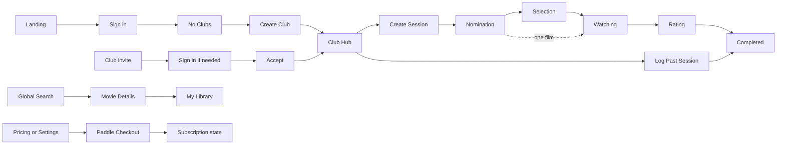

# PickFlick — Design

> The experience direction, screen behavior, components, and design QA. Exact visual values are
> implemented in `apps/frontend/src/styles/tokens.scss`; the canonical design package under
> `_docs/design/prototypes` stays their source.

| Owner         | Last reviewed                  |
| ------------- | ------------------------------ |
| Product owner | 2026-10-23 (Phase 12 accepted) |

## 1. Authority and sources

This document owns experience direction, visual foundations, interaction patterns, screen behavior,
and design QA. [ROADMAP.md](ROADMAP.md) owns scope, routes, and business rules;
[ARCHITECTURE.md](ARCHITECTURE.md) owns system boundaries. The design package owns exact tokens,
responsive compositions, and component appearance; production code implements them traceably.

When sources conflict:

1. A later explicit developer decision wins.
2. The design package beats the retired roadmap for product behavior and visual intent.
3. This document records where prototype fixture content is not a requirement.
4. Scope and technical topology never come from incidental prototype HTML.

| Source                                                                                                                  | Authoritative for                                                       | Note                                                      |
| ----------------------------------------------------------------------------------------------------------------------- | ----------------------------------------------------------------------- | --------------------------------------------------------- |
| [Package index](_docs/design/prototypes/index.html)                                                                     | Surface inventory and navigation.                                       | Static prototype, not production routing.                 |
| [Design system](_docs/design/prototypes/design-system.html)                                                             | Foundations, component states, navigation, forms, feedback, responsive. | Shows representative content.                             |
| [Exact design contract](_docs/design/prototypes/DESIGN.md)                                                              | Tokens, component rules, motion, accessibility, interaction.            |                                                           |
| [UX flow map](_docs/design/prototypes/ux-flow-map.html)                                                                 | Journeys, roles, branches.                                              | The Roadmap resolves permissions and edge cases.          |
| [Responsive baselines](_docs/design/prototypes/responsive-baselines.html)                                               | S/M/L/XL composition.                                                   | Representative widths, not the only tested ones.          |
| [Asset catalog](_docs/design/prototypes/asset-catalog.html) and [manifest](_docs/design/prototypes/asset-manifest.json) | Prototype asset usage.                                                  | Film images are fixtures, not licensed production assets. |
| [Brand specification](_docs/design/prototypes/brand-spec.md)                                                            | Brand intent and mascot use.                                            |                                                           |
| [Package handoff](_docs/design/prototypes/FINAL-PACKAGE.md)                                                             | Canonical and superseded files.                                         |                                                           |
| [Production brand assets](assets/brand/README.md)                                                                       | Reusable mascot and logo files with semantic names.                     | `panda-invited-2.webp` has English text baked in.         |

**Status values.** Design: `None`, `Draft`, `Approved` (the product owner accepted the direction).
Build: `Not started`, `Partial`, `Done` (the documented contract is implemented). QA: `Not checked`,
`Passed`, `Issues` (`Passed` needs a recorded comparison and baseline evidence).

The design package is approved as direction. Foundations, shells, public pages, Login, Club
onboarding and settings, delivered Hub views, read-only Movie Details, Session creation,
Nomination and Selection are implemented. Remaining Hub views and later-phase screens are still
unbuilt. A good-looking prototype is not production QA; the owner accepted the delivered screens in
Phase 12 (2026-10-23), and each later screen needs its own review.

## 2. Experience direction

- **Users:** friends running recurring movie nights, people building a personal film memory, Club
  Admins and Moderators running Sessions, and App Admins operating the service.
- **Core experience:** the current Club, screening, phase, progress, next action, and lasting result
  always feel connected.
- **Character:** editorial, cinematic, nocturnal, premium but friendly; high-contrast monochrome with
  restrained warmth and expressive panda art.
- **Voice:** short, human, lightly theatrical, film-aware. Privacy, billing, errors, permissions, and
  destructive actions are plain.
- **Non-goals:** generic SaaS dashboards, gold on every primary action, admin chrome in member flows,
  hover-only behavior, anonymous participation, and desktop layouts squeezed onto phones.

| Principle                     | In practice                                                                                                                |
| ----------------------------- | -------------------------------------------------------------------------------------------------------------------------- |
| One screening story           | Nomination, Selection, Watching, Rating, and Completed are states of one Session page, not separate pages.                 |
| Context before action         | Every mutation shows the Club, Session, role, phase, effect, and recovery path.                                            |
| Noir structure, warm meaning  | Monochrome carries layout and hierarchy; ivory and gold mark ratings, achievements, selection, invitations, focal moments. |
| Mobile is recomposed          | Navigation, tables, controls, and hierarchy adapt to touch; horizontal page scrolling is never the fallback.               |
| Progress without pressure     | Participation counts are clear, but unfinished Rating never blocks the next Session.                                       |
| Visible, enforced permissions | Unavailable actions are hidden, disabled with a reason, or replaced by a safe state; the server is the real boundary.      |
| Reuse the cinematic language  | Film strips, call sheets, sprockets, status banners, and mascot scenes recur instead of being reinvented.                  |

## 3. Foundations

Tokens live in [`tokens.scss`](apps/frontend/src/styles/tokens.scss) and components in
[`components/ui`](apps/frontend/src/components/ui), both traceable to the
[design contract](_docs/design/prototypes/DESIGN.md). Never copy partial token sets into features.

| Area                | Contract                                                                                                                                                                                                                                                                                                                                                                                                  | Source                                                                   | Build   | QA                                     |
| ------------------- | --------------------------------------------------------------------------------------------------------------------------------------------------------------------------------------------------------------------------------------------------------------------------------------------------------------------------------------------------------------------------------------------------------- | ------------------------------------------------------------------------ | ------- | -------------------------------------- |
| Color               | Dark only. The `#0c0c0c` family for structure, neutral text and borders, ivory and gold `#C89B55` for warm emphasis. Pages use a flat `--bg`. The warm spotlight belongs only to the Landing, Pricing, and legal heroes, the Login scene, and the no-Clubs and error stages; form scenes use the neutral `--accent-glow`. Small text on surfaces uses `--fg-secondary`, because `--muted` fails AA there. | [Color tokens](_docs/design/prototypes/DESIGN.md#color-tokens)           | Done    | Screenshots                            |
| Typography          | Iowan/Charter/Georgia-style display, system sans for product copy, mono for metadata and status.                                                                                                                                                                                                                                                                                                          | [Typography](_docs/design/prototypes/DESIGN.md#typography)               | Done    | Screenshots                            |
| Spacing and layout  | Shared scale, containers, gutters, sectional rhythm, flat hierarchy, deliberate negative space.                                                                                                                                                                                                                                                                                                           | [Layout](_docs/design/prototypes/DESIGN.md#layout)                       | Done    | Screenshots                            |
| Breakpoints         | S below 576, M from 768, L from 1024, XL from 1400; the gaps between them are tested too. Stylelint allows only these boundaries.                                                                                                                                                                                                                                                                         | [Responsive baseline](_docs/design/prototypes/responsive-baselines.html) | Partial | Overflow at 7 widths for built screens |
| Radii and elevation | Restrained radii, low-contrast borders; elevation belongs to overlays, tickets, and cinematic scenes.                                                                                                                                                                                                                                                                                                     | [Design system](_docs/design/prototypes/design-system.html)              | Done    | Screenshots                            |
| Icons               | Fine-line, consistent strokes; actions have accessible names; decorative sprockets and film glyphs are not semantic.                                                                                                                                                                                                                                                                                      | [Components](_docs/design/prototypes/DESIGN.md#components)               | Partial | Not checked                            |
| Imagery             | Transparent noir panda art cues emotion and scene; provider film images are data, not brand chrome.                                                                                                                                                                                                                                                                                                       | [Brand assets](assets/brand/README.md)                                   | Done    | Not checked                            |
| Motion              | Short feedback and reveals, nothing that jolts layout; reduced motion honored and focus preserved.                                                                                                                                                                                                                                                                                                        | [Motion](_docs/design/prototypes/DESIGN.md#motion--animation)            | Done    | Automated                              |

| Baseline      | Contract                                                                                                                                                                   |
| ------------- | -------------------------------------------------------------------------------------------------------------------------------------------------------------------------- |
| Accessibility | Semantic controls, visible focus, keyboard-operable tabs, menus, dialogs, and ratings, focus trap and return, live regions, contrast review, 44px targets, reduced motion. |
| Localization  | English MVP; externalize copy, use locale-aware dates, numbers, and currency, tolerate longer text, and bake no text into new images.                                      |
| Overflow      | Wrap by default; truncate only when the full text stays accessible; tables scroll in their own container; test long user and provider text.                                |
| Input         | Mouse, keyboard, and touch are first-class; hover only enhances. The browser and device matrix is finalized in Phases 22–24.                                               |

## 4. Structure

### Shells and navigation

The shells live in `apps/frontend/src/components/shells`, one folder per shell or navigation piece.
`/shell-preview` shows the public, setup,
product, Session, Settings, Library, and App Admin compositions without feature data; the shells
default to the product routes and the preview supplies its own route map.

| Context              | Shell                                                                                                                                                                                                                                                                                                                         | Responsive behavior                                                                                                                                                                                                                                                                                                                                                                                             | Source                                                                                                                                               |
| -------------------- | ----------------------------------------------------------------------------------------------------------------------------------------------------------------------------------------------------------------------------------------------------------------------------------------------------------------------------- | --------------------------------------------------------------------------------------------------------------------------------------------------------------------------------------------------------------------------------------------------------------------------------------------------------------------------------------------------------------------------------------------------------------- | ---------------------------------------------------------------------------------------------------------------------------------------------------- |
| Public               | Brand header with How it works, Features, Pricing, and a small secondary Go to App; a wordmark-and-tagline footer with How it works · Privacy · Terms · Contact; cinematic sections.                                                                                                                                          | No bottom menu. Below 768px the header holds the brand and Go to App (44px); the links join from 768px, and the landing price block offers "Compare plans". The footer stacks. Contact uses a focused form scene with Back and omits the full marketing header/footer.                                                                                                                                          | [Landing](_docs/design/prototypes/landing.html), [Pricing](_docs/design/prototypes/pricing.html)                                                     |
| Auth and setup       | A focused cinematic scene, minimal escape navigation, one task card.                                                                                                                                                                                                                                                          | Art and form reorder and scale without hiding context.                                                                                                                                                                                                                                                                                                                                                          | [Login](_docs/design/prototypes/login.html), [Invite](_docs/design/prototypes/invite.html), [Create Club](_docs/design/prototypes/create-group.html) |
| Product              | The brand links to the public home and Hub links to `/app`; the public footer appears on every page. Round 34px search, notifications, and avatar controls with 44px targets; search slides down over the header; notifications open a popover and the avatar a downward film strip; Club switcher, Call Sheet, product tabs. | A fixed four-column bottom bar: Hub (labelled with the current Club view), My Library, Alerts, Settings. Film strips rise above their trigger, stay inside the viewport, and keep the tail on the trigger. The Hub strip lists Club views only; Settings holds Profile, Notifications, Subscription, Privacy, Sign out, and Admin Panel for App Admins. With no Club, Hub offers Create a Club and Join a Club. | [Club Hub](_docs/design/prototypes/app.html)                                                                                                         |
| Session detail       | The product shell, phase banner, hero metadata and actions, phase content.                                                                                                                                                                                                                                                    | The primary phase action and progress stay above secondary detail.                                                                                                                                                                                                                                                                                                                                              | [Session family](_docs/design/prototypes/session-detail-nomination.html)                                                                             |
| Settings and Library | The product shell with local tabs or sidebar, tables and cards, stable feedback regions.                                                                                                                                                                                                                                      | The sidebar becomes a menu; tables scroll in bounded regions.                                                                                                                                                                                                                                                                                                                                                   | [Library](_docs/design/prototypes/library.html), [Settings](_docs/design/prototypes/settings.html)                                                   |
| App Admin            | Protected sidebar, overview panels, searchable tables, settings, typed confirmations.                                                                                                                                                                                                                                         | Complete on mobile through the admin menu and bounded tables.                                                                                                                                                                                                                                                                                                                                                   | [Admin Panel](_docs/design/prototypes/admin-panel.html)                                                                                              |

### Key flows

Nomination closes automatically when every participant has acted or its deadline passes; Selection
closes when all accepted participants submit. Operators can close either phase early. Watching
moves to Rating only by hand; Rating closes when everyone has rated or an operator
finishes it.

The [UX flow map](_docs/design/prototypes/ux-flow-map.html) is the visual source; edge rules live in
the [Roadmap](ROADMAP.md#3-business-rules).

## 5. Screens and states

All canonical screens are MVP and approved as direction.

| Route / view                        | Purpose                                                                                                                                                                                                                                                                               | Source                                                                                   | Build                                                                                                                                     | QA                                                                            |
| ----------------------------------- | ------------------------------------------------------------------------------------------------------------------------------------------------------------------------------------------------------------------------------------------------------------------------------------- | ---------------------------------------------------------------------------------------- | ----------------------------------------------------------------------------------------------------------------------------------------- | ----------------------------------------------------------------------------- |
| `/`                                 | Explain the ritual and lead visitors to sign up.                                                                                                                                                                                                                                      | [landing.html](_docs/design/prototypes/landing.html)                                     | Done                                                                                                                                      | Passed locally                                                                |
| `/pricing`                          | Compare Free and Pro; enter checkout.                                                                                                                                                                                                                                                 | [pricing.html](_docs/design/prototypes/pricing.html)                                     | Done; checkout disabled until billing                                                                                                     | Passed locally                                                                |
| `/contact`                          | Send a short message with stable validation and success feedback.                                                                                                                                                                                                                     | [contact.html](_docs/design/prototypes/contact.html)                                     | Done                                                                                                                                      | Passed locally                                                                |
| `/legal/privacy`, `/legal/terms`    | Public entries that never present draft policy as approved.                                                                                                                                                                                                                           | Shared public shell                                                                      | Done; final legal copy pending                                                                                                            | Passed locally                                                                |
| `/login`                            | Sign in with an enabled provider and continue; signed-in Users go to `/app`. Apple is hidden while gated.                                                                                                                                                                             | [login.html](_docs/design/prototypes/login.html)                                         | Done for Google; Apple built but gated                                                                                                    | Passed locally with Apple off                                                 |
| `/invite/club/[token]`              | Preview and accept or decline a Club invitation; expiry and sign-in.                                                                                                                                                                                                                  | [invite.html](_docs/design/prototypes/invite.html)                                       | Accepted in Phase 12                                                                                                                      | Passed locally; owner accepted 2026-10-23                                     |
| `/invite/session/[token]`           | Accept a member-only Session invite or show privacy-safe denial.                                                                                                                                                                                                                      | [Club Hub invite ticket](_docs/design/prototypes/app.html)                               | Accepted in Phase 12                                                                                                                      | Passed locally; owner accepted 2026-10-23                                     |
| `/app` with no Clubs                | Orient a new User and create or join the first Club.                                                                                                                                                                                                                                  | [app-no-clubs.html](_docs/design/prototypes/app-no-clubs.html)                           | Done; invitation links arrive with invitations                                                                                            | Passed locally                                                                |
| `/clubs/new`                        | Create a Club and choose its Selection scale.                                                                                                                                                                                                                                         | [create-group.html](_docs/design/prototypes/create-group.html)                           | Done: one slider for the `0..N` upper bound, explained by an InfoTip                                                                      | Passed locally                                                                |
| `/clubs/[clubId]`                   | Run and understand one Club across six Hub views.                                                                                                                                                                                                                                     | [app.html](_docs/design/prototypes/app.html)                                             | Active — Overview, Sessions/history, Members, Manage Club, carousel and phase-aware Call Sheet; Ratings statistics and Achievements later | Existing views accepted 2026-10-23; Sessions/history exact-SHA review pending |
| `/clubs/[clubId]/members`           | Active roster, current role, member removal confirmation, and adminless/read-only notices.                                                                                                                                                                                            | Members view in [app.html](_docs/design/prototypes/app.html)                             | Active                                                                                                                                    | Phase 12 contract checks; owner accepted 2026-10-23                           |
| `/clubs/[clubId]/settings`          | Manage Club info, visibility, scale, roles, lifecycle, and destructive actions.                                                                                                                                                                                                       | Manage Club view in [app.html](_docs/design/prototypes/app.html)                         | Done for the Phase 5 foundation; the full Hub arrives in Phase 7                                                                          | Passed locally (Admin, Member, archived)                                      |
| `/clubs/[clubId]/sessions/new`      | Create a full-cycle or pre-selected Session and share its member-only join link.                                                                                                                                                                                                      | [create-session.html](_docs/design/prototypes/create-session.html)                       | Accepted in Phase 12                                                                                                                      | Local QA passed; owner accepted 2026-10-23                                    |
| `/clubs/[clubId]/sessions/past/new` | Record a past screening with partial evidence.                                                                                                                                                                                                                                        | [create-past-session.html](_docs/design/prototypes/create-past-session.html)             | Not started                                                                                                                               | Not checked                                                                   |
| Session — Nomination                | Choose one film, see allowed nominations, follow progress.                                                                                                                                                                                                                            | [session-detail-nomination.html](_docs/design/prototypes/session-detail-nomination.html) | Active for the delivered flow                                                                                                             | Responsive and accessibility checks passed; owner accepted 2026-10-23         |
| Session — Selection                 | Score every nomination, submit once, follow progress.                                                                                                                                                                                                                                 | [session-detail-selection.html](_docs/design/prototypes/session-detail-selection.html)   | Active — ballots, closure and policy-filtered outcomes                                                                                    | Responsive and accessibility checks passed; owner accepted 2026-10-23         |
| Session — Watching                  | Focus on the film; an operator opens Rating.                                                                                                                                                                                                                                          | [session-detail-watching.html](_docs/design/prototypes/session-detail-watching.html)     | Active — film, context, joined roster and operator-confirmed Rating opening; owner review pending                                         | Base accepted 2026-10-23; new action awaits preview review                    |
| Session — Rating                    | Submit 1–10 with an optional comment; see permitted results and rivals.                                                                                                                                                                                                               | [session-detail-rating.html](_docs/design/prototypes/session-detail-rating.html)         | Active — form, saved response, progress, partial completion and permitted results; owner review pending                                   | Four widths, axe, keyboard/touch passed; owner review pending                 |
| Session — Completed                 | Keep the screening, ratings, rivals, attendees, and notes.                                                                                                                                                                                                                            | [session-detail.html](_docs/design/prototypes/session-detail.html)                       | Active — film, screening facts, historical ratings/comments and permitted nomination breakdowns                                           | Exact-SHA hosted preview and owner review pending                             |
| `/library`                          | Search personal Ratings and Watchlist; personal statistics and achievements.                                                                                                                                                                                                          | [library.html](_docs/design/prototypes/library.html)                                     | Not started                                                                                                                               | Not checked                                                                   |
| `/movies/[movieId]`                 | Inspect a film, edit Personal Rating and Watchlist, discover related films.                                                                                                                                                                                                           | [movie-details.html](_docs/design/prototypes/movie-details.html)                         | Details, trailer player and links implemented; Personal Rating and Watchlist placeholders until Phase 15                                  | Owner accepted 2026-10-23                                                     |
| `/settings`                         | Profile, notifications, subscription, Privacy & data, import/export.                                                                                                                                                                                                                  | [settings.html](_docs/design/prototypes/settings.html)                                   | Not started                                                                                                                               | Not checked                                                                   |
| `/admin`                            | Operate Users, Clubs, metrics, and settings.                                                                                                                                                                                                                                          | [admin-panel.html](_docs/design/prototypes/admin-panel.html)                             | Not started                                                                                                                               | Not checked                                                                   |
| `not-found`, `error`                | Recover from missing routes and failures. Signed-in visitors get the product shell with Back to Hub (500 adds Try again); signed-out visitors get the public shell with Back to main. If the root layout itself fails, a plain Projector Malfunction page with Try again replaces it. | [error.html](_docs/design/prototypes/error.html)                                         | Done                                                                                                                                      | Passed locally                                                                |

"Passed locally" means the Playwright suite passes at 390 and 1440 pixels plus overflow checks at
every breakpoint and gap width.

### Screen rules

The prototypes show composition and appearance. These rules add the behavior they cannot show and
record where production deliberately differs. Pixel values live in the prototypes and tokens, not
here.

#### Product shell

- Public and product headers share one height: 73px, and 63px below 1024px, so moving from the
  site into the app does not shift the page. Both slide away while the page scrolls down and
  return on any scroll up; they stay near the top, while focus is inside them and while one of
  their menus or panels is open. The phone bottom bar never hides; reduced motion drops the slide.
  Sticky section menus rise with the hidden header instead of leaving its height empty.
- The public footer stays on every product page, phones included, because it carries the legal and
  contact links. It sits at the bottom of short pages, and below 1024px its links end above the
  floating invite ticket while the ticket shows.
- The bottom bar's Hub strip lists the Club's sections wherever a Club is in context, the Session page
  included; without one it offers Create and Join on the onboarding Hub and a Club Hub link elsewhere.
  Choosing a strip link closes the strip.
- Back to Hub and other in-header actions use the shared small button, with its hover and focus.
- The account film strip lists Settings, Privacy & data, Pricing, Contact Us and Sign out, with Admin
  Panel first for App Admins. Movie Details marks no header destination as current.
- Search, notifications and film-strip menus move focus inside when they open, also under reduced
  motion, and return it to the trigger when they close.

#### Club Hub

- Overview, Sessions, Members and Manage Club share one mounted frame with the Club switcher and Call Sheet.
  Each panel rechecks authorization and refreshes the frame's snapshot; its links keep the scroll
  position. Below 768px the section tabs give way to the bottom bar's Hub strip. A section switch
  answers at once: the strip closes, the current section moves and a card skeleton holds the panel
  until the server responds. The same `LoadingState` cards variant suits later panel routes such as
  the Library.
- The carousel ends with Create new club. The caption shows member count, the count of Sessions that
  were not cancelled, and the founding month and year; description, plan, role and scale stay in
  their own panels. Names wrap by whole words and stop at three lines. Phones show position dots and
  switch Clubs with a clearly sideways swipe over the name as well as the arrows; wider screens hide
  the dots.
- The Call Sheet opens the current Session from every section, for participants too. Without one it
  keeps the sheet's frame: "No screening scheduled", the projectionist panda in the still and, for
  Admins and Moderators, Schedule a Session. Its number is the Club-local creation order, cancelled Sessions
  included. Sessions store only a date, so the call-time slot shows the location (two lines at most)
  until a real time exists, never a fabricated midnight. Topics stop at two lines.
- The Call Sheet still uses cached Movie artwork or an explicit missing-image state, never fixture
  film data. Before a film is selected it shows the choosing panda rather than a nominated poster,
  because nominations stay behind the Club's visibility settings.
- Overview shows seven statistics with `—` for missing values; Club-wide rating statistics remain
  later work. In the Active Session card only its button acts: Open Session for participants, Join me!
  for an eligible member. Session history is a quiet disclosure row.
- Manage Club's Active Session gives Admins and Moderators the gear menu's controls: Start next phase
  (Selection, or Watching for a single nomination or after Selection), Kick participant and Cancel
  Session, with the same typed confirmations. Watching offers Start next phase: Rating through the shared Open Rating dialog.
- Members shows each role and the accepted participations, excluding cancelled Sessions. Admins
  remove Members or Moderators, Moderators remove Members, and Members leave through Manage Club.
  Removal needs `REMOVE`, keeps shared history and returns focus to the Members heading. Session
  counts stay in one column whether or not a row has a remove control. Role changes happen in the
  Manage Moderators dialog, whose role controls wrap under a name rather than truncate it; + Invite
  opens Manage Club. Dates read as `Oct 21, 2026`.
- Club Info holds the avatar beside the Club name: clicking it picks an image with a preview, its
  requirements sit in a tip, and Save Changes uploads it with the other fields. Settings lists its
  checkboxes at a fixed spacing with Save Changes at the card's base. A Pro-only setting carries a
  Pro marker and its reason in a tip instead of a bare disabled box.
- The last row pairs two compact cards of equal height: Members (places in use, Invite members, and
  Manage Moderators for the Admin) and the Danger Zone (one line, then Archive or Reactivate and
  Delete, or Leave).
- All three views show the same adminless, archived and excess-member notices. Adminless Clubs
  explain the missing owner actions; excess-member Clubs keep history and participation but pause new
  Sessions and invites while roster recovery stays available.
- Invite members opens the invitation dialog, which loads recent links once. It creates one
  single-use link with a 12-hour expiry: the link field carries Copy, and Revoke is a quiet link
  beneath it. Recent links list a short ID, status, expiry and a quiet Revoke, the newest marked;
  the link survives closing and reopening the dialog.
  A new link stays visible and revocable if the list fails to refresh. Active links are capped at the
  plan's member limit; managers can still inspect and revoke when creation is paused. Members and
  archived Clubs see no invitation controls.

#### Pending invites

- Club rows list recipient-targeted links with inviter, member count and expiry; shareable Club links
  stay in their own flow. Session rows are the caller's unanswered open Sessions with topic, Club and
  date, and have no token expiry. Accepting a Session invite opens the Session.
- Responding moves focus to Close before the row's controls change, so the trap and Escape keep
  working after the last answer. Loading, empty, retry and stale-invitation feedback are explicit.
- The ticket appears once an invitation or a loading failure exists, and then stays, so focus can
  return to it after the last answer; with nothing pending it never covers content. On phones it
  floats above the bottom bar.

#### Invitation pages

- Club invitations use one setup scene. The heading says "You are invited" because links reserve no
  capacity. The preview shows only Club name, icon-labelled member count and inviter, and Accept
  carries the prototype's check; signed-out and unsafe states omit Club details. Long names use a one-line ellipsis with the full name still accessible.
- Accept and Decline wait for hydration, show pending and retry feedback and keep the card's size.
  Success and already-member states open the Hub.
- Legacy personal Session invitation URLs keep their recipient check, seven-day expiry and focused
  scene. Signed-out visitors continue through sign-in; non-members see no screening context.

#### Global search and Movie Details

- Header search reuses the product overlay. A 300ms debounce updates a bounded, locally scrolling
  panel with loading, empty, cached, provider failure, rate-limit, unconfigured and expired-session
  feedback; a new query clears obsolete results at once. Arrow keys move through results while focus
  stays in the combobox, Enter opens the canonical Movie route, and Tab and touch work too.
- Results fall back to an available source title; "Untitled film" means no title at all. Posters load
  lazily through authenticated same-origin URLs, with the neutral PF placeholder when missing.
- Movie Details shows title, then the Session header's meta line (year, runtime, language name and
  the italic genres), an action rail like the Session's (one rating to one decimal, IMDb else
  Kinopoisk, with a mark instead of the source name, which readers and the tooltip still get, or a
  dash; then Rate, a disabled placeholder until Phase 15) and the prototype's Watchlist ribbon on
  the poster's top-right corner, also a placeholder, poster, directors, writers, up to five actors
  in one row, budget and worldwide revenue in compact US dollars, synopsis and a trailer player.
  Rows without data other than directors and actors are left out. On wide screens the poster and
  trailer share one height (3 : 8 columns), and the poster behaves as in Sessions. Provider
  attribution stays with TMDB in search results only; where PoiskKino and TheTVDB are credited for
  public launch is decided in #89. Movie Details and Sessions share one loading skeleton of this
  layout. On phones the header is the same film ticket as in Sessions, with that rail as its stub.
  There is no in-content Back. On phones each credit keeps its label and value on one row.
- Missing media, absent English synopsis, provider outage, rate limits, unconfigured catalog, partial
  and stale details each have explicit feedback. Related titles load separately: up to six
  provider-supplied links, grayscale until hover or focus, with no personalization claim.
- IMDb, Kinopoisk and Letterboxd links are built by the backend from verified identifiers (a
  PoiskKino ID is the Kinopoisk film ID; Letterboxd resolves the IMDb, else the TMDB, ID); Wikipedia
  is a title search. They are bordered pills with each source's one-colour mark and an outbound
  arrow, marks only on phones, followed by the dotted sprocket divider. The trailer card shows the
  film still (or the blurred poster) with a Play button; only pressing it loads YouTube's
  privacy-enhanced player in place, with up to three trailers to choose from. A Search YouTube
  caption closes the card on the same line as the poster's Film details caption, because provider
  trailers can be teasers or missing. One credit region covers the film and its related titles.
  Unknown Movies use the not-found page. Personal Rating and Watchlist arrive with the Library.

#### Create Session

- The setup scene has a Back link, required date and location, optional topic and notes, the two live
  modes and an optional `hh:mm` Nomination duration. Date-only entries are stored at midnight UTC.
  Pre-selected mode replaces the deadline with catalog search and a removable selected Movie.
- Validation focuses the first invalid field; saving, offline and API failures keep the entries. A
  blocking Session or a Club or role restriction replaces the form with a recovery link.
- Success links to the new Session and the Hub. Creating or editing a Session refreshes the Hub and
  Session pages, so browser Back shows current data.

#### Session page

- Every phase is one page: the status banner (with manual refresh while Nomination or Selection is
  open), the heading with topic, notes and a relative Nomination deadline anchored to the request
  time, then the phase content, the reel separator with the phase mascot, and the facts.
- Invite copies the member-only Session link and confirms in its own label. Invite, the Settings
  gear menu and Join or Leave share one action rail of icon-and-label cells. The gear menu holds
  early closure, Edit, Kick and Cancel; on short screens its rows compact and it scrolls clear of
  the bottom bar. The strip centres under its trigger so its tab always sits mid-strip.
- Dialogs have no close icon: Escape, the overlay and their own Cancel or Close dismiss them. Edit is
  a focus-trapped form; Cancel, Kick and early closure keep typed `CANCEL`, `REMOVE` and `CLOSE`.
  Terminal Sessions have no edit or cancel controls. A phase change focuses the Session heading.
- Participants appear only in the facts. Any current member may join from Nomination through Rating;
  a declined or departed participant can rejoin, but operator removal blocks self-join. Late
  Selection participants score the frozen films. Kick lists removable participants and can still
  revoke legacy personal links. Archived Clubs and terminal Sessions drop the controls they cannot use.
- The facts companion is the progress metric while Nomination or Selection is open, a coming-soon chat
  while Watching, and the permitted Session average as Club score after Rating completes.

#### Nomination

- Search opens a dropdown over the card; a chosen film becomes a row with Change and Nominate This.
  Suggestions are the caller's own past losing nominations in this Club and use the same flow.
- Current Nominations show posters, titles, cached genres and the nominator when the Club allows it.
  Feedback stays inside the nomination card; a successful submission focuses its heading.
- Empty history, hidden nominations, missing metadata, non-participant and read-only access, pending
  saves, failures, offline recovery and locked submission each have explicit copy.
- Early closure cannot close with no films; one film moves to Watching, several open Selection, and
  automatic `N/N` completion does the same. Other clients poll a progress version, re-read the page
  when it moves (also on reconnect and focus), keep polling after a failed check with a visible
  notice, and recover through a transient "Session unavailable" page.

#### Selection

- Every eligible nomination gets a score row on the Club's scale (`0..N`, or a legacy `1..N`) with one
  year · genres · nominator line. Rows stack on phones and wide scales scroll inside the row. Scores
  keep 44px targets and support arrows, Home, End and touch; a score marks only the chosen option.
- Missing scores focus the first unscored film with live feedback; errors keep the input.
  Submission is final: a saved ballot shows locked rails with the choices marked. Archived Clubs and
  ineligible participants cannot submit, and the server filters nominator names.
- After closure a warm winner card links the Movie, names the permitted nominator and records how
  and when Selection closed. When allowed, the ranking shows totals, top-score votes, supporters and
  the deciding tie-break; hidden results show only the winner and why. Zero ballots are explained.
- Early closure confirms with `CLOSE`, states the received and pending ballots and returns focus to
  its trigger on cancel.

#### Watching

- A film header (linked title; year and runtime, then the genres in the display italic after a
  hairline; a phase stamp whose dot pulses only while Watching) sits above the Movie Details media
  grid. From 576px the stamp sits left of a compact action rail (icon and label inline); below it
  the header becomes the shared film ticket: the poster carries title, meta, an info mark and the
  stamp, and the rail is its stub, joined by a perforation with outlined notches. The rail shows
  only the viewer's actions: Invite, Settings for Session managers, and Join or Leave. The media
  poster links to Movie Details, mostly grey at rest (softer than the prototype's full grey);
  colour, a slight zoom and its caption arrive together on hover. When the meta line cannot fit, the
  genres take a second line, both lines centre and the hairline goes. When film details are
  unavailable the phase stamp stays and the warning links to the selected Movie.
- Admins and Moderators in writable Clubs open Rating from Settings → Open Rating, or the same
  dialog in Manage Club. Typed `OPEN` confirms that the screening is finished and frees the Club
  for another Session. Cancel or Escape keeps Watching and returns focus; success focuses the
  Session heading. Pending, offline, stale-phase, lost-access and API failure feedback stays in
  the dialog. Members and read-only Clubs have no Rating-opening control.
- The accepted roster supplies the joined-screening count and participant names. Page activity,
  joining, polling and elapsed scheduled time never open Rating. Rating submission and completion follow the rules below.

#### Rating and completion

- Rating reuses the film header and media, with accepted-participant progress above the header.
  Its fixed 1–10 star control supports arrows, Home, End, pointer and touch with 44px targets;
  wide rails scroll locally on phones. The optional labeled comment is limited to 2000 characters.
- Submit is final. Pending saves lock the form; validation focuses the rating control, and API or
  offline errors retain the score and comment. Success replaces the form in place with the saved
  score and comment and focuses its heading. The existing progress poll refreshes other clients.
- Positive N/N completion is automatic. Session Settings offers Close Rating early to authorized
  operators, with received/pending counts and typed `CLOSE`. Cancel or Escape preserves Rating and
  returns focus. Failure preserves the dialog and confirmation; success focuses the Session heading.
- Other responses and the Club score remain hidden while Rating is open. Completed results show
  individual scores, comments and the average only when the server permits them. Hidden results,
  no received ratings, non-participation and read-only Clubs have explicit text. The caller's own
  response stays visible. Completion removes further submission and management controls.
- Completed places the film and stable screening facts before two result panels: individual
  ratings/comments and historical nominations. The latter identifies the winner and exposes
  permitted aggregate vote totals, top-score votes and supporters through keyboard-operable
  disclosures. Pre-selected screenings explain the absence of nominations and votes. Empty,
  partial and hidden results never invent responses. Catalog titles and account display names
  remain current; saved choices, scores, scale and closure information remain historical.
- The Hub Sessions section shows the single blocking Session, all unfinished Rating Sessions
  with accepted-participant progress, and the latest twenty closed Sessions. History uses the
  server-permitted Session average, or `—` when absent or hidden. Overview and Manage Club also
  expose all open Ratings; the Call Sheet and Active Session card represent the blocking Session.
  Without one, an authorized operator can schedule while Ratings remain open.
- Exact-SHA hosted preview review and owner acknowledgment remain required for acceptance.

#### Public, Login and Contact

- Login shows the enabled identity providers only; dormant Apple sign-in stays hidden.
- Contact uses the focused task scene with Back and requires JavaScript through `@mantine/form`;
  revisit no-JavaScript submission only if it becomes a requirement.

### Prototype fixtures and superseded content

| Prototype shows                                                                                                                     | Build this instead                                                                                                                                                                                                                                                                                                                                                                                      |
| ----------------------------------------------------------------------------------------------------------------------------------- | ------------------------------------------------------------------------------------------------------------------------------------------------------------------------------------------------------------------------------------------------------------------------------------------------------------------------------------------------------------------------------------------------------- |
| Personal suggestions beside Nomination search.                                                                                      | Suggest only the current user's own past nominations in this Club that did not win. Derive them from history; selecting a card uses the normal nomination flow. There is no separate shared saved-film list or manual add/remove UI.                                                                                                                                                                    |
| Nomination, Selection, and Rating rows together under "Active Sessions".                                                            | Examples of row states. A Club has one blocking Session at a time; any number of Rating Sessions.                                                                                                                                                                                                                                                                                                       |
| Manage Club with one Active Session and several Active Ratings.                                                                     | The real concurrency rule and the preferred composition.                                                                                                                                                                                                                                                                                                                                                |
| Pricing promising unlimited nomination rounds on Pro.                                                                               | Superseded: both plans have one blocking Session per Club. Pro adds limits, result visibility, grace period, and analytics.                                                                                                                                                                                                                                                                             |
| Selection copy saying "rank", and "three films" beside five scored rows.                                                            | Users score every nomination on the Club's scale; there is no drag ranking.                                                                                                                                                                                                                                                                                                                             |
| Score buttons 0–3.                                                                                                                  | Generated from the Club's stored scale: `0..N` for new Clubs, existing `1..N` Clubs keep theirs; N at most 10.                                                                                                                                                                                                                                                                                          |
| A Session invite beside a Club invite.                                                                                              | Valid only for an existing member; non-members see no details and are told to join the Club.                                                                                                                                                                                                                                                                                                            |
| A Support role in the admin table; annual Pro in the subscription mix.                                                              | Fixtures. App roles are User and App Admin; MVP sells monthly Pro at €5.                                                                                                                                                                                                                                                                                                                                |
| Settings deletion copy saying all Club and Session history is removed.                                                              | Superseded: shared history stays with anonymized attribution; members are notified if a Club becomes adminless.                                                                                                                                                                                                                                                                                         |
| Settings with fixed deletion, cookie, and legal claims; Russian "coming later".                                                     | Layout approved; policy copy must match implementation and legal review. English is MVP, Russian post-MVP.                                                                                                                                                                                                                                                                                              |
| Navigation controls resting at `--muted` (header links and icons, tabs, film-strip frames, mobile bar, footer links, search close). | Interactive navigation rests at `--fg-secondary` with `--border-lit` icon circles; `--muted` reads as disabled. Header links and icons turn ivory on hover, focus, or open, with a gold underline or gold-border circle. Tabs and menu frames brighten to `--fg`. The current destination is ivory (tabs: `--fg` with an underline). `--muted` is only for metadata, placeholders, and disabled states. |
| The `settings.html` Privacy panel repeating policy prose under "Privacy".                                                           | Policy text lives only in the public Privacy Notice (`/legal/privacy`). The in-app section is "Privacy & data": a summary, rights actions, and a link to the Notice. Login and legal links call it "Privacy Notice".                                                                                                                                                                                    |
| [`settings-subscription.html`](_docs/design/prototypes/settings-subscription.html).                                                 | Superseded study; the Subscription panel in `settings.html` is canonical.                                                                                                                                                                                                                                                                                                                               |

### States every data surface needs

| State                     | Expected behavior                                                                                        |
| ------------------------- | -------------------------------------------------------------------------------------------------------- |
| Loading                   | Stable layout, local skeleton or progress, a status for assistive technology, and no duplicate mutation. |
| Empty                     | Why it is empty and the next useful authorized action.                                                   |
| Validation                | A message next to the field, focus or summary when useful, preserved input, never color alone.           |
| Provider or network error | The cause when known, a safe retry, preserved non-sensitive input, and other navigation.                 |
| Unauthorized              | No protected data; explain the membership or role needed without leaking details.                        |
| Read-only                 | Keep history visible, explain the limit or downgrade, and link the Admin to recovery.                    |
| Offline                   | Keep safe cached context if any; disable mutations with a reconnect instruction.                         |
| Success                   | Stable inline confirmation or toast with the new state; move focus only when context changed.            |
| Destructive               | Name the target and consequence; typed confirmation for high-impact actions; restore focus on cancel.    |

## 6. Components and patterns

The UI kit lives in `apps/frontend/src/components/ui/<Name>/`. The `/ui-preview` gallery exercises
foundation components; feature-specific wrappers are checked in their built screens.

| Component                      | Purpose and states                                                                                                                                                                                                                                                                                                                                                                                                                                                                                                  | Source                                                                   | Build                                                                    |
| ------------------------------ | ------------------------------------------------------------------------------------------------------------------------------------------------------------------------------------------------------------------------------------------------------------------------------------------------------------------------------------------------------------------------------------------------------------------------------------------------------------------------------------------------------------------- | ------------------------------------------------------------------------ | ------------------------------------------------------------------------ |
| Public and product header      | Brand, navigation, search, notifications, account; public, authenticated, and admin on desktop and mobile.                                                                                                                                                                                                                                                                                                                                                                                                          | [Design system](_docs/design/prototypes/design-system.html)              | Done                                                                     |
| Film-strip menu and mobile bar | Compact cinematic secondary navigation for Hub, Library, Settings, Admin; open, closed, active (`FilmStripMenu`).                                                                                                                                                                                                                                                                                                                                                                                                   | [DESIGN.md](_docs/design/prototypes/DESIGN.md)                           | Done                                                                     |
| Club switcher and Call Sheet   | Keep Club and screening context: several Clubs, no Session, each phase, with or without image.                                                                                                                                                                                                                                                                                                                                                                                                                      | [Club Hub](_docs/design/prototypes/app.html)                             | Active for delivered Club/Session phases; remaining views are later work |
| Tabs                           | Local views without losing shell context; horizontal, vertical, mobile menu (`Tabs`).                                                                                                                                                                                                                                                                                                                                                                                                                               | [Design system](_docs/design/prototypes/design-system.html)              | Partial                                                                  |
| Buttons                        | Primary, secondary, ghost, danger, secondary-danger; loading, disabled, success; links styled as buttons (`Button`, `ButtonLink`).                                                                                                                                                                                                                                                                                                                                                                                  | [DESIGN.md](_docs/design/prototypes/DESIGN.md)                           | Done                                                                     |
| Form controls                  | `TextInput`, `Textarea`, `Select`, `Switch`, the Club Selection scale slider, and `InfoTip` (a "?" hint on hover, focus, or tap). Controls sit one step darker than their surface (`--bg` on `--surface`). Labels are `--fg-secondary`, weight 500, with a quiet qualifier (`— required`, `— optional`); counters read `n/max`; focus is a gold border with a soft gold ring; checkboxes are monochrome. Native date, file and segmented controls are active in delivered forms; later field types remain Proposed. | [Design system](_docs/design/prototypes/design-system.html)              | Partial                                                                  |
| Movie search result            | Catalog discovery: loading, results, empty, error, selected, removed.                                                                                                                                                                                                                                                                                                                                                                                                                                               | [Create Session](_docs/design/prototypes/create-session.html)            | Active — Session Movie picker                                            |
| Score selector                 | Score every nomination on the configured scale; incomplete, submitted, keyboard and touch (`ScoreControl`).                                                                                                                                                                                                                                                                                                                                                                                                         | [Selection](_docs/design/prototypes/session-detail-selection.html)       | Done                                                                     |
| Rating control                 | 1–10 personal or Session score (`RatingControl`).                                                                                                                                                                                                                                                                                                                                                                                                                                                                   | [Rating](_docs/design/prototypes/session-detail-rating.html)             | Done                                                                     |
| Progress film strip            | `N/N` participation, compact or full (`Progress`).                                                                                                                                                                                                                                                                                                                                                                                                                                                                  | [Club Hub](_docs/design/prototypes/app.html)                             | Done                                                                     |
| Status banner and phase stamp  | Lifecycle and recovery for each phase, error, read-only (`StatusBanner`).                                                                                                                                                                                                                                                                                                                                                                                                                                           | [Session family](_docs/design/prototypes/session-detail-nomination.html) | Done                                                                     |
| Invite ticket and popover      | Club and Session invitations: several, empty, accept, decline, expired, forbidden.                                                                                                                                                                                                                                                                                                                                                                                                                                  | [Club Hub](_docs/design/prototypes/app.html)                             | Active for Club and Session invitations                                  |
| Notification popover           | Recent in-app events: read, unread, empty, loading, error, mobile.                                                                                                                                                                                                                                                                                                                                                                                                                                                  | [Settings](_docs/design/prototypes/settings.html)                        | Partial                                                                  |
| Dialog                         | Phase moves, edits, removals, cancellation, destructive actions; typed confirmation (`Modal`).                                                                                                                                                                                                                                                                                                                                                                                                                      | [Design system](_docs/design/prototypes/design-system.html)              | Partial                                                                  |
| Stat, leaderboard, table       | Summaries, histories, rankings, usage, admin lists; sorted, filtered, mobile scroll (`Table`).                                                                                                                                                                                                                                                                                                                                                                                                                      | [Club Hub](_docs/design/prototypes/app.html)                             | Partial                                                                  |
| Achievement card and filter    | Earned, in-progress, and locked goals.                                                                                                                                                                                                                                                                                                                                                                                                                                                                              | [Library](_docs/design/prototypes/library.html)                          | Not started                                                              |
| Privacy accordion              | Data summary and rights actions (export, GDPR archive, deletion) in "Privacy & data", linking to the Privacy Notice.                                                                                                                                                                                                                                                                                                                                                                                                | [Settings](_docs/design/prototypes/settings.html)                        | Not started                                                              |

| Pattern              | Behavior                                                                                                                           |
| -------------------- | ---------------------------------------------------------------------------------------------------------------------------------- |
| Forms                | Validate on blur or submit; keep values; focus the first error; keep help and error regions stable.                                |
| Loading              | Local feedback, stable geometry, locked repeat submissions, announced long transitions and exports.                                |
| Empty and error      | Specific, calm, recoverable; always an authorized next action or safe navigation.                                                  |
| Feedback             | The in-app inbox is durable; toasts and inline messages confirm local actions; email follows preferences and mandatory exceptions. |
| Dialogs and overlays | One header popover at a time; focus enters, stays, and returns; Escape closes non-blocking dialogs.                                |
| Destructive actions  | A separate danger action that names the effect and irreversibility; typed target for sensitive App Admin actions.                  |
| Permissions          | Never expose protected data; hide irrelevant actions, disable with a reason when it teaches, and use explicit read-only states.    |

## 7. Design decisions

| ID      | Area                   | Decision                                                                                                                                                                                                                                                                                                    | Status   | Source                                                                                                       |
| ------- | ---------------------- | ----------------------------------------------------------------------------------------------------------------------------------------------------------------------------------------------------------------------------------------------------------------------------------------------------------- | -------- | ------------------------------------------------------------------------------------------------------------ |
| DES-001 | Authority              | Design pages beat the retired roadmap; later explicit developer decisions beat both.                                                                                                                                                                                                                        | Decided  | Developer direction                                                                                          |
| DES-002 | Visual system          | Projector Noir replaces the legacy color and type direction.                                                                                                                                                                                                                                                | Decided  | [Design package](_docs/design/prototypes/design-system.html)                                                 |
| DES-003 | Responsive             | S/M/L/XL behavior is MVP, not later polish.                                                                                                                                                                                                                                                                 | Decided  | [Responsive baseline](_docs/design/prototypes/responsive-baselines.html)                                     |
| DES-004 | Concurrency examples   | Several active rows show view variants; only Rating Sessions may coexist without limit.                                                                                                                                                                                                                     | Decided  | Developer decision 8                                                                                         |
| DES-005 | Selection              | A generated inclusive score range replaces the fixed 0–3 buttons and the stale "rank three" copy.                                                                                                                                                                                                           | Decided  | Developer decision 2                                                                                         |
| DES-006 | Session invite privacy | Non-members see no details and must join the Club first.                                                                                                                                                                                                                                                    | Decided  | Developer decision 10                                                                                        |
| DES-007 | Ratings                | Historical Session Rating and editable Personal Rating are separate.                                                                                                                                                                                                                                        | Decided  | Developer decision 12                                                                                        |
| DES-008 | Legal copy             | Layout approved; retention, deletion, and cookie claims stay provisional until implementation and review agree.                                                                                                                                                                                             | Deferred | Phase 19 / 23 review                                                                                         |
| DES-009 | Contact identity       | Publish `hello@pick-flick.app`; production email comes from `PickFlick <notifications@pick-flick.app>` with replies to the public address; UAT uses `PickFlick UAT <notifications@uat.pick-flick.app>`.                                                                                                     | Decided  | [ADR-009](_docs/decisions/README.md#adr-009--use-one-public-contact-and-environment-specific-resend-senders) |
| DES-010 | Monochrome fidelity    | No global or duplicated warm washes. Form controls follow the prototype field contract; Create Club uses one range slider for the scale. In-flow Back links return to the previous PickFlick page with a safe fallback.                                                                                     | Decided  | Phase 6, 2026-09-24                                                                                          |
| DES-011 | Manage Club            | Manage Club renders inside the Club Hub frame as a card grid: Club Info (name, description, scale), Settings (visibility), Club Avatar, and a Danger Zone with Manage Moderators, Archive or Reactivate, Delete, or Leave. Role changes happen in the Manage Moderators dialog. Audit events are not shown. | Decided  | Phase 6, 2026-09-24                                                                                          |

## 8. Design QA

| Check              | Target                                                                                                           | Evidence                                                                                                                                                                                                                                                                                      | Status      |
| ------------------ | ---------------------------------------------------------------------------------------------------------------- | --------------------------------------------------------------------------------------------------------------------------------------------------------------------------------------------------------------------------------------------------------------------------------------------- | ----------- |
| Source parity      | Every screen and shared component compared with its source.                                                      | 84 baselines at 390 and 1440 (gallery, seven shells, public pages, Login, Club onboarding, invitations, Hub, members/settings, recovery, Movie Details, Session creation, Nomination and Selection). The owner accepted the delivered screens in Phase 12.                                    | In progress |
| Responsive         | Continuous widths plus 390, 768, 1024, 1440; orientation where it matters.                                       | Established screens: overflow at 390, 640, 768, 900, 1024, 1200, 1440. Session creation/detail: 390, 768, 1024, 1440.                                                                                                                                                                         | In progress |
| Keyboard and focus | Auth, Club creation, Sessions, search, menus, dialogs, rating and score controls, settings, admin confirmations. | Automated for shared and shell controls, Pricing FAQ, Contact and Create Club validation focus, Club switch, member removal, pending invites, Club settings dialogs, Session validation, Movie selection, edit/cancel dialogs, and the unavailable checkout. Remaining feature flows pending. | In progress |
| Accessibility      | Structure, names, focus, contrast, live regions, targets, reduced motion.                                        | Axe at 390 and 1440 on every built screen; automated focus, live-region, 44px target, local-scroll, and reduced-motion checks. Manual review pending.                                                                                                                                         | In progress |
| Dynamic content    | Empty, loading, error, read-only, offline, long text, large lists, provider failures.                            | Contact covers validation, loading, rate limit, service failure, offline, and preserved input; Hub covers no-Clubs, loading, unauthorized, archived, adminless, and over-limit states; pending invites cover loading, empty, retry, and responses. The broader feature matrix is pending.     | In progress |
| Localization       | Longer English, locale-safe formats, no new text in images.                                                      | None yet; reviewed in Phases 22 and 24.                                                                                                                                                                                                                                                       | Not checked |
| Browsers and input | The final browser and device matrix with mouse, keyboard, and touch.                                             | Chromium automation only.                                                                                                                                                                                                                                                                     | In progress |

Update this document when a design source changes, visible behavior is clarified, a screen or
component is added, or build or QA status changes. A correct-looking prototype is not passed QA.

Phase 12 compared every prototype file with the live app on 2026-10-21 at 390, 768, 844×390,
1024 and 1440px as Admin, participant and non-participant, across Nomination, Selection, Watching,
Rating and Completed; owner reviews on 2026-10-22 and 2026-10-23 refined the result, and the owner
accepted it on 2026-10-23. Its outcomes are recorded in the screen rules above; run evidence lives in
[Phase 12](ROADMAP.md#phase-12--human-verification--bug-fixing-ii--done). Linux baselines prove
regression stability. The Completed composition and Hub Sessions/Rating/history projections are implemented in Phase 13.
Their exact-SHA hosted preview and owner acknowledgment remain required; later Hub Ratings
statistics and achievements remain outside this delivery.
