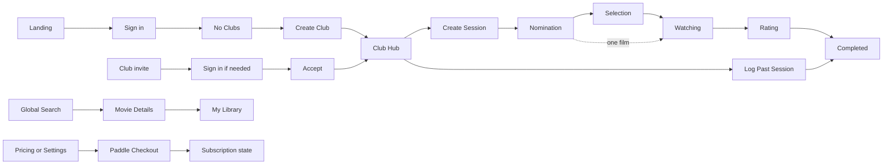

# PickFlick — Design

> The experience direction, screen behavior, components, and design QA. Exact visual values are
> implemented in `apps/frontend/src/styles/tokens.scss`; the canonical design package under
> `_docs/design/prototypes` stays their source.

| Owner         | Last reviewed                  |
| ------------- | ------------------------------ |
| Product owner | 2026-10-23 (Phase 12 accepted) |

## 1. Authority and sources

This document owns experience direction, visual foundations, interaction patterns, screen behavior,
and design QA. [ROADMAP.md](ROADMAP.md) owns scope, routes, and business rules;
[ARCHITECTURE.md](ARCHITECTURE.md) owns system boundaries. The design package owns exact tokens,
responsive compositions, and component appearance; production code implements them traceably.

When sources conflict:

1. A later explicit developer decision wins.
2. The design package beats the retired roadmap for product behavior and visual intent.
3. This document records where prototype fixture content is not a requirement.
4. Scope and technical topology never come from incidental prototype HTML.

| Source                                                                                                                  | Authoritative for                                                       | Note                                                      |
| ----------------------------------------------------------------------------------------------------------------------- | ----------------------------------------------------------------------- | --------------------------------------------------------- |
| [Package index](_docs/design/prototypes/index.html)                                                                     | Surface inventory and navigation.                                       | Static prototype, not production routing.                 |
| [Design system](_docs/design/prototypes/design-system.html)                                                             | Foundations, component states, navigation, forms, feedback, responsive. | Shows representative content.                             |
| [Exact design contract](_docs/design/prototypes/DESIGN.md)                                                              | Tokens, component rules, motion, accessibility, interaction.            |                                                           |
| [UX flow map](_docs/design/prototypes/ux-flow-map.html)                                                                 | Journeys, roles, branches.                                              | The Roadmap resolves permissions and edge cases.          |
| [Responsive baselines](_docs/design/prototypes/responsive-baselines.html)                                               | S/M/L/XL composition.                                                   | Representative widths, not the only tested ones.          |
| [Asset catalog](_docs/design/prototypes/asset-catalog.html) and [manifest](_docs/design/prototypes/asset-manifest.json) | Prototype asset usage.                                                  | Film images are fixtures, not licensed production assets. |
| [Brand specification](_docs/design/prototypes/brand-spec.md)                                                            | Brand intent and mascot use.                                            |                                                           |
| [Package handoff](_docs/design/prototypes/FINAL-PACKAGE.md)                                                             | Canonical and superseded files.                                         |                                                           |
| [Production brand assets](assets/brand/README.md)                                                                       | Reusable mascot and logo files with semantic names.                     | `panda-invited-2.webp` has English text baked in.         |

**Status values.** Design: `None`, `Draft`, `Approved` (the product owner accepted the direction).
Build: `Not started`, `Partial`, `Done` (the documented contract is implemented). QA: `Not checked`,
`Passed`, `Issues` (`Passed` needs a recorded comparison and baseline evidence).

The design package is approved as direction. Foundations, shells, public pages, Login, Club
onboarding and settings, delivered Hub views, read-only Movie Details, Session creation,
Nomination and Selection are implemented. Remaining Hub views and later-phase screens are still
unbuilt. A good-looking prototype is not production QA; the owner accepted the delivered screens in
Phase 12 (2026-10-23), and each later screen needs its own review.

## 2. Experience direction

- **Users:** friends running recurring movie nights, people building a personal film memory, Club
  Admins and Moderators running Sessions, and App Admins operating the service.
- **Core experience:** the current Club, screening, phase, progress, next action, and lasting result
  always feel connected.
- **Character:** editorial, cinematic, nocturnal, premium but friendly; high-contrast monochrome with
  restrained warmth and expressive panda art.
- **Voice:** short, human, lightly theatrical, film-aware. Privacy, billing, errors, permissions, and
  destructive actions are plain.
- **Non-goals:** generic SaaS dashboards, gold on every primary action, admin chrome in member flows,
  hover-only behavior, anonymous participation, and desktop layouts squeezed onto phones.

| Principle                     | In practice                                                                                                                |
| ----------------------------- | -------------------------------------------------------------------------------------------------------------------------- |
| One screening story           | Nomination, Selection, Watching, Rating, and Completed are states of one Session page, not separate pages.                 |
| Context before action         | Every mutation shows the Club, Session, role, phase, effect, and recovery path.                                            |
| Noir structure, warm meaning  | Monochrome carries layout and hierarchy; ivory and gold mark ratings, achievements, selection, invitations, focal moments. |
| Mobile is recomposed          | Navigation, tables, controls, and hierarchy adapt to touch; horizontal page scrolling is never the fallback.               |
| Progress without pressure     | Participation counts are clear, but unfinished Rating never blocks the next Session.                                       |
| Visible, enforced permissions | Unavailable actions are hidden, disabled with a reason, or replaced by a safe state; the server is the real boundary.      |
| Reuse the cinematic language  | Film strips, call sheets, sprockets, status banners, and mascot scenes recur instead of being reinvented.                  |

## 3. Foundations

Tokens live in [`tokens.scss`](apps/frontend/src/styles/tokens.scss) and components in
[`components/ui`](apps/frontend/src/components/ui), both traceable to the
[design contract](_docs/design/prototypes/DESIGN.md). Never copy partial token sets into features.

Active action feedback uses one 350ms scale pulse, starting on primary pointer-down or the
control's activation key (Enter/Space as applicable). Hover keeps the existing color, background
and border transitions without scaling or a wave. Default native controls use a 5% peak,
shared Buttons/ButtonLinks 8%, Achievements filters 10%, and icon controls, score/star options,
checkboxes and Switch tracks 12%. Scale is independent of existing translation and rotation.
Hidden inputs animate their visible mark; trailer Play animates only its ring. No animation runs
just because a control mounts or starts selected. Disabled, busy, read-only and inert controls
do not pulse; reduced motion suppresses the effect and stops running pulses. The UI provider
installs one delegated listener pair, including controls in portals. A manual desktop check confirms
350ms pulses and return to rest on the Achievements filter and Movie Details rating trigger.
Computed CSS timing accepts both milliseconds and seconds. Full cross-device/automated verification
remains deferred until the case-by-case fix round ends.

All adjustable press parameters live in `tokens.scss`: duration, easing, peak offset and the four
strengths. Components only choose a strength or mark a visible surface; `PressFeedback` owns the
single keyframe sequence and input handling. Tabs animate their inner label rather than expanding
the scrollable tab frame. Hub section navigation suppresses vertical overflow while retaining
horizontal scrolling for genuinely long tab lists.

Temporary Button success feedback keeps the variant's normal palette, including on hover and
keyboard focus. Only the original label and confirmation crossfade/slide; success does not
recolor the button. Enabled Settings checkboxes, Switch tracks and Past Session attendee chips
respond to hover with background/border changes over the shared 150ms local timing, without
growth or changing checked values. Disabled controls retain their unavailable appearance.

Loading visuals compose the shared UI `Skeleton` primitives: text, title, avatar, poster, control
and block. The primitive owns the shimmer, tones and reduced-motion behavior. It
can measure already-authorized text in an invisible inline box, preserving its font, wrapping
and height while painting the shared skeleton over it. Decorative loading content is inert.
The primitive uses a Mantine Box span so it also fits inside headings and inline labels.
`LoadingState` owns the accessible loading status and wraps a content-shaped skeleton that its
route owns; skeletons two routes share sit in their component group. Hub has separate Overview,
Sessions, Ratings, Members, Achievements and Manage Club fallbacks. Members shows only list rows,
without a placeholder for an absent top action. My Library uses table layouts
for My Ratings/Watchlist, the achievement shelf for Achievements and eight statistic placeholders.
Library table fallbacks have no visible count row. My Ratings reserves a right-aligned 44px square
score control; Watchlist reserves the same fixed-width priority control as its loaded table.
Shared Table empty/no-match rows use centered 14px body text in secondary color. They span the
table and never inherit the first rank/participant column's typography or color.
My Ratings, Watchlist and Club Ratings also use the shared table-skeleton rows while search,
sorting, pagination or Clear filters navigation is pending. Keep the current row count (one
placeholder for an empty table), mounted search/header/pagination and local scroll container.
The table is busy and placeholder tbody is inert/assistive-hidden; real controls keep their
existing pending guards, while search remains usable for newer input. Native link navigation
retains modifier/new-tab behavior through ButtonLink's Next onNavigate forwarding.
Achievement filter placeholders reserve the actual counter line height from `--fs-app-title` and
`--lh-title`, the label line and 24px vertical padding; their four-column grid becomes two below
576px, matching the live summary rather than using generic 100px card geometry. The gap from
filters to the achievement shelf is 32px (`--gap-lg`), matching the live summary's bottom spacing.
The shelf retains three columns from 768px and two below, 80/64px medals, the actual description
slot and 5px progress track. Overview, statistics and Members mirror their real padding, type
slots and horizontal phone composition. Hub loading reads the frame's existing authorized snapshot
for conditional actions and rows. Club Ratings/My Ratings/Watchlist use the real Table with five/six
columns and native local scrolling, no posters, and the real pagination geometry. Manage Club
reserves its session cards and distinct Info, Visibility/range, Members and Danger sections.
Library query-tab content has a keyed Suspense boundary and statistics stream independently.
Session card loading modes share the live 104px minimum; Hub Session/History rows and their
skeleton counterparts use matching 12px vertical padding.
Numeric/filter and title placeholders center the shared 24px/14px strips inside their original
line boxes instead of filling the full line height. Achievement description strips have an 8px
row gap; outer card sizes, padding and section spacing stay matched to the live content.
Movie Details and Session loading share the live MovieMedia layout and TicketPoster geometry,
including the phone ticket, tablet credits beside the poster, trailer after synopsis on compact
screens and Session's wider desktop credits. Search retains its count slot, five rows and shimmer.
Session loading reuses the real Nomination, Selection, Your rating, Facts and Results components
in inert loading modes; saved/read-only states, absent sections, author privacy and scale bounds
come from the authorized Session response. Headers share the real host/ticket classes, and the
reel break, Session Details heading, facts rows and results header slots retain their live spacing.
Until the authorized Session response supplies the phase, the route shows a
neutral heading skeleton. A nested Suspense boundary then shows that phase while roster and film
load in parallel. Existing sign-in, denial, unavailable-film and recovery behavior is retained.
These changes are source-reviewed only; visual and automated verification remain pending.
Content-loading fallbacks for Log a Past Session, related films and the initial notification list
also use shared skeleton paint. The past-session fallback preserves the real scene/card, step bars
and first-step fields, using TextInput/Textarea loading modes that overlay the native control box
while retaining labels/help slots. Related cards reuse their real grid and poster aspect ratio;
notification placeholders reuse the actual row/icon/message/time spacing. Loading announcements
remain visually hidden. Invitation checking and explicit action-progress states retain their copy.

| Area                | Contract                                                                                                                                                                                                                                                                                                                                                                                                  | Source                                                                   | Build   | QA                                     |
| ------------------- | --------------------------------------------------------------------------------------------------------------------------------------------------------------------------------------------------------------------------------------------------------------------------------------------------------------------------------------------------------------------------------------------------------- | ------------------------------------------------------------------------ | ------- | -------------------------------------- |
| Color               | Dark only. The `#0c0c0c` family for structure, neutral text and borders, ivory and gold `#C89B55` for warm emphasis. Pages use a flat `--bg`. The warm spotlight belongs only to the Landing, Pricing, and legal heroes, the Login scene, and the no-Clubs and error stages; form scenes use the neutral `--accent-glow`. Small text on surfaces uses `--fg-secondary`, because `--muted` fails AA there. | [Color tokens](_docs/design/prototypes/DESIGN.md#color-tokens)           | Done    | Screenshots                            |
| Typography          | Iowan/Charter/Georgia-style display, system sans for product copy, mono for metadata and status.                                                                                                                                                                                                                                                                                                          | [Typography](_docs/design/prototypes/DESIGN.md#typography)               | Done    | Screenshots                            |
| Spacing and layout  | Shared scale, containers, gutters, sectional rhythm, flat hierarchy, deliberate negative space.                                                                                                                                                                                                                                                                                                           | [Layout](_docs/design/prototypes/DESIGN.md#layout)                       | Done    | Screenshots                            |
| Breakpoints         | S below 576, M from 768, L from 1024, XL from 1400; the gaps between them are tested too. Stylelint allows only these boundaries.                                                                                                                                                                                                                                                                         | [Responsive baseline](_docs/design/prototypes/responsive-baselines.html) | Partial | Overflow at 7 widths for built screens |
| Radii and elevation | Restrained radii, low-contrast borders; elevation belongs to overlays, tickets, and cinematic scenes.                                                                                                                                                                                                                                                                                                     | [Design system](_docs/design/prototypes/design-system.html)              | Done    | Screenshots                            |
| Icons               | Fine-line, consistent strokes; actions have accessible names; decorative sprockets and film glyphs are not semantic.                                                                                                                                                                                                                                                                                      | [Components](_docs/design/prototypes/DESIGN.md#components)               | Partial | Not checked                            |
| Imagery             | Transparent noir panda art cues emotion and scene; provider film images are data, not brand chrome.                                                                                                                                                                                                                                                                                                       | [Brand assets](assets/brand/README.md)                                   | Done    | Not checked                            |
| Motion              | Short feedback and reveals, nothing that jolts layout; reduced motion honored and focus preserved.                                                                                                                                                                                                                                                                                                        | [Motion](_docs/design/prototypes/DESIGN.md#motion--animation)            | Done    | Automated                              |

| Baseline      | Contract                                                                                                                                                                   |
| ------------- | -------------------------------------------------------------------------------------------------------------------------------------------------------------------------- |
| Accessibility | Semantic controls, visible focus, keyboard-operable tabs, menus, dialogs, and ratings, focus trap and return, live regions, contrast review, 44px targets, reduced motion. |
| Localization  | English MVP; externalize copy, use locale-aware dates, numbers, and currency, tolerate longer text, and bake no text into new images.                                      |
| Overflow      | Wrap by default; truncate only when the full text stays accessible; tables scroll in their own container; test long user and provider text.                                |
| Input         | Mouse, keyboard, and touch are first-class; hover only enhances. The browser and device matrix is finalized in Phases 22–24.                                               |

## 4. Structure

### Shells and navigation

The shells live in `apps/frontend/src/components/shells`, one folder per shell or navigation piece.
`/shell-preview` shows the public, setup,
product, Session, Settings, Library, and App Admin compositions without feature data; the shells
default to the product routes and the preview supplies its own route map.

| Context              | Shell                                                                                                                                                                                                                                                                                                                                                                    | Responsive behavior                                                                                                                                                                                                                                                                                                                                                                                             | Source                                                                                                                                               |
| -------------------- | ------------------------------------------------------------------------------------------------------------------------------------------------------------------------------------------------------------------------------------------------------------------------------------------------------------------------------------------------------------------------ | --------------------------------------------------------------------------------------------------------------------------------------------------------------------------------------------------------------------------------------------------------------------------------------------------------------------------------------------------------------------------------------------------------------- | ---------------------------------------------------------------------------------------------------------------------------------------------------- |
| Public               | Brand header with How it works, Features, Pricing, and a small secondary Go to App; a wordmark-and-tagline footer with How it works · Privacy · Terms · Contact; cinematic sections.                                                                                                                                                                                     | No bottom menu. Below 768px the header holds the brand and Go to App (44px); the links join from 768px, and the landing price block offers "Compare plans". The footer stacks. Contact uses a focused form scene with Back and omits the full marketing header/footer.                                                                                                                                          | [Landing](_docs/design/prototypes/landing.html), [Pricing](_docs/design/prototypes/pricing.html)                                                     |
| Auth and setup       | A focused cinematic scene, minimal escape navigation, one task card.                                                                                                                                                                                                                                                                                                     | Art and form reorder and scale without hiding context.                                                                                                                                                                                                                                                                                                                                                          | [Login](_docs/design/prototypes/login.html), [Invite](_docs/design/prototypes/invite.html), [Create Club](_docs/design/prototypes/create-group.html) |
| Product              | The brand links to the public home and Hub links to `/app`; the public footer appears on every page. Round 42px search, notifications, and avatar rings with 48px targets; 20px action glyphs and a 40px account avatar; search slides down over the header; notifications open a popover and the avatar a downward film strip; Club switcher, Call Sheet, product tabs. | A fixed four-column bottom bar: Hub (labelled with the current Club view), My Library, Alerts, Settings. Film strips rise above their trigger, stay inside the viewport, and keep the tail on the trigger. The Hub strip lists Club views only; Settings holds Profile, Notifications, Subscription, Privacy, Sign out, and Admin Panel for App Admins. With no Club, Hub offers Create a Club and Join a Club. | [Club Hub](_docs/design/prototypes/app.html)                                                                                                         |
| Session detail       | The product shell, phase banner, hero metadata and actions, phase content.                                                                                                                                                                                                                                                                                               | The primary phase action and progress stay above secondary detail.                                                                                                                                                                                                                                                                                                                                              | [Session family](_docs/design/prototypes/session-detail-nomination.html)                                                                             |
| Settings and Library | The product shell with local tabs or sidebar, tables and cards, stable feedback regions.                                                                                                                                                                                                                                                                                 | The sidebar becomes a menu; tables scroll in bounded regions.                                                                                                                                                                                                                                                                                                                                                   | [Library](_docs/design/prototypes/library.html), [Settings](_docs/design/prototypes/settings.html)                                                   |
| App Admin            | Protected sidebar, overview panels, searchable tables, settings, typed confirmations.                                                                                                                                                                                                                                                                                    | Complete on mobile through the admin menu and bounded tables.                                                                                                                                                                                                                                                                                                                                                   | [Admin Panel](_docs/design/prototypes/admin-panel.html)                                                                                              |

### Key flows

Nomination closes automatically when every active Club member has joined and nominated, with at
least two accepted participants, or when its deadline passes; Selection
closes when all accepted participants submit. Operators can close either phase early. Watching
moves to Rating only by hand; Rating closes when everyone has rated or an operator
finishes it.

The [UX flow map](_docs/design/prototypes/ux-flow-map.html) is the visual source; edge rules live in
the [Roadmap](ROADMAP.md#3-business-rules).

## 5. Screens and states

All canonical screens are MVP and approved as direction.

| Route / view                        | Purpose                                                                                                                                                                                                                                                                               | Source                                                                                   | Build                                                                                                                     | QA                                                                                |
| ----------------------------------- | ------------------------------------------------------------------------------------------------------------------------------------------------------------------------------------------------------------------------------------------------------------------------------------- | ---------------------------------------------------------------------------------------- | ------------------------------------------------------------------------------------------------------------------------- | --------------------------------------------------------------------------------- |
| `/`                                 | Explain the ritual and lead visitors to sign up.                                                                                                                                                                                                                                      | [landing.html](_docs/design/prototypes/landing.html)                                     | Done                                                                                                                      | Passed locally                                                                    |
| `/pricing`                          | Compare Free and Pro; enter checkout.                                                                                                                                                                                                                                                 | [pricing.html](_docs/design/prototypes/pricing.html)                                     | Done; checkout disabled until billing                                                                                     | Passed locally                                                                    |
| `/contact`                          | Send a short message with stable validation and success feedback.                                                                                                                                                                                                                     | [contact.html](_docs/design/prototypes/contact.html)                                     | Done                                                                                                                      | Passed locally                                                                    |
| `/legal/privacy`, `/legal/terms`    | Public entries that never present draft policy as approved.                                                                                                                                                                                                                           | Shared public shell                                                                      | Done; final legal copy pending                                                                                            | Passed locally                                                                    |
| `/login`                            | Sign in with an enabled provider and continue; signed-in Users go to `/app`. Apple is hidden while gated.                                                                                                                                                                             | [login.html](_docs/design/prototypes/login.html)                                         | Done for Google; Apple built but gated                                                                                    | Passed locally with Apple off                                                     |
| `/invite/club/[token]`              | Preview and accept or decline a Club invitation; expiry and sign-in.                                                                                                                                                                                                                  | [invite.html](_docs/design/prototypes/invite.html)                                       | Accepted in Phase 12                                                                                                      | Passed locally; owner accepted 2026-10-23                                         |
| `/app` with no Clubs                | Orient a new User and create or join the first Club.                                                                                                                                                                                                                                  | [app-no-clubs.html](_docs/design/prototypes/app-no-clubs.html)                           | Done; invitation links arrive with invitations                                                                            | Passed locally                                                                    |
| `/clubs/new`                        | Create a Club and choose its Selection scale.                                                                                                                                                                                                                                         | [create-group.html](_docs/design/prototypes/create-group.html)                           | Done: one slider for the `0..N` upper bound, explained by an InfoTip                                                      | Passed locally                                                                    |
| `/clubs/[clubId]`                   | Run and understand one Club across six Hub views.                                                                                                                                                                                                                                     | [app.html](_docs/design/prototypes/app.html)                                             | Active — Overview, Sessions/history, Ratings leaderboard, Members, Achievements and Manage Club                           | Existing views accepted 2026-10-23; Sessions/history exact-SHA review pending     |
| `/clubs/[clubId]/members`           | Active roster, current role, member removal confirmation, and adminless/read-only notices.                                                                                                                                                                                            | Members view in [app.html](_docs/design/prototypes/app.html)                             | Active                                                                                                                    | Phase 12 contract checks; owner accepted 2026-10-23                               |
| `/clubs/[clubId]/settings`          | Manage Club info, visibility, scale, roles, lifecycle, and destructive actions.                                                                                                                                                                                                       | Manage Club view in [app.html](_docs/design/prototypes/app.html)                         | Done for the Phase 5 foundation; the full Hub arrives in Phase 7                                                          | Passed locally (Admin, Member, archived)                                          |
| `/clubs/[clubId]/sessions/new`      | Create a full-cycle or pre-selected Session and share its member-only join link.                                                                                                                                                                                                      | [create-session.html](_docs/design/prototypes/create-session.html)                       | Accepted in Phase 12                                                                                                      | Local QA passed; owner accepted 2026-10-23                                        |
| `/clubs/[clubId]/sessions/past/new` | Record a past screening with partial evidence.                                                                                                                                                                                                                                        | [create-past-session.html](_docs/design/prototypes/create-past-session.html)             | Active — screening, attendees, imported ratings and partial nomination/score evidence                                     | Exact-SHA hosted preview and owner review pending                                 |
| Session — Nomination                | Choose one film, see allowed nominations, follow progress.                                                                                                                                                                                                                            | [session-detail-nomination.html](_docs/design/prototypes/session-detail-nomination.html) | Active for the delivered flow                                                                                             | Responsive and accessibility checks passed; owner accepted 2026-10-23             |
| Session — Selection                 | Score every nomination, submit once, follow progress.                                                                                                                                                                                                                                 | [session-detail-selection.html](_docs/design/prototypes/session-detail-selection.html)   | Active — ballots, closure and policy-filtered outcomes                                                                    | Responsive and accessibility checks passed; owner accepted 2026-10-23             |
| Session — Watching                  | Focus on the film; an operator opens Rating.                                                                                                                                                                                                                                          | [session-detail-watching.html](_docs/design/prototypes/session-detail-watching.html)     | Active — film, context, joined roster and operator-confirmed Rating opening; owner review pending                         | Base accepted 2026-10-23; new action awaits preview review                        |
| Session — Rating                    | Submit 1–10 with an optional comment; see permitted results and rivals.                                                                                                                                                                                                               | [session-detail-rating.html](_docs/design/prototypes/session-detail-rating.html)         | Active — form, saved response, progress, partial completion and permitted results; owner review pending                   | Four widths, axe, keyboard/touch passed; owner review pending                     |
| Session — Completed                 | Keep the screening, ratings, rivals, attendees, and notes.                                                                                                                                                                                                                            | [session-detail.html](_docs/design/prototypes/session-detail.html)                       | Active — film, screening facts, historical ratings/comments and permitted nomination breakdowns                           | Exact-SHA hosted preview and owner review pending                                 |
| `/library`                          | Search personal Ratings and Watchlist; personal statistics and achievements.                                                                                                                                                                                                          | [library.html](_docs/design/prototypes/library.html)                                     | Active — searchable Ratings/Watchlist tables with sortable headers and shared editors; statistics and achievement shelves | Exact-SHA hosted preview and owner review pending                                 |
| `/movies/[movieId]`                 | Inspect a film, edit Personal Rating and Watchlist, discover related films.                                                                                                                                                                                                           | [movie-details.html](_docs/design/prototypes/movie-details.html)                         | Details, trailer player, links, Personal Rating and Watchlist priority editors implemented                                | Details accepted 2026-10-23; editor QA recorded in Phase 15; owner review pending |
| `/settings`                         | Profile, notifications, subscription, Privacy & data, import/export.                                                                                                                                                                                                                  | [settings.html](_docs/design/prototypes/settings.html)                                   | Partial — Profile and Appearance implemented; remaining sections Proposed                                                 | Local 390/1440 checks passed; hosted owner review pending                         |
| `/admin`                            | Operate Users, Clubs, metrics, and settings.                                                                                                                                                                                                                                          | [admin-panel.html](_docs/design/prototypes/admin-panel.html)                             | Not started                                                                                                               | Not checked                                                                       |
| `not-found`, `error`                | Recover from missing routes and failures. Signed-in visitors get the product shell with Back to Hub (500 adds Try again); signed-out visitors get the public shell with Back to main. If the root layout itself fails, a plain Projector Malfunction page with Try again replaces it. | [error.html](_docs/design/prototypes/error.html)                                         | Done                                                                                                                      | Passed locally                                                                    |

"Passed locally" means the Playwright suite passes at 390 and 1440 pixels plus overflow checks at
every breakpoint and gap width.

### Screen rules

The prototypes show composition and appearance. These rules add the behavior they cannot show and
record where production deliberately differs. Pixel values live in the prototypes and tokens, not
here.

#### Product shell

- Public and product headers share one height: 73px, and 63px below 1024px, so moving from the
  site into the app does not shift the page. Both slide away while the page scrolls down and
  return on any scroll up; they stay near the top, while focus is inside them and while one of
  their menus or panels is open. The phone bottom bar never hides; reduced motion drops the slide.
  Sticky section menus rise with the hidden header instead of leaving its height empty.
- Below 1024px the product header places its compact panda/wordmark in one row at the left and
  search/actions at the right. Phone gutters remain 16px; header actions use 48px targets. The desktop
  header retains its existing layout. All header wordmarks share the home page's 19px display-serif
  style, including mobile; the product header has no smaller type override.
- The public footer stays on every product page, phones included, because it carries the legal and
  contact links. It sits at the bottom of short pages, and below 1024px its links end above the
  floating invite ticket while the ticket shows.
- The bottom bar's Hub strip lists the Club's sections wherever a Club is in context, the Session page
  included; without one it offers Create and Join on the onboarding Hub and a Club Hub link elsewhere.
  Choosing a strip link closes the strip.
- Back to Hub and other in-header actions use the shared small button, with its hover and focus.
- The account film strip lists Settings, Privacy & data, Pricing, Contact Us and Sign out, with Admin
  Panel first for App Admins. Movie Details marks no header destination as current.
- The header account control uses the stored Google profile photo, grayscale at rest and in color
  on hover, focus or while its menu is open. Initials remain during loading or after an unavailable
  photo. The existing 34px circle, 44px target, accessible name and account menu remain unchanged.
- Search, notifications and film-strip menus move focus inside when they open, also under reduced
  motion, and return it to the trigger when they close.

#### Club Hub

- Club Hub and My Library share one 32px (`--gap-lg`) gap from section navigation to the first
  panel element. SectionTabs owns this through its panel padding, including loading/error content;
  Members, Achievements and Manage Club add no separate top offset. Below 768px the top tabs are
  hidden and the panel retains the same 32px inset after the preceding shared content.
- Tabs with a single main section do not repeat the selected tab name as a visible heading:
  Members and Achievements in Club Hub, plus My Ratings, Watchlist and Achievements in My Library.
  Semantic headings remain visually hidden for accessible section names and existing focus return.
  Members centers a 200px-wide outlined Invite action below the list on every screen size;
  viewers without invitation permission get no empty action row.
- Overview, Sessions, Ratings, Members and Manage Club share one mounted frame with the Club switcher and Call Sheet.
  Each panel rechecks authorization and refreshes the frame's snapshot; its links keep the scroll
  position. Below 768px the section tabs give way to the bottom bar's Hub strip. A section switch
  answers at once: the strip closes, the current section moves and a card skeleton holds the panel
  until the server responds.
- The carousel ends with Create new club. The caption shows member count, the count of Sessions that
  were not cancelled, and the founding month and year; description, plan, role and scale stay in
  their own panels. Names wrap by whole words and stop at three lines. Phones show position dots and
  switch Clubs with a clearly sideways swipe over the name as well as the arrows; wider screens hide
  the dots. The selected clean-arrow treatment uses full-shaft arrows without circular frames or
  hover-dependent visibility: 32px icons on desktop, 28px on phones, with 48px hit targets.
  The Club heading and Create new club share one stable layout slot. Leaving Create for another
  Club retains that slot until the destination frame is ready, without revealing the previous Club.
- The Call Sheet opens the current Session from every section, for participants too. Without one it
  keeps the sheet's frame: "No screening scheduled", the projectionist panda in the still and, for
  eligible Admins and Moderators, a compact Schedule New action in its header. The empty-state
  header hides the redundant Current phase / none metadata on phones, keeping Call sheet and
  Schedule New on one row. There is no full-width creation button in the main scene.
  The active Call Sheet is unchanged. Its number is the Club-local creation order, cancelled
  Sessions included. The call-time slot shows the optional venue time, otherwise the location (two lines
  at most), never a fabricated midnight. Topics stop at two lines.
- The Call Sheet still uses cached Movie artwork or an explicit missing-image state, never fixture
  film data. Before a film is selected it shows the choosing panda rather than a nominated poster,
  because nominations stay behind the Club's visibility settings.
- Overview shows all seven statistics on every plan. Known empty
  counts are zero; missing or hidden extended values show `—`. Metadata summaries require complete
  cached coverage and use current cached details. In the Active Session card only its button acts: Open Session for participants, Join me!
  for an eligible member. The card stays beside Members when no active Session exists: eligible
  Admins and Moderators get icon-labelled Schedule New and Log Past buttons in one row; other members see only
  "No active Session." Session history lives in the Sessions tab.
- Overview's Members pills use the shared Avatar with the authorized member avatar URL and initials
  fallback. Photos stay grayscale, including hover, without ColorReveal; retain the existing 28px
  avatar frame, member names and admin labels. This differs from the full Members tab's ordinary
  hover-to-color behavior.
- Ratings shows the Movie leaderboard on every plan with rank, Film, Year, Genre and one-decimal Rating.
  Highest rating is the default. A centered title search is capped at 480px and fills the available
  phone width. Search replaces the dropdown toolbar; the section adds no extra top padding beyond
  the canonical tab spacing. Film, Year, Genre and Rating headers sort on click: ascending, descending,
  then the default order. Clicking another header while a sort is active also resets to default.
  Active direction is visible and exposed through aria-sort; header labels are vertically centered.
  Sorting and search reset pagination; URL state survives reload and sign-in. Pages contain at most 25 films,
  stable Movie ties keep their order, and the shared table scrolls locally on phones. Its scroll
  region is keyboard-focusable and Film links have 44px targets. Previous/Next use the same clean
  full-shaft arrows as the Club switcher, with 48px targets and disabled page bounds. Loading announces progress;
  offline sorting preserves the current rows with feedback. Invalid filters, unavailable service,
  denied access and no published ratings have explicit recovery or empty copy. Ratings contain no individual scores or comments and only use
  completed results the current role may view. Exact-SHA hosted preview and owner review remain
  pending for this delivery; local captures do not establish visual acceptance.
- Manage Club's Active Session gives Admins and Moderators the gear menu's controls: Start next phase
  (Selection, or Watching for a single nomination or after Selection), Kick participant and Cancel
  Session, with the same typed confirmations. Watching offers Start next phase: Rating through the shared Open Rating dialog.
- Members follows the History list: unframed rows with separators only between entries, a 40px
  photo/initial avatar beside the name, role below it, then the display-serif Session count and
  permitted removal action at the right. Names wrap within the remaining phone width; rows retain
  the existing hover treatment and 44px action targets. Members opts out of the radial reveal: avatar photos
  regain color through the ordinary 150ms filter transition on row hover/focus.
  The shared Avatar also supplies the 24px AvatarGroup images and 32px header account image, with
  the same initials fallback. Other avatar consumers retain the shared reveal. Members shows each role and the accepted
  participations, excluding cancelled Sessions. Admins
  remove Members or Moderators, Moderators remove Members, and Members leave through Manage Club.
  Removal needs `REMOVE`, keeps shared history and returns focus to the Members heading. Session
  counts stay in one column whether or not a row has a remove control. Role changes happen in the
  Manage Moderators dialog: Members and Moderators form two lists, with one Save enabled only
  when roles change. Invite opens the shared invitation dialog. Dates read as `Oct 21, 2026`.
- Club Info holds the avatar beside the Club name: clicking it picks an image with a preview,
  and Save Changes uploads it with the other fields. The heading tooltip contains image formats,
  size/private-storage requirements and upload instructions; there is no separate Avatar caption.
  Settings owns the Selection score range below its visibility tabs, before Save Changes. The slider keeps its numeric
  value and accessible value text without a repeated Members score nominations caption. Each form
  sends only its own fields, so saving one card never resets the other.
  Settings uses neutral
  During Session/After Session tabs with three visibility checkboxes in each. Both panels stay
  mounted so saving either tab retains all six values. Appearance is not a Club-level control.
  Settings has an adjacent tooltip saying “These rules apply to everyone.” No explanatory paragraph
  or applies-to-new-Sessions line is shown. Save Changes remains at the card's base.
  The shared tab list keeps its active underline inside its bounds and never scrolls vertically.
  Hub failure actions use a wrapping flex row with the standard gap between Retry and Back.
- The last row pairs two compact cards of equal height: Members (places in use, Invite members, and
  Manage Moderators for the Admin) and the Danger Zone (one line, then Archive or Reactivate and
  Delete, or Leave).
- Manage Club's Active Ratings matches the prototype rows: title/date and response count at the
  left, an outlined Finish Session action at the right, and separators between rows. The action
  reuses typed CLOSE confirmation and server-projected permission/version data; failed or changed
  Session reads offer per-row Refresh. Phones stack the action beneath the screening facts.
  Members puts occupied/available places beside its title instead of repeating a sentence below.
  Admins always see Delete Club; Session history keeps it disabled, with the reason in the existing
  action tooltip and no separate explanatory line.
  The existing no-history deletion rule and typed Club-name confirmation are retained.
- Club settings provide six global controls (Nomination authors, named Selection scores and Session ratings,
  each During/After Session), available on all plans. During Selection/Rating,
  other submitted responses appear only after the caller submits their own response. After means
  Session Completed, and all visibility switches apply to Admins/Moderators as well as Members.
  Save Changes applies the current rules to existing, historical and future Sessions. The Settings
  rating switches are labelled Show individual ratings. Club averages stay visible independently
  of these switches and of the viewer's own submission; the settings tooltip states this.
  Legacy Session fields do not override the global rules. Authorized Selection matrices show participant names, film columns
  and missing imported cells as `—`; author-only nominations remain independent of score visibility.
  Read-only Selection scores use the shared Table matrix variant: a 24px/600 sans section title,
  a quiet scale label, ruled table edges and display-font score numerals. Participant and film
  headers reuse the shared ascending/descending/reset controls, with keyboard focus and aria-sort.
  Sorting is local to the received rows; ties retain their source order and missing cells stay
  last in either direction, distinct from zero. Phones retain the labelled local horizontal scroll.
  Film headers wrap at normal word boundaries and retain a longest-word minimum width; whole
  words never split merely to fit the viewport. Extra width stays inside the table's scroll region.
- All three views show the same adminless, archived and excess-member notices. Adminless Clubs
  explain the missing owner actions; excess-member Clubs keep history and participation but pause new
  Sessions and invites while roster recovery stays available.
- Invite members opens the shared gold ticket dialog and creates a single-use link with a
  12-hour expiry once per page view. Copy sits on the ticket stub; New link creates another.
  Recent links fold into an accordion and list short ID, status, expiry and Revoke. The current
  link survives closing and reopening the dialog; lifetime guidance lives in an info popover.
  A new link stays visible and revocable if the list fails to refresh. Active links are capped at the
  plan's member limit; managers can still inspect and revoke when creation is paused. Members and
  archived Clubs see no invitation controls.

#### Pending invites

- Club rows list recipient-targeted links with inviter, member count and expiry; shareable Club links
  stay in their own flow. Session rows are the caller's unanswered open Sessions with topic, Club and
  date, and have no token expiry. Accepting a Session invite opens the Session.
- Responding moves focus to Close before the row's controls change, so the trap and Escape keep
  working after the last answer. Loading, empty, retry and stale-invitation feedback are explicit.
- Failed reads show Temporarily unavailable in the header and a shared warning Alert plus a
  small retry button inside the padded body. Show Retry only after a failure; its pending state
  disables duplicate activation. Loading and error labels must not appear simultaneously.
- The ticket appears once an invitation or a loading failure exists, and then stays, so focus can
  return to it after the last answer; with nothing pending it never covers content. On phones it
  floats above the bottom bar.
- Its fixed clipping box stays inside the viewport even when hidden; only the ticket slides behind
  that edge. Hidden invitations never add horizontal page scrolling. The shared table similarly
  contains absolutely positioned accessibility labels inside its own scroll region.

#### Invitation pages

- Club invitations use one setup scene. The heading says "You are invited" because links reserve no
  capacity. The preview shows only Club name, icon-labelled member count and inviter, and Accept
  carries the prototype's check; signed-out and unsafe states omit Club details. Long names use a one-line ellipsis with the full name still accessible.
- Accept and Decline wait for hydration, show pending and retry feedback and keep the card's size.
  Success and already-member states open the Hub.

#### Notification inbox

- The shared desktop bell and mobile Alerts trigger open the same recent inbox. Reuse `app.html`'s
  344px panel, elevated neutral surface, heading with an inline unread-count badge, bounded scrolling list, event icons
  and small gold unread dots. Mobile centers the panel above the bottom bar. The existing overlay
  handles focus, Escape, outside dismissal and return to the trigger; another overlay closes it.
  Following a notification link closes the panel within the persistent Club frame. Reverse Tab
  from the panel after a read action wraps to its last enabled control.
- Notifications keeps unread count in a 22px round badge beside the title (99+ visually, full
  count in the live status); zero hides the badge and announces the caught-up state. Mark all as
  read uses the shared ghost/compact Button: 28px visual height, 11px label and an extended 44px
  hit area. The header uses 12px vertical padding and does not add a second count line.
- Linked rows and explicit unread-dot buttons have 44px targets. Marking one or all read updates
  the shared count; pagination stays inside the panel. Loading, empty, load/save failure, retry,
  offline, ended-session and paused-live-update feedback are explicit. UTC metadata accompanies
  static, authorization-aware copy; unavailable sources have no link.
- Local reference comparison covers 390 and 1440px. An exact-head hosted
  preview and owner visual acknowledgment remain required before #61 is accepted.

#### Interaction continuity

- Small interaction continuity: invitation URL fields select the complete link on focus. Club form
  entry links carry their originating view as an allowlisted `returnTo`; Back uses that view rather
  than losing the active Club tab. Direct visits keep the existing safe fallback.
- Selecting a Nomination film focuses Change; Change restores focus to the search field without
  submitting. Log Past step changes focus the newly mounted heading/legend, while validation keeps
  the existing invalid-field path. Review text keeps its layout with a transparent 44px hit area.
- Editing Session form values clears obsolete submit feedback. Notification retries use the shared
  Button loading state and retain the label footprint while refresh is pending.
- Session polling failures use a shared warning Alert inside the Session content width and gutters,
  in both the normal and unavailable views; recovery stays automatic. Notification failures use
  the same Alert with a separated retry action, without overriding shared Button styling. Library
  read/filter failures and Club Ratings invalid filters keep a standard gap before their recovery
  button. These states apply to production network/API failures as well as local restarts.
- Shared `HorizontalScroll` supplies decorative edge fades for application tables and Pricing's
  comparison table. Each fade appears only when more columns remain in that direction, updates on
  scroll/resize, does not capture pointers, and keeps the labelled keyboard-focusable scroll region.
- Page and internal native scrollbars share global thin/neutral styling from the initial stylesheet.
  Visibility/autohide follows the browser and OS; no scroll listener, timer or hydration attribute
  controls it. Forced-colors uses system styling. Modern scrollbar-color/width only.

#### Global search and Movie Details

- Header search reuses the product overlay. A 300ms debounce updates a bounded, locally scrolling
  panel with loading, empty, cached, provider failure, rate-limit, unconfigured and expired-session
  feedback; a new query clears obsolete results at once. Arrow keys move through results while focus
  stays in the combobox, Enter opens the canonical Movie route, and Tab and touch work too.
  Below 1024px its close control replaces Search at the exact same position: both use a 48px
  target, 42px ring and 20px glyph. The overlay shares the header's content width and phone gutters.
- Header search and all form pickers share `MovieSearchResults`: a 2px field-to-popup gap,
  320px panel (clamped on short viewports), 32px count slot aligned right, and 64px result rows.
  Loading uses five decorative skeleton rows and a count placeholder; results and empty/error
  states keep the same panel height. Empty copy is centered in the results body. Loading remains
  announced to assistive technology; reduced motion stops the shimmer. Rows include year and
  available English genres, retaining attribution and keyboard selection/navigation.
- Results fall back to an available source title; "Untitled film" means no title at all. Posters load
  lazily through authenticated same-origin URLs, with the neutral PF placeholder when missing.
- Movie Details shows title, then the Session header's meta line (year, runtime, language name and
  the italic genres), an action rail like the Session's (one rating to one decimal, IMDb else
  Kinopoisk, with a mark instead of the source name, which readers and the tooltip still get, or a
  dash; then Rate or the current Personal Rating) and the prototype's Watchlist ribbon on
  the poster's top-right corner, poster, directors, writers, up to five actors
  in one row, budget and worldwide revenue in compact US dollars, synopsis and a trailer player.
  Rows without data other than directors and actors are left out. On wide screens the poster and
  trailer share one height (3 : 8 columns), and the poster behaves as in Sessions.
  Session information below that row follows the prototype's three-column spans: credits cover
  the poster plus half the trailer region, and Synopsis occupies the remaining column. Movie
  Details keeps its separate equal-width information columns. Below 1024px the existing stacked
  information layout remains unchanged.
  Provider attribution stays with TMDB in search results only; where PoiskKino and TheTVDB are credited for
  public launch is decided in #89. Movie Details and Sessions share one loading skeleton of this
  layout. On phones the header is the same film ticket as in Sessions, with that rail as its stub.
  When the rail has no visible content, the header uses a continuous rounded outline and poster
  corners without stub cutouts or perforation. This follows available actions, not just the phase.
  There is no in-content Back. On phones each credit keeps its label and value on one row.
- Missing media, absent English synopsis, provider outage, rate limits, unconfigured catalog, partial
  and stale details each have explicit feedback. Related titles load separately: up to six
  provider-supplied links, grayscale until hover or focus, with no personalization claim.
- IMDb, Kinopoisk and Letterboxd links are built by the backend from verified identifiers (a
  PoiskKino ID is the Kinopoisk film ID; Letterboxd resolves the IMDb, else the TMDB, ID); Wikipedia
  is a title search. They are bordered pills with each source's one-colour mark and an outbound
  arrow, marks only on phones, followed by the dotted sprocket divider. The trailer card shows the
  selected video's cached YouTube thumbnail with a Play button; only pressing it loads YouTube's
  privacy-enhanced player in place. Up to three distinct video IDs are available through the shared
  clean arrows and a position counter, replacing the repeated Trailer pills. Switching videos fades
  in the corresponding thumbnail with the shared local motion timing; an unavailable thumbnail
  leaves a neutral cover with Play available. The chooser and Search YouTube link sit in the bottom
  footer. The preview image uses shared ColorReveal with its existing dim exposure; the Play ring
  and captions stay outside the effect. The controls
  disappear during playback. Play stays at the exact card centre independently of the
  footer or trailer name; the name sits at the top. Cached images that finish before hydration are
  revealed on attachment as well as on load. Provider trailers can be teasers or missing.
  One credit region covers the film and its related titles.
  Unknown Movies use the not-found page.
- Personal Rating opens a compact, focus-trapped popover containing one row of ten stars. Hover
  previews stars; arrows/Home/End, pointer and touch work. A settled selection saves automatically
  after 400ms. Own and historical rating displays show the score without a visible N/10 label;
  accessible names still announce the scale. Stars fit one row on phones.
  Keyboard focus uses a centered 28px square around the 24px SVG, independently of the taller
  hit target. Native button padding is reset and the icon/frame share the same center.
  Offline/API errors retain selection and show recovery feedback. Pending and success messages are announced without visible
  text. Successful saves update the header and survive reload.
  Escape or outside dismissal returns focus to the trigger. Personal edits preserve Session and
  Club history; a new live Session Rating sets the current opinion, while retries preserve later edits.

- Watchlist ribbons stay ivory while unsaved and become filled gold after a successful save.
  Hover and opening the popover keep the ribbon in place.
  Activating an unsaved ribbon saves Medium priority and opens the focus-trapped priority popover.
  Priority and Personal Rating popovers share a 336px maximum width, opaque surface, border and
  compact 8px outer padding. Priorities form one unframed row of 44px-high choices, with a warm
  selected state and a separate 44px removal control. There is no nested rounded group frame.
  Low, Medium and High buttons expose their saved state with `aria-pressed`; choosing a priority
  or Remove from watchlist saves immediately and closes the popover. Escape and outside dismissal
  return focus. Pending controls prevent duplicate submissions; pending and success messages are
  announced without visible text. Offline/API errors keep the saved state and show retry feedback.
  Successful changes refresh Movie Details and the Library.
- `/library` opens My Ratings; `?tab=my-ratings` and `?tab=watchlist` select the two sections in
  the control shell. Tables show rank, Film, cached Genre, Year, Rated on/Added on and the shared
  rating or priority editor. Missing metadata uses `—`; Film links open Movie Details.
- Library Film links use Club Ratings' 600-weight neutral text and pagination typography.
  My Ratings' numeric column aligns right and uses the same 20px display font as Club Ratings,
  inside a shared secondary 44px square button with normal hover/focus and its existing editor.
  Watchlist priorities use equal 112×44px outlined rectangles with 12px corners, consistent
  14px/500 body text, left-aligned labels and a trailing chevron. Low/Medium/High share the same
  geometry and weight; an open trigger has the normal gold border/rotated chevron. No visible
  films-rated/queued count row appears in either table; result totals remain assistive feedback.
- My Ratings and Watchlist reuse the centered 480px title search, sortable headers and arrow
  pagination from Club Ratings. Filter and sort dropdowns are removed. Film, Genre, Year,
  Rated on/Added on and Rating/Priority support the same ascending → descending → reset cycle;
  switching columns resets an active sort. The default stays highest rating or highest priority.
  Search applies after a typing pause or Enter, announces the result count and retains newer input while
  earlier responses arrive. URL state survives reloads and changes start at page one. Existing
  exact score/priority query links remain supported with a Clear filters recovery action.
  Each page contains at most 25 films, with Previous/Next bounds and counts.
- Tables scroll locally on phones; rating stars fit one row. Successful Library edits return focus to the
  section heading and announce feedback, including when the edit removes a filtered row. Loading,
  empty Library, no matches, invalid filters, unavailable/retry and sign-in recovery are explicit.
  Personal statistics appear above the local tabs on all Library views, independent of table
  filters. Eight bordered tiles use the canonical stat icons and a decorative panda backdrop;
  the four-column desktop grid recomposes into two columns below L. Genre/person names wrap fully,
  including unbroken text. Empty counts and watch hours show zero; absent averages and metadata
  summaries show an em dash. The summary has no standalone calculation tooltip or reserved footer
  row; empty statistics retain their invitation to rate a film. Loading uses the Library boundary; statistics failures show their own retry
  while the table stays usable. Existing editor revalidation updates the totals after saves.
  `?tab=achievements` opens the personal shelf, and the Club Achievements tab opens
  `/clubs/[clubId]/achievements`. Shared shelves use at most three columns from 768px and two
  below 768px. The current presentation uses medal groups separated by gaps, each with a thin
  neutral rounded outline and transparent background: a shaded
  circular badge with a double rim, status text, a wrapping display-serif title, description and
  progress below. Earned medals and their progress use gold-light; other states stay neutral.
  Badge sizes are 80px on wider screens and 64px below 768px. Existing criteria, evidence and
  private-progress rules are retained. Summary buttons use the shared 350ms press pulse with a 10% peak, with smooth
  checkbox color/check visibility and 35% opacity when off. They toggle Unlocked, In progress and Not started independently
  with `aria-pressed`; all start selected, and zero matches has explicit feedback. The completion
  tile counts visible-to-caller unlocked versions over all returned versions. Cards show an icon,
  status, description, bounded progress and expandable rule/version explanation. Earned versions
  show their UTC date. Members see only current private criteria, independent of earned history;
  these cards have no numeric progress and display their privacy explanation once, without expandable
  calculation details. Retired private award cards are omitted.
  Loading, unavailable/retry, empty and sign-in/Club-denied states reuse existing boundaries.
  World Tour uses recorded production countries; Silent Era uses a release year before 1930.
  Exact-SHA hosted visual review is pending.
  No fixture statistics or film content appear.

#### Personal Appearance — Partial

Personal Settings [#65](https://github.com/Shagon1k/PickFlick/issues/65) implements Profile and
Appearance at `/settings`. The desktop composition follows `settings.html`: heading and personal
account context, a 218px sidebar, 36px content gap, and one flat bordered card. Below 768px the
shared product Settings menu replaces the sidebar. The 72px profile avatar and upload actions
recompose vertically on phones. Shared form controls provide read-only email/provider and English
language information, name validation, offline/error feedback and live save status. Other Settings
sections remain Proposed under their owning issues.

Appearance saves per-user monochrome film/trailer media, Color reveal, quiet mode,
Comfortable/Compact spacing and one shared optional-column setup. Quiet mode has an adjacent
InfoTip and removes grain; current product surfaces have no continuous decorative motion apart
from loading indicators, which remain active. System reduced motion and action press feedback
remain independent. Disabling Color reveal cancels active masks and restores ordinary hover
feedback. Club Ratings, My Ratings and Watchlist retain ordinary table hover behavior.

Compact rows use shared tokens without changing fonts, 44px controls, or tab-to-content spacing.
Film and Rating/Priority columns remain available; optional Rank, Year, Genre and Date preferences
apply wherever those columns exist. The control keeps keyboard focus while saving and leaves
server sorting, filters and pagination unchanged. Tables keep local horizontal scrolling.
Existing Club/Session media fields remain legacy data; no shared history or privacy snapshot is
rewritten. Private personal uploads are served only through the account endpoint; existing shared
provider-photo permissions are unchanged.

Local rendered comparison and axe/overflow checks cover 390 and 1440. Representative baselines
and the remaining verification are tracked in [Phase 19 Settings](_docs/phase-19-settings.md).
The exact-head hosted preview still requires owner acknowledgment; local evidence is not final
visual acceptance.

#### Create Session

- The setup scene has a Back link, required date and location, optional topic and notes, the two live
  modes and an optional `hh:mm` Nomination duration. Date-only entries are stored at midnight UTC.
  Pre-selected mode replaces the deadline with catalog search and a removable selected Movie.
- Validation focuses the first invalid field; saving, offline and API failures keep the entries. A
  blocking Session or a Club or role restriction replaces the form with a recovery link.
- Success links to the new Session and the Hub. Creating or editing a Session refreshes the Hub and
  Session pages, so browser Back shows current data.

#### Session page

- Every phase is one page: the status banner, the heading with topic, notes and a relative Nomination deadline anchored to the request
  time, then the phase content, the reel separator with the phase mascot, and the facts.
- Invite copies the member-only Session link and confirms in its own label. Invite, the Settings
  gear menu and Join or Leave share one action rail of icon-and-label cells. The gear menu holds
  early closure, Edit, Kick and Cancel; on short screens its rows compact and it scrolls clear of
  the bottom bar. The strip centres under its trigger so its tab always sits mid-strip.
- Dialogs have no close icon: Escape, the overlay and their own Cancel or Close dismiss them. Edit is
  a focus-trapped form; Cancel, Kick and early closure keep typed `CANCEL`, `REMOVE` and `CLOSE`.
  Terminal Sessions have no edit or cancel controls. A phase change focuses the Session heading.
  Edit Session keeps the shared Modal padding; its mounted live-feedback paragraph reserves no
  height/margin while empty, so no invisible status row adds space below Cancel/Save.
- Participants appear only in the facts. Any current member may join from Nomination through Rating;
  a declined or departed participant can rejoin, but operator removal blocks self-join. Late
  Selection participants score the frozen films. Kick lists removable participants and can still
  revoke legacy personal links. Archived Clubs and terminal Sessions drop the controls they cannot use.
- The facts companion is the progress metric while Nomination or Selection is open, a coming-soon chat
  while Watching, and the Session average as Club score after Rating completes.

#### Nomination

- Search opens a dropdown over the card; selection keeps the same field dimensions and shows only
  the film title on one line, truncating long titles with an ellipsis. The full title remains
  available to assistive technology and in a native tooltip. Change and the explicit Nominate
  arrow sit inside the field, with reserved space before selection. Both use the same 44px subtle
  icon button, hover treatment and icon-only press feedback; the arrow is disabled until selection.
  Desktop Find & Nominate and Current Nominations panels share 20px padding and the Open Ratings
  24px/600 body heading. Find & Nominate sizes to its content with a 280px minimum; the adjacent
  Current Nominations matches its height and scrolls internally without expanding the row.
  Below 1024px the main panels stack with natural heights and a bounded nomination list.
- Inside Find & Nominate, below the picker, Try again and Watchlist are independent horizontal
  strips with smaller 16px h3 headings and explanatory InfoTips. They sit side by side, stacking
  below 768px while both remain inside the same Find & Nominate frame.
  Try again retains the caller's earlier losing nominations in this Club. Watchlist contains only
  that user's saved films, ordered High → Medium → Low, then saved date and Movie ID. Selecting
  either kind of suggestion uses the normal selection/Change/explicit submission flow.
- Current Nominations show posters, titles, cached genres and the nominator when the Club allows it.
  The whole item links to its Movie. Nomination items and suggestion cards use shared ColorReveal
  with grayscale at rest; suggestion buttons provide the same whole-card hover/focus feedback.
  Suggestion strips reserve space around cards for press enlargement and scroll horizontally only.
  Feedback stays inside the nomination card; a successful submission focuses its heading.
- Current Nominations, Your nomination and live/Logged Rivals reuse the shared
  `NominationMovieCard`; their lists use `NominationMovieList`. The 48×72px poster centers vertically,
  while title, 12px author credit and genre chips form one top-aligned block with 4px internal gaps.
  Rivals add an independent right-hand slot for a plain total or a 52px-minimum avg. button,
  without changing the text spacing or adding a phone footer. Ratings and rival avg./total numbers
  share History's 600-weight display font: 28px normally and 22px below 576px, controlled by the
  same font token and mirrored in loading states. Native full-card Movie links keep the avg.
  button separate and do not underline titles.
  Lists use an unconstrained inner equal-row grid inside a 300px-max scroller: all cards in a list
  match its tallest card, without fixed heights, clipping or a measurement controller. The 104px
  minimum and 12px card padding/radius remain. Nomination retains its three-genre limit; Rivals
  retain all supplied genres and the existing author/count visibility rules. Selection stays separate.
- After submission, the left panel becomes Your nomination, with a quiet check and
  Submitted · Waiting for selection status above the film. Omit the redundant by-you credit and
  the form's minimum height; the right panel remains the shared Current Nominations list.
- Empty history, hidden nominations, missing metadata, non-participant and read-only access, pending
  saves, failures, offline recovery and locked submission each have explicit copy.
- Early closure cannot close with no films; one film moves to Watching, several open Selection, and
  automatic completion requires every active Club member to have joined and nominated, with at least
  two accepted participants. Nomination progress uses the active Club member count. Deadline and
  operator closure keep their existing rules. Other clients poll a progress version, re-read the page
  when it moves (also on reconnect and focus), keep polling after a failed check with a visible
  notice, and recover through a transient "Session unavailable" page.

#### Selection

- Selection shows Your scores with a 24px/600 body heading and a brief instruction; viewers without
  a ballot or submission permission see Nominated films. Every eligible nomination gets a score row
  on the Club's scale (`0..N`, or a legacy `1..N`). Poster/title/metadata form one Movie link, separate
  from the score controls. The native Movie link stretches across the entire card; the separate
  score buttons sit above it and never navigate. Empty rail space, padding and gaps pass pointer
  hits through to the Movie link. Card feedback replaces title underlining, with
  a full-card keyboard focus outline and no row navigation handler or event-propagation workaround.
  Film text is top-aligned to the poster regardless of missing metadata.
  Compact layouts right-align the year beside the title; from 1024px it returns below the title.
  An optional nominator line and restrained genre chips follow. Cards reuse the
  Nomination border, 12px padding and radius, 48×72px posters and whole-card soft ColorReveal.
  On phones the poster stays beside the text, with the score rail below. Wide scales scroll locally;
  safe alignment keeps the first value reachable when centered/end-aligned content overflows. Scores
  keep 44px targets and support arrows, Home, End and touch; a score marks only the chosen option.
- A compact N/M count sits at the right of the section heading above the cards, with full scored
  progress/readiness announced to assistive technology. The scoring/finality InfoTip sits beside
  Your scores. Submit scores sits alone on a centered row below the cards, 250px wide or the
  available width on narrow screens, without a progress caption.
- Missing scores focus the first unscored film with live feedback; errors keep the input.
  Submission is final: a saved ballot keeps the same rows and rails with the choices marked, and
  shows Submitted · Waiting for other participants below Your scores. Submitted score choices stay
  fully opaque; other values recede and have no actionable hover. Archived Clubs and
  ineligible participants cannot submit, and the server filters nominator names.
- After closure a warm winner card links the Movie, names the permitted nominator and records how
  and when Selection closed. When allowed, the ranking shows totals, top-score votes, supporters and
  the deciding tie-break; hidden results show only the winner and why. Zero ballots are explained.
- Early closure confirms with `CLOSE`, states the received and pending ballots and returns focus to
  its trigger on cancel.

#### Watching

- A film header (linked title; year and runtime, then the genres in the display italic after a
  hairline) sits above the Movie Details media
  grid. The capsule is 28px high with 11px body text and centered 14×14px SVG icons from the shared
  library. Watching uses Play, Rating a star, Completed a check and Logged a clock; Logged keeps
  its existing InfoTip. SessionStatus overlays the poster's top-right at both desktop and phone
  sizes; unavailable film metadata retains an inline fallback. The capsule replaces the separate
  uppercase phase stamp and live dot.
  From 576px the action rail keeps icons and labels inline; below it
  the header becomes the shared film ticket: the poster carries title, meta, an info mark and the
  stamp, and the rail is its stub, joined by a perforation with outlined notches. The rail shows
  only the viewer's actions: Invite, Settings for Session managers, and Join or Leave. The media
  poster links to Movie Details, mostly grey at rest (softer than the prototype's full grey);
  colour, a slight zoom and its caption arrive together on hover. When the meta line cannot fit, the
  genres take a second line, both lines centre and the hairline goes. When film details are
  unavailable the phase stamp stays and the warning links to the selected Movie.
- Admins and Moderators in writable Clubs open Rating from Settings → Open Rating, or the same
  dialog in Manage Club. Typed `OPEN` confirms that the screening is finished and frees the Club
  for another Session. Cancel or Escape keeps Watching and returns focus; success focuses the
  Session heading. Pending, offline, stale-phase, lost-access and API failure feedback stays in
  the dialog. Members and read-only Clubs have no Rating-opening control.
- The Watching banner shows accepted participants out of all active Club members. The accepted
  roster supplies participant names. Page activity,
  joining, polling and elapsed scheduled time never open Rating. Rating submission and completion follow the rules below.

#### Rating and completion

- Rating reuses the film header and media, with accepted-participant progress above the header.
  Its fixed 1–10 star control supports arrows, Home, End, pointer and touch; ten stars fit one row
  on phones with at least 24px width and 44px height. The optional comment is limited to 2000 characters.
- Your rating follows the prototype's transparent outlined card: up to 720px wide, responsive
  padding and a 72px gold line on its top edge. A small mono heading precedes neutral ivory stars,
  an 80px-minimum transparent comment field up to 480px wide, and a centered submit control with
  the existing finality InfoTip. Visible N/10 labels stay omitted. During Rating, the same card
  shows the saved historical score after submission. Ineligible non-participants do not get a form.
  Mobile star rails remove horizontal gaps/padding so icons fit the narrower card without page scroll.
- Submit is final. Pending saves lock the form; validation focuses the rating control, and API or
  offline errors retain the score and comment. Success shows the saved score in the same personal
  card and the own row at the top of the results list, labelled You without a Final tag or special card colors.
  The response stays immutable even though the list omits the lock badge. Reviews show one line and open
  in a popover; a small chevron indicates this action and rotates while open. Below 576px,
  Review and Selection-details popovers use the available viewport width with 20px side gaps
  and an opaque surface, keeping contextual vertical placement with flip/shift. Desktop widths
  remain compact. The existing progress poll refreshes other clients.
- Positive N/N completion is automatic. Session Settings offers Close Rating early to authorized
  operators, with received/pending counts and typed `CLOSE`. Cancel or Escape preserves Rating and
  returns focus. Failure preserves the dialog and confirmation; success focuses the Session heading.
- Other individual responses appear only when the current Club period policy permits
  them; live disclosure additionally requires the caller's own submitted rating. Club averages
  remain visible independently in Rating, Completed and Logged Sessions, History/activity,
  statistics and the Club Ratings table. No received ratings uses a dash. Hidden individual results,
  no received ratings, non-participation and read-only Clubs have explicit text. The caller's own
  response stays visible. Completion removes further submission and management controls.
- Rating and Completed share SessionResults after the film and stable screening facts: individual
  ratings/comments and historical nominations. The latter identifies the winner and exposes
  permitted aggregate vote totals, top-score votes and supporters through keyboard-operable
  disclosures. Pre-selected screenings explain the absence of nominations and votes. Empty,
  partial and hidden results never invent responses. Catalog titles and account display names
  remain current; saved choices, scores, scale and closure information remain historical.
- When Rating has no available rows yet, the Ratings panel keeps its position and shows a dash
  with In progress. Already permitted results and the own response still follow the server's
  visibility policy. The permitted Selection matrix follows the panels in both phases.
- Completed replaces the header's standalone phase label with readonly Club, historical Session
  You and Global rating cells, adapting the shared Movie Details ticket rail. Unavailable/private
  values are dashes. GlobalMovieRating shares its source priority, count and accessible scale with
  Movie Details; the Session You cell never edits or reads PersonalMovieRating. Rail icons are 20px;
  desktop icon/value/label groups center vertically. Numbers are 20px desktop/16px phone, and the
  phone ticket keeps stacked icons above centered value/label groups. Personal Rating in Movie
  Details uses the same alignment and numeral sizing while retaining its editor.
- Completed retains both result panels' neutral outer borders and uses independent rounded row
  cards inside. Ratings and Nomination Rivals share the Open Ratings heading typography: 600,
  24px body sans, with a 44px header slot and matching panel padding. Shared tokens set a 104px
  row minimum and 300px list maximum; the desktop grid stretches the panels to equal outer height
  without assuming equal counts. Below 1024px the panels stack and use their natural heights.
  Individual Ratings list scores display `1.0` through `9.0`, with `10` kept without decimals.
  The loading text uses the same formatted value to preserve its measured footprint.
  Ratings use the shared 48px Avatar with same-origin photos and initials; Rivals retain actual
  Movie posters. Images restore color on row hover/focus, and plain scores change from white to
  gold-light. Gray card backgrounds apply only to actual fine-pointer hover, without lingering
  after focus returns from a popover; visible keyboard focus remains. Plain rating numbers have
  an additional 8px right inset. The own row uses the same neutral border/background as its peers;
  You and first position identify it. Live Selection averages are framed
  buttons with an avg. label, chevron and distinct hover/focus/open states, opening the existing
  aggregate details popover. Imported totals stay non-interactive and never imply a full ballot.
  Recorded total values align right with a compact total caption. Repeated equal score counts
  are assistive-only; differing counts remain visible because logged evidence can be partial.
  The Avatar extra-large size applies to Ratings without changing Member/header/group sizes.
- Sessions shows Open Ratings only when at least one Session remains in Rating, then History.
  The single blocking Session stays in the Call Sheet instead of being repeated in this list.
  Open Ratings has no redundant Rating pill. Accepted participants appear as up to five overlapping
  24px avatars plus `+N` for the remainder; photos are grayscale until hover or keyboard focus,
  with initials for missing/failed images. Activating the 44px group trigger opens a compact,
  keyboard-accessible full participant list. The 32px film strip occupies a separate right-hand
  column, up to 320px wide and vertically centered, from 1024px. Below that it returns to the
  bottom right beside the avatars and shrinks to fit. Row borders separate adjacent entries only;
  the final entry has no bottom border before the section separator. This is participation context,
  not disclosure of individual ratings or submission status. The strip rests in grayscale and
  restores its existing colors on parent-row hover or focus, using the same transition as the poster.
- Compact Schedule New and Log Past links use the shared subtle Button variant: primary-color
  semibold labels, a calendar/clock icon, no resting frame or underline, and a soft neutral
  background on hover or keyboard focus. They remain navigation links, with visible focus and
  44px targets. Existing outlined actions in the Overview empty card retain their treatment.
- Members' Invite uses the shared secondary outlined variant with the existing user-plus icon
  instead of a text plus prefix; it remains a button opening the invitation dialog.
- History starts with ten Completed/Cancelled Sessions. Load More appends the next ten from the
  server, retaining the loaded list on ordinary Hub refreshes and announcing completion without
  visible success text. The shown count includes both terminal states; absent
  averages remain `—`. A role change resets loaded pages to the newly authorized projection.
  Eligible operators keep a compact Log Past action beside History, even while a blocking Session
  exists. Manage Club also retains open Ratings; Overview omits the duplicate Active Ratings card.
  Section headings use the body font;
  History scores use neutral display-serif numbers without a Club score caption, with canonical
  row/poster spacing and stationary content on hover. Phone History keeps poster, flexible film
  text and score/Cancelled in three columns. From 1024px, Open Ratings and History rows have 20px
  left/right padding; compact layouts retain their existing edge spacing. Phone History keeps
  the score at the right edge; metadata wraps
  inside the middle column instead of moving the score below the film. History always places
  attendee count on its own line below date/location, on both phone and desktop.
  Sessions posters regain color on row hover
  or keyboard focus; History and Club Ratings scores rest at `--fg` and turn `--gold-light` in the
  same states. Club Ratings, My Ratings and Watchlist tables retain their ordinary 150ms row hover,
  without ColorReveal layers. Session Ratings, Selection scoring cards, Nomination Rivals, Hub Sessions/History, Call Sheet
  and Related Movie cards use the whole item as one `ColorReveal` surface. History separators stay
  straight; the row has no corner radius.
  One mask coordinates the background, frame/rules, images and score accents; body text keeps its
  contrast. Independent row hover fills are removed, including the average-score button's fast
  hover fill. Average-score buttons retain a direct 150ms gold border/chevron hover, with matching
  keyboard-focus/open accents and no background change. Images and score text have assistive-hidden visual copies; live controls are never
  duplicated. Color diffuses from pointer entry or touch through a broad soft edge over 350ms everywhere,
  including Movie/Session Details posters, phone tickets and trailer previews. Dismissal fades use
  the same duration. On exit, color contracts
  toward the exit point: the farthest pixels lose color first and the nearest last. Interrupted transitions preserve
  the current mask. Keyboard focus starts at the center; reduced motion changes color without movement.
  Trailer previews and standalone Movie posters retain the image-level reveal and resting treatment.
  Members retains its ordinary avatar color transition. There is no light ring or brightness overlay.
  Duration and feather live in `tokens.scss`; feather is 0.4 of the maximum distance from the origin.
  `COLOR_REVEAL_CONFIG.enabled` in the shared ColorReveal configuration
  switches all remaining reveals to ordinary 150ms hover feedback without a radial mask. The persisted
  personal Appearance preference combines with this central switch; the global default remains enabled.
  Related Movie titles/years are centered with 12px side padding and 12px bottom padding below the year.
  Local DOM checks cover both global switch states, timings, table opt-outs and 390px Related Movie
  alignment/overflow; broader visual/automated checks remain deferred.
- Exact-SHA hosted preview review and owner acknowledgment remain required for acceptance.

#### Past Sessions

- The wizard's live status stays mounted but reserves no height or margin while empty, including
  in its loading view. Back/Next and Log Session retain only the scene card's normal bottom padding.

- Hub → Sessions offers Log a Past Session to operators in writable Clubs, including while a live
  screening is open. The form reuses the Session setup scene, mascot, fields and Movie picker in
  three steps: film/date/place, attendees with ratings, then nominations and recorded scores.
- Fields and submission stay disabled until their client-side handlers are attached.
- Date, location and Movie are required. The date may be today or earlier. Topic, notes,
  attendees and each attendee’s 1–10 rating are independent evidence.
- Former members are labeled and may be selected. No attendee is selected automatically. Each
  selected attendee has the shared keyboard/touch star control and can clear their optional rating.
  Tapping the selected star again clears it; ten stars fit one row. An empty selection leaves attendance unrecorded.
- Pending saves lock the form. Validation focuses the first invalid field; offline and request
  failures preserve entries and the submission identifier. An unchanged retry returns the saved
  screening if the original response was lost. Changed entries show an explicit error that they
  were not saved, retain the form values and direct the operator to Club history for the saved
  record. A new form allows an intentional repeat screening.
  Success opens the Completed Session directly. Loading and denied access have explicit states.
- Completed identifies imported history with one Logged capsule and an info popover. Missing attendance,
  ratings, nominations and votes remain unknown; existing result visibility still applies.
- Movie selection shows a compact poster/title card with a Change film icon instead of a disabled
  input. Back and Next preserve the selected title and explicit nomination removals.
- The screened film starts as a nominee when selected. Optional Nomination Details reuse Movie search and allow each nominated Movie once. Selected
  attendees form the matrix rows; nominations form columns. Each nomination offers an optional
  nominator selector with `—` for an unrecorded author and current/former Club members, independent of attendance;
  each member can nominate only one film and leaves the other selectors once chosen.
  Nomination count is capped at the selected Who came? attendees, including the screened film.
  Show N/M in the picker label and disable additions at the limit; zero attendees permits no
  nominations. Reducing attendance preserves entered nominations and scores, shows an over-limit
  error and blocks saving until the operator removes extra films or selects more attendees.
  The screened Movie may still be logged without attendees or nomination evidence.
  Each row shows its film title once, followed by the author selector and a 44px remove icon.
  The author label remains available to assistive technology. Shared Select arrows are inset from
  the right edge; native matrix selects use the shared chevron with an explicit inset.
  Each cell offers `—` for an unrecorded score and the inclusive Club Selection scale, including zero where permitted. Clearing a cell restores `—`. Removing
  an attendee or nomination clears its associated cells. The matrix scrolls locally on phones, with
  labeled controls, table headers, visible focus and 44px targets.
- Completed reuses the shared Nomination Movie cards for imported nominations. Recorded totals
  use the right-hand score slot on desktop and phone. The viewed film is labelled Watched, independent
  of totals; this never declares it the Selection winner. Recorded totals retain
  their recorded score count; a missing total shows `—`, never zero. The LOGGED info popover explains
  that evidence can be incomplete. Permitted known nominators use current display
  names; absent or hidden authors add no invented attribution. Original submission times and
  Selection closure remain unknown. The screened Movie is marked independently of recorded totals;
  no ranking or winner rationale is inferred. Hidden evidence has explicit copy. Imports remain read-only.

#### Public, Login and Contact

- Login shows the enabled identity providers only; dormant Apple sign-in stays hidden. Provider
  buttons remain disabled until React attaches their handlers, so an early sign-in tap is not lost.
- Contact uses the focused task scene with Back and requires JavaScript through `@mantine/form`;
  revisit no-JavaScript submission only if it becomes a requirement.

### Prototype fixtures and superseded content

The owner-backed product periods and remaining policy/copy gates are recorded in
[Phase 19 preparation](_docs/phase-19-privacy.md). Pricing's 90/180-day inactivity copy is superseded
by the Roadmap's 180/360 days; displayed copy still needs reconciliation in #69/#74. Keep legal
entries provisional until review and implementation agree. The 24-hour cleanup target and other
retention inputs are not unconditional public guarantees; the 18+ suggestion remains unapproved.

| Prototype shows                                                                                                                     | Build this instead                                                                                                                                                                                                                                                                                                                                                                                      |
| ----------------------------------------------------------------------------------------------------------------------------------- | ------------------------------------------------------------------------------------------------------------------------------------------------------------------------------------------------------------------------------------------------------------------------------------------------------------------------------------------------------------------------------------------------------- |
| Personal suggestions beside Nomination search.                                                                                      | Separate Try again and Watchlist strips use the caller's own losing nominations in this Club and their private saved films, ordered by priority. Selecting a card uses the normal nomination flow. No shared saved-film list or new add/remove controls are introduced here.                                                                                                                            |
| Nomination, Selection, and Rating rows together under "Active Sessions".                                                            | Examples of row states. A Club has one blocking Session at a time; any number of Rating Sessions.                                                                                                                                                                                                                                                                                                       |
| Manage Club with one Active Session and several Active Ratings.                                                                     | The real concurrency rule and the preferred composition.                                                                                                                                                                                                                                                                                                                                                |
| Pricing promising unlimited nomination rounds on Pro.                                                                               | Superseded: both plans have one blocking Session per Club. Pro adds limits, grace period, and analytics; Session visibility is configurable on both plans.                                                                                                                                                                                                                                              |
| Selection copy saying "rank", and "three films" beside five scored rows.                                                            | Users score every nomination on the Club's scale; there is no drag ranking.                                                                                                                                                                                                                                                                                                                             |
| Score buttons 0–3.                                                                                                                  | Generated from the Club's stored scale: `0..N` for new Clubs, existing `1..N` Clubs keep theirs; N at most 10.                                                                                                                                                                                                                                                                                          |
| A Session invite beside a Club invite.                                                                                              | Valid only for an existing member; non-members see no details and are told to join the Club.                                                                                                                                                                                                                                                                                                            |
| A Support role in the admin table; annual Pro in the subscription mix.                                                              | Fixtures. App roles are User and App Admin; MVP sells monthly Pro at €5.                                                                                                                                                                                                                                                                                                                                |
| Settings deletion copy saying all Club and Session history is removed.                                                              | Superseded: shared history stays with anonymized attribution; members are notified if a Club becomes adminless.                                                                                                                                                                                                                                                                                         |
| Settings with fixed deletion, cookie, and legal claims; Russian "coming later".                                                     | Layout approved; policy copy must match implementation and legal review. English is MVP, Russian post-MVP.                                                                                                                                                                                                                                                                                              |
| Navigation controls resting at `--muted` (header links and icons, tabs, film-strip frames, mobile bar, footer links, search close). | Interactive navigation rests at `--fg-secondary` with `--border-lit` icon circles; `--muted` reads as disabled. Header links and icons turn ivory on hover, focus, or open, with a gold underline or gold-border circle. Tabs and menu frames brighten to `--fg`. The current destination is ivory (tabs: `--fg` with an underline). `--muted` is only for metadata, placeholders, and disabled states. |
| The `settings.html` Privacy panel repeating policy prose under "Privacy".                                                           | Policy text lives only in the public Privacy Notice (`/legal/privacy`). The in-app section is "Privacy & data": a summary, rights actions, and a link to the Notice. Login and legal links call it "Privacy Notice".                                                                                                                                                                                    |
| [`settings-subscription.html`](_docs/design/prototypes/settings-subscription.html).                                                 | Superseded study; the Subscription panel in `settings.html` is canonical.                                                                                                                                                                                                                                                                                                                               |

### States every data surface needs

| State                     | Expected behavior                                                                                        |
| ------------------------- | -------------------------------------------------------------------------------------------------------- |
| Loading                   | Stable layout, local skeleton or progress, a status for assistive technology, and no duplicate mutation. |
| Empty                     | Why it is empty and the next useful authorized action.                                                   |
| Validation                | A message next to the field, focus or summary when useful, preserved input, never color alone.           |
| Provider or network error | The cause when known, a safe retry, preserved non-sensitive input, and other navigation.                 |
| Unauthorized              | No protected data; explain the membership or role needed without leaking details.                        |
| Read-only                 | Keep history visible, explain the limit or downgrade, and link the Admin to recovery.                    |
| Offline                   | Keep safe cached context if any; disable mutations with a reconnect instruction.                         |
| Success                   | Stable inline confirmation or toast with the new state; move focus only when context changed.            |
| Destructive               | Name the target and consequence; typed confirmation for high-impact actions; restore focus on cancel.    |

## 6. Components and patterns

The UI kit lives in `apps/frontend/src/components/ui/<Name>/`. The `/ui-preview` gallery exercises
foundation components; feature-specific wrappers are checked in their built screens.

| Component                      | Purpose and states                                                                                                                                                                                                                                                                                                                                                                                                                                                                                                               | Source                                                                   | Build                                                                         |
| ------------------------------ | -------------------------------------------------------------------------------------------------------------------------------------------------------------------------------------------------------------------------------------------------------------------------------------------------------------------------------------------------------------------------------------------------------------------------------------------------------------------------------------------------------------------------------- | ------------------------------------------------------------------------ | ----------------------------------------------------------------------------- |
| Public and product header      | Brand, navigation, search, notifications, account; public, authenticated, and admin on desktop and mobile.                                                                                                                                                                                                                                                                                                                                                                                                                       | [Design system](_docs/design/prototypes/design-system.html)              | Done                                                                          |
| Film-strip menu and mobile bar | Compact cinematic secondary navigation for Hub, Library, Settings, Admin; open, closed, active (`FilmStripMenu`).                                                                                                                                                                                                                                                                                                                                                                                                                | [DESIGN.md](_docs/design/prototypes/DESIGN.md)                           | Done                                                                          |
| Club switcher and Call Sheet   | Keep Club and screening context: several Clubs, no Session, each phase, with or without image.                                                                                                                                                                                                                                                                                                                                                                                                                                   | [Club Hub](_docs/design/prototypes/app.html)                             | Active for delivered Club/Session phases; remaining views are later work      |
| Tabs                           | Local views without losing shell context; horizontal, vertical, mobile menu (`Tabs`).                                                                                                                                                                                                                                                                                                                                                                                                                                            | [Design system](_docs/design/prototypes/design-system.html)              | Partial                                                                       |
| Buttons                        | Primary, secondary, ghost, danger, secondary-danger; loading, disabled, success; links styled as buttons (`Button`, `ButtonLink`).                                                                                                                                                                                                                                                                                                                                                                                               | [DESIGN.md](_docs/design/prototypes/DESIGN.md)                           | Done                                                                          |
| Form controls                  | `TextInput`, `Textarea`, `Select`, `Switch`, the Club Selection scale slider, and `InfoTip` (a small italic "i" hint on hover, focus, or tap). Controls sit one step darker than their surface (`--bg` on `--surface`). Labels are `--fg-secondary`, weight 500, with a quiet qualifier (`— required`, `— optional`); counters read `n/max`; focus is a gold border with a soft gold ring; checkboxes are monochrome. Native date, file and segmented controls are active in delivered forms; later field types remain Proposed. | [Design system](_docs/design/prototypes/design-system.html)              | Partial                                                                       |
| Movie search result            | Catalog discovery: loading, results, empty, error, selected, removed.                                                                                                                                                                                                                                                                                                                                                                                                                                                            | [Create Session](_docs/design/prototypes/create-session.html)            | Active — Session Movie picker                                                 |
| Score selector                 | Score every nomination on the configured scale; incomplete, submitted, keyboard and touch (`ScoreControl`).                                                                                                                                                                                                                                                                                                                                                                                                                      | [Selection](_docs/design/prototypes/session-detail-selection.html)       | Done                                                                          |
| Rating control                 | 1–10 personal or Session score (`RatingControl`).                                                                                                                                                                                                                                                                                                                                                                                                                                                                                | [Rating](_docs/design/prototypes/session-detail-rating.html)             | Done                                                                          |
| Progress film strip            | `N/N` participation, compact or full (`Progress`).                                                                                                                                                                                                                                                                                                                                                                                                                                                                               | [Club Hub](_docs/design/prototypes/app.html)                             | Done                                                                          |
| Status banner and phase stamp  | Lifecycle and recovery for each phase, error, read-only (`StatusBanner`).                                                                                                                                                                                                                                                                                                                                                                                                                                                        | [Session family](_docs/design/prototypes/session-detail-nomination.html) | Done                                                                          |
| Invite ticket and popover      | Club and Session invitations: several, empty, accept, decline, expired, forbidden.                                                                                                                                                                                                                                                                                                                                                                                                                                               | [Club Hub](_docs/design/prototypes/app.html)                             | Active for Club and Session invitations                                       |
| Notification popover           | Recent in-app events: read, unread, empty, loading, error, mobile.                                                                                                                                                                                                                                                                                                                                                                                                                                                               | [Settings](_docs/design/prototypes/settings.html)                        | Partial                                                                       |
| Dialog                         | Phase moves, edits, removals, cancellation, destructive actions; typed confirmation (`Modal`).                                                                                                                                                                                                                                                                                                                                                                                                                                   | [Design system](_docs/design/prototypes/design-system.html)              | Partial                                                                       |
| Stat, leaderboard, table       | Summaries, histories, rankings, usage, admin lists; sorted, filtered, mobile scroll (`Table`).                                                                                                                                                                                                                                                                                                                                                                                                                                   | [Club Hub](_docs/design/prototypes/app.html)                             | Partial                                                                       |
| Achievement card and filter    | Earned, in-progress, and locked goals.                                                                                                                                                                                                                                                                                                                                                                                                                                                                                           | [Library](_docs/design/prototypes/library.html)                          | Partial — shelf, filters and evidence explanations; visual acceptance pending |
| Privacy accordion              | Data summary and rights actions (export, GDPR archive, deletion) in "Privacy & data", linking to the Privacy Notice.                                                                                                                                                                                                                                                                                                                                                                                                             | [Settings](_docs/design/prototypes/settings.html)                        | Not started                                                                   |

| Pattern              | Behavior                                                                                                                           |
| -------------------- | ---------------------------------------------------------------------------------------------------------------------------------- |
| Forms                | Validate on blur or submit; keep values; focus the first error; keep help and error regions stable.                                |
| Loading              | Local feedback, stable geometry, locked repeat submissions, announced long transitions and exports.                                |
| Empty and error      | Specific, calm, recoverable; always an authorized next action or safe navigation.                                                  |
| Feedback             | The in-app inbox is durable; toasts and inline messages confirm local actions; email follows preferences and mandatory exceptions. |
| Dialogs and overlays | One header popover at a time; focus enters, stays, and returns; Escape closes non-blocking dialogs.                                |
| Destructive actions  | A separate danger action that names the effect and irreversibility; typed target for sensitive App Admin actions.                  |
| Permissions          | Never expose protected data; hide irrelevant actions, disable with a reason when it teaches, and use explicit read-only states.    |

## 7. Design decisions

| ID      | Area                   | Decision                                                                                                                                                                                                                                                                                                                                                                                                                                                                                                              | Status   | Source                                                                                                       |
| ------- | ---------------------- | --------------------------------------------------------------------------------------------------------------------------------------------------------------------------------------------------------------------------------------------------------------------------------------------------------------------------------------------------------------------------------------------------------------------------------------------------------------------------------------------------------------------- | -------- | ------------------------------------------------------------------------------------------------------------ |
| DES-001 | Authority              | Design pages beat the retired roadmap; later explicit developer decisions beat both.                                                                                                                                                                                                                                                                                                                                                                                                                                  | Decided  | Developer direction                                                                                          |
| DES-002 | Visual system          | Projector Noir replaces the legacy color and type direction.                                                                                                                                                                                                                                                                                                                                                                                                                                                          | Decided  | [Design package](_docs/design/prototypes/design-system.html)                                                 |
| DES-003 | Responsive             | S/M/L/XL behavior is MVP, not later polish.                                                                                                                                                                                                                                                                                                                                                                                                                                                                           | Decided  | [Responsive baseline](_docs/design/prototypes/responsive-baselines.html)                                     |
| DES-004 | Concurrency examples   | Several active rows show view variants; only Rating Sessions may coexist without limit.                                                                                                                                                                                                                                                                                                                                                                                                                               | Decided  | Developer decision 8                                                                                         |
| DES-005 | Selection              | A generated inclusive score range replaces the fixed 0–3 buttons and the stale "rank three" copy.                                                                                                                                                                                                                                                                                                                                                                                                                     | Decided  | Developer decision 2                                                                                         |
| DES-006 | Session invite privacy | Non-members see no details and must join the Club first.                                                                                                                                                                                                                                                                                                                                                                                                                                                              | Decided  | Developer decision 10                                                                                        |
| DES-007 | Ratings                | Historical Session Rating and editable Personal Rating are separate.                                                                                                                                                                                                                                                                                                                                                                                                                                                  | Decided  | Developer decision 12                                                                                        |
| DES-008 | Legal copy             | Layout approved; retention, deletion, and cookie claims stay provisional until implementation and review agree.                                                                                                                                                                                                                                                                                                                                                                                                       | Deferred | Phase 19 / 23 review                                                                                         |
| DES-009 | Contact identity       | Publish `hello@pick-flick.app`; production email comes from `PickFlick <notifications@pick-flick.app>` with replies to the public address; UAT uses `PickFlick UAT <uat@pick-flick.app>`.                                                                                                                                                                                                                                                                                                                             | Decided  | [ADR-009](_docs/decisions/README.md#adr-009--use-one-public-contact-and-environment-specific-resend-senders) |
| DES-010 | Monochrome fidelity    | No global or duplicated warm washes. Form controls follow the prototype field contract; Create Club uses one range slider for the scale. In-flow Back links return to the previous PickFlick page with a safe fallback.                                                                                                                                                                                                                                                                                               | Decided  | Phase 6, 2026-09-24                                                                                          |
| DES-011 | Manage Club            | Manage Club renders inside the Club Hub frame as a card grid: Club Info (name, description, scale), Settings (visibility), Club Avatar, and a Danger Zone with Manage Moderators, Archive or Reactivate, Delete, or Leave. Role changes happen in the Manage Moderators dialog. Audit events are not shown.                                                                                                                                                                                                           | Decided  | Phase 6, 2026-09-24                                                                                          |
| DES-012 | Interface copy         | Rules and explanations live in a small italic (i) InfoTip, never beside a page or dialog title; success is announced to assistive technology, not printed; only progress and failures stay on screen.                                                                                                                                                                                                                                                                                                                 | Decided  | Phase 18 verification                                                                                        |
| DES-013 | Layout                 | Actions in a column fill its width or split it equally; no part-width button beside empty space. One state is said once (no duplicate empty states or progress text).                                                                                                                                                                                                                                                                                                                                                 | Decided  | Phase 18 verification                                                                                        |
| DES-014 | Time                   | Moments (closing, deadlines, notifications, expiry) show in the viewer's time zone without "UTC"; Session days are calendar dates.                                                                                                                                                                                                                                                                                                                                                                                    | Decided  | Phase 18 verification                                                                                        |
| DES-015 | Rating stars           | A ten-star row narrows to fit phones (at least 24px wide, 44px tall) instead of scrolling sideways, as the prototype's 28px stars do.                                                                                                                                                                                                                                                                                                                                                                                 | Decided  | Phase 18 verification                                                                                        |
| DES-016 | My Library             | My Library mirrors the Club Hub: statistics, a sprocket divider and underlined tabs (the bottom bar on phones); search and filters apply as they change.                                                                                                                                                                                                                                                                                                                                                              | Decided  | Phase 18 verification                                                                                        |
| DES-017 | Alignment amendment    | Supersedes DES-012's blanket silent-success rule: Save and Copy may show a temporary animated Saved or Copied label inside the existing button, then restore its label without changing dimensions. The shared confirmation defaults to 1800ms; existing Session Copy flows keep their 1500ms lifetime. Other success narration stays assistive-only; Watchlist pending text is also hidden. Rating scores have no visible N/10 suffix. InfoTip bubbles use normal sentence typography and escape clipped containers. | Decided  | Owner alignment request, 2026-11-01                                                                          |

## 8. Design QA

| Check              | Target                                                                                                           | Evidence                                                                                                                                                                                                                                                                                                          | Status      |
| ------------------ | ---------------------------------------------------------------------------------------------------------------- | ----------------------------------------------------------------------------------------------------------------------------------------------------------------------------------------------------------------------------------------------------------------------------------------------------------------- | ----------- |
| Source parity      | Every screen and shared component compared with its source.                                                      | 120 baselines at 390 and 1440, including the three Past Session steps, shared invite/Moderator dialogs and imported Completed states. The [alignment review](_docs/ui-quality.md#owner-alignment-review-2026-11-01) records 49 refreshed and two added captures. Exact-head hosted owner acceptance remains open. | In progress |
| Responsive         | Continuous widths plus 390, 768, 1024, 1440; orientation where it matters.                                       | Established screens: overflow at 390, 640, 768, 900, 1024, 1200, 1440. Session creation/detail: 390, 768, 1024, 1440.                                                                                                                                                                                             | In progress |
| Keyboard and focus | Auth, Club creation, Sessions, search, menus, dialogs, rating and score controls, settings, admin confirmations. | Automated for shared and shell controls, Pricing FAQ, Contact and Create Club validation focus, Club switch, member removal, pending invites, Club settings dialogs, Session validation, Movie selection, edit/cancel dialogs, and the unavailable checkout. Remaining feature flows pending.                     | In progress |
| Accessibility      | Structure, names, focus, contrast, live regions, targets, reduced motion.                                        | Axe at 390 and 1440 on every built screen; automated focus, live-region, 44px target, local-scroll, and reduced-motion checks. Manual review pending.                                                                                                                                                             | In progress |
| Dynamic content    | Empty, loading, error, read-only, offline, long text, large lists, provider failures.                            | Contact covers validation, loading, rate limit, service failure, offline, and preserved input; Hub covers no-Clubs, loading, unauthorized, archived, adminless, and over-limit states; pending invites cover loading, empty, retry, and responses. The broader feature matrix is pending.                         | In progress |
| Localization       | Longer English, locale-safe formats, no new text in images.                                                      | None yet; reviewed in Phases 22 and 24.                                                                                                                                                                                                                                                                           | Not checked |
| Browsers and input | The final browser and device matrix with mouse, keyboard, and touch.                                             | Chromium automation only.                                                                                                                                                                                                                                                                                         | In progress |

Phase 17 notification panels have twelve passing browser checks at 390 and 1440px, including axe,
read actions, local pagination, focus/dismissal, two-tab state, reconnect and failure recovery.
They also cover persistent Club navigation, reverse Tab after reads, heartbeat silence and
overlapping refreshes. The full selection passes 96 smoke and 106 visual checks.
The canonical `app.html` popovers and rendered implementation were inspected at both widths;
the new populated panel baselines preserve their composition with 44px actions. Exact-head hosting
and owner visual acknowledgment remain pending for #61.

Update this document when a design source changes, visible behavior is clarified, a screen or
component is added, or build or QA status changes. A correct-looking prototype is not passed QA.

### Alignment review, 2026-11-01

The owner reopened visual alignment after the earlier local test and baseline review. Independent
source review compared the Phase 18 register with the canonical Session family, `app.html`,
`movie-details.html`, `library.html`, the design contract and responsive baselines. It traced shared
shells, invitations, Hub panels, achievements, ratings, bookmarks, imported rivals and the past
wizard, including the owner's recorded design choices. This is source evidence, not visual acceptance.

The current alignment changes target the footer's hidden-ticket spacer, compact star popovers,
rating score labels, stable bookmarks, InfoTip typography and clipping, imported rival cards,
Movie selection and wizard persistence, leaderboard framing and temporary button feedback. Session
progress now uses all active Club members for Nomination and Watching. The alignment run passes
310 UI contract checks and 112 pinned-Linux visual checks. All 51 changed/new baselines and eight
actual before/after phone pairs were reviewed. The real two-account Hub refresh journey passes,
and both local test emails have provider-confirmed delivery. The owner accepted it with Phase 18
on 2026-11-06.

Phase 12 compared every prototype file with the live app on 2026-10-21 at 390, 768, 844×390,
1024 and 1440px as Admin, participant and non-participant, across Nomination, Selection, Watching,
Rating and Completed; owner reviews on 2026-10-22 and 2026-10-23 refined the result, and the owner
accepted it on 2026-10-23. Its outcomes are recorded in the screen rules above; run evidence lives in
[Phase 12](ROADMAP.md#phase-12--human-verification--bug-fixing-ii--done). Linux baselines prove
regression stability. The Completed composition and Hub Sessions/Rating/history projections are implemented in Phase 13.
Their exact-SHA hosted preview and owner acknowledgment remain required; later Hub Ratings
statistics and achievements remain outside this delivery.

Phase 16 Club analytics and Ratings have eight passing browser checks at 390, 768, 1024 and
1440px, covering sorting, pagination, local scrolling, axe, keyboard/touch, offline feedback,
loading, empty/Free/error states, retry recovery and sign-in continuation. The existing 13 Hub
behavior checks pass. Phone and desktop captures were inspected locally; screenshot baselines
are unchanged. Exact-SHA hosted preview and owner acknowledgment remain pending for #57.

Phase 16 achievement shelves have five passing browser checks at 390/768/1024/1440px for axe,
keyboard/touch filters, long content, empty/error recovery, retained Library statistics and sign-in
or Club-denied states. Local phone/desktop captures were inspected without updating visual
baselines. One real-API journey verifies both scopes and retained earned history. Exact-SHA hosted
preview and owner acknowledgment are still required for acceptance.

The 2026-10-26 UI quality review extends the Linux baseline coverage to the delivered later states.
It also restores the shared Achievements shelf's continuous, centered composition: two columns
below 768px, three from 768px, and five from 1400px. Rule explanations, private progress, filters,
and earned history retain their behavior. New screens require representative reviewed 390/1440 baselines in the same PR; additional states
need captures only for materially different layouts. PRs select smoke and visual checks by affected
area, with full selections for shared changes.
This does not establish hosted owner acceptance or confirm a subsequent main/UAT deployment.

## Notification email composition

The owner selected **Card** for all sixteen Notification events in #62. The email layout uses a
centered wordmark, one noir editorial card, restrained amber category, serif headline, secondary
body copy and a neutral action. At narrow widths, card spacing and headline size reduce while
content remains in one readable column. Email-safe tables, inline token values and standard font
fallbacks replace browser-only styling; no remote images, fonts, scripts or tracking pixels are added.

Copy is static; current authorization supplies canonical links. Unavailable targets use a generic
subject/body without an entity action. Optional email explains the opt-in and links Notification
settings; mandatory service notices have no opt-out action. `pnpm email:preview` generates all
sixteen available/unavailable cases using the actual renderer and synthetic references.

Local browser QA covers 320, 390 and 1440px and compares representative layouts with the selected
draft and app.html/settings.html at 390/1440. The composition is implemented; actual email-client
rendering and exact-head hosted owner acknowledgement remain pending. Selection of the draft does
not imply final visual acceptance or completion of Phase 17.
