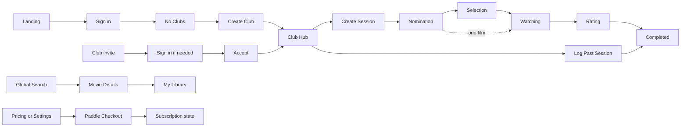

# PickFlick — Design

> The experience direction, screen behavior, components, and design QA. Exact visual values are
> implemented in `apps/frontend/src/styles/tokens.scss`; the canonical design package under
> `_docs/design/prototypes` stays their source.

| Owner         | Last reviewed |
| ------------- | ------------- |
| Product owner | 2026-09-26    |

## 1. Authority and sources

This document owns experience direction, visual foundations, interaction patterns, screen behavior,
and design QA. [ROADMAP.md](ROADMAP.md) owns scope, routes, and business rules;
[ARCHITECTURE.md](ARCHITECTURE.md) owns system boundaries. The design package owns exact tokens,
responsive compositions, and component appearance; production code implements them traceably.

When sources conflict:

1. A later explicit developer decision wins.
2. The design package beats the retired roadmap for product behavior and visual intent.
3. This document records where prototype fixture content is not a requirement.
4. Scope and technical topology never come from incidental prototype HTML.

| Source                                                                                                                  | Authoritative for                                                       | Note                                                      |
| ----------------------------------------------------------------------------------------------------------------------- | ----------------------------------------------------------------------- | --------------------------------------------------------- |
| [Package index](_docs/design/prototypes/index.html)                                                                     | Surface inventory and navigation.                                       | Static prototype, not production routing.                 |
| [Design system](_docs/design/prototypes/design-system.html)                                                             | Foundations, component states, navigation, forms, feedback, responsive. | Shows representative content.                             |
| [Exact design contract](_docs/design/prototypes/DESIGN.md)                                                              | Tokens, component rules, motion, accessibility, interaction.            |                                                           |
| [UX flow map](_docs/design/prototypes/ux-flow-map.html)                                                                 | Journeys, roles, branches.                                              | The Roadmap resolves permissions and edge cases.          |
| [Responsive baselines](_docs/design/prototypes/responsive-baselines.html)                                               | S/M/L/XL composition.                                                   | Representative widths, not the only tested ones.          |
| [Asset catalog](_docs/design/prototypes/asset-catalog.html) and [manifest](_docs/design/prototypes/asset-manifest.json) | Prototype asset usage.                                                  | Film images are fixtures, not licensed production assets. |
| [Brand specification](_docs/design/prototypes/brand-spec.md)                                                            | Brand intent and mascot use.                                            |                                                           |
| [Package handoff](_docs/design/prototypes/FINAL-PACKAGE.md)                                                             | Canonical and superseded files.                                         |                                                           |
| [Production brand assets](assets/brand/README.md)                                                                       | Reusable mascot and logo files with semantic names.                     | `panda-invited-2.webp` has English text baked in.         |

**Status values.** Design: `None`, `Draft`, `Approved` (the product owner accepted the direction).
Build: `Not started`, `Partial`, `Done` (the documented contract is implemented). QA: `Not checked`,
`Passed`, `Issues` (`Passed` needs a recorded comparison and baseline evidence).

The design package is approved as direction. Tokens, brand assets, the UI kit, shells, public pages,
Login, Club onboarding, and Club settings are built; other screens are not started. A good-looking
prototype is not production QA, and owner review of the hosted preview is still pending for every
built screen.

## 2. Experience direction

- **Users:** friends running recurring movie nights, people building a personal film memory, Club
  Admins and Moderators running Sessions, and App Admins operating the service.
- **Core experience:** the current Club, screening, phase, progress, next action, and lasting result
  always feel connected.
- **Character:** editorial, cinematic, nocturnal, premium but friendly; high-contrast monochrome with
  restrained warmth and expressive panda art.
- **Voice:** short, human, lightly theatrical, film-aware. Privacy, billing, errors, permissions, and
  destructive actions are plain.
- **Non-goals:** generic SaaS dashboards, gold on every primary action, admin chrome in member flows,
  hover-only behavior, anonymous participation, and desktop layouts squeezed onto phones.

| Principle                     | In practice                                                                                                                |
| ----------------------------- | -------------------------------------------------------------------------------------------------------------------------- |
| One screening story           | Nomination, Selection, Watching, Rating, and Completed are states of one Session page, not separate pages.                 |
| Context before action         | Every mutation shows the Club, Session, role, phase, effect, and recovery path.                                            |
| Noir structure, warm meaning  | Monochrome carries layout and hierarchy; ivory and gold mark ratings, achievements, selection, invitations, focal moments. |
| Mobile is recomposed          | Navigation, tables, controls, and hierarchy adapt to touch; horizontal page scrolling is never the fallback.               |
| Progress without pressure     | Participation counts are clear, but unfinished Rating never blocks the next Session.                                       |
| Visible, enforced permissions | Unavailable actions are hidden, disabled with a reason, or replaced by a safe state; the server is the real boundary.      |
| Reuse the cinematic language  | Film strips, call sheets, sprockets, status banners, and mascot scenes recur instead of being reinvented.                  |

## 3. Foundations

Tokens live in [`tokens.scss`](apps/frontend/src/styles/tokens.scss) and components in
[`components/ui`](apps/frontend/src/components/ui), both traceable to the
[design contract](_docs/design/prototypes/DESIGN.md). Never copy partial token sets into features.

| Area                | Contract                                                                                                                                                                                                                                                                                                                                                                                                  | Source                                                                   | Build   | QA                                     |
| ------------------- | --------------------------------------------------------------------------------------------------------------------------------------------------------------------------------------------------------------------------------------------------------------------------------------------------------------------------------------------------------------------------------------------------------- | ------------------------------------------------------------------------ | ------- | -------------------------------------- |
| Color               | Dark only. The `#0c0c0c` family for structure, neutral text and borders, ivory and gold `#C89B55` for warm emphasis. Pages use a flat `--bg`. The warm spotlight belongs only to the Landing, Pricing, and legal heroes, the Login scene, and the no-Clubs and error stages; form scenes use the neutral `--accent-glow`. Small text on surfaces uses `--fg-secondary`, because `--muted` fails AA there. | [Color tokens](_docs/design/prototypes/DESIGN.md#color-tokens)           | Done    | Screenshots                            |
| Typography          | Iowan/Charter/Georgia-style display, system sans for product copy, mono for metadata and status.                                                                                                                                                                                                                                                                                                          | [Typography](_docs/design/prototypes/DESIGN.md#typography)               | Done    | Screenshots                            |
| Spacing and layout  | Shared scale, containers, gutters, sectional rhythm, flat hierarchy, deliberate negative space.                                                                                                                                                                                                                                                                                                           | [Layout](_docs/design/prototypes/DESIGN.md#layout)                       | Done    | Screenshots                            |
| Breakpoints         | S below 576, M from 768, L from 1024, XL from 1400; the gaps between them are tested too. Stylelint allows only these boundaries.                                                                                                                                                                                                                                                                         | [Responsive baseline](_docs/design/prototypes/responsive-baselines.html) | Partial | Overflow at 7 widths for built screens |
| Radii and elevation | Restrained radii, low-contrast borders; elevation belongs to overlays, tickets, and cinematic scenes.                                                                                                                                                                                                                                                                                                     | [Design system](_docs/design/prototypes/design-system.html)              | Done    | Screenshots                            |
| Icons               | Fine-line, consistent strokes; actions have accessible names; decorative sprockets and film glyphs are not semantic.                                                                                                                                                                                                                                                                                      | [Components](_docs/design/prototypes/DESIGN.md#components)               | Partial | Not checked                            |
| Imagery             | Transparent noir panda art cues emotion and scene; provider film images are data, not brand chrome.                                                                                                                                                                                                                                                                                                       | [Brand assets](assets/brand/README.md)                                   | Done    | Not checked                            |
| Motion              | Short feedback and reveals, nothing that jolts layout; reduced motion honored and focus preserved.                                                                                                                                                                                                                                                                                                        | [Motion](_docs/design/prototypes/DESIGN.md#motion--animation)            | Done    | Automated                              |

| Baseline      | Contract                                                                                                                                                                   |
| ------------- | -------------------------------------------------------------------------------------------------------------------------------------------------------------------------- |
| Accessibility | Semantic controls, visible focus, keyboard-operable tabs, menus, dialogs, and ratings, focus trap and return, live regions, contrast review, 44px targets, reduced motion. |
| Localization  | English MVP; externalize copy, use locale-aware dates, numbers, and currency, tolerate longer text, and bake no text into new images.                                      |
| Overflow      | Wrap by default; truncate only when the full text stays accessible; tables scroll in their own container; test long user and provider text.                                |
| Input         | Mouse, keyboard, and touch are first-class; hover only enhances. The browser and device matrix is finalized in Phases 22–24.                                               |

## 4. Structure

### Shells and navigation

The shells live in `apps/frontend/src/components/shells`, one folder per shell or navigation piece.
`/shell-preview` shows the public, setup,
product, Session, Settings, Library, and App Admin compositions without feature data; the shells
default to the product routes and the preview supplies its own route map.

| Context              | Shell                                                                                                                                                                                                                                                                                                             | Responsive behavior                                                                                                                                                                                                                                                                                                                                                                                             | Source                                                                                                                                               |
| -------------------- | ----------------------------------------------------------------------------------------------------------------------------------------------------------------------------------------------------------------------------------------------------------------------------------------------------------------- | --------------------------------------------------------------------------------------------------------------------------------------------------------------------------------------------------------------------------------------------------------------------------------------------------------------------------------------------------------------------------------------------------------------- | ---------------------------------------------------------------------------------------------------------------------------------------------------- |
| Public               | Brand header with How it works, Features, Pricing, and a small secondary Go to App; a wordmark-and-tagline footer with How it works · Privacy · Terms · Contact; cinematic sections.                                                                                                                              | No bottom menu. Below 768px the header holds the brand and Go to App (44px); the links join from 768px, and the landing price block offers "Compare plans". The footer stacks.                                                                                                                                                                                                                                  | [Landing](_docs/design/prototypes/landing.html), [Pricing](_docs/design/prototypes/pricing.html)                                                     |
| Auth and setup       | A focused cinematic scene, minimal escape navigation, one task card.                                                                                                                                                                                                                                              | Art and form reorder and scale without hiding context.                                                                                                                                                                                                                                                                                                                                                          | [Login](_docs/design/prototypes/login.html), [Invite](_docs/design/prototypes/invite.html), [Create Club](_docs/design/prototypes/create-group.html) |
| Product              | The brand links to the public home and Hub links to `/app`; the public footer is shared. Round 34px search, notifications, and avatar controls with 44px targets; search slides down over the header; notifications open a popover and the avatar a downward film strip; Club switcher, Call Sheet, product tabs. | A fixed four-column bottom bar: Hub (labelled with the current Club view), My Library, Alerts, Settings. Film strips rise above their trigger, stay inside the viewport, and keep the tail on the trigger. The Hub strip lists Club views only; Settings holds Profile, Notifications, Subscription, Privacy, Sign out, and Admin Panel for App Admins. With no Club, Hub offers Create a Club and Join a Club. | [Club Hub](_docs/design/prototypes/app.html)                                                                                                         |
| Session detail       | Back to Hub, phase banner, hero metadata and actions, phase content.                                                                                                                                                                                                                                              | The primary phase action and progress stay above secondary detail.                                                                                                                                                                                                                                                                                                                                              | [Session family](_docs/design/prototypes/session-detail-nomination.html)                                                                             |
| Settings and Library | The product shell with local tabs or sidebar, tables and cards, stable feedback regions.                                                                                                                                                                                                                          | The sidebar becomes a menu; tables scroll in bounded regions.                                                                                                                                                                                                                                                                                                                                                   | [Library](_docs/design/prototypes/library.html), [Settings](_docs/design/prototypes/settings.html)                                                   |
| App Admin            | Protected sidebar, overview panels, searchable tables, settings, typed confirmations.                                                                                                                                                                                                                             | Complete on mobile through the admin menu and bounded tables.                                                                                                                                                                                                                                                                                                                                                   | [Admin Panel](_docs/design/prototypes/admin-panel.html)                                                                                              |

### Key flows

Nomination and Selection close automatically when every participant has acted or the deadline
passes; Watching moves to Rating only by hand; Rating closes when everyone has rated or an operator
finishes it.

The [UX flow map](_docs/design/prototypes/ux-flow-map.html) is the visual source; edge rules live in
the [Roadmap](ROADMAP.md#3-business-rules).

## 5. Screens and states

All canonical screens are MVP and approved as direction.

| Route / view                        | Purpose                                                                                                                                                                                                                                                                               | Source                                                                                   | Build                                                                                   | QA                                                                               |
| ----------------------------------- | ------------------------------------------------------------------------------------------------------------------------------------------------------------------------------------------------------------------------------------------------------------------------------------- | ---------------------------------------------------------------------------------------- | --------------------------------------------------------------------------------------- | -------------------------------------------------------------------------------- |
| `/`                                 | Explain the ritual and lead visitors to sign up.                                                                                                                                                                                                                                      | [landing.html](_docs/design/prototypes/landing.html)                                     | Done                                                                                    | Passed locally                                                                   |
| `/pricing`                          | Compare Free and Pro; enter checkout.                                                                                                                                                                                                                                                 | [pricing.html](_docs/design/prototypes/pricing.html)                                     | Done; checkout disabled until billing                                                   | Passed locally                                                                   |
| `/contact`                          | Send a short message with stable validation and success feedback.                                                                                                                                                                                                                     | [contact.html](_docs/design/prototypes/contact.html)                                     | Done                                                                                    | Passed locally                                                                   |
| `/legal/privacy`, `/legal/terms`    | Public entries that never present draft policy as approved.                                                                                                                                                                                                                           | Shared public shell                                                                      | Done; final legal copy pending                                                          | Passed locally                                                                   |
| `/login`                            | Sign in with an enabled provider and continue; signed-in Users go to `/app`. Apple is hidden while gated.                                                                                                                                                                             | [login.html](_docs/design/prototypes/login.html)                                         | Done for Google; Apple built but gated                                                  | Passed locally with Apple off                                                    |
| `/invite/club/[token]`              | Preview and accept or decline a Club invitation; expiry and sign-in.                                                                                                                                                                                                                  | [invite.html](_docs/design/prototypes/invite.html)                                       | Built; exact-SHA preview acknowledgement pending                                        | Passed locally; owner acknowledgement pending                                    |
| `/invite/session/[token]`           | Accept a member-only Session invite or show privacy-safe denial.                                                                                                                                                                                                                      | [Club Hub invite ticket](_docs/design/prototypes/app.html)                               | Not started                                                                             | Not checked                                                                      |
| `/app` with no Clubs                | Orient a new User and create or join the first Club.                                                                                                                                                                                                                                  | [app-no-clubs.html](_docs/design/prototypes/app-no-clubs.html)                           | Done; invitation links arrive with invitations                                          | Passed locally                                                                   |
| `/clubs/new`                        | Create a Club and choose its Selection scale.                                                                                                                                                                                                                                         | [create-group.html](_docs/design/prototypes/create-group.html)                           | Done: one slider for the `0..N` upper bound, explained by an InfoTip                    | Passed locally                                                                   |
| `/clubs/[clubId]`                   | Run and understand one Club across six Hub views.                                                                                                                                                                                                                                     | [app.html](_docs/design/prototypes/app.html)                                             | Partial — Overview, switcher, Call Sheet, and basic Session data; remaining views later | Hub interaction and visual checks passed locally; exact-SHA owner review pending |
| `/clubs/[clubId]/settings`          | Manage Club info, visibility, scale, roles, lifecycle, and destructive actions.                                                                                                                                                                                                       | Manage Club view in [app.html](_docs/design/prototypes/app.html)                         | Done for the Phase 5 foundation; the full Hub arrives in Phase 7                        | Passed locally (Admin, Member, archived)                                         |
| `/clubs/[clubId]/sessions/new`      | Create a full-cycle or pre-selected Session and invite members.                                                                                                                                                                                                                       | [create-session.html](_docs/design/prototypes/create-session.html)                       | Not started                                                                             | Not checked                                                                      |
| `/clubs/[clubId]/sessions/past/new` | Record a past screening with partial evidence.                                                                                                                                                                                                                                        | [create-past-session.html](_docs/design/prototypes/create-past-session.html)             | Not started                                                                             | Not checked                                                                      |
| Session — Nomination                | Choose one film, see allowed nominations, follow progress.                                                                                                                                                                                                                            | [session-detail-nomination.html](_docs/design/prototypes/session-detail-nomination.html) | Not started                                                                             | Not checked                                                                      |
| Session — Selection                 | Score every nomination, submit once, follow progress.                                                                                                                                                                                                                                 | [session-detail-selection.html](_docs/design/prototypes/session-detail-selection.html)   | Not started                                                                             | Not checked                                                                      |
| Session — Watching                  | Focus on the film; an operator opens Rating.                                                                                                                                                                                                                                          | [session-detail-watching.html](_docs/design/prototypes/session-detail-watching.html)     | Not started                                                                             | Not checked                                                                      |
| Session — Rating                    | Submit 1–10 with an optional comment; see permitted results and rivals.                                                                                                                                                                                                               | [session-detail-rating.html](_docs/design/prototypes/session-detail-rating.html)         | Not started                                                                             | Not checked                                                                      |
| Session — Completed                 | Keep the screening, ratings, rivals, attendees, and notes.                                                                                                                                                                                                                            | [session-detail.html](_docs/design/prototypes/session-detail.html)                       | Not started                                                                             | Not checked                                                                      |
| `/library`                          | Search personal Ratings and Watchlist; personal statistics and achievements.                                                                                                                                                                                                          | [library.html](_docs/design/prototypes/library.html)                                     | Not started                                                                             | Not checked                                                                      |
| `/movies/[tmdbId]`                  | Inspect a film, edit Personal Rating and Watchlist, discover related films.                                                                                                                                                                                                           | [movie-details.html](_docs/design/prototypes/movie-details.html)                         | Not started                                                                             | Not checked                                                                      |
| `/settings`                         | Profile, notifications, subscription, Privacy & data, import/export.                                                                                                                                                                                                                  | [settings.html](_docs/design/prototypes/settings.html)                                   | Not started                                                                             | Not checked                                                                      |
| `/admin`                            | Operate Users, Clubs, metrics, and settings.                                                                                                                                                                                                                                          | [admin-panel.html](_docs/design/prototypes/admin-panel.html)                             | Not started                                                                             | Not checked                                                                      |
| `not-found`, `error`                | Recover from missing routes and failures. Signed-in visitors get the product shell with Back to Hub (500 adds Try again); signed-out visitors get the public shell with Back to main. If the root layout itself fails, a plain Projector Malfunction page with Try again replaces it. | [error.html](_docs/design/prototypes/error.html)                                         | Done                                                                                    | Passed locally                                                                   |

"Passed locally" means the Playwright suite passes at 390 and 1440 pixels plus overflow checks at
every breakpoint and gap width.

### Prototype clarifications

| Prototype shows                                                                                                                     | Build this instead                                                                                                                                                                                                                                                                                                                                                                                      |
| ----------------------------------------------------------------------------------------------------------------------------------- | ------------------------------------------------------------------------------------------------------------------------------------------------------------------------------------------------------------------------------------------------------------------------------------------------------------------------------------------------------------------------------------------------------- |
| Nomination, Selection, and Rating rows together under "Active Sessions".                                                            | Examples of row states. A Club has one blocking Session at a time; any number of Rating Sessions.                                                                                                                                                                                                                                                                                                       |
| Manage Club with one Active Session and several Active Ratings.                                                                     | The real concurrency rule and the preferred composition.                                                                                                                                                                                                                                                                                                                                                |
| Pricing promising unlimited nomination rounds on Pro.                                                                               | Superseded: both plans have one blocking Session per Club. Pro adds limits, result visibility, grace period, and analytics.                                                                                                                                                                                                                                                                             |
| Selection copy saying "rank", and "three films" beside five scored rows.                                                            | Users score every nomination on the Club's scale; there is no drag ranking.                                                                                                                                                                                                                                                                                                                             |
| Score buttons 0–3.                                                                                                                  | Generated from the Club's stored scale: `0..N` for new Clubs, existing `1..N` Clubs keep theirs; N at most 10.                                                                                                                                                                                                                                                                                          |
| A Session invite beside a Club invite.                                                                                              | Valid only for an existing member; non-members see no details and are told to join the Club.                                                                                                                                                                                                                                                                                                            |
| A Support role in the admin table; annual Pro in the subscription mix.                                                              | Fixtures. App roles are User and App Admin; MVP sells monthly Pro at €5.                                                                                                                                                                                                                                                                                                                                |
| Settings deletion copy saying all Club and Session history is removed.                                                              | Superseded: shared history stays with anonymized attribution; members are notified if a Club becomes adminless.                                                                                                                                                                                                                                                                                         |
| Settings with fixed deletion, cookie, and legal claims; Russian "coming later".                                                     | Layout approved; policy copy must match implementation and legal review. English is MVP, Russian post-MVP.                                                                                                                                                                                                                                                                                              |
| Navigation controls resting at `--muted` (header links and icons, tabs, film-strip frames, mobile bar, footer links, search close). | Interactive navigation rests at `--fg-secondary` with `--border-lit` icon circles; `--muted` reads as disabled. Header links and icons turn ivory on hover, focus, or open, with a gold underline or gold-border circle. Tabs and menu frames brighten to `--fg`. The current destination is ivory (tabs: `--fg` with an underline). `--muted` is only for metadata, placeholders, and disabled states. |
| The `settings.html` Privacy panel repeating policy prose under "Privacy".                                                           | Policy text lives only in the public Privacy Notice (`/legal/privacy`). The in-app section is "Privacy & data": a summary, rights actions, and a link to the Notice. Login and legal links call it "Privacy Notice".                                                                                                                                                                                    |
| [`settings-subscription.html`](_docs/design/prototypes/settings-subscription.html).                                                 | Superseded study; the Subscription panel in `settings.html` is canonical.                                                                                                                                                                                                                                                                                                                               |

### States every data surface needs

| State                     | Expected behavior                                                                                        |
| ------------------------- | -------------------------------------------------------------------------------------------------------- |
| Loading                   | Stable layout, local skeleton or progress, a status for assistive technology, and no duplicate mutation. |
| Empty                     | Why it is empty and the next useful authorized action.                                                   |
| Validation                | A message next to the field, focus or summary when useful, preserved input, never color alone.           |
| Provider or network error | The cause when known, a safe retry, preserved non-sensitive input, and other navigation.                 |
| Unauthorized              | No protected data; explain the membership or role needed without leaking details.                        |
| Read-only                 | Keep history visible, explain the limit or downgrade, and link the Admin to recovery.                    |
| Offline                   | Keep safe cached context if any; disable mutations with a reconnect instruction.                         |
| Success                   | Stable inline confirmation or toast with the new state; move focus only when context changed.            |
| Destructive               | Name the target and consequence; typed confirmation for high-impact actions; restore focus on cancel.    |

## 6. Components and patterns

The UI kit lives in `apps/frontend/src/components/ui/<Name>/`; the `/ui-preview` gallery shows every
component and state.

| Component                      | Purpose and states                                                                                                                                                                                                                                                                                                                                                                                                                                                   | Source                                                                   | Build                                                 |
| ------------------------------ | -------------------------------------------------------------------------------------------------------------------------------------------------------------------------------------------------------------------------------------------------------------------------------------------------------------------------------------------------------------------------------------------------------------------------------------------------------------------- | ------------------------------------------------------------------------ | ----------------------------------------------------- |
| Public and product header      | Brand, navigation, search, notifications, account; public, authenticated, and admin on desktop and mobile.                                                                                                                                                                                                                                                                                                                                                           | [Design system](_docs/design/prototypes/design-system.html)              | Done                                                  |
| Film-strip menu and mobile bar | Compact cinematic secondary navigation for Hub, Library, Settings, Admin; open, closed, active (`FilmStripMenu`).                                                                                                                                                                                                                                                                                                                                                    | [DESIGN.md](_docs/design/prototypes/DESIGN.md)                           | Done                                                  |
| Club switcher and Call Sheet   | Keep Club and screening context: several Clubs, no Session, each phase, with or without image.                                                                                                                                                                                                                                                                                                                                                                       | [Club Hub](_docs/design/prototypes/app.html)                             | Partial — Club switching and current Session skeleton |
| Tabs                           | Local views without losing shell context; horizontal, vertical, mobile menu (`Tabs`).                                                                                                                                                                                                                                                                                                                                                                                | [Design system](_docs/design/prototypes/design-system.html)              | Partial                                               |
| Buttons                        | Primary, secondary, ghost, danger, secondary-danger; loading, disabled, success; links styled as buttons (`Button`, `ButtonLink`).                                                                                                                                                                                                                                                                                                                                   | [DESIGN.md](_docs/design/prototypes/DESIGN.md)                           | Done                                                  |
| Form controls                  | `TextInput`, `Textarea`, `Select`, `Switch`, the Club Selection scale slider, and `InfoTip` (a "?" hint on hover, focus, or tap). Controls sit one step darker than their surface (`--bg` on `--surface`). Labels are `--fg-secondary`, weight 500, with a quiet qualifier (`— required`, `— optional`); counters read `n/max`; focus is a gold border with a soft gold ring; checkboxes are monochrome. Date, time, file, and segmented controls are still to come. | [Design system](_docs/design/prototypes/design-system.html)              | Partial                                               |
| Movie search result            | TMDB discovery: loading, results, empty, error, selected, removed.                                                                                                                                                                                                                                                                                                                                                                                                   | [Create Session](_docs/design/prototypes/create-session.html)            | Not started                                           |
| Score selector                 | Score every nomination on the configured scale; incomplete, submitted, keyboard and touch (`ScoreControl`).                                                                                                                                                                                                                                                                                                                                                          | [Selection](_docs/design/prototypes/session-detail-selection.html)       | Done                                                  |
| Rating control                 | 1–10 personal or Session score (`RatingControl`).                                                                                                                                                                                                                                                                                                                                                                                                                    | [Rating](_docs/design/prototypes/session-detail-rating.html)             | Done                                                  |
| Progress film strip            | `N/N` participation, compact or full (`Progress`).                                                                                                                                                                                                                                                                                                                                                                                                                   | [Club Hub](_docs/design/prototypes/app.html)                             | Done                                                  |
| Status banner and phase stamp  | Lifecycle and recovery for each phase, error, read-only (`StatusBanner`).                                                                                                                                                                                                                                                                                                                                                                                            | [Session family](_docs/design/prototypes/session-detail-nomination.html) | Done                                                  |
| Invite ticket and popover      | Club and Session invitations: several, empty, accept, decline, expired, forbidden.                                                                                                                                                                                                                                                                                                                                                                                   | [Club Hub](_docs/design/prototypes/app.html)                             | Not started                                           |
| Notification popover           | Recent in-app events: read, unread, empty, loading, error, mobile.                                                                                                                                                                                                                                                                                                                                                                                                   | [Settings](_docs/design/prototypes/settings.html)                        | Partial                                               |
| Dialog                         | Phase moves, edits, removals, cancellation, destructive actions; typed confirmation (`Modal`).                                                                                                                                                                                                                                                                                                                                                                       | [Design system](_docs/design/prototypes/design-system.html)              | Partial                                               |
| Stat, leaderboard, table       | Summaries, histories, rankings, usage, admin lists; sorted, filtered, mobile scroll (`Table`).                                                                                                                                                                                                                                                                                                                                                                       | [Club Hub](_docs/design/prototypes/app.html)                             | Partial                                               |
| Achievement card and filter    | Earned, in-progress, and locked goals.                                                                                                                                                                                                                                                                                                                                                                                                                               | [Library](_docs/design/prototypes/library.html)                          | Not started                                           |
| Privacy accordion              | Data summary and rights actions (export, GDPR archive, deletion) in "Privacy & data", linking to the Privacy Notice.                                                                                                                                                                                                                                                                                                                                                 | [Settings](_docs/design/prototypes/settings.html)                        | Not started                                           |

| Pattern              | Behavior                                                                                                                           |
| -------------------- | ---------------------------------------------------------------------------------------------------------------------------------- |
| Forms                | Validate on blur or submit; keep values; focus the first error; keep help and error regions stable.                                |
| Loading              | Local feedback, stable geometry, locked repeat submissions, announced long transitions and exports.                                |
| Empty and error      | Specific, calm, recoverable; always an authorized next action or safe navigation.                                                  |
| Feedback             | The in-app inbox is durable; toasts and inline messages confirm local actions; email follows preferences and mandatory exceptions. |
| Dialogs and overlays | One header popover at a time; focus enters, stays, and returns; Escape closes non-blocking dialogs.                                |
| Destructive actions  | A separate danger action that names the effect and irreversibility; typed target for sensitive App Admin actions.                  |
| Permissions          | Never expose protected data; hide irrelevant actions, disable with a reason when it teaches, and use explicit read-only states.    |

## 7. Design decisions

| ID      | Area                   | Decision                                                                                                                                                                                                                                                                                                    | Status   | Source                                                                                                       |
| ------- | ---------------------- | ----------------------------------------------------------------------------------------------------------------------------------------------------------------------------------------------------------------------------------------------------------------------------------------------------------- | -------- | ------------------------------------------------------------------------------------------------------------ |
| DES-001 | Authority              | Design pages beat the retired roadmap; later explicit developer decisions beat both.                                                                                                                                                                                                                        | Decided  | Developer direction                                                                                          |
| DES-002 | Visual system          | Projector Noir replaces the legacy color and type direction.                                                                                                                                                                                                                                                | Decided  | [Design package](_docs/design/prototypes/design-system.html)                                                 |
| DES-003 | Responsive             | S/M/L/XL behavior is MVP, not later polish.                                                                                                                                                                                                                                                                 | Decided  | [Responsive baseline](_docs/design/prototypes/responsive-baselines.html)                                     |
| DES-004 | Concurrency examples   | Several active rows show view variants; only Rating Sessions may coexist without limit.                                                                                                                                                                                                                     | Decided  | Developer decision 8                                                                                         |
| DES-005 | Selection              | A generated inclusive score range replaces the fixed 0–3 buttons and the stale "rank three" copy.                                                                                                                                                                                                           | Decided  | Developer decision 2                                                                                         |
| DES-006 | Session invite privacy | Non-members see no details and must join the Club first.                                                                                                                                                                                                                                                    | Decided  | Developer decision 10                                                                                        |
| DES-007 | Ratings                | Historical Session Rating and editable Personal Rating are separate.                                                                                                                                                                                                                                        | Decided  | Developer decision 12                                                                                        |
| DES-008 | Legal copy             | Layout approved; retention, deletion, and cookie claims stay provisional until implementation and review agree.                                                                                                                                                                                             | Deferred | Phase 19 / 23 review                                                                                         |
| DES-009 | Contact identity       | Publish `hello@pick-flick.app`; production email comes from `PickFlick <notifications@pick-flick.app>` with replies to the public address; UAT uses `PickFlick UAT <notifications@uat.pick-flick.app>`.                                                                                                     | Decided  | [ADR-009](_docs/decisions/README.md#adr-009--use-one-public-contact-and-environment-specific-resend-senders) |
| DES-010 | Monochrome fidelity    | No global or duplicated warm washes. Form controls follow the prototype field contract; Create Club uses one range slider for the scale. In-flow Back links return to the previous PickFlick page with a safe fallback.                                                                                     | Decided  | Phase 6, 2026-09-24                                                                                          |
| DES-011 | Manage Club            | Manage Club renders inside the Club Hub frame as a card grid: Club Info (name, description, scale), Settings (visibility), Club Avatar, and a Danger Zone with Manage Moderators, Archive or Reactivate, Delete, or Leave. Role changes happen in the Manage Moderators dialog. Audit events are not shown. | Decided  | Phase 6, 2026-09-24                                                                                          |

## 8. Design QA

| Check              | Target                                                                                                           | Evidence                                                                                                                                                                                               | Status      |
| ------------------ | ---------------------------------------------------------------------------------------------------------------- | ------------------------------------------------------------------------------------------------------------------------------------------------------------------------------------------------------ | ----------- |
| Source parity      | Every screen and shared component compared with its source.                                                      | 44 baselines at 390 and 1440 (gallery, seven shells, public pages, Login, Club onboarding, Hub overview and settings, recovery states); Hub preview needs exact-SHA owner review.                      | In progress |
| Responsive         | Continuous widths plus 390, 768, 1024, 1440; orientation where it matters.                                       | Overflow checks at 390, 640, 768, 900, 1024, 1200, and 1440 for every built screen.                                                                                                                    | In progress |
| Keyboard and focus | Auth, Club creation, Sessions, search, menus, dialogs, rating and score controls, settings, admin confirmations. | Automated for shared and shell controls, Pricing FAQ, Contact and Create Club validation focus, Club switch, Club settings dialogs, and the unavailable checkout. Feature flows pending.               | In progress |
| Accessibility      | Structure, names, focus, contrast, live regions, targets, reduced motion.                                        | Axe at 390 and 1440 on every built screen; automated focus, live-region, 44px target, local-scroll, and reduced-motion checks. Manual review pending.                                                  | In progress |
| Dynamic content    | Empty, loading, error, read-only, offline, long text, large lists, provider failures.                            | Contact covers validation, loading, rate limit, service failure, offline, and preserved input; Hub covers no-Clubs, loading, unauthorized, and archived states. The broader feature matrix is pending. | In progress |
| Localization       | Longer English, locale-safe formats, no new text in images.                                                      | None yet; reviewed in Phases 22 and 24.                                                                                                                                                                | Not checked |
| Browsers and input | The final browser and device matrix with mouse, keyboard, and touch.                                             | Chromium automation only.                                                                                                                                                                              | In progress |

Update this document when a design source changes, visible behavior is clarified, a screen or
component is added, or build or QA status changes. A correct-looking prototype is not passed QA.

Club invitation states use one setup scene with the invitation mascot, reserved card regions, and
stable recovery actions. Its heading says "You are invited" because invitation links do not reserve
capacity. Signed-out and unsafe states omit Club details. The usable preview shows
only Club name, member count, and inviter; Session totals are omitted. Accept and Decline have visible
pending and retry feedback. Success and already-member states open the authorized Hub. Manage Club
lets Admins and Moderators create, copy, inspect, and revoke links; the pending-invite popover remains
in issue #35. Owner review of the exact hosted head SHA remains required.
