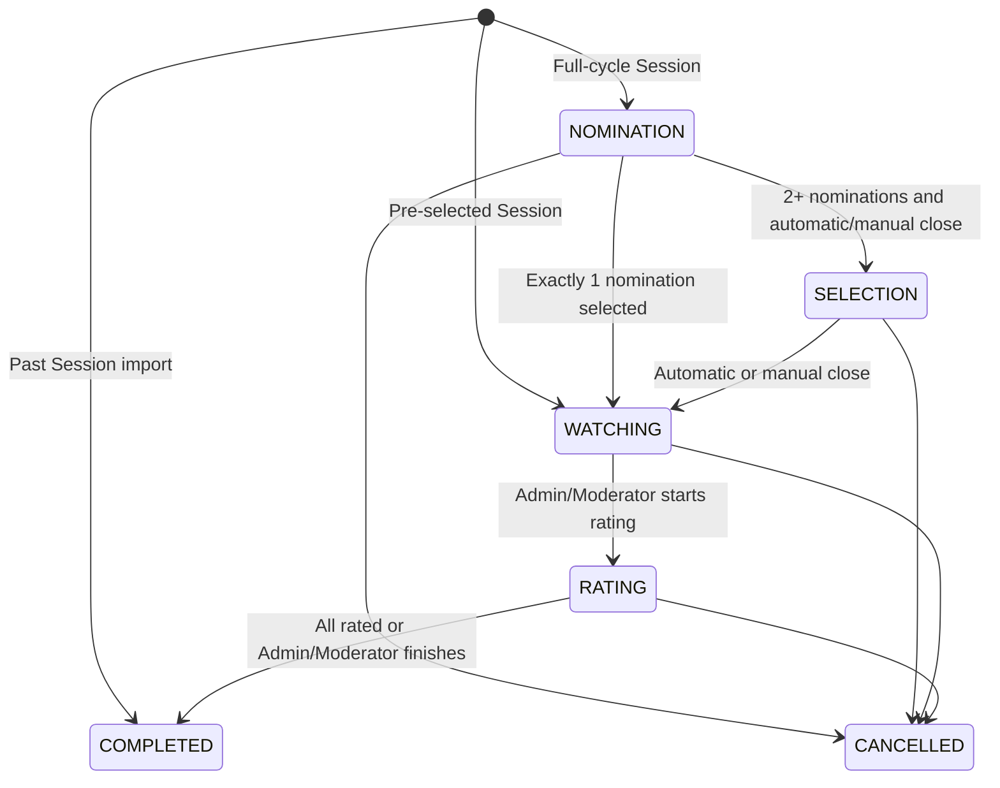

# PickFlick — Roadmap

> The product and delivery contract: what PickFlick is, the rules it must follow, and the phases
> that build it. When this document and the design package disagree, the design package wins
> unless a later decision below says otherwise.

Related: [DESIGN.md](DESIGN.md) · [ARCHITECTURE.md](ARCHITECTURE.md) ·
[ADR registry](_docs/decisions/README.md) · [prototypes](_docs/design/prototypes/index.html) ·
[GitHub Project 3](https://github.com/users/Shagon1k/projects/3)

Project 3 owns actionable work and its live status. This Roadmap owns scope, rules, phase
acceptance, and phase-level evidence; it is not a task list.

## 1. Product

| Field         | Value                                                                                                                                                |
| ------------- | ---------------------------------------------------------------------------------------------------------------------------------------------------- |
| Product       | A private, registered-user web app that helps film clubs nominate, select, watch, rate, and remember films together.                                 |
| Primary users | Friends and small film clubs; Club Admins and Moderators who run Sessions; App Admins who operate PickFlick.                                         |
| Core outcome  | A club moves from "what should we watch?" to a shared, durable film-night memory without chat-thread chaos or spreadsheets.                          |
| MVP proof     | Real clubs repeatedly complete the Session lifecycle, return to their shared and personal histories, and understand the Free/Pro boundary.           |
| Non-goals     | Anonymous participation, Session-only guests, native mobile apps, offline writes, public social profiles, AI analysis, and enterprise organizations. |

### Core loop

```text
Create or join a Club -> Create a Session -> Nominate -> Select -> Watch -> Rate -> Remember
```

Other entries:

```text
Pre-selected film -> Watch -> Rate -> Remember
Past screening -> Record attendees, optional nominations/votes, and ratings -> Remember
Discover a film -> Rate or add to Watchlist -> My Library
```

### What makes it different

- The whole club ritual lives in one lifecycle instead of chat, polls, notes, and spreadsheets.
- Scored Selection with deterministic tie-breaking produces a winner without negotiation.
- Club history and personal film memory coexist; historical Session Ratings never collapse into an
  editable Personal Rating.
- Club character matters: Projector Noir visuals, the panda mascot, achievements, leaderboards, and
  screening-language copy make organizing feel ceremonial rather than bureaucratic.
- Members join unlimited Clubs for free; the organizer's plan sets each administered Club's limits.

### Brand and UX

| Area            | Decision                                                                                                                                                                      |
| --------------- | ----------------------------------------------------------------------------------------------------------------------------------------------------------------------------- |
| Visual identity | "Projector Noir": deep monochrome surfaces, restrained ivory and gold, an editorial serif display face, a utilitarian sans body face, mono metadata, and cinematic panda art. |
| Voice           | Warm, concise, film-literate, lightly theatrical. Forms, errors, privacy, billing, and destructive actions stay plain.                                                        |
| UX principle    | Keep context through the whole movie night: the current Club, Session, phase, progress, next action, and recovery path are always obvious.                                    |

## 2. MVP scope

Every canonical surface in the design package is MVP. "Coming soon" items inside those surfaces stay
out when listed under Out.

### In

**Public, authentication, and setup**

- Responsive landing, pricing, contact, legal-entry, sign-in, Club invitation, and error pages.
- Registered accounts only. Google OAuth is active; the reviewed Apple implementation stays dormant
  until the owner approves Apple Developer Program membership and sandbox/UAT activation. No
  anonymous or password sign-in.
- Return to the intended destination after sign-in, including Club invitation acceptance.
- No-Clubs first run, Create Club, Join Club, and safe error and recovery states.

**Clubs and roles**

- Create, edit, switch, archive/reactivate, and delete Clubs.
- Club description and avatar, member list, invite link, activity, statistics, ratings leaderboard,
  achievements, and Session history.
- Club roles Admin, Moderator, and Member; app roles App Admin and User only.
- Club moderation, ownership transfer through App Admin operations, and explicit adminless handling.

**Session lifecycle**

- Full-cycle, pre-selected, and past Session modes.
- Member-only Session invitations and a participant roster.
- Nomination through the catalog facade, one nomination per participant, and suggestions from the
  user's own past nominations in the current Club that did not win.
- Scored Selection on the Club's `0..N` scale (N from 1 to 10; see Selection rules).
- Deterministic tie-breaking and result visibility set by plan and Club settings.
- Optional nomination deadline and the automatic transitions in section 3.
- Watching, Rating, Completed, early operator closure, participant removal, cancellation, and
  editing Session details.
- Any number of incomplete Rating Sessions alongside at most one Nomination, Selection, or Watching
  Session per Club.
- Past Sessions with selected attendees, optional attendee ratings, and optional reconstructed
  nominations and votes.

**Personal film memory**

- Global film search and normalized Movie Details, initially PoiskKino + TheTVDB.
- One editable Personal Rating per User and Movie; completed Session Ratings stay immutable history.
- Watchlist with Low, Medium, and High priority.
- My Library ratings, Watchlist, statistics, search and filters, and personal achievements.
- Club statistics, leaderboard, and Club achievements.
- Provider-backed "You may also like"; personalized AI recommendations are not MVP.

**Settings, notifications, privacy, billing, and operations**

- Profile and avatar, language-ready settings, notification preferences, subscription and billing
  history, billing portal, privacy, data import/export, GDPR archive, and account deletion.
- In-app and email notifications for lifecycle, inactivity, and billing events.
- Free and monthly Pro plans through Paddle checkout, portal, and webhooks; downgrade and read-only
  behavior; recurring billing anchored to the first payment date.
- App Admin overview, activity, User suspension/reinstatement, Club ownership transfer and deletion,
  registration controls, maintenance mode, catalog refresh settings, and audit retention settings.
- An installable, online-first PWA; mutations need a connection and fail with an explicit message
  offline.
- Responsive S/M/L/XL layouts and accessible keyboard, touch, focus, validation, dialog, and
  reduced-motion behavior.

### Out

| Item                                                        | Why                                                                           | Target      |
| ----------------------------------------------------------- | ----------------------------------------------------------------------------- | ----------- |
| AI analysis of watch history                                | Needs a stable history corpus, privacy design, evaluation, and cost controls. | Post-MVP    |
| Personalized AI film recommendations                        | Provider-related titles cover the MVP surface without an inference pipeline.  | Post-MVP    |
| AI-enhanced Club analytics                                  | Deterministic analytics ship first.                                           | Post-MVP    |
| Club ratings CSV export                                     | Marked "Coming soon" in pricing; personal rating CSV stays MVP.               | Post-MVP    |
| Offline nominations, votes, ratings, or any queued mutation | Conflict resolution and stale phases add disproportionate risk.               | Post-MVP    |
| Web push notifications                                      | In-app and email cover MVP.                                                   | Post-MVP    |
| Annual billing                                              | The first offer is €5 monthly Pro only.                                       | Post-MVP    |
| Russian or other UI locales                                 | Build localization-ready; ship English first.                                 | Post-MVP    |
| Session-only guests                                         | Session access needs registration and Club membership.                        | Not planned |
| App-wide Support role                                       | App authorization has only User and App Admin.                                | Not planned |

### Baseline concerns

| Area             | Status   | Decision                                                                                                                                                                                                                                                               |
| ---------------- | -------- | ---------------------------------------------------------------------------------------------------------------------------------------------------------------------------------------------------------------------------------------------------------------------- |
| Foundation       | Partial  | pnpm TypeScript monorepo with frontend, backend, shared contracts, PostgreSQL, and containerized delivery; Nomination deadlines use a PostgreSQL job table and worker (ADR-018).                                                                                       |
| Users and auth   | Partial  | Registered OAuth users only; Google active, Apple behind an owner-controlled gate. App Admin/User globally, Admin/Moderator/Member per Club, enforced on the server.                                                                                                   |
| Design system    | Partial  | Projector Noir rules and prototypes live in `_docs/design/prototypes`; the production UI kit and shells exist.                                                                                                                                                         |
| Localization     | Deferred | English MVP with externalized copy, locale-safe formatting, and layouts that tolerate longer text; Russian when scheduled.                                                                                                                                             |
| Monitoring       | Planned  | Structured logs, error and performance monitoring, health checks, job metrics, and first-party aggregate product metrics; no undisclosed behavioral trackers.                                                                                                          |
| SEO              | Partial  | Public marketing, pricing, contact, and legal pages are indexable with metadata and previews; authenticated and invite routes are `noindex`.                                                                                                                           |
| Security         | Partial  | Deny-by-default authorization, boundary validation, output encoding, secure cookies, CSRF defense, rate limits, security headers with a nonce CSP, and secret isolation are active; verified webhooks and security logging come later ([Security](_docs/security.md)). |
| Testing          | Partial  | Unit, integration, database, E2E, accessibility, responsive visual, and provider-contract checks run in CI.                                                                                                                                                            |
| Data and privacy | Planned  | Data inventory, personal CSV and GDPR archive, account deletion with anonymization, shared-history preservation, audit retention, and provider disclosures before launch.                                                                                              |
| Mobile           | Partial  | First-class and recomposed, not shrunk; fixed bottom navigation in the product and 44px touch targets.                                                                                                                                                                 |
| PWA              | Planned  | Installable, online-first; a cached shell or read-only fallback is allowed, mutations need a connection; push deferred.                                                                                                                                                |
| Environments     | Partial  | Local, CI, `https://uat.pick-flick.app`, and `https://pick-flick.app`; automatic UAT delivery and a guarded manual production promotion. Backups and restore still required.                                                                                           |

`Planned`: direction chosen, not built. `Partial`: some is built. `Covered`: built and verified.
`Deferred`: postponed with a revisit trigger.

### Before the first production launch

Resolve each item before launch. A deferral needs an owner and a revisit trigger and cannot bypass a
launch-critical risk.

| Topic               | Required decision and evidence                                                                                             | Status         | Owner                             | Direction                                                                                                                      |
| ------------------- | -------------------------------------------------------------------------------------------------------------------------- | -------------- | --------------------------------- | ------------------------------------------------------------------------------------------------------------------------------ |
| Deploy ownership    | One release owner and rollback authority; the approved revision, readiness and smoke evidence, and a tested rollback path. | Needs decision | Release owner (unassigned)        | Phase 23 prepares the release candidate; Phase 25 records production evidence. Assign before the Phase 23 rehearsal.           |
| Data durability     | Backup destination and retention, a demonstrated restore, and a response to regional or hosting-account loss.              | Needs decision | Infrastructure owner (unassigned) | PostgreSQL and avatars need backups. Align retention with the Phase 19 privacy decision; drill restore in Phase 23.            |
| Edge reliability    | Client identity behind the proxy, abuse limits, graceful drain, and a real UAT drill.                                      | Needs decision | Infrastructure owner (unassigned) | Decide before Phase 23 and verify again in production-like UAT before Go.                                                      |
| Public surface      | Canonical host, SEO, PWA, and social assets validated in production; crawler-cache refresh accounted for.                  | Planned        | Product owner + developer         | Metadata exists since Phase 3 and completes in Phase 23; validate deployed behavior and cache refresh before launch.           |
| Compliance boundary | Separate shipped behavior from external legal actions; mark each open item `Launch gate` or `Post-launch follow-up`.       | Needs decision | Product owner + privacy reviewer  | Privacy, retention, billing, provider disclosure, and legal copy need review before Phase 23 exits; none defers past Phase 24. |

## 3. Business rules

### Identity and access

| Rule                                                                                                                      | Why                                                                                     | Enforcement                                           |
| ------------------------------------------------------------------------------------------------------------------------- | --------------------------------------------------------------------------------------- | ----------------------------------------------------- |
| Every participant has a registered PickFlick account.                                                                     | Personal history, privacy rights, invitations, and phase denominators need an identity. | OAuth gate plus API authorization.                    |
| App roles are User and App Admin only.                                                                                    | No global Support permission model.                                                     | Database constraint and server policy.                |
| A Club has at most one Admin, any number of Moderators, and may temporarily have no Admin.                                | Separates ownership and billing from operational help; covers account deletion.         | Membership constraints and audited transitions.       |
| The Admin owns billing, ownership, Club deletion, role management, and every Moderator capability.                        | High-impact actions stay with the owner.                                                | Server authorization, never UI alone.                 |
| A Moderator may create, edit, cancel, and advance Sessions, invite or remove participants, and log past Sessions.         | Trusted members run movie nights without financial or ownership power.                  | Server authorization.                                 |
| A Member may accept eligible invitations, participate, view allowed results and history, manage personal data, and leave. | The normal participant journey.                                                         | Server authorization and visibility policy.           |
| A Session invite reveals nothing about the Session to a non-member.                                                       | Enforces the Club boundary.                                                             | Generic forbidden state with a hint to join the Club. |
| Accepting a Session invite never creates Club membership.                                                                 | Membership comes only from the Club invitation flow.                                    | Invite-type validation inside the transaction.        |

### Club and Session invariants

| Rule                                                                                                               | Why                                                           | Enforcement                                                  |
| ------------------------------------------------------------------------------------------------------------------ | ------------------------------------------------------------- | ------------------------------------------------------------ |
| A Club has at most one blocking Session (Nomination, Selection, or Watching).                                      | Members focus on one decision at a time.                      | Database invariant plus a transactional state change.        |
| Any number of Sessions may stay in Rating while a new blocking Session runs.                                       | Slow raters must not block the next movie night.              | Rating is non-blocking.                                      |
| An Admin or Moderator may close Rating early.                                                                      | Participation is voluntary.                                   | Confirmed action; received ratings stay immutable.           |
| Each participant submits one nomination in a full-cycle Session.                                                   | Keeps influence balanced.                                     | Unique Session/participant nomination.                       |
| A submitted Selection ballot is immutable.                                                                         | Preserves trust and makes completion deterministic.           | Unique ballot plus a closed submission state.                |
| Session Ratings are history; Personal Ratings are editable summaries.                                              | Club history does not change when someone changes their mind. | Separate entities and aggregates.                            |
| Past Sessions may record partial evidence.                                                                         | Old movie nights rarely have complete data.                   | Optional nominations, ballots, and ratings with provenance.  |
| A Club you are not an active member of does not exist for you.                                                     | Private Clubs disclose nothing, not even their existence.     | `404` from every Club route; App Admin gains no Club access. |
| Archived Clubs are read-only until their Admin reactivates them.                                                   | Archiving pauses a Club without losing it.                    | Every Club command checks the lifecycle.                     |
| Archive, leave, removal, and delete need typed confirmation: `ARCHIVE`, `LEAVE`, `REMOVE`, or the exact Club name. | Destructive actions must be deliberate.                       | The server compares the confirmation.                        |
| The Admin cannot leave; they transfer administration or delete the Club.                                           | A Club keeps its owner unless an account is deleted.          | `ADMIN_MUST_TRANSFER` conflict.                              |
| Only a Club without Session history can be deleted, and deletion keeps an audit tombstone.                         | One person cannot erase shared history.                       | `SESSION_HISTORY` conflict; soft deletion.                   |
| Free Clubs cannot show Selection results to ordinary members.                                                      | A Pro entitlement.                                            | `TIER_SETTING_UNAVAILABLE` conflict.                         |

Club membership invitation links expire after seven days and are single-use. An Admin or Moderator
creates a shareable link or targets a registered User. Only an eligible registered User sees a minimal
preview; accepting creates one active Membership and declining consumes the link without joining.
Seats are checked when the response commits, so a link never reserves capacity. A Club may have
at most its plan's member limit in live pending links (8 Free, 16 Pro). Creation and revocation
serialize on the Club row. Manager lists identify each invitation by a short record ID and keep
older links accessible even if they exceed the creation limit. The pending-invite
ticket lists only eligible invitations targeted to the signed-in User; shareable links stay in their
link flow. Invalid, expired,
revoked, wrong-target, full, and unavailable states reveal no Club details. Session invitations remain
a separate member-only flow.

Session invitations target one active Membership and expire after seven days. Admins and Moderators
create or revoke them; a replacement link revokes the previous pending link. Only the target member
in an active Club and open Session sees the preview or responds. All unavailable links and ineligible
viewers receive the same denial with no Club or Session fields. Acceptance changes the existing
SessionParticipant, never Membership. Pending Session rows share the product invitation ticket.
Accepted participants may leave with `LEAVE`; operators remove another participant with `REMOVE`.
Leaving or removal preserves history, updates the denominator, and revokes pending links. Club departure
propagates to invited/accepted participants in open Sessions; completed Session history stays intact.
Archived Clubs allow Session leave but prohibit new invitations, acceptance, revocation and removal.
Adminless/over-limit Clubs prohibit new invites while preserving existing participation and roster recovery.

Club Admins may remove Members and Moderators; Moderators may remove Members. Neither route can
remove the Admin or the caller. Removal ends access while keeping the departed Membership and shared
history, and records one audit event. Archived Clubs allow leaving but reject roster and role changes.
Adminless notices appear in every built Hub view; ownership recovery remains with App Admin operations.
The Hub projects lifecycle, missing administration, and excess member count as explicit new-work
restrictions. An over-limit Club keeps history and existing participation; roster recovery stays
available. Billing will supply entitlements in Phase 20; choosing among an Admin's excess Clubs
remains undecided.

### Automatic phase transitions

`N` is the count of accepted SessionParticipants, excluding invited, declined, left, and removed
rows. Roster writes and phase decisions lock the Session; decisions read its phase, `phaseVersion`,
and accepted participants under that lock and hold it until the decision commits. Leaving or
removal updates the participant state before completion is checked. Every transition is idempotent and serialized
so two clients or a deadline job cannot advance a Session twice.

| Phase      | Trigger                                        | Result                                                                         |
| ---------- | ---------------------------------------------- | ------------------------------------------------------------------------------ |
| Nomination | All `N` nominated, at least two nominations.   | Open Selection and notify participants.                                        |
| Nomination | All `N` nominated, exactly one nomination.     | Select that film and advance to Watching.                                      |
| Nomination | Deadline passes with at least two nominations. | Close nominations, open Selection, notify participants.                        |
| Nomination | Deadline passes with exactly one nomination.   | Select that film and advance to Watching.                                      |
| Nomination | Deadline passes with no nominations.           | Stay in Nomination and notify the Admin and Moderators; submissions stay open. |
| Selection  | All `N` submitted ballots.                     | Compute the winner, advance to Watching, notify participants.                  |
| Rating     | All `N` rated.                                 | Complete the Session and publish the allowed results.                          |

Otherwise only the Admin or a Moderator advances a phase. Watching always moves to Rating by hand,
because attendance and the real screening cannot be inferred from page activity. Early closure uses
the same result rules and cannot advance Nomination with no films.

### Selection and results

- Each Club sets the upper bound N (at most 10) of an inclusive `0..N` scale. The data model and API
  still accept a stored `1` start, which existing Clubs keep; the UI no longer offers it.
- Every participant scores every nomination before submitting.
- Selection fixes its eligible nominations when it opens. Later departures change participation
  progress without changing the films in a submitted ballot.
- The winner has the highest total. Ties break by, in order: more maximum scores, more distinct
  supporting voters, earlier nomination, lower movie-provider ID, then lower nomination ID.
- Supporting voters give a score above zero. All received ballots count, including departed
  participants' ballots; only accepted participants count toward automatic positive N/N closure.
  With no ballots, operator closure treats every total as zero and applies the remaining tie-breaks.
- Provider IDs use the lowest stored `(source, externalId)` mapping: source names sort by code
  point, numeric IDs compare numerically, text IDs by code point, and missing mappings sort last.
  Repeated Movies remain separate nominations. Closure freezes inputs, ranking and the decisive
  tie-break; later roster or catalog changes cannot recalculate history.
- Free Clubs hide vote results from ordinary members; Pro Club Admins choose post-close visibility.
  App Admins get audited operational access only when required.
- "Show who nominated", pre-submission nomination visibility, post-close vote visibility, and
  post-close rating visibility are independent Club settings where the plan allows.
- Post-close Selection projections show the winner to current Club members. Club Admins and
  Moderators can see aggregate rankings; ordinary members need the current Pro entitlement and
  the Session's snapshotted vote-result visibility. Free members receive no breakdown even if
  that snapshot flag is true. Individual ballots and internal winner inputs stay private.
- Session Ratings use a fixed 1–10 scale with an optional comment.

### Plans and limits

| Feature                          | Free — Screening Room               | Pro — Director's Cut             |
| -------------------------------- | ----------------------------------- | -------------------------------- |
| Price                            | €0                                  | €5 per monthly billing period    |
| Clubs you administer             | 1                                   | 5                                |
| Clubs joined as Member/Moderator | Unlimited                           | Unlimited                        |
| Members per Club                 | 8                                   | 16                               |
| Blocking Sessions per Club       | 1                                   | 1                                |
| Open Rating Sessions per Club    | Unlimited                           | Unlimited                        |
| Session history                  | Unlimited                           | Unlimited                        |
| Club customization               | Included                            | Included                         |
| Vote-result visibility           | Always hidden from ordinary members | Admin-configurable               |
| Inactivity grace                 | 90 days                             | 180 days                         |
| Analytics                        | Basic counters                      | Extended deterministic analytics |

- Paddle anchors billing to the first successful payment, not the calendar month.
- Cancellation or downgrade takes effect at the end of the paid period.
- Over-limit Clubs and accounts keep their data but become read-only for new rounds and invites
  until they fit the Free limits. Which Club stays writable is an open question.
- Inactive Clubs are archived after their plan's grace period, with Admin notice. They are never
  deleted automatically and can be reactivated.
- Members never need Pro to participate; the Admin's plan sets the Club's limits.

### Account deletion and shared history

- Delete the User's private profile data and cancel their subscription through an audited workflow.
- Keep shared Club and Session history by anonymizing the User's attribution instead of deleting
  nominations, votes, ratings, or Sessions that other members rely on.
- Remove memberships and personal Library and Watchlist data under the approved retention policy.
- If the User was a Club's Admin and no transfer happened, the Club becomes adminless, every member
  is notified, and owner-only actions stay unavailable until a recovery policy exists.
- Legal wording and deletion timing need review before launch; prototype copy is not a commitment.

## 4. Glossary

| Term             | Meaning                                                                                                 | Canonical name              |
| ---------------- | ------------------------------------------------------------------------------------------------------- | --------------------------- |
| PickFlick        | The product and application.                                                                            | `PickFlick`                 |
| User             | Any registered account; may hold app or Club roles.                                                     | `User`                      |
| App Admin        | A User who operates the service globally.                                                               | `APP_ADMIN`                 |
| Club             | A private group that organizes and remembers screenings. "Group" is retired.                            | `Club`                      |
| Club Admin       | The Club owner and its subscription and role authority.                                                 | `ADMIN` membership role     |
| Moderator        | A member who runs Sessions but has no ownership or billing power.                                       | `MODERATOR` membership role |
| Member           | A normal Club participant.                                                                              | `MEMBER` membership role    |
| Session          | One planned or historical screening and its lifecycle data.                                             | `Session`                   |
| Blocking Session | A Session in Nomination, Selection, or Watching; one per Club.                                          | Derived classification      |
| Nomination       | A participant's proposed film in a full-cycle Session.                                                  | `Nomination`                |
| Selection        | The scored phase that chooses among nominations. "Voting" may appear in copy but is not the phase name. | `SELECTION`                 |
| Ballot           | A participant's immutable scores for every nomination.                                                  | `SelectionBallot`           |
| Session Rating   | A participant's historical 1–10 response to one screening.                                              | `SessionRating`             |
| Personal Rating  | A User's current, editable rating for a Movie.                                                          | `PersonalMovieRating`       |
| Suggestions      | The user's past losing nominations in the current Club, offered for reuse.                              | `Nomination` history        |
| Watchlist        | A User's saved films with a viewing priority.                                                           | `WatchlistItem`             |
| Rating phase     | The non-blocking period after watching while attendees rate.                                            | `RATING`                    |
| Completed        | A closed Session whose visible results and history are stable.                                          | `COMPLETED`                 |

## 5. Domain model

| Entity                 | Key fields                                                                                  | Notes                                                                           |
| ---------------------- | ------------------------------------------------------------------------------------------- | ------------------------------------------------------------------------------- |
| User                   | profile, email, app role, status, locale                                                    | Suspended Users are signed out and denied.                                      |
| ProviderAccount        | provider, provider subject, User                                                            | Google or Apple identity; the provider subject is unique.                       |
| AuthSession            | User, opaque token, expiry                                                                  | Server-side session; revoked on suspension.                                     |
| Club                   | Admin, name, description, avatar, plan limits, visibility settings, lifecycle               | May be temporarily adminless; shared history survives account deletion.         |
| Membership             | Club, User, role, status, joined/left times                                                 | One active Membership per User and Club.                                        |
| ClubAuditEvent         | Club, actor, action, time                                                                   | Audits Club and Session changes without personal content.                       |
| ClubInvite             | token digest, Club, inviter, expiry, state                                                  | Inspectable only within the privacy-safe invitation contract.                   |
| Session                | Club, type, phase, date, location, topic, notes, selected Movie, deadline, closure metadata | Type is Full Cycle, Pre-selected, or Past; the phase decides whether it blocks. |
| SessionParticipant     | Session, Membership, invitation and attendance state                                        | Owns the phase denominator and the attendance snapshot.                         |
| SessionInvite          | token digest, Session, invited Membership, expiry, state                                    | Valid only for an existing member.                                              |
| Movie                  | UUID, external-source mappings, normalized metadata, media, source freshness                | Canonical UUID; source IDs are separately unique external mappings.             |
| Nomination             | Session, participant, Movie, submitted time, provenance                                     | One per participant; imported past data is marked.                              |
| SelectionBallot        | Session, participant, submitted time                                                        | Immutable after submission.                                                     |
| SelectionScore         | Ballot, Nomination, score                                                                   | Validated against the Club's scale snapshot.                                    |
| SessionRating          | Session, participant, score, comment, time                                                  | Immutable after the Session completes.                                          |
| PersonalMovieRating    | User, Movie, score, updated time, source                                                    | Editable; a Session Rating may update it without rewriting history.             |
| WatchlistItem          | User, Movie, priority, times                                                                | Priority is Low, Medium, or High.                                               |
| AchievementDefinition  | scope, key, rule version, presentation                                                      | Personal or Club; rules are versioned instead of rewriting earned history.      |
| AchievementAward       | definition, User or Club, progress, awarded time                                            | Supports unlocked, in-progress, and not-started views.                          |
| Notification           | recipient, type, payload reference, read and delivery state                                 | In-app source of truth; payloads reference entities safely.                     |
| NotificationPreference | User, event type, in-app and email flags                                                    | Billing and service notices may be mandatory.                                   |
| Subscription           | User, Paddle IDs, plan, status, billing period                                              | Club entitlements derive from the Admin's plan.                                 |
| BillingEvent           | provider event ID, type, processing state                                                   | Idempotent webhook record and audit trail.                                      |
| AdminAuditEvent        | actor, action, target, safe metadata, time                                                  | Append-only log of sensitive operations with configurable retention.            |
| DataExportJob          | User, export type, status, expiry                                                           | Produces a personal CSV or GDPR archive without blocking requests.              |

Contact messages are sent by email and not stored.

### Session state machine



`RATING` and `COMPLETED` do not use the Club's blocking slot. `CANCELLED` stays auditable but is
hidden from normal history unless product copy exposes it.

## 6. Navigation and routes

| Surface               | Decision                                                                                                                                                                                                                           |
| --------------------- | ---------------------------------------------------------------------------------------------------------------------------------------------------------------------------------------------------------------------------------- |
| Public header         | Product mark, How it works and Features anchors, Pricing, and Go to App. Below 768px only Go to App stays; the landing price block links to Pricing ("Compare plans"). No bottom menu; Contact and legal links live in the footer. |
| Authenticated desktop | Global film search, notifications, account menu, Club switcher, and context tabs or sidebar.                                                                                                                                       |
| Authenticated mobile  | Fixed bottom navigation for Hub, My Library, Alerts, and Settings; film-strip menus open subviews. App Admins reach the Admin Panel from the Settings strip.                                                                       |
| App Admin             | A separate protected shell for App Admins only.                                                                                                                                                                                    |
| After sign-in         | A valid pending invite first; otherwise the last-used Club, or the no-Clubs state.                                                                                                                                                 |

| Route                               | Description                                                                                                                                                      |
| ----------------------------------- | ---------------------------------------------------------------------------------------------------------------------------------------------------------------- |
| `/`                                 | Public landing page.                                                                                                                                             |
| `/pricing`                          | Free/Pro comparison and billing entry.                                                                                                                           |
| `/contact`                          | Public contact form.                                                                                                                                             |
| `/login`                            | Provider sign-in and legal links; signed-in Users continue to `/app`. Google is shown; dormant Apple is not.                                                     |
| `/legal/privacy`, `/legal/terms`    | Launch-required legal pages; final copy needs review.                                                                                                            |
| `/invite/club/[token]`              | Club invitation preview, sign-in continuation, accept/decline, expired state.                                                                                    |
| `/invite/session/[token]`           | Member-only Session invitation; a generic error for non-members or invalid access.                                                                               |
| `/app`                              | Authenticated landing: the last Club Hub or the no-Clubs state.                                                                                                  |
| `/clubs/new`                        | Create a Club and set its Selection scale.                                                                                                                       |
| `/clubs/[clubId]`                   | Club Hub: Overview, Sessions, Ratings, Members, Achievements, and Manage Club.                                                                                   |
| `/clubs/[clubId]/sessions/new`      | Create a full-cycle or pre-selected Session.                                                                                                                     |
| `/clubs/[clubId]/sessions/past/new` | Log a past screening.                                                                                                                                            |
| `/sessions/[sessionId]`             | Phase-aware Session detail.                                                                                                                                      |
| `/library`                          | Personal ratings, Watchlist, statistics, and achievements.                                                                                                       |
| `/movies/[movieId]`                 | Movie Details, personal rating, Watchlist priority, and related films.                                                                                           |
| `/settings`                         | Profile, notifications, subscription, Privacy & data, and import/export. Privacy & data holds the data summary and rights actions and links to `/legal/privacy`. |
| `/admin`                            | App Admin overview, Users, Clubs, and application settings.                                                                                                      |
| `not-found`, `error`                | Branded 404 and application-error states with safe navigation and retry.                                                                                         |

## 7. Technical direction

[ARCHITECTURE.md](ARCHITECTURE.md) and the [ADR registry](_docs/decisions/README.md) own the detail.

| Area       | Decision                                                                                                    | ADR               |
| ---------- | ----------------------------------------------------------------------------------------------------------- | ----------------- |
| Repository | pnpm monorepo with `frontend` and `backend`; a backend worker applies Nomination deadlines from PostgreSQL. | ADR-014, ADR-018  |
| Frontend   | Next.js App Router; UI kit on unstyled Mantine inside the frontend; Projector Noir owns styles.             | ADR-013           |
| Validation | Shared zod schemas for requests, forms, and the environment.                                                | ADR-012           |
| Backend    | NestJS feature modules; Better Auth database sessions at the API boundary.                                  | ADR-002, 010, 011 |
| Database   | PostgreSQL with reviewed Prisma migrations and database-enforced invariants.                                | ADR-003           |
| Jobs       | Separate backend worker reads due Sessions from PostgreSQL; no job table or queue library.                  | ADR-018           |
| Deployment | Dokploy UAT and production, source-built Compose, UAT-proven SemVer promotion guarded off.                  | ADR-007, 008      |

| Provider              | Purpose                                                                                    | Status                                                                                   |
| --------------------- | ------------------------------------------------------------------------------------------ | ---------------------------------------------------------------------------------------- |
| Google OAuth          | Registered identity.                                                                       | Built; owner sandbox/UAT evidence pending                                                |
| Apple Sign in         | Registered identity after approved activation.                                             | Built but dormant; needs owner approval and sandbox/UAT evidence                         |
| Catalog sources       | PoiskKino search/media/ratings/related titles; TheTVDB English metadata; TMDB alternative. | Partial — adapter, canonical cache, search and read-only details; refresh worker pending |
| Paddle                | Merchant of record, checkout, subscriptions, invoices, portal, tax.                        | Planned                                                                                  |
| Resend                | Transactional and opted-in email.                                                          | Contact delivery built; notifications planned                                            |
| S3-compatible storage | Avatars, catalog images and expiring exports.                                              | Club avatars and catalog images built; User avatars and exports planned                  |
| Sentry                | Error and performance visibility with privacy-safe context.                                | Planned                                                                                  |
| IMDb/Wikipedia links  | IMDb from stored identifiers; explicit Wikipedia title search, with no inferred article.   | Active read-only surface                                                                 |

## 8. Phase plan

Each delivery phase produces one independently verifiable outcome. A Human Verification & Bug
Fixing gate follows every five delivery phases; gates add to, never replace, each phase's own tests.

**How phases run**

- Before a phase starts, create or confirm its Project 3 issues, then create
  `_docs/phase-N-short-name.md` with the issue links, implementation decisions, edge cases, and
  verification commands. Link it from `_docs/README.md` while the phase is active.
- Project 3 owns live task status; update this Roadmap only at phase boundaries.
- Record the evidence each acceptance check names. Do not mark a phase Done with an unchecked
  acceptance item, missing evidence, or undocumented deferral.
- When a phase ends, move durable knowledge into its canonical document, record evidence here, and
  delete the phase document.
- A verification gate keeps a severity-classified register. Fix every Blocker and Major before
  continuing; a lower-severity deferral needs a Decision Log entry or a later owning phase.

```mermaid
flowchart LR
  P0["0 Guidance"] --> P1["1 Foundation"] --> P2["2 Design system"] --> P3["3 Public site"]
  P2 --> P4["4 Auth"] --> P5["5 Clubs"]
  P3 --> G1{{"6 Verify I"}}
  P5 --> G1
  G1 --> P7["7 Hub & invites"] --> P9["9 Sessions"]
  G1 --> P8["8 Movies"] --> P9
  P9 --> P10["10 Nomination"] --> P11["11 Selection"] --> G2{{"12 Verify II"}}
  G2 --> P13["13 Watch & rate"] --> P14["14 Past Sessions"] --> P15["15 Library"] --> P16["16 Stats & achievements"] --> P17["17 Notifications"] --> G3{{"18 Verify III"}}
  G3 --> P19["19 Privacy"] --> P20["20 Billing"] --> P21["21 App Admin"] --> P22["22 PWA"] --> P23["23 Release readiness"] --> G4{{"24 Verify IV"}} --> P25["25 Production"]
```



Hexagons are verification gates. The graph shows the main dependencies; each phase lists all of
its own.

**Where the build stands:** Phases 1–5 and 7–10 are built. They stay In progress until their
verification gate records the evidence: Phase 6 for 1–5 (running now) and Phase 12 for 7–11.
Phase 11 Selection is active; its verification and preview acceptance remain open.

### Phase 0 — Guidance Baseline · Done

**Goal:** One coherent, source-backed product, design, and architecture contract.

**Scope and acceptance:** Audited the retired blueprints, designs, UX flow, design system, responsive
rules, and assets; resolved product conflicts with the developer; created the guidance set;
organized the self-contained prototypes and brand assets; validated paths and manifests.

**Evidence:** The guidance validator passed all seven documents; the prototype scan passed 26 HTML
files and 584 local references; JSON validation passed; the brand manifest and dimensions passed for
24 assets. Retired blueprints are removed. No application code was created.

### Phase 1 — Infrastructure, Repository & Deployment Foundation · In progress

**Goal:** A reproducible monorepo and runtime, proven by automatic UAT delivery, plus a disabled
production-promotion path.

**Dependencies:** Phase 0; accepted foundational ADRs; DNS control of `pick-flick.app`.

**Tickets:** [#9](https://github.com/Shagon1k/PickFlick/issues/9) architecture and ADR baseline ·
[#10](https://github.com/Shagon1k/PickFlick/issues/10) monorepo and command map ·
[#11](https://github.com/Shagon1k/PickFlick/issues/11) data services, migrations, seeds, configuration ·
[#12](https://github.com/Shagon1k/PickFlick/issues/12) health, logging, correlation, API errors ·
[#13](https://github.com/Shagon1k/PickFlick/issues/13) images and Compose topology ·
[#14](https://github.com/Shagon1k/PickFlick/issues/14) CI quality gates ·
[#15](https://github.com/Shagon1k/PickFlick/issues/15) UAT and exact-revision delivery ·
[#16](https://github.com/Shagon1k/PickFlick/issues/16) guarded production promotion and runbooks

**Scope:**

- [x] Record repository topology, auth boundary, database workflow, queue approach, deployment
      baseline, and UI primitive strategy.
- [ ] Scaffold the frontend, backend, database, contracts, and configuration packages with no unused
      generated files. (Phase 6 removed the idle worker, Redis, and the separate UI package; see
      ADR-013 and ADR-014.)
- [ ] Configure PostgreSQL, object storage, and Resend with typed environment validation.
- [ ] Set up the Prisma migration workflow, seeds and fixtures, and a safe non-production reset.
- [ ] Add real commands for install, dev, build, lint, type-check, test, migrate, seed, image build,
      Compose validation, and E2E smoke, and list them in `AGENTS.md`.
- [ ] Keep production frontend, backend, and release images; align Compose with managed PostgreSQL,
      ordered release and health gates, revision traceability, private ports, and signal handling.
- [ ] Provision UAT at `https://uat.pick-flick.app` through Dokploy and Cloudflare with synthetic
      data and sandbox providers.
- [ ] Prepare the production Dokploy and environment contract for `https://pick-flick.app` with
      automatic deployment off and the production guard false. Live production resources belong to
      #94.
- [ ] Replace placeholder CI with real gates; deploy each green `main` revision to UAT automatically,
      wait for that exact revision, and run health and browser smoke checks.
- [ ] Add a manual SemVer promotion that accepts only current `main` with successful UAT evidence,
      pins production to its tag, and cannot deploy while the guard is false. Registry digests wait
      until separate build and deployment hosts need them.
- [ ] Establish the environment inventory, secret boundaries, structured logs, request correlation,
      health endpoints, and a stable API error envelope.
- [ ] Document deployment, configuration, migration compatibility, UAT smoke, rollback, and
      production enablement without secret values.

**Acceptance:**

- [ ] A clean checkout installs, starts services, migrates, seeds, and runs the frontend and backend
      from documented commands.
- [ ] Lint, type-check, unit and integration tests, builds, image builds, and Compose validation pass
      locally and in CI.
- [ ] A green `main` revision deploys to UAT automatically and passes HTTPS health and browser smoke.
- [ ] A failed release migration or seed keeps the new revision from becoming active.
- [ ] Repository validation shows UAT and production use distinct projects, credentials, storage,
      and service aliases with no published application or data port. Live production is verified
      under #94.
- [ ] A known-good UAT revision can be restored under the schema-compatibility rules.
- [ ] The production workflow validates without deploying while the guard is false.
- [ ] Invalid or missing configuration fails safely without exposing secrets.
- [ ] Architecture and ADR documentation match the repository and runtime.

**Out of scope:** Production traffic, real users and data, live billing, email, and storage
providers, the final production restore drill, and end-user features.

### Phase 2 — Production Design System & App Shells · In progress

**Goal:** Projector Noir as reusable production foundations and responsive public, private, and
admin shells.

**Dependencies:** Phase 1 frontend foundation.

**Tickets:** [#17](https://github.com/Shagon1k/PickFlick/issues/17) tokens, brand assets, and UI
primitives · [#18](https://github.com/Shagon1k/PickFlick/issues/18) accessibility, viewport, and
visual-regression QA · [#19](https://github.com/Shagon1k/PickFlick/issues/19) responsive shells

**Scope:**

- [ ] Implement color, typography, spacing, layout, border, elevation, imagery, and motion tokens.
- [ ] Build accessible buttons, fields, toggles, tabs, menus, dialogs, progress, banners, tables,
      feedback, and rating and score controls.
- [ ] Build public, authenticated, Session, Settings/Library, and App Admin shells without feature
      data.
- [ ] Implement S/M/L/XL composition, fixed mobile navigation, bounded table scrolling, and 44px
      targets.
- [ ] Add reduced-motion, keyboard and focus, component-state, visual-regression, and accessibility
      test harnesses.
- [ ] Serve brand assets through one reusable asset contract.

**Acceptance:**

- [ ] Primitives cover default, hover, focus, pressed, loading, disabled, validation, success, and
      destructive states where applicable.
- [ ] Shells work at 390, 768, 1024, and 1440 pixels without horizontal page scrolling.
- [ ] Keyboard, touch, and automated accessibility checks pass for the shared components.
- [ ] Source-comparison captures are recorded and Design build and QA status is honest.

**Out of scope:** Complete page content and business mutations.

### Phase 3 — Public Site & System States · In progress

**Goal:** The complete public PickFlick story and safe recovery pages.

**Dependencies:** Phase 2 public shell; contact and sender identities fixed by
[ADR-009](_docs/decisions/README.md#adr-009--use-one-public-contact-and-environment-specific-resend-senders).

**Tickets:** [#20](https://github.com/Shagon1k/PickFlick/issues/20) contact and sender identity ·
[#21](https://github.com/Shagon1k/PickFlick/issues/21) Landing and Pricing ·
[#22](https://github.com/Shagon1k/PickFlick/issues/22) Contact form ·
[#23](https://github.com/Shagon1k/PickFlick/issues/23) legal routes and indexing ·
[#24](https://github.com/Shagon1k/PickFlick/issues/24) not-found and error recovery

**Scope:**

- [ ] Implement Landing, Pricing, and Contact from the designs.
- [ ] Implement privacy and terms pages with clearly provisional copy until legal review.
- [ ] Implement branded not-found and application-error recovery.
- [ ] Wire the Contact form with validation, rate limiting, stable feedback, and privacy-safe
      delivery.
- [ ] Add metadata, canonical URLs, social previews, robots, sitemap, and `noindex` for non-public
      routes.
- [ ] Cover loading, provider and network failure, long content, and reduced motion.

**Acceptance:**

- [ ] Every public route matches its responsive source and works with keyboard, touch, and assistive
      technology.
- [ ] Contact handles valid, invalid, rate-limited, and delivery-failure cases without losing input.
- [ ] 404 and 500 recovery reveal no internal details and offer working navigation and retry.
- [ ] Metadata and indexing rules are correct in a production build.

**Out of scope:** Registration, authenticated pages, live checkout, and final legal approval.

### Phase 4 — Authentication & Account Onboarding · In progress

**Goal:** A person becomes a registered User through an approved provider and returns to where they
were going. Apple stays dormant pending owner approval.

**Dependencies:** Phase 1 identity foundation; Phase 2 authenticated shell; OAuth callback
configuration.

**Tickets:** [#25](https://github.com/Shagon1k/PickFlick/issues/25) auth library and linking
contract · [#26](https://github.com/Shagon1k/PickFlick/issues/26) Google OAuth, sessions,
return-to-intent · [#27](https://github.com/Shagon1k/PickFlick/issues/27) Sign in with Apple ·
[#28](https://github.com/Shagon1k/PickFlick/issues/28) authentication, suspension, revocation, and
roles at every boundary

**Scope:**

- [x] Choose the auth and session implementation and the account-linking contract.
- [ ] Implement Google and Apple OAuth against the API-owned contract.
- [ ] Implement server-managed sessions, callback validation, sign-out, revocation, and linking
      rules (explicit linking is deferred; see the Decision Log).
- [ ] Implement Login and the initial profile from provider-safe fields.
- [ ] Validate return-to-intent for the app, Club invitations, and safe fallbacks.
- [ ] Enforce User and App Admin roles and deny suspended Users at route, API, SSE, and file
      boundaries.
- [ ] Add auth abuse protection, token-free security logging, and provider-failure recovery.

**Acceptance:**

- [ ] New and returning Users sign in and out through each enabled provider and reach the intended
      destination; dormant providers are unavailable in the UI and API.
- [ ] Invalid state, nonce, or callback, provider denial, duplicate identity, suspension, expiry, and
      revoked sessions fail safely.
- [ ] Protected routes and APIs reject unauthenticated and forged requests regardless of the UI.
- [ ] Auth integration, E2E, and security checks pass with no provider tokens in browser storage or
      logs.

**Out of scope:** Anonymous use, passwords, Club membership, and full profile settings.

### Phase 5 — Clubs, Membership & Roles · In progress

**Goal:** The private Club boundary and its role and entitlement invariants.

**Dependencies:** Phase 4 identity; Phase 1 database; Phase 2 authenticated shell.

**Tickets:** [#29](https://github.com/Shagon1k/PickFlick/issues/29) membership, roles, constraints,
policy projections · [#30](https://github.com/Shagon1k/PickFlick/issues/30) no-Clubs and Create Club ·
[#31](https://github.com/Shagon1k/PickFlick/issues/31) settings, lifecycle, roles, destructive
safeguards

**Scope:**

- [ ] Implement Club, Membership, Admin/Moderator/Member roles, settings, lifecycle, and audited
      role transitions.
- [ ] Implement the no-Clubs state and Create Club with the `0..N` Selection scale.
- [ ] Enforce one Admin at most, temporary adminless state, unique Membership, Free defaults, and
      plan-derived limits.
- [ ] Implement Club edit, archive/reactivate, leave, and delete with explicit confirmations.
- [ ] Build server-side policy for Admin, Moderator, Member, App Admin, suspended User, and
      non-member.
- [ ] Use fixture plan entitlements until Billing replaces them in Phase 20.

**Acceptance:**

- [ ] The full role, limit, and action matrix passes integration tests, including forged requests
      and adminless Clubs.
- [ ] Club creation validates names, limits, and score ranges in one transaction.
- [ ] Destructive and ownership actions are audited and never rely on hidden UI.
- [ ] No-Clubs, Create Club, and member views match their responsive designs.

**Out of scope:** Invitations, full Club Hub data, Sessions, and live billing.

### Phase 6 — Human Verification & Bug Fixing I · In progress

**Goal:** Stabilize the foundation, design system, public and auth flows, and the Club boundary
before the core movie-night workflow.

**Dependencies:** Phases 1–5 with their evidence.

**Tickets:** [#32](https://github.com/Shagon1k/PickFlick/issues/32) verify and stabilize Phases 1–5
in UAT

**Scope:**

- [x] Create `_docs/phase-6-human-verification-1.md` with the tested build and a severity-classified
      register.
- [ ] Exercise clean setup, public, Contact, and error pages, Google and Apple auth, no-Clubs, Club
      creation, roles, limits, and destructive flows by hand.
- [ ] Compare every delivered surface at S/M/L/XL and with keyboard, touch, and reduced motion.
- [ ] Run negative authorization, revocation, validation, configuration, migration, and
      provider-failure checks.
- [ ] Fix every Blocker and Major and rerun the affected checks.
- [ ] Defer remaining Minor issues with an owner and trigger; consolidate durable docs and remove
      staging docs.

**Acceptance:**

- [ ] No open Blocker or Major.
- [ ] CI and the E2E, accessibility, and responsive suites pass after fixes.
- [ ] Manual evidence covers all five phases and the documentation matches verified behavior.
- [ ] The register records every finding, fix, retest, and approved deferral.

**Out of scope:** New capability unrelated to verification findings.

### Phase 7 — Club Hub & Club Invitations · In progress

**Goal:** Clubs you can navigate, understand, and join through the Hub and invitations.

**Dependencies:** Phase 6; Phase 5 Club model.

**Tickets:** [#33](https://github.com/Shagon1k/PickFlick/issues/33) Club switching, post-login
routing, Hub overview · [#34](https://github.com/Shagon1k/PickFlick/issues/34) Club invitation
lifecycle · [#35](https://github.com/Shagon1k/PickFlick/issues/35) Hub membership, moderation,
adminless, and read-only states

**Scope:**

- [ ] Implement the Club switcher and post-login routing to the last Club or the no-Clubs state.
- [ ] Implement Hub Overview, Members, the Manage Club foundation, recent activity, basic counters,
      and empty, loading, and read-only states.
- [ ] Implement Club invites: hashed tokens, expiry, revocation, a privacy-safe preview, sign-in
      continuation, accept/decline, and member limits.
- [ ] Implement the shared pending-invite ticket and popover; Session rows arrive in Phase 9.
- [ ] Implement moderator management, leave and removal boundaries, and adminless notices in the
      Hub.
- [ ] Keep Hub actions ready for Phase 20 downgrade and read-only projections.

**Acceptance:**

- [ ] A User accepts or declines a valid Club invitation and lands in the right Hub.
- [ ] Expired, revoked, over-limit, already-member, and wrong-target invitations show only safe
      information and recover clearly.
- [ ] Switching Clubs never leaks cached data or permissions.
- [ ] Hub and invite pages meet the responsive, keyboard, and touch contracts.

**Out of scope:** Session creation, advanced statistics, leaderboard, and achievements.

### Phase 8 — Movie Catalog, Sources & Global Search · In progress

**Goal:** One trusted Movie identity, search, and detail layer for nominations, history, and the
Library.

**Dependencies:** Phase 1 database; Phase 2 shell and search primitives; Phase 4 authentication.

**Tickets:** [#36](https://github.com/Shagon1k/PickFlick/issues/36) source adapters and canonical Movie records ·
[#37](https://github.com/Shagon1k/PickFlick/issues/37) global Movie search ·
[#38](https://github.com/Shagon1k/PickFlick/issues/38) Movie Details, credits, trailers, links,
related titles

**Scope:**

- [ ] Implement configurable catalog adapters with server-held credentials, normalized search/details and media
      mapping, rate-limit handling, and cache freshness.
- [ ] Preserve canonical Movie UUIDs and resolve separately unique verified external IDs transactionally across sources.
- [ ] Implement authenticated global search with loading, no-results, stale-safe, provider-error, and
      keyboard behavior.
- [ ] Implement Movie Details metadata, trailer, credits, trusted outbound links, and related titles.
- [ ] Add refresh jobs and the refresh-cadence setting for Phase 21. If no earlier phase has, this
      introduces the worker and queue (ADR-014).
- [ ] Keep fixture posters out of production data and record each source’s attribution and usage terms.

**Acceptance:**

- [ ] Search and detail results are deduplicated, safely encoded, cached deliberately, and recover
      from provider failure and rate limits.
- [ ] Global search is authorized, responsive, keyboard-accessible, and routes to stable Movies.
- [ ] Refresh jobs are idempotent and observable; stale data appears only where explicitly safe.
- [ ] Movie Details matches the design without implying AI personalization.

**Out of scope:** Personal Rating, Watchlist changes, AI recommendations, and nominations.

The internal catalog structure follows
[ADR-017](_docs/decisions/README.md#adr-017--keep-movie-identity-independent-of-catalog-sources).
The default source combination is PoiskKino + TheTVDB. Provider switching retains UUIDs and
requires filling missing external correspondences; live response completeness remains separate.
Refresh jobs remain the ADR-016 checkpoint.

### Phase 9 — Session Creation & Participant Roster · In progress

**Goal:** Full-cycle and pre-selected Sessions with a member-only roster and the one-blocking-Session
guarantee.

**Dependencies:** Phase 7 Clubs and invitations; Phase 8 Movie search; Phase 1 database.

**Tickets:** [#39](https://github.com/Shagon1k/PickFlick/issues/39) Session, roster, settings
snapshots, blocking invariant · [#40](https://github.com/Shagon1k/PickFlick/issues/40) Session
creation, editing, cancellation · [#41](https://github.com/Shagon1k/PickFlick/issues/41) member-only
Session invitations and roster

**Scope:**

- [ ] Implement Session, SessionParticipant, SessionInvite, type, phase, date, location, topic,
      notes, and edit and cancel.
- [ ] Enforce one Nomination, Selection, or Watching Session per Club in PostgreSQL, with unlimited
      Rating Sessions.
- [ ] Implement Create Session modes, required fields, the optional deadline, pre-selected Movie
      search, and the result state.
- [ ] Implement member-only Session invites, the accepted roster, leave and removal, expiry, and
      generic non-member denial with a join-Club hint.
- [ ] Add the active, Rating, and history rows the Hub needs.
- [ ] Snapshot the Club settings and score range and define roster denominator and versioning for
      later automatic transitions.

**Acceptance:**

- [ ] Full-cycle and pre-selected Sessions validate and start in the right phase.
- [ ] Concurrent requests cannot create two blocking Sessions in one Club; Rating Sessions do not
      block creation.
- [ ] Non-members learn nothing about a Session, and accepting a Session invite never creates
      membership.
- [ ] Roster changes and edits are authorized, audited where sensitive, and shown consistently.

**Out of scope:** Nominations, ballots, watching and rating, and past Sessions.

### Phase 10 — Nomination & Deadline Automation · In progress

**Goal:** Every participant nominates one film, and Nomination advances safely when complete or
expired.

**Dependencies:** Phase 9 Sessions; Phase 8 Movies; the background job and outbox foundation
(introduced here if Phase 8 did not); notification events may be stored before Phase 17 adds the
inbox.

**Tickets:** [#42](https://github.com/Shagon1k/PickFlick/issues/42) nominations, personal
suggestions, visibility · [#43](https://github.com/Shagon1k/PickFlick/issues/43) deadlines with durable
reconciliation · [#44](https://github.com/Shagon1k/PickFlick/issues/44) serialized transitions and
live progress (version polling since #172)

**Scope:**

- [ ] Implement Nomination with one nomination per participant, catalog selection, and suggestions
      from the user's own past nominations in the current Club that did not win.
      Derive suggestions from Nomination history; selecting one uses the normal nomination flow.
      Do not add a separate saved-film entity or manual add/remove operations.
- [ ] Implement the Nomination detail state, progress, visibility policies, submission locking, and
      operator controls.
- [ ] Implement durable deadline automation driven by the Session row, with stale-decision guards
      and safe deadline changes and cancellation (simplified from job rows and reconciliation in
      #172).
- [ ] Implement the automatic `N/N` transition: two or more nominations open Selection; one selects
      that Movie and advances to Watching.
- [ ] Implement deadline outcomes: none stays open and alerts operators; one advances to Watching;
      two or more open Selection.
- [ ] Write transactional outbox events for progress and later notifications.

**Acceptance:**

- [ ] Duplicate or concurrent nominations cannot break uniqueness or advance the Session twice.
- [ ] Complete, sole-nomination, zero/one/many at deadline, changed deadline, cancelled, restart,
      and reconciliation cases pass.
- [ ] Visibility settings hide nominations and nominators when disabled.
- [ ] Suggestions contain only the current user's nominations from earlier Sessions in this Club
      with a resolved winner, where the nominated Movie was not selected.
- [ ] The Nomination UI, progress, and controls meet the responsive and accessibility contracts.

**Out of scope:** Selection scoring and notification inbox and email delivery.

### Phase 11 — Selection & Winner Resolution · In progress

**Goal:** Immutable scored ballots and one deterministic winner, whether closure is automatic or
manual.

**Dependencies:** Phase 10 transitions; Phase 9 roster and scale snapshot.

**Tickets:** [#45](https://github.com/Shagon1k/PickFlick/issues/45) immutable ballots and score
controls · [#46](https://github.com/Shagon1k/PickFlick/issues/46) deterministic winners under
automatic and early closure · [#47](https://github.com/Shagon1k/PickFlick/issues/47) policy-filtered
results and live updates

**Scope:**

- [ ] Implement SelectionBallot and SelectionScore: one score per nomination, validated against the
      Session's scale snapshot.
- [ ] Implement the Selection detail, generated score controls, completeness checks, immutable
      submission, progress, and permitted result visibility.
- [ ] Transition automatically when all `N` ballots arrive.
- [ ] Implement operator early closure over received ballots with the tie-break order from section 3.
- [ ] Store an explainable winner and tie-break outcome with the immutable inputs.
- [ ] Publish progress and winner events through the outbox and live updates.

**Acceptance:**

- [ ] Every supported scale, incomplete ballot, duplicate submit, early closure, no-ballot, and
      roster-change case behaves explicitly.
- [ ] Ties resolve repeatably through every tie-break step and never change on retry.
- [ ] Automatic, manual, and concurrent closure advance once and pick the same winner.
- [ ] Hidden results and nominators stay filtered on the server; the Selection UI is accessible and
      responsive.

**Out of scope:** Watching, Rating, and notification preferences and delivery.

### Phase 12 — Human Verification & Bug Fixing II · Not started

**Goal:** Stabilize Club navigation, Movies, Session creation, Nomination, deadlines, and Selection
before completion and history.

**Dependencies:** Phases 7–11 with evidence; Phase 6 findings resolved or deferred.

**Tickets:** [#48](https://github.com/Shagon1k/PickFlick/issues/48) verify the Club-to-winner journey
in UAT

**Scope:**

- [ ] Create `_docs/phase-12-human-verification-2.md` with the build identity and a
      severity-classified register.
- [ ] Run multi-user journeys: Club invite, switcher, Movie search, Session roster and invites,
      Nomination, deadline, Selection, early closure, and ties.
- [ ] Exercise concurrent tabs and users, process and job restarts, progress polling recovery, stale
      data, provider failures, and permission changes mid-flow.
- [ ] Compare delivered screens at S/M/L/XL with keyboard, touch, and reduced motion, and with long,
      empty, error, and read-only content.
- [ ] Fix every Blocker and Major and retest the affected domain, job, API, and UI boundaries.
- [ ] Consolidate durable docs, remove staging docs, and schedule accepted lower-severity debt.

**Acceptance:**

- [ ] No open Blocker or Major.
- [ ] The full Club-to-winner journey passes manual and automated multi-user checks.
- [ ] Deadline, transition, tie, and authorization invariants survive retries and concurrency.
- [ ] Documentation and issue disposition match verified behavior.

**Out of scope:** New features unrelated to verification findings.

### Phase 13 — Watching, Rating & Completion · Not started

**Goal:** Complete the Session lifecycle while unfinished ratings stay non-blocking.

**Dependencies:** Phase 12; Phase 9 blocking invariant.

**Tickets:** [#49](https://github.com/Shagon1k/PickFlick/issues/49) Watching and the manual move to
Rating · [#50](https://github.com/Shagon1k/PickFlick/issues/50) Session Ratings and idempotent
completion · [#51](https://github.com/Shagon1k/PickFlick/issues/51) Completed history and
non-blocking Rating views

**Scope:**

- [ ] Implement the Watching detail: selected Movie, Session context, attendance, and edit, invite,
      leave, and operator controls.
- [ ] Implement the manual Watching → Rating transition and release the blocking slot in the same
      transaction.
- [ ] Implement 1–10 Session Ratings with an optional comment, one per participant, progress,
      permitted visibility, and immutability after completion.
- [ ] Complete automatically at `N/N` and on early operator completion with partial ratings.
- [ ] Implement the Completed detail: Movie, attendees, notes, ratings, rival nominations, votes, and
      policy-filtered breakdowns.
- [ ] Update the Hub's active, Rating, and history views so Rating Sessions coexist with one new
      blocking Session.

**Acceptance:**

- [ ] Watching never advances from page presence; an operator must act.
- [ ] All-rated and partial manual completion are idempotent and keep exactly the ratings received.
- [ ] Several Rating Sessions stay open while one blocking Session runs.
- [ ] Watching, Rating, and Completed screens pass responsive, accessibility, and authorization
      checks.

**Out of scope:** Past Sessions, editable Personal Rating, and achievements.

### Phase 14 — Past Sessions & Shared History · Not started

**Goal:** Record screenings from before PickFlick with incomplete but trustworthy evidence.

**Dependencies:** Phase 13 completion; Phase 8 Movies; Phase 5 Membership history.

**Tickets:** [#52](https://github.com/Shagon1k/PickFlick/issues/52) minimal past Sessions ·
[#53](https://github.com/Shagon1k/PickFlick/issues/53) optional historical nominations and scores

**Scope:**

- [ ] Implement Create Past Session with date, location, Movie, topic, notes, and attendees.
- [ ] Support optional attendee 1–10 ratings marked as distinct from live submissions.
- [ ] Support an optional nomination list and a participant-by-nomination score matrix on the Club's
      scale snapshot.
- [ ] Reuse Completed views without inventing missing participants, ballots, or phase times.
- [ ] Validate duplicate Movies, departed members, partial rows, malformed matrices, and permission
      failures.
- [ ] Keep attendee attribution correct after later account deletion.

**Acceptance:**

- [ ] A minimal past Session stores with no nominations or ratings.
- [ ] Optional fields validate independently and never imply completeness that was not supplied.
- [ ] Entries are authorized, audited, deduplicated, and appear in the right Club history.
- [ ] The form and resulting Completed view match the responsive and validation design.

**Out of scope:** Bulk third-party history import and personal CSV import/export.

### Phase 15 — Personal Library, Ratings & Watchlist · Not started

**Goal:** A durable, editable personal film memory independent of shared history.

**Dependencies:** Phase 8 Movies; Phase 13 Session Ratings; Phase 14 history.

**Tickets:** [#54](https://github.com/Shagon1k/PickFlick/issues/54) editable Personal Ratings ·
[#55](https://github.com/Shagon1k/PickFlick/issues/55) prioritized Watchlist ·
[#56](https://github.com/Shagon1k/PickFlick/issues/56) searchable My Library

**Scope:**

- [ ] Implement one editable PersonalMovieRating per User and Movie with source and update metadata.
- [ ] Update the Personal Rating when a Session Rating is submitted, without rewriting the Session
      Rating.
- [ ] Implement Watchlist add, edit, and remove with Low/Medium/High priority and stable duplicates.
- [ ] Wire rating and Watchlist controls into Movie Details, plus "You may also like".
- [ ] Implement My Library ratings and Watchlist tables with search, filter, sort, empty, loading,
      and error states, and bounded mobile layouts.
- [ ] Add Library authorization and the aggregates Phases 16 and 19 need.

**Acceptance:**

- [ ] Editing a Personal Rating never changes Session or Club history.
- [ ] A Session Rating initializes or updates the Personal Rating idempotently.
- [ ] Watchlist and rating controls agree between Movie Details and the Library.
- [ ] Library and Movie changes reject cross-user access and pass responsive, keyboard, and touch
      checks.

**Out of scope:** Recomputing Personal Ratings from all viewings and AI recommendations.

### Phase 16 — Club/Personal Statistics & Achievements · Not started

**Goal:** Accurate, explainable summaries and achievements from Club and personal activity.

**Dependencies:** Phases 13–15.

**Tickets:** [#57](https://github.com/Shagon1k/PickFlick/issues/57) Club statistics and leaderboard ·
[#58](https://github.com/Shagon1k/PickFlick/issues/58) personal statistics ·
[#59](https://github.com/Shagon1k/PickFlick/issues/59) versioned achievements

**Scope:**

- [ ] Implement Club statistics, the rating leaderboard, sorting, and basic and extended plan views
      without depending on Paddle.
- [ ] Implement personal statistics: counts, yearly activity, average, watch time, Watchlist count,
      favorite genre, top director, and top actor.
- [ ] Implement versioned personal and Club achievement definitions, awards, and progress for every
      design criterion.
- [ ] Make recomputation deterministic, observable, and safe for historical and partial Sessions.
- [ ] Wire the Ratings and Achievements views with unlocked, in-progress, and not-started filters.
- [ ] Define how provider metadata changes affect genre and person aggregates without silently
      rewriting awards.

**Acceptance:**

- [ ] Aggregates reproduce from fixtures and stay stable across retries and provider refresh.
- [ ] Free and Pro views expose only permitted analytics and never leak hidden individual results.
- [ ] Awards and progress are versioned, idempotent, and explainable from their source data.
- [ ] Statistics, leaderboard, and achievement screens meet the responsive, empty, loading, and
      filter behavior.

**Out of scope:** AI insights and Club rating CSV export.

### Phase 17 — Notifications & Preferences · Not started

**Goal:** Durable in-app and opted-in email notifications for lifecycle, membership, inactivity, and
billing events.

**Dependencies:** Events from Phases 7–16; the background job foundation; Phase 4 identity; Phase 20
adds Paddle events later.

**Tickets:** [#60](https://github.com/Shagon1k/PickFlick/issues/60) notifications, preferences,
event mapping · [#61](https://github.com/Shagon1k/PickFlick/issues/61) inbox, bell, read state, SSE ·
[#62](https://github.com/Shagon1k/PickFlick/issues/62) Resend templates, retries, suppression

**Scope:**

- [ ] Store Notification, delivery attempts, and per-event, per-channel preferences with explicit
      mandatory-service exceptions.
- [ ] Map Session, Club, achievement, and inactivity events to safe payloads and Resend templates.
- [ ] Implement the list, unread count, mark one or all read, pagination, and a safe fallback when
      the referenced entity is gone.
- [ ] Implement authenticated per-user SSE for unread counts and progress, with reconnect, initial
      REST state, and multi-instance event distribution.
- [ ] Wire the desktop and mobile bell and the Settings preference matrix.
- [ ] Implement email retry and backoff, bounce and suppression handling, delivery observability,
      and logs without bodies or secrets.

**Acceptance:**

- [ ] Bell, list, and read state stay consistent across tabs and devices and survive reconnects.
- [ ] Every event and channel respects preferences and mandatory exceptions.
- [ ] Duplicate events and retries never create duplicate notifications or emails.
- [ ] Notification UI states, focus and dismissal, and mobile behavior pass design and accessibility
      checks.

**Out of scope:** Web push and Paddle events before Phase 20.

### Phase 18 — Human Verification & Bug Fixing III · Not started

**Goal:** Stabilize completion, past history, the Library, statistics, achievements, and
notifications as one retention loop.

**Dependencies:** Phases 13–17 with evidence; earlier gate issues resolved or deferred.

**Tickets:** [#63](https://github.com/Shagon1k/PickFlick/issues/63) verify the retention loop in UAT

**Scope:**

- [ ] Create `_docs/phase-18-human-verification-3.md` and a severity-classified register.
- [ ] Run Watch → Rate → Complete → History → Library → Statistics and Achievements across several
      Clubs and Users.
- [ ] Verify partial Rating closure, multiple Rating Sessions, past data, repeat viewings,
      Personal-versus-Session Rating separation, and anonymized or departed members.
- [ ] Exercise notification preferences, retries, multi-tab SSE, deleted entities, empty, long, and
      error states, and email-safe content.
- [ ] Compare every delivered surface at representative widths with keyboard, touch, and reduced
      motion.
- [ ] Fix Blockers and Majors, retest, consolidate docs, delete staging docs, and schedule remaining
      debt.

**Acceptance:**

- [ ] No open Blocker or Major.
- [ ] Shared history and Personal Rating invariants survive repeated edits, imports, recomputation,
      and membership changes.
- [ ] Automated suites and cross-feature journeys pass after fixes.
- [ ] Documentation and issue disposition match verified behavior.

**Out of scope:** Billing, full privacy and deletion, and App Admin operations.

### Phase 19 — Profile, Privacy, Import/Export & Account Deletion · Not started

**Goal:** Users control their profile, portability, privacy rights, and account removal without
damaging shared history.

**Dependencies:** Phase 18; Phase 17 notifications; legal and retention decisions before UAT
approval.

**Tickets:** [#64](https://github.com/Shagon1k/PickFlick/issues/64) retention, deletion, export, and
legal-copy policy · [#65](https://github.com/Shagon1k/PickFlick/issues/65) profile and avatar ·
[#66](https://github.com/Shagon1k/PickFlick/issues/66) personal ratings CSV ·
[#67](https://github.com/Shagon1k/PickFlick/issues/67) GDPR archive ·
[#68](https://github.com/Shagon1k/PickFlick/issues/68) account deletion and anonymization ·
[#69](https://github.com/Shagon1k/PickFlick/issues/69) privacy surfaces

**Scope:**

- [ ] Implement display name, avatar upload and removal, email and provider display, and
      locale-ready settings.
- [ ] Implement the ratings CSV schema with parser limits, formula-injection handling, a validation
      preview, idempotent import, and export.
- [ ] Implement the GDPR archive job with a private expiring download, manifest, disclosures, and
      retry status.
- [ ] Implement re-authenticated deletion: revoke sessions, handle billing, remove private data,
      anonymize shared attribution, and clean up objects.
- [ ] Keep adminless Clubs, disable owner actions, and notify members when no transfer happened.
- [ ] Replace provisional privacy, cookie, and retention copy with reviewed, implementation-backed
      text.

**Acceptance:**

- [ ] Upload, import, export, and archive expose only the requesting User's data and reject unsafe
      files.
- [ ] Deletion keeps shared history anonymously, revokes access, handles adminless Clubs, and is
      idempotent and recoverable at job boundaries.
- [ ] Published privacy text matches the real providers, collection, retention, cookies, exports,
      and deletion.
- [ ] Settings, privacy, and import/export pass responsive, accessibility, and destructive-flow
      checks.

**Out of scope:** Non-English UI and ownership recovery beyond the adminless state.

### Phase 20 — Subscription & Entitlements · Not started

**Goal:** Run the €5 monthly Pro offer while keeping data through every billing change.

**Dependencies:** Phase 19 account hooks; Phase 5 entitlement interfaces; Phase 17 notifications;
confirmed Paddle configuration.

**Tickets:** [#70](https://github.com/Shagon1k/PickFlick/issues/70) downgrade Club selection and
Paddle configuration · [#71](https://github.com/Shagon1k/PickFlick/issues/71) checkout, portal,
billing history, Subscription UI · [#72](https://github.com/Shagon1k/PickFlick/issues/72) idempotent
webhooks · [#73](https://github.com/Shagon1k/PickFlick/issues/73) subscription-derived entitlements ·
[#74](https://github.com/Shagon1k/PickFlick/issues/74) inactive Club archiving

**Scope:**

- [ ] Implement Paddle checkout, success, cancel, and failure returns, portal access, and the monthly
      anchor.
- [ ] Verify raw-body webhook signatures and keep an idempotent BillingEvent ledger with
      out-of-order reconciliation.
- [ ] Replace fixture entitlements with subscription-derived Club and member limits, visibility,
      analytics tier, and inactivity grace.
- [ ] Implement the Subscription settings: plan, usage, billing history, portal, cancellation, and
      the Pricing upgrade handoff.
- [ ] Implement payment failure, renewal, cancellation, downgrade and read-only, reactivation, and
      non-destructive over-limit behavior.
- [ ] Send billing notifications through Phase 17 and cancel billing on Phase 19 deletion.

**Acceptance:**

- [ ] Duplicate, out-of-order, or invalid webhooks cannot grant access or duplicate effects.
- [ ] Billing anchor, cancel-at-period-end, payment failure, downgrade, reactivation, and portal
      state match the Paddle sandbox.
- [ ] Downgrade never deletes Club or Session data and has a resolved writable-Club policy.
- [ ] The entitlement matrix and billing UI pass API, E2E, and design checks.

**Out of scope:** Annual billing, custom coupons, and native-app purchases.

### Phase 21 — App Admin & Operational Controls · Not started

**Goal:** App Admins safely operate Users, Clubs, settings, metadata, and sensitive actions.

**Dependencies:** Phase 20 billing data; all earlier modules; observability and audit foundations.

**Tickets:** [#75](https://github.com/Shagon1k/PickFlick/issues/75) admin shell, overview, metrics ·
[#76](https://github.com/Shagon1k/PickFlick/issues/76) suspension, reinstatement, revocation ·
[#77](https://github.com/Shagon1k/PickFlick/issues/77) ownership transfer and deletion ·
[#78](https://github.com/Shagon1k/PickFlick/issues/78) settings, audit retention, operational
indicators

**Scope:**

- [ ] Implement overview metrics, activity, subscription mix, and privacy-safe aggregates.
- [ ] Implement User search and filters, suspend and reinstate, session revocation, and status.
- [ ] Implement Club search and filters, ownership transfer, deletion, and plan and usage views.
- [ ] Implement registration and verified-email defaults, maintenance mode, the Free member default,
      catalog refresh cadence, and audit retention settings.
- [ ] Require typed-name confirmations, validate transfer targets, make sensitive operations
      idempotent, and record AdminAuditEvents.
- [ ] Show the health, job, and provider indicators operations need, without a Support role.

**Acceptance:**

- [ ] Normal Users cannot reach App Admin routes, APIs, data, SSE, or actions, even with forged
      requests.
- [ ] Suspend, reinstate, transfer, delete, and settings actions are confirmed, authorized, audited,
      and recover on retry.
- [ ] Admin metrics reconcile with the data and providers within a documented freshness.
- [ ] Admin tables, filters, dialogs, and settings pass design and accessibility checks on desktop
      and mobile.

**Out of scope:** A Support role and arbitrary database editing.

### Phase 22 — PWA & Mobile Installability · Not started

**Goal:** An installable, online-first PickFlick with safe updates and explicit offline behavior.

**Dependencies:** Phase 21 feature-complete UI; Phase 2 responsive shell; the chosen service worker
and browser matrix.

**Tickets:** [#79](https://github.com/Shagon1k/PickFlick/issues/79) service-worker strategy and
browser matrix · [#80](https://github.com/Shagon1k/PickFlick/issues/80) manifest, icons, cache
privacy, safe updates · [#81](https://github.com/Shagon1k/PickFlick/issues/81) offline guards and
mobile, tablet, and standalone behavior

**Scope:**

- [ ] Generate the manifest, icons, theme and display metadata, install prompts, and launch handling
      from brand sources.
- [ ] Implement an online-first service worker that caches only assets and read-only responses with
      explicit privacy and staleness rules.
- [ ] Discover and activate updates safely without trapping Users on incompatible clients.
- [ ] Block network-required mutations clearly while offline; never queue nominations, ballots,
      ratings, billing, or privacy actions.
- [ ] Finish touch, mobile, tablet, safe-area, keyboard, orientation, and standalone behavior on every
      surface.
- [ ] Test install, update, offline, and reconnect on the approved browser and device matrix.

**Acceptance:**

- [ ] Installability, icons, and manifest pass browser audits and real-device checks.
- [ ] Offline, read-only, and update behavior never leaks another User's cached data or submits stale
      changes.
- [ ] Every critical surface works in supported mobile, tablet, and standalone modes.
- [ ] Reconnect and update recovery are understandable and tested.

**Out of scope:** Offline writes, background-sync mutations, and web push.

### Phase 23 — Security, SEO, Observability & Release Readiness · Not started

**Goal:** A secure, observable, recoverable MVP, discoverable where public and ready for final UAT.

**Dependencies:** Phases 19–22; production-like UAT and final domain and provider configuration.

**Tickets:** [#82](https://github.com/Shagon1k/PickFlick/issues/82) release ownership and launch
governance · [#83](https://github.com/Shagon1k/PickFlick/issues/83) backup retention and account-loss
strategy · [#84](https://github.com/Shagon1k/PickFlick/issues/84) proxy identity, abuse, graceful
drain · [#85](https://github.com/Shagon1k/PickFlick/issues/85) threat model and security scans ·
[#86](https://github.com/Shagon1k/PickFlick/issues/86) observability, alerts, dashboards, runbooks ·
[#87](https://github.com/Shagon1k/PickFlick/issues/87) retention schedules and object cleanup ·
[#88](https://github.com/Shagon1k/PickFlick/issues/88) migrations, backups, restore, rollback, drain ·
[#89](https://github.com/Shagon1k/PickFlick/issues/89) brand and media rights, attribution ·
[#90](https://github.com/Shagon1k/PickFlick/issues/90) SEO, canonical, social, crawler, PWA ·
[#91](https://github.com/Shagon1k/PickFlick/issues/91) performance and accessibility budgets ·
[#92](https://github.com/Shagon1k/PickFlick/issues/92) release-candidate rehearsal

**Scope:**

- [ ] Complete the threat model, rate limits, headers, proxy, session, CSRF, and CORS policies,
      webhook, upload, and export hardening, dependency and secret scanning, and abuse cases.
- [ ] Complete public SEO metadata, structured data, sitemap, robots, canonicals, and previews, and
      verify `noindex` for authenticated, invite, and admin routes.
- [ ] Complete logs, metrics, traces, error monitoring, alerts for jobs, deadlines, webhooks, email,
      exports, and deletion, dashboards, and runbook links.
- [ ] Finalize production migrations, downtime constraints, backups, restore, rollback, retention
      jobs, and disaster-recovery runbooks.
- [ ] Assign the release owner and rollback authority; rehearse one release revision through
      readiness, smoke, drain, and rollback.
- [ ] Decide and verify proxy client identity, edge abuse limits, graceful drain, backup destination
      and retention, and the response to regional or account loss.
- [ ] Validate the canonical host, PWA and social assets, robots and sitemap, and crawler-cache
      refresh in production-like UAT.
- [ ] Reconcile shipped privacy, billing, and provider behavior with external legal actions and mark
      each remaining item a launch gate or an owned follow-up.
- [ ] Load-test critical API, SSE, search, job, aggregate, and admin paths and resolve blocking
      budgets.
- [ ] Complete the privacy, security, content, and accessibility checklists and close every
      launch-critical Decision Log item.

**Acceptance:**

- [ ] Security review, scans, and abuse tests have no unresolved launch-blocking finding.
- [ ] Monitoring and alerts catch controlled failures without collecting unnecessary personal data.
- [ ] Restore, migration rehearsal, rollback, drain, and UAT smoke are demonstrated; the regional and
      account-loss decision is recorded.
- [ ] Public SEO is correct; private, token, and admin data is not indexable; canonical, PWA, and OG
      checks and crawler-cache evidence exist; performance and accessibility targets pass.
- [ ] Every launch-readiness item has an owner, evidence, and a resolved decision or an approved
      non-critical follow-up.

**Out of scope:** Production traffic and post-MVP features.

### Phase 24 — Human Verification & Bug Fixing IV · Not started

**Goal:** Final human UAT and an explicit Go/No-Go decision.

**Dependencies:** Phases 19–23; production-like UAT with live or sandbox providers.

**Tickets:** [#93](https://github.com/Shagon1k/PickFlick/issues/93) final UAT and Go/No-Go

**Scope:**

- [ ] Create `_docs/phase-24-human-verification-4.md` with the release candidate, environment, data
      set, owners, and a severity-classified register.
- [ ] Run every public, auth, Club, Session, Library, Settings, Billing, Admin, and PWA flow across
      roles, devices, and failure states.
- [ ] Verify real OAuth, catalog providers, the Paddle sandbox, Resend, storage, jobs and deadlines, SSE,
      monitoring, backup and restore, and rollback.
- [ ] Run the production-like edge drill through the chosen proxy: client identity, abuse handling,
      drain, public crawlers, and release and rollback handoffs.
- [ ] Review visual parity; long, empty, error, read-only, and offline states; keyboard, touch,
      screen reader, and reduced motion; and the browser matrix.
- [ ] Fix every Blocker and Major; defer Minor issues only with post-launch owners and no safety,
      privacy, billing, or accessibility risk.
- [ ] Consolidate docs, confirm checklists, record the remaining risk, and issue the Go/No-Go.

**Acceptance:**

- [ ] No open Blocker or Major and no unresolved launch-critical item.
- [ ] CI, E2E, accessibility, PWA, and security suites pass on the release candidate.
- [ ] Manual UAT evidence covers every screen family, role, integration, and critical recovery path.
- [ ] The product owner records an explicit Go for Phase 25.

**Out of scope:** The production deployment and new scope.

### Phase 25 — Production Deploy · Not started

**Goal:** Deploy the approved release safely and verify real production operation.

**Dependencies:** Phase 24 Go; production secrets, domains, providers, infrastructure, and rollback
owners ready.

**Tickets:** [#94](https://github.com/Shagon1k/PickFlick/issues/94) production providers, secrets,
storage, backups, domains · [#95](https://github.com/Shagon1k/PickFlick/issues/95) deploy and verify
the MVP

**Scope:**

- [ ] Provision and verify production configuration, secrets, domains and TLS, OAuth callbacks,
      Paddle webhooks, the Resend sender, storage, monitoring, and backups.
- [ ] Apply migrations in the rehearsed order and deploy the approved release tag.
- [ ] Record the release owner, deployed revision, readiness decision, and rollback authority before
      traffic moves.
- [ ] Smoke production: health, migrations, auth, public pages, Clubs and Sessions, billing-safe
      paths, jobs and SSE, storage and email, PWA, SEO and OG, crawler cache, and monitoring.
- [ ] Verify alert routing, backups, job and deadline health, webhook receipt, log scrubbing, proxy
      client identity, abuse limits, drain, and rollback readiness.
- [ ] Watch the launch window, triage findings, and roll back or fix forward by the runbook.
- [ ] Record deployment evidence, the release revision, remaining risk, and the Roadmap and
      Architecture state.

**Acceptance:**

- [ ] Production serves the approved revision and critical smoke passes with no data, privacy, or
      billing regression.
- [ ] Monitoring, alerts, backups, jobs, webhooks, and providers run healthily.
- [ ] Rollback stays executable; launch-window Blockers and Majors are fixed or trigger rollback.
- [ ] Guidance separates Active production behavior from Proposed or deferred work.

**Out of scope:** Post-MVP work.

## 9. Decision Log

### Resolved

| Decision                          | Owner         | Resolution                                                                                                                                                                                                                                                                                    | Evidence                                                                                                                  |
| --------------------------------- | ------------- | --------------------------------------------------------------------------------------------------------------------------------------------------------------------------------------------------------------------------------------------------------------------------------------------- | ------------------------------------------------------------------------------------------------------------------------- |
| UAT and production domains        | Product owner | `https://uat.pick-flick.app` and `https://pick-flick.app`; no other environment aliases.                                                                                                                                                                                                      | Developer decision, 2026-08-24.                                                                                           |
| Proportional deployment baseline  | Developer     | Dokploy-managed data services and one application Compose resource per environment; source-built UAT traced by full revision. (Redis later removed by ADR-014; digests deferred by ADR-008.)                                                                                                  | [ADR-007](_docs/decisions/README.md#adr-007--use-a-proportional-dokploy-deployment-baseline), 2026-09-07.                 |
| Source-built production promotion | Developer     | Promote only current `main` with successful UAT evidence, pinned to an immutable SemVer tag; production disabled by default; digests wait for separate build and deployment hosts.                                                                                                            | [ADR-008](_docs/decisions/README.md#adr-008--promote-source-built-production-from-uat-proven-semver-tags), 2026-09-11.    |
| Contact and sender identity       | Product owner | Publish `hello@pick-flick.app`; send as `PickFlick <notifications@pick-flick.app>` in production and `PickFlick UAT <notifications@uat.pick-flick.app>` in UAT. Google Workspace receives mail, Resend sends it, Cloudflare owns DNS, and Alex controls all three.                            | [ADR-009](_docs/decisions/README.md#adr-009--use-one-public-contact-and-environment-specific-resend-senders), 2026-09-13. |
| Authentication                    | Developer     | Better Auth inside the NestJS API with database sessions; accounts keyed by provider subject; implicit email linking disabled. Next.js presents but never decides authorization. (Explicit linking was later deferred.)                                                                       | [ADR-010](_docs/decisions/README.md#adr-010--use-better-auth-at-the-api-boundary), 2026-09-16.                            |
| Apple Sign In activation          | Product owner | Keep the reviewed Apple implementation disabled everywhere until the owner approves Apple Developer Program membership, real configuration, and sandbox/UAT checks.                                                                                                                           | Issue #27 review, 2026-09-17.                                                                                             |
| Selection scale start             | Product owner | New Clubs use `0..N` with one slider for N (1–10), matching the Create Club design. A stored `1` start stays valid in the data model, API, and existing Clubs, so nothing migrates; tightening the schema needs a reviewed migration.                                                         | Phase 6, 2026-09-24.                                                                                                      |
| Product navigation density        | Product owner | The mobile Hub strip lists Club views only (My Library is its own tab). The Settings strip and account menu keep Profile, Notifications, Subscription, Privacy, Sign out, and Admin Panel for App Admins. Contact stays in the footer; Manage Club stays visible to every member.             | Phase 6, 2026-09-24.                                                                                                      |
| Public marketing navigation       | Product owner | Header with How it works, Features, Pricing, and Go to App; no mobile bottom menu. Below 768px only Go to App stays and "Compare plans" reaches Pricing (821px until 2026-09-26, moved to the design-contract breakpoint). Contact, Privacy, and Terms move to a wordmark-and-tagline footer. | Phase 6, 2026-09-24.                                                                                                      |
| Explicit provider linking         | Developer     | Deferred. Implicit linking stays disabled: a signed-out sign-in whose email matches another User fails safely, and each User keeps one provider identity. Revisit when Users ask to add a provider.                                                                                           | Phase 6, 2026-09-26.                                                                                                      |
| Apple display name                | Developer     | Apple sends a name only on first consent; without it, the name falls back to the email address.                                                                                                                                                                                               | Phase 6, 2026-09-26.                                                                                                      |
| Contact delivery                  | Developer     | The API emails each valid Contact message through Resend and answers `503` if delivery fails; the form keeps the text for a retry. Messages are not stored.                                                                                                                                   | Phase 6, 2026-09-26.                                                                                                      |
| Worker, Redis, and operation IDs  | Developer     | Removed until needed: the worker and Redis return with the first background job (ADR-014); Club commands dropped caller operation IDs because serialized database checks already make the observed races safe.                                                                                | Phase 6, 2026-09-26.                                                                                                      |
| Code conventions                  | Developer     | Follow TailorTales: `apps/frontend` and `apps/backend`, zod at boundaries (ADR-012), the UI kit on unstyled Mantine inside the frontend (ADR-013), deployment logic in workflow steps, and house style enforced by ESLint.                                                                    | Phase 6, 2026-09-26.                                                                                                      |
| Nomination suggestions            | Product owner | Reuse the user's own past losing nominations in the current Club as suggestions derived from Nomination history. This replaces the previously planned shared saved-film entity and manual list management.                                                                                    | Owner clarification, 2026-10-12; [#42](https://github.com/Shagon1k/PickFlick/issues/42).                                  |

### Open questions

| Question                                                                                                                                   | Owner                            | Needed by     | Next step                                                                                            |
| ------------------------------------------------------------------------------------------------------------------------------------------ | -------------------------------- | ------------- | ---------------------------------------------------------------------------------------------------- |
| Which administered Club stays writable when a Pro User with several Clubs downgrades to Free?                                              | Product owner                    | Phase 20      | Design the choice and default before entitlement work.                                               |
| How are external crawler caches refreshed after production cutover?                                                                        | Product owner                    | Phase 23      | Define and rehearse the procedure before final metadata validation.                                  |
| Which deletion, export, audit, inactive-data, and backup retention periods are legally approved, and which legal actions are launch gates? | Product owner + privacy reviewer | Phase 19 / 23 | Reconcile shipped behavior, backups, published copy, and legal disposition before release readiness. |
| Which service-worker approach and browser and device matrix will be maintained?                                                            | Developer                        | Phase 22      | Confirm framework support and finalize before PWA work.                                              |
| Who is the release owner and rollback authority, and what evidence is required around cutover?                                             | Product owner + release owner    | Phase 23 / 25 | Assign the owner and accept the release runbook before the Phase 23 rehearsal.                       |
| What are the backup destination, restore target, and regional or account-loss strategy?                                                    | Product owner + infrastructure   | Phase 23      | Approve the operations ADR, then drill restore and disaster recovery.                                |
| Which proxy configuration gives trustworthy client identity, abuse limits, and graceful drain?                                             | Infrastructure owner + developer | Phase 23      | Decide with the final topology and verify in the UAT drill.                                          |

### Deferred decisions and tech debt

| #   | Item                                      | Current stance                                                                       | Revisit when                                                   |
| --- | ----------------------------------------- | ------------------------------------------------------------------------------------ | -------------------------------------------------------------- |
| 1   | Recalculate Personal Ratings from history | A new Session Rating updates the Personal Rating; later edits never rewrite history. | Users need averages, per-viewing trends, or a rebuild action.  |
| 2   | Adminless Club recovery                   | Keep history and disable owner-only actions.                                         | First real case, support load, or ownership-recovery planning. |
| 3   | Recommendation algorithm                  | Provider related titles with a deterministic fallback.                               | AI recommendations start or provider quality falls short.      |
| 4   | Annual billing                            | Not implemented; the offer is monthly.                                               | Commercial validation supports it.                             |
| 5   | Offline mutations                         | Reject or disable network-required actions with clear recovery; never queue them.    | Real offline demand appears.                                   |
| 6   | Localization                              | Externalize copy and formats; ship English.                                          | Russian is scheduled.                                          |
| 7   | Legal and privacy prototype copy          | Prototype numbers and "no cookie banner" claims are design copy, not policy.         | Pre-launch legal review.                                       |

## 10. Post-MVP backlog

| Item                              | Value                                                       | Needs                                                                  | Priority | Ticket                                                   |
| --------------------------------- | ----------------------------------------------------------- | ---------------------------------------------------------------------- | -------- | -------------------------------------------------------- |
| AI watch-history analysis         | Personal trends and deeper retention.                       | Enough history, consent and privacy design, evaluation, cost controls. | High     | [#96](https://github.com/Shagon1k/PickFlick/issues/96)   |
| Personal rating recomputation     | Shows changing opinions across repeat screenings.           | Stable Session and Personal Rating model.                              | High     | [#97](https://github.com/Shagon1k/PickFlick/issues/97)   |
| Personalized AI recommendations   | Better discovery than related titles.                       | History quality, evaluation, privacy and cost controls.                | Medium   | [#98](https://github.com/Shagon1k/PickFlick/issues/98)   |
| AI-enhanced Club analytics        | Optional insight once deterministic analytics prove useful. | Stable analytics, privacy design, evaluation, cost controls.           | Medium   | [#99](https://github.com/Shagon1k/PickFlick/issues/99)   |
| Club rating CSV export            | Portable Club analysis.                                     | Export authorization and privacy policy.                               | Medium   | [#100](https://github.com/Shagon1k/PickFlick/issues/100) |
| Russian localization              | Reaches intended users.                                     | Externalized strings and locale QA.                                    | Medium   | [#101](https://github.com/Shagon1k/PickFlick/issues/101) |
| Web push                          | Faster phase participation.                                 | PWA permission strategy and reliable notifications.                    | Medium   | [#102](https://github.com/Shagon1k/PickFlick/issues/102) |
| Offline writes                    | Works during poor-connectivity movie nights.                | Conflict resolution and a stale-phase protocol.                        | Low      | [#103](https://github.com/Shagon1k/PickFlick/issues/103) |
| Annual Pro plan                   | Lower churn and pricing flexibility.                        | Monthly validation and Paddle pricing design.                          | Low      | [#104](https://github.com/Shagon1k/PickFlick/issues/104) |
| Adminless Club ownership recovery | Restores owner actions without corrupting history.          | Support evidence and an approved recovery policy.                      | Low      | [#105](https://github.com/Shagon1k/PickFlick/issues/105) |

## 11. Progress

| Phase                                                  | Status      | Evidence                                                                                                                  |
| ------------------------------------------------------ | ----------- | ------------------------------------------------------------------------------------------------------------------------- |
| 0 — Guidance Baseline                                  | Done        | Guidance, prototype-link, JSON, and 24-asset checks passed on 2026-07-22.                                                 |
| 1 — Infrastructure, Repository & Deployment Foundation | In progress | Local and CI gates pass; owner-run UAT delivery, failed-release, rollback, and guard evidence pending (Phase 6 register). |
| 2 — Production Design System & App Shells              | In progress | UI kit and shells verified by `pnpm test:ui` (136 checks, 42 baselines); owner visual acknowledgement pending.            |
| 3 — Public Site & System States                        | In progress | Public pages, Contact, and recovery states verified locally; live email evidence pending.                                 |
| 4 — Authentication & Account Onboarding                | In progress | Google sign-in and session integration specs pass; Apple dormant; owner sandbox/UAT evidence pending.                     |
| 5 — Clubs, Membership & Roles                          | In progress | Club integration specs (role matrix, lifecycle, avatars, `404` privacy) and UI checks pass locally; UAT evidence pending. |
| 6 — Human Verification & Bug Fixing I                  | In progress | [Phase 6 register](_docs/phase-6-human-verification-1.md).                                                                |
| 7–11                                                   | Not started |                                                                                                                           |
| 12 — Human Verification & Bug Fixing II                | Not started | Gate for Phases 7–11.                                                                                                     |
| 13–17                                                  | Not started |                                                                                                                           |
| 18 — Human Verification & Bug Fixing III               | Not started | Gate for Phases 13–17.                                                                                                    |
| 19–22                                                  | Not started |                                                                                                                           |
| 23 — Security, SEO, Observability & Release Readiness  | Not started | Produces the release candidate.                                                                                           |
| 24 — Human Verification & Bug Fixing IV                | Not started | Final UAT and Go/No-Go.                                                                                                   |
| 25 — Production Deploy                                 | Not started | Needs the Phase 24 Go.                                                                                                    |

Statuses: `Not started` · `In progress` · `Done` · `Blocked` · `Needs approval`.
