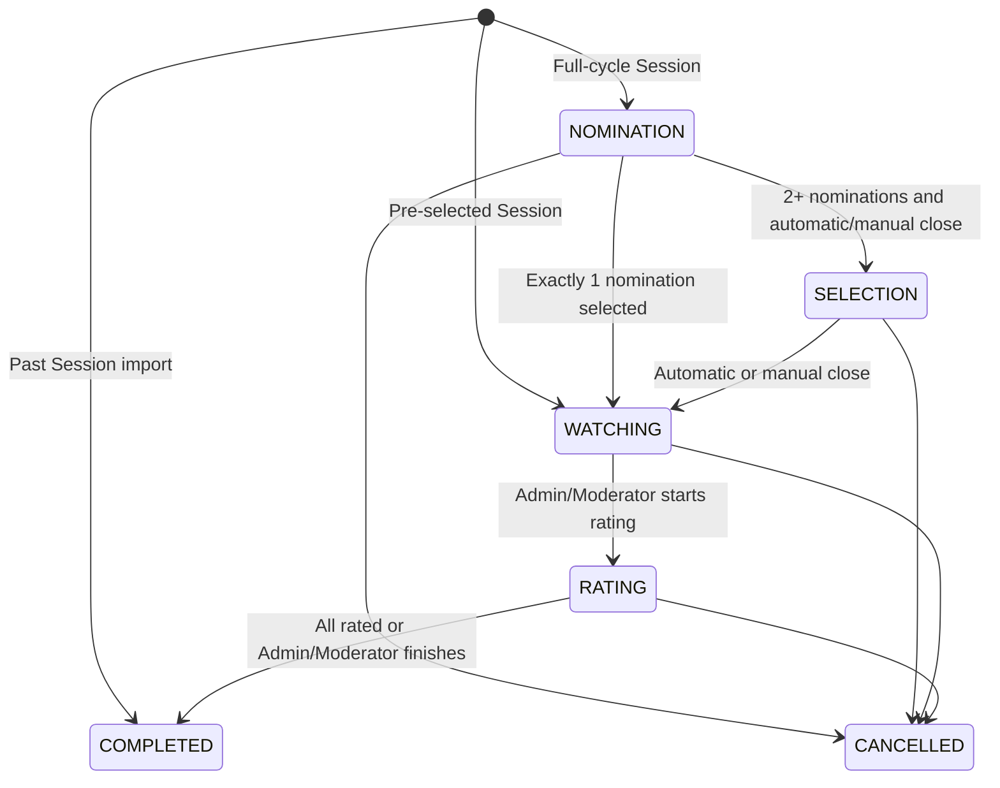

# PickFlick — Web App Roadmap

> Living product and delivery contract for the greenfield PickFlick application.
> Product behavior follows the approved design package when it conflicts with the retired blueprint,
> except where later developer decisions are recorded here.

| Related artifact | Project path |
| --- | --- |
| Design reference | [DESIGN.md](DESIGN.md) |
| Architecture reference | [ARCHITECTURE.md](ARCHITECTURE.md) |
| ADR registry | [_docs/decisions/README.md](_docs/decisions/README.md) |
| Canonical prototypes | [_docs/design/prototypes/index.html](_docs/design/prototypes/index.html) |

## 1. Project Contract

| Field | Value |
| --- | --- |
| Product | A private, registered-user web app that helps film clubs nominate, select, watch, rate, and remember films together. |
| Primary users | Friends and small film clubs; Club Admins and Moderators coordinating sessions; App Admins operating PickFlick. |
| Core outcome | A club can move from “what should we watch?” to a shared, durable film-night memory without chat-thread chaos or spreadsheet bookkeeping. |
| MVP proof | Real clubs repeatedly complete the session lifecycle, return to their shared and personal histories, and understand the Free/Pro value boundary. |
| Non-goals | Anonymous participation, session-only guests, native mobile apps, offline writes, public social profiles, AI analysis, and enterprise organization management. |

## 2. Product Shape

### Core Loop

```text
Create or join a Club -> Create a Session -> Nominate -> Select -> Watch -> Rate -> Remember
```

Alternative entries:

```text
Pre-selected film -> Watch -> Rate -> Remember
Past screening -> Record attendees, optional nominations/votes, and ratings -> Remember
Discover a film -> Rate or add to Watchlist -> My Library
```

### Key Differentiators

- The full club ritual lives in one coherent lifecycle instead of being split across chat, polls, notes, and spreadsheets.
- Configurable scored selection and deterministic tie-breaking produce a result without social negotiation deadlock.
- Club history and personal film memory coexist without collapsing historical session ratings into an editable personal rating.
- Club character matters: Projector Noir visuals, the panda mascot, achievements, leaderboards, and screening-language copy make administration feel ceremonial rather than bureaucratic.
- Members can join unlimited Clubs for free; the organizer’s plan controls each administered Club’s limits.

### Brand & UX Direction

| Area | Decision |
| --- | --- |
| Visual identity | “Projector Noir”: deep monochrome surfaces, restrained ivory and connected gold, editorial serif display type, utilitarian sans body type, mono metadata, and cinematic panda illustrations. |
| Voice & tone | Warm, concise, film-literate, and lightly theatrical. Forms, errors, privacy, billing, and destructive actions stay plain and unambiguous. |
| UX principle | Preserve context through the whole movie-night journey; make the current Club, Session, phase, progress, next action, and recovery path obvious. |

## 3. MVP Scope

Every canonical product surface in the design package is part of MVP. “Coming soon” items inside those surfaces remain out when listed below.

### IN

#### Public, authentication, and setup

- Responsive landing, pricing, contact, legal-entry, sign-in, Club invitation, and system error experiences.
- Registered accounts only, using Google or Apple OAuth; no anonymous or password-based use in MVP.
- Auth return-to-intended-destination, including Club invitation acceptance.
- First-run no-Clubs state, Create Club, Join Club, and safe error/recovery states.

#### Clubs and roles

- Create, edit, switch, archive/reactivate, and delete Clubs.
- Club description/avatar, member list, invite link, activity, statistics, ratings leaderboard, achievements, and session history.
- Club-level roles: Admin, Moderator, and Member.
- App-level roles: App Admin and User only.
- Club moderation, ownership transfer through App Admin operations, and explicit adminless-Club handling.

#### Session lifecycle

- Full-cycle, pre-selected, and past-session creation modes.
- Member-only Session invitations and participation roster.
- Nomination search through TMDB, one nomination per participant, and reusable Club bench items.
- Configurable scored voting range: lower bound 0 or 1; upper bound from 1 through 10; upper bound must exceed the lower bound.
- Deterministic tie-breaking and configurable result visibility according to plan and Club settings.
- Optional nomination deadline and automatic phase transitions defined in Section 5.
- Watching, Rating, Completed, early admin-controlled phase closure, participant removal, Session cancellation, and Session detail editing.
- Multiple incomplete Rating-phase Sessions without blocking a new Session; no parallel Nomination, Selection, or Watching Sessions in one Club.
- Past-session attendee selection, optional attendee ratings, and optional reconstruction of nominations and votes.

#### Personal film memory

- Global film search and TMDB-backed Movie Details.
- One editable personal rating per user/movie.
- Immutable completed Session ratings retained separately for historical accuracy.
- Watchlist with Low, Medium, and High priority.
- My Library ratings, watchlist, aggregate statistics, search/filtering, and personal achievements.
- Club aggregate statistics, leaderboard, and Club achievements.
- Provider-backed “You may also like” recommendations; personalized AI recommendations are not MVP.

#### Settings, notifications, privacy, billing, and operations

- Profile/avatar, language-ready settings, notification preferences, subscription/usage/billing history, billing portal, privacy, data import/export, GDPR archive, and account deletion.
- In-app and email notifications for lifecycle, inactivity, and billing events.
- Free and monthly Pro plan, Paddle checkout/portal/webhooks, downgrade/read-only behavior, and provider-managed recurring billing anchored to the initial payment date.
- App Admin overview, operational activity, user suspension/reinstatement, Club ownership transfer/deletion, registration controls, maintenance mode, TMDB refresh configuration, and audit-retention configuration.
- Installable, online-first PWA shell; network-required mutations and explicit offline failure messaging.
- Responsive S/M/L/XL behavior and accessible keyboard, touch, focus, validation, dialog, and reduced-motion contracts.

### OUT

| Item | Why out | Target |
| --- | --- | --- |
| AI analysis of watch history | Requires a stable history corpus, privacy design, evaluation, and cost controls. | Post-MVP |
| Personalized AI film recommendations | TMDB/provider-related titles cover the MVP surface without an inference pipeline. | Post-MVP |
| AI-enhanced Club analytics | Extended deterministic analytics ship first. | Post-MVP |
| Club ratings CSV export | Marked “Coming soon” in pricing; personal rating CSV remains MVP. | Post-MVP |
| Offline nominations, votes, ratings, or queued mutations | Conflict resolution and stale phase handling would add disproportionate risk. | Post-MVP |
| Web push notifications | In-app and email channels cover MVP. | Post-MVP |
| Annual billing | Initial commercial offer is €5 monthly Pro only. | Post-MVP |
| Russian or other UI locales | Build localization-ready now; ship English first. | Post-MVP |
| Session-only guests | Session access requires both registration and Club membership. | Not planned |
| App-wide Support role | App authorization has only User and App Admin. | Not planned |

## 4. Baseline Web App Considerations

| Status | Meaning |
| --- | --- |
| `Needs decision` | A safe answer is still required; the Decision Log names its trigger. |
| `Planned` | Direction is chosen but not implemented. |
| `Covered` | Implemented and verified with linked evidence. |
| `Deferred` | Intentionally postponed with a revisit trigger. |
| `Not applicable` | Retained to show why the concern does not apply. |

| Area | Default question | Status | Decision / note |
| --- | --- | --- | --- |
| Infrastructure & Foundation | How are repo layout, local dev, scripts, CI, containers, and base architecture handled? | Planned | pnpm TypeScript monorepo with web, API, worker, shared contracts, PostgreSQL, Redis, and containerized delivery; final choices are approved in Phase 1. |
| Users & Authentication | Does the app need users, roles, sessions, OAuth, permissions, or anonymous mode? | Planned | Registered Google/Apple OAuth users only; App Admin/User globally; Admin/Moderator/Member per Club; server-side authorization is mandatory. |
| Design System | How do UI primitives, layout, styling, tokens, and component rules stay consistent? | Planned | Canonical Projector Noir rules and prototypes live under `_docs/design/prototypes`; production tokens/components are established in Phase 2. |
| Localization | Is the product single-language, multilingual now, or multilingual-ready later? | Deferred | English MVP with externalized copy, locale-safe date/number formatting, and layout tolerance; add Russian when localization becomes scheduled. |
| Analytics & Monitoring | How will we know usage, errors, latency, job health, and outages? | Planned | Structured logs, error/performance monitoring, health checks, job metrics, and first-party aggregate product metrics; no undisclosed behavioral tracker. |
| SEO | Does the app have public/indexable pages, metadata, sitemap, robots, and share previews? | Planned | Public marketing/pricing/contact/legal pages are indexable with metadata and social previews; authenticated and invite-token routes are noindex. |
| Security | What are the auth, validation, secrets, rate limits, headers, abuse, and data-protection rules? | Planned | Deny-by-default authorization, boundary validation, output encoding, secure cookies/tokens, CSRF strategy, rate limits, verified webhooks, encrypted transport, and secret isolation. |
| Testing & Quality Gates | How will behavior be verified? | Planned | Unit/domain, API integration, database, worker/job, E2E critical-flow, accessibility, responsive visual, and provider-contract checks run through CI gates. |
| Data & Privacy | What personal data is stored, exported, deleted, retained, and shared? | Planned | Data inventory, personal CSV and GDPR archive, account deletion/anonymization, shared-history preservation, audit retention, and provider disclosures are launch requirements. |
| Mobile Support | Is mobile first-class? | Planned | Mobile is first-class, recomposed rather than merely shrunk, with fixed bottom navigation and 44px minimum touch targets. |
| PWA / installability | Does the app need offline support, installability, push, or an app shell? | Planned | Installable online-first PWA; cached shell/read-only fallback may be used, but mutations require a live connection; push deferred. |
| Environments & Production Deploy | How are environments, migrations, deploys, rollback, and smoke checks handled? | Planned | Local, CI/test, UAT, and production profiles; Docker deployment through Dokploy remains proposed; forward migrations, backups, rollback, and smoke checks are required. |

### Pre-MVP Production Readiness

These decisions must be resolved before the first production MVP launch. A `Deferred` item needs
an owner and revisit trigger; it cannot bypass a launch-critical risk.

| Topic | Required decision and evidence | Status | Owner | Current planning direction / revisit trigger |
| --- | --- | --- | --- | --- |
| Deploy ownership | Name one release owner and rollback authority; record the exact approved revision, readiness and smoke evidence, and tested rollback path. | Needs decision | Release owner — to be assigned | Phase 23 prepares the release candidate and runbooks; Phase 25 records the deployed revision and production evidence. Assign before Phase 23 release rehearsal. |
| Data durability | Decide backup destination and retention; demonstrate restore; separately decide the response to regional or hosting-account loss. | Needs decision | Infrastructure owner — to be assigned | PostgreSQL and durable avatars require backups; Redis is not a domain source of truth. Align retention with the Phase 19 legal/privacy decision and complete the restore/disaster-recovery drill in Phase 23. |
| Edge reliability | Verify client identity behind the chosen proxy, abuse limits, graceful connection/workload drain, and a real UAT drill. | Needs decision | Infrastructure owner — to be assigned | Reverse proxy and Dokploy are Proposed. Decide their concrete behavior before Phase 23; verify it again with production-like UAT before the Go decision. |
| Public surface | Decide the canonical host; validate SEO, PWA, and social/OG assets in production; account for external crawler cache refresh. | Needs decision | Product owner + developer | Public metadata is implemented in Phase 3 and completed in Phase 23. Final domain remains open; validate deployed canonical/robots/sitemap/preview behavior and document cache-refresh evidence before launch. |
| Compliance boundary | Separate technically shipped behavior from required external legal action, then explicitly decide `Launch gate` or `Post-launch follow-up` for each unresolved item. | Needs decision | Product owner + legal/privacy reviewer | Privacy, retention, billing, provider disclosure, and public legal copy require review. Resolve the disposition before Phase 23 exits; no safety, privacy, or billing risk may be deferred through Phase 24. |

## 5. Business, Product & Monetization Rules

### Identity and access

| Rule | Rationale | Enforcement |
| --- | --- | --- |
| Every participant has a registered PickFlick account. | Personal history, privacy rights, invitations, and phase denominators require a durable identity. | OAuth gate plus API authorization. |
| App roles are only User and App Admin. | Avoid an unsupported global Support permission model. | Database constraint and server policy. |
| Each Club has at most one Admin, may have multiple Moderators, and may temporarily have no Admin. | Separates ownership/billing from operational help and supports rare account-deletion cases. | Membership-role constraints and audited transitions. |
| Admin owns billing, ownership, Club deletion, role management, and all Moderator capabilities. | High-impact actions remain with the owner. | Server authorization; never UI-only. |
| Moderator may create/edit/cancel/advance Sessions, invite or remove Session participants, and log past Sessions. | Lets trusted members run movie nights without financial or ownership authority. | Server authorization. |
| Member may accept eligible invitations, participate, view allowed results/history, manage personal data, and leave a Session or Club. | Covers the normal participant journey. | Server authorization and visibility policy. |
| A Session invite reveals no Session details to a non-member. | Prevents accidental disclosure and enforces the Club boundary. | Generic forbidden state with a hint to join the Club first. |
| Accepting a Session invite never creates membership. | Membership requires the separate Club invitation flow. | Invite-type validation and transaction boundary. |

### Club and Session invariants

| Rule | Rationale | Enforcement |
| --- | --- | --- |
| A Club may have at most one blocking Session in Nomination, Selection, or Watching. | Members should focus on one active movie-night decision. | Database-level invariant plus transactional state change. |
| Any number of Sessions may remain in Rating while a new blocking Session runs. | Slow or unwilling raters must not block the next movie night. | Rating is explicitly non-blocking. |
| Admin or Moderator may close Rating before all responses arrive. | Participation is voluntary and waiting indefinitely is not useful. | Confirmed phase action; received ratings remain immutable history. |
| One participant may submit one nomination in a full-cycle Session. | Keeps influence balanced. | Unique Session/participant nomination constraint. |
| A submitted Selection ballot is immutable in MVP. | Preserves trust and makes automatic completion deterministic. | Unique ballot plus closed submission state. |
| Session ratings are historical records; personal movie ratings are editable summaries. | Club history must not rewrite when a person changes their mind later. | Separate entities and aggregates. |
| Past Sessions may record partial historical evidence. | Old movie nights rarely have complete data. | Optional nominations, ballots, and attendee ratings with provenance. |

### Automatic phase transitions

The eligible denominator `N` is the current Session participant roster for that phase. Removing or leaving a Session updates the roster before completion is evaluated. Every transition is idempotent and serialized to prevent two clients or a deadline job from advancing twice.

| Current phase | Automatic trigger | Result |
| --- | --- | --- |
| Nomination | All `N` participants have nominated and at least two nominations exist. | Open Selection and notify participants. |
| Nomination | All `N` participants have nominated and exactly one nomination exists. | Select the sole film and advance to Watching. |
| Nomination | Optional deadline expires with at least two nominations. | Close nominations, open Selection, and notify participants. |
| Nomination | Optional deadline expires with exactly one nomination. | Select the sole film and advance to Watching. |
| Nomination | Optional deadline expires with zero nominations. | Stay in Nomination and notify the Admin/Moderators; submissions remain open until manual action or a new deadline. |
| Selection | All `N` participants have submitted ballots. | Compute the winner, advance to Watching, and notify participants. |
| Rating | All `N` participants have rated. | Complete the Session and publish allowed results. |

Otherwise, only the Club Admin or a Moderator advances a phase with explicit controls. Watching always moves to Rating manually because attendance, the real screening, and timing cannot be inferred from page activity. Manual early closure must use the same deterministic result rules and may not advance Nomination with zero films.

### Selection and result rules

- Each Club chooses an inclusive score scale `0..N` or `1..N`; the upper bound is no greater than 10.
- Every Selection participant scores every nomination before submitting.
- Winner computation uses total score first, then the deterministic tie-break sequence retained from the product blueprint: more maximum scores, more distinct supporting voters, earlier nomination, stable movie-provider ID, then stable nomination ID.
- Free Clubs keep vote results hidden from ordinary members; Pro Club Admins configure post-close visibility. App Admins retain audited operational access only when required.
- “Show who nominated,” pre-submission nomination visibility, post-close vote visibility, and post-close rating visibility are independent Club policies where the plan permits configuration.
- Rating uses a fixed 1–10 scale and may include an optional comment.

### Pricing / Limits

| Feature / limit | Free — Screening Room | Pro — Director’s Cut |
| --- | --- | --- |
| Price | €0 | €5 per recurring monthly billing period |
| Admin Clubs per subscriber | 1 | 5 |
| Clubs joined as Member/Moderator | Unlimited | Unlimited |
| Members per Club | 8 | 16 |
| Blocking Sessions per Club | 1 | 1 |
| Open Rating Sessions per Club | Unlimited | Unlimited |
| Session history | Unlimited | Unlimited |
| Club customization | Included | Included |
| Vote-result visibility | Always hidden from ordinary members | Admin-configurable |
| Inactivity grace | 90 days | 180 days |
| Analytics | Basic counters | Extended deterministic analytics |

- The monthly billing anchor is the first successful payment date and is managed by Paddle; it is not a calendar-month subscription.
- Pro cancellation or downgrade takes effect at the end of the paid billing period.
- Over-limit Clubs and accounts retain data but become read-only for new rounds/invites until within Free limits. The exact Club-selection UX on downgrade remains in the Decision Log.
- Inactive Clubs become draft/archived after their plan’s grace period, with Admin notification. They are not automatically deleted and may be reactivated.
- Members never need Pro solely to participate; the Club Admin’s plan determines Club limits.

### Account deletion and shared history

- Delete the user’s private profile data and cancel their active subscription through an auditable workflow.
- Preserve shared Club/Session history by anonymizing the departing user’s attribution rather than deleting nominations, votes, ratings, or Sessions required by other members’ history.
- Remove memberships and personal Library/Watchlist data according to the approved retention policy.
- If the deleted user was Club Admin and no transfer occurred, leave the Club adminless, notify all remaining members, and make ownership-dependent actions unavailable until a later recovery policy is chosen.
- Exact legal wording and deletion timing require pre-launch review; prototype copy is not a legal commitment.

## 6. Glossary

| Term | Meaning | Canonical usage |
| --- | --- | --- |
| PickFlick | The product and application. | `PickFlick` |
| User | Any registered account; may also have app-level or Club-level roles. | `User` |
| App Admin | A User authorized to operate the PickFlick service globally. | `APP_ADMIN` |
| Club | A private group that organizes and remembers screenings. “Group” is retired product terminology. | `Club` |
| Club Admin | The Club owner and subscription/role authority. | `ADMIN` membership role |
| Moderator | A Club member allowed to operate Sessions but not ownership or billing. | `MODERATOR` membership role |
| Member | A normal Club participant. | `MEMBER` membership role |
| Session | One planned or historical screening and its lifecycle data. | `Session` |
| Blocking Session | A Session in Nomination, Selection, or Watching; only one per Club. | Derived lifecycle classification |
| Nomination | One participant’s proposed film for a full-cycle Session. | `Nomination` |
| Selection | The scored voting phase used to choose among nominations. “Voting” may appear as explanatory copy but is not the canonical phase name. | `SELECTION` |
| Ballot | One participant’s immutable set of scores for every nomination. | `SelectionBallot` |
| Session Rating | A participant’s historical 1–10 response for one screening. | `SessionRating` |
| Personal Rating | A user’s current editable rating for a Movie, independent from historical Session records. | `PersonalMovieRating` |
| Bench | Club-specific films saved for quick future nomination. | `ClubBenchItem` |
| Watchlist | A user’s personal saved films with viewing priority. | `WatchlistItem` |
| Rating phase | Non-blocking period after watching while attendees submit ratings. | `RATING` |
| Completed | Closed Session whose visible results and history are stable. | `COMPLETED` |

## 7. Domain Model & State

### Domain Model

| Entity | Key fields | Notes |
| --- | --- | --- |
| User | profile, email, app role, status, locale | Registered identity; suspended users are signed out and denied access. |
| OAuthAccount | provider, provider subject, User | Google and Apple identities; provider subject is unique. |
| Club | Admin, name, description, avatar, plan-derived limits, visibility settings, lifecycle | May temporarily be adminless; shared history survives personal account deletion. |
| Membership | Club, User, role, status, joined/left timestamps | Unique active membership per User/Club; roles Admin, Moderator, Member. |
| ClubInvite | token digest, Club, inviter, expiry, state | May be inspected only within the privacy-safe invitation contract. |
| Session | Club, type, phase, date, location, topic, notes, selected Movie, deadline, closure metadata | Type is Full Cycle, Pre-selected, or Past; phase controls blocking status. |
| SessionParticipant | Session, Membership, invitation/attendance state | Owns phase denominator and historical attendance snapshot. |
| SessionInvite | token digest, Session, invited Membership, expiry, state | Valid only for an existing Club member; non-members receive no details. |
| Movie | TMDB ID, title, release data, credits, media metadata, refresh state | Cached provider record; TMDB ID is canonical external identity. |
| ClubBenchItem | Club, Movie, creator, created time | Reusable future nomination shortcut. |
| Nomination | Session, participant, Movie, submitted time, provenance | One per participant; imported past data is marked as such. |
| SelectionBallot | Session, participant, submitted time | Immutable after submission. |
| SelectionScore | Ballot, Nomination, score | Score validated against the Club’s snapshot scale. |
| SessionRating | Session, participant, score, comment, submitted time | Historical value; immutable after Session completion. |
| PersonalMovieRating | User, Movie, score, updated time, source | Editable current rating; Session submission may update it without rewriting history. |
| WatchlistItem | User, Movie, priority, timestamps | Priority is Low, Medium, or High. |
| AchievementDefinition | scope, key, rule/version, presentation | Personal or Club achievement; version rules rather than mutating earned history silently. |
| AchievementAward | definition, User or Club, progress, awarded time | Supports unlocked, in-progress, and not-started views. |
| Notification | recipient, type, payload reference, read/delivery state | In-app source of truth; payload uses safe entity references. |
| NotificationPreference | User, event type, in-app/email flags | Billing/service announcements may have mandatory policy exceptions. |
| Subscription | User, Paddle IDs, plan, status, billing period | Club entitlements derive from the Admin’s active plan. |
| BillingEvent | provider event ID, type, processing state | Idempotent webhook record and audit trail. |
| AdminAuditEvent | actor, action, target, safe metadata, timestamp | Append-oriented sensitive operations log with configurable retention. |
| ContactMessage | optional identity fields, message, handling state | Message is required and limited to 500 characters. |
| DataExportJob | User, export type, status, expiry | Produces personal CSV or GDPR archive without blocking requests. |

### Session State Machine



`RATING` and `COMPLETED` do not consume the Club’s single blocking-Session slot. `CANCELLED` remains auditable but is excluded from normal history unless product copy explicitly exposes it.

## 8. Navigation & Route Map

### Navigation Decisions

| Surface | Decision |
| --- | --- |
| Public header | Product mark, product/how-it-works entry, Pricing, Contact, and Sign in/Get started actions. |
| Authenticated desktop | Global film search, notifications, account menu, Club switcher, and context tabs/sidebar. |
| Authenticated mobile | Recomposition with fixed bottom navigation for Hub, Library, Alerts, and Settings; local film-strip menus expose subviews. |
| App Admin | Separate protected administration shell accessible only to App Admin. |
| Post-login routing | Return to a valid pending invite when present; otherwise open last-used Club, or the no-Clubs onboarding state. |

### Route Map

| Route | Description |
| --- | --- |
| `/` | Public landing page. |
| `/pricing` | Free/Pro comparison and billing entry. |
| `/contact` | Public contact form. |
| `/login` | Google/Apple sign-in and legal links. |
| `/legal/privacy` | Launch-required privacy notice; final copy requires review. |
| `/legal/terms` | Launch-required terms; final copy requires review. |
| `/invite/club/[token]` | Club invitation preview, auth continuation, accept/decline, expired state. |
| `/invite/session/[token]` | Member-only Session invitation; generic error for non-members or invalid access. |
| `/app` | Authenticated landing; last Club Hub or no-Clubs state. |
| `/clubs/new` | Create Club and configure selection scale. |
| `/clubs/[clubId]` | Club Hub with Overview, Sessions, Ratings, Members, Achievements, and Manage Club views. |
| `/clubs/[clubId]/sessions/new` | Create full-cycle or pre-selected Session. |
| `/clubs/[clubId]/sessions/past/new` | Log a past screening. |
| `/sessions/[sessionId]` | Phase-aware Session detail for Nomination, Selection, Watching, Rating, or Completed. |
| `/library` | Personal ratings, Watchlist, statistics, and achievements. |
| `/movies/[tmdbId]` | TMDB-backed Movie Details, personal rating, Watchlist priority, and related films. |
| `/settings` | Profile, notifications, subscription, privacy, and import/export sections. |
| `/admin` | App Admin overview, Users, Clubs, and application settings. |
| `not-found` | Branded 404 state with safe navigation. |
| `error` | Branded application error state with retry and Hub recovery. |

## 9. Architecture Decisions

All technical choices are proposed until verified in Phase 1. Exact versions are selected then, not frozen in planning prose.

| Area | Planning decision | State | Architecture / ADR reference |
| --- | --- | --- | --- |
| Repository | pnpm TypeScript monorepo with web, API, worker, and shared packages. | Proposed | [Architecture](ARCHITECTURE.md#3-building-blocks--boundaries) |
| Frontend | Next.js App Router, selective Mantine primitives, CSS Modules/custom tokens, TanStack Query; add Zustand only for demonstrated cross-route client state. | Proposed | [Architecture](ARCHITECTURE.md#2-system-overview) |
| Backend | NestJS modular REST API with OpenAPI contracts and SSE for live progress. | Proposed | [Architecture](ARCHITECTURE.md#2-system-overview) |
| Database | PostgreSQL with Prisma migrations and transactional domain invariants. | Proposed | [Architecture](ARCHITECTURE.md#4-data--interfaces) |
| Jobs / async | Redis + BullMQ worker for deadlines, notification delivery, exports, metadata refresh, and webhook follow-up. | Proposed | [Architecture](ARCHITECTURE.md#3-building-blocks--boundaries) |
| Storage | S3-compatible object storage for user/Club avatars and generated exports; bundled brand assets remain static. | Proposed | [Architecture](ARCHITECTURE.md#4-data--interfaces) |
| Deployment | Docker images behind a reverse proxy, proposed Dokploy target, PostgreSQL/Redis/object-store dependencies, separate API and worker processes. | Proposed | [Architecture](ARCHITECTURE.md#6-runtime--delivery) |

## 10. External Integrations

| Provider / capability | Purpose | MVP status | Architecture reference |
| --- | --- | --- | --- |
| Google OAuth | Registered identity. | Planned | [External integrations](ARCHITECTURE.md#external-integrations) |
| Apple Sign in | Registered identity. | Planned | [External integrations](ARCHITECTURE.md#external-integrations) |
| TMDB | Film search, metadata, credits, images, and related titles. | Planned | [External integrations](ARCHITECTURE.md#external-integrations) |
| Paddle | Merchant of record, checkout, recurring subscription state, invoices, portal, tax handling. | Planned | [External integrations](ARCHITECTURE.md#external-integrations) |
| Resend | Transactional and opted-in email notifications. | Planned | [External integrations](ARCHITECTURE.md#external-integrations) |
| S3-compatible storage | Avatar uploads and time-limited export artifacts. | Planned | [External integrations](ARCHITECTURE.md#external-integrations) |
| Sentry | Error and performance visibility with privacy-safe context. | Planned | [External integrations](ARCHITECTURE.md#external-integrations) |
| IMDb/Wikipedia links | Optional outbound Movie Details links built from trusted identifiers. | Planned | [External integrations](ARCHITECTURE.md#external-integrations) |

## 11. Phase Plan

Each delivery phase owns one independently verifiable outcome. Verification gates occur after every five delivery phases. They supplement, rather than postpone, automated tests and focused manual checks inside each feature phase.

### Phase elaboration and evidence contract

- Keep future phases at the detail level below: dependencies, meaningful scope, observable acceptance, expected evidence, deliverables, and exclusions.
- Before a phase starts, create `_docs/phase-N-short-name.md` with implementation-level decisions, inherited behavior, temporary shims/removals, exact subtasks, edge cases, and verification commands.
- Link the active phase document from `_docs/README.md` while work is in progress.
- On completion, consolidate durable product/design/architecture/operations knowledge into its canonical document, record evidence in this Roadmap, and delete the temporary phase document.
- Do not mark a phase Done with unchecked acceptance items, missing evidence, or undocumented deferred work.
- A Human Verification & Bug Fixing gate produces a severity-classified issue register. Blockers and Majors must be fixed before continuing; lower-severity deferrals require a Roadmap Decision Log entry or a later owning phase.

### Phase 0 — Guidance Baseline · Done

**Goal:** Establish one coherent, source-backed product/design/architecture contract and reusable source layout.

**Dependencies:** None.

**Scope:**

- [x] Audit the retired blueprints, canonical designs, UX flow, design system, responsive rules, and asset inventory.
- [x] Resolve material product conflicts with the developer.
- [x] Create and align the canonical guidance set.
- [x] Organize the self-contained prototypes and reusable production brand assets.
- [x] Validate paths, manifests, and guidance integrity.

**Acceptance Check:**

- [x] Guidance validator passes with no placeholders or broken links.
- [x] Canonical design package remains self-contained.
- [x] Production brand assets have a verified reusable inventory.

**Evidence:** Project-guidance validator passed all seven required documents; prototype scan passed 26 HTML files and 584 static local references; JSON validation passed; the brand manifest and dimensions passed for 24 assets; retired blueprints and OS metadata are absent.

**Deliverables:** Roadmap, Design, Architecture, agent instructions, docs map, ADR registry, organized prototypes, and brand assets.

**Out of scope:** Application scaffolding or dependency installation.

### Phase 1 — Infrastructure & Repository Foundation · Not started

**Goal:** Create a reproducible monorepo/runtime foundation on which every vertical slice can be built and verified.

**Dependencies:** Phase 0 guidance; approval of the foundational architecture ADRs.

**Scope:**

- [ ] Decide and record repository topology, auth-boundary direction, database workflow, queue/outbox approach, and deployment baseline.
- [ ] Scaffold web, API, worker, database, contracts, UI, and configuration packages without retaining unused generated files.
- [ ] Establish PostgreSQL, Redis, object-storage, and mail-development dependencies with typed environment validation.
- [ ] Create the initial Prisma/migration workflow, seed/test-fixture strategy, and safe reset policy for non-production environments.
- [ ] Add real install/dev/build/lint/type-check/test/migrate commands and update `AGENTS.md`.
- [ ] Establish CI, structured logging, request/job correlation, health/readiness endpoints, and a stable API error envelope.

**Acceptance Check:**

- [ ] A clean checkout installs, starts required services, migrates, seeds, and runs web/API/worker from documented commands.
- [ ] Lint, type-check, unit test, integration test, and production builds pass locally and in CI.
- [ ] Invalid/missing configuration fails safely without exposing secrets.
- [ ] Architecture/ADR documentation matches the generated repository and runtime topology.

**Evidence:** Command logs, CI run, service health checks, initial migration/test output, ADRs, and repository tree review.

**Deliverables:** Runnable monorepo, local dependency stack, CI baseline, database foundation, typed configuration, and real command map.

**Out of scope:** Production UI and end-user feature behavior.

### Phase 2 — Production Design System & App Shells · Not started

**Goal:** Translate Projector Noir into reusable production foundations and responsive public/private/admin shells.

**Dependencies:** Phase 1 runnable web foundation.

**Scope:**

- [ ] Implement approved color, typography, spacing, layout, border/elevation, imagery, and motion tokens from the canonical design contract.
- [ ] Build accessible buttons, fields, toggles, tabs, menus, dialogs, progress, banners, tables, feedback, and rating/score primitives.
- [ ] Build public, authenticated, Session-detail, Settings/Library, and App Admin shell structures without feature data coupling.
- [ ] Implement S/M/L/XL responsive composition, fixed mobile navigation, bounded table scrolling, and 44px touch targets.
- [ ] Add reduced-motion, keyboard/focus, component-state, visual-regression, and accessibility test harnesses.
- [ ] Wire normalized brand assets through a single reusable asset contract.

**Acceptance Check:**

- [ ] Shared primitives cover default, hover, focus, pressed, loading, disabled, validation, success, and destructive states where applicable.
- [ ] Shells work at representative 390, 768, 1024, and 1440 widths without horizontal page scrolling.
- [ ] Keyboard/touch interaction and automated accessibility checks pass for the shared component set.
- [ ] Source-comparison captures are recorded and Design build/QA status is updated honestly.

**Evidence:** Story/demo routes, component tests, accessibility output, viewport captures, visual diffs, and Design updates.

**Deliverables:** Production token/component layer, responsive shells, and visual/accessibility QA harness.

**Out of scope:** Complete page content or business mutations.

### Phase 3 — Public Site & System States · Not started

**Goal:** Deliver the complete public-facing PickFlick story and safe recovery surfaces.

**Dependencies:** Phase 2 public shell and primitives; production domain/contact values may remain environment-configured until confirmed.

**Scope:**

- [ ] Implement Landing, Pricing, and Contact surfaces from canonical designs.
- [ ] Implement privacy/terms entry routes with clearly provisional copy until legal review.
- [ ] Implement branded not-found and application-error recovery surfaces.
- [ ] Wire the contact form with validation, rate limiting, stable success/error feedback, and privacy-safe delivery/storage.
- [ ] Add baseline metadata, canonical URLs, social previews, robots, sitemap, and noindex boundaries for non-public routes.
- [ ] Cover loading, provider/network failure, long-content, and reduced-motion behavior.

**Acceptance Check:**

- [ ] Every public route matches its responsive source and is usable with keyboard, touch, and assistive technology.
- [ ] Contact submission handles valid, invalid, duplicate, rate-limited, and delivery-failure cases without losing safe input.
- [ ] 404/500 recovery never reveals internal details and offers working navigation/retry.
- [ ] Metadata and indexing rules are correct in a production build.

**Evidence:** E2E runs, responsive captures, accessibility results, contact integration tests, and metadata/robots inspection.

**Deliverables:** Public marketing/contact/legal-entry/system-state vertical slice.

**Out of scope:** Registration, authenticated pages, live billing checkout, and final legal approval.

### Phase 4 — Authentication & Account Onboarding · Not started

**Goal:** Let a person become a registered PickFlick User through Google or Apple and safely retain intended navigation.

**Dependencies:** Phase 1 identity foundation; Phase 2 authenticated shell; confirmed OAuth callback configuration.

**Scope:**

- [ ] Choose/record the auth/session implementation and implement Google and Apple OAuth.
- [ ] Implement secure server-managed sessions, callback validation, sign-out, session revocation, and account linking rules.
- [ ] Implement Login and initial account/profile bootstrap from provider-safe fields.
- [ ] Preserve and validate return-to-intent for app, Club invitation, and safe fallback routes.
- [ ] Enforce User/App Admin global roles and suspended-user denial at route, API, SSE, and file boundaries.
- [ ] Add auth abuse protection, security logging without token leakage, and provider-failure recovery.

**Acceptance Check:**

- [ ] New and returning Google/Apple Users can sign in/out and reach the intended authorized destination.
- [ ] Invalid state/nonce/callback, provider denial, duplicate identity, suspension, expiry, and revoked-session cases fail safely.
- [ ] Protected routes and APIs reject unauthenticated/forged access independently of UI controls.
- [ ] Auth integration/E2E/security checks pass without provider tokens in browser storage or logs.

**Evidence:** Provider sandbox runs, auth integration/E2E tests, session-revocation proof, log review, and accepted auth ADR.

**Deliverables:** Registered-user identity/session vertical slice.

**Out of scope:** Anonymous use, password authentication, Club membership, and complete profile settings.

### Phase 5 — Clubs, Membership & Roles · Not started

**Goal:** Create the secure private Club boundary and its role/entitlement invariants.

**Dependencies:** Phase 4 registered identity; Phase 1 database; Phase 2 authenticated shell.

**Scope:**

- [ ] Implement Club, Membership, Admin/Moderator/Member roles, settings, lifecycle, and audit-safe role transitions.
- [ ] Implement the no-Clubs state and Create Club flow, including configurable `0..N` or `1..N` Selection scale.
- [ ] Enforce one Admin maximum, temporary adminless state, unique Membership, Free defaults, and plan-derived limits.
- [ ] Implement Club edit, archive/reactivate, leave, and delete foundations with explicit confirmations.
- [ ] Build server-side policy guards/projections for Admin, Moderator, Member, App Admin, suspended User, and non-member.
- [ ] Seed/test plan entitlements without Paddle; the Billing module will replace fixture subscription state in Phase 20.

**Acceptance Check:**

- [ ] The complete role/limit/action matrix passes integration tests, including forged requests and adminless Clubs.
- [ ] Club creation validates names, limits, and score ranges transactionally.
- [ ] Destructive and ownership-sensitive actions are audited and never rely on hidden UI alone.
- [ ] No-Clubs/Create Club/member views match their responsive design sources.

**Evidence:** Database constraints, policy/integration tests, role matrix, audit examples, E2E captures, and guidance updates.

**Deliverables:** Club/membership domain, role policies, onboarding states, and Club creation/settings foundation.

**Out of scope:** Invitations, full Club Hub data, Sessions, and live subscription billing.

### Phase 6 — Human Verification & Bug Fixing I · Not started

**Goal:** Stabilize the foundation, design system, public/auth flows, and Club boundary before building the core movie-night workflow.

**Dependencies:** Phases 1–5 complete with their own evidence.

**Scope:**

- [ ] Create `_docs/phase-6-human-verification-1.md` with a severity-classified issue register and tested build/environment.
- [ ] Manually exercise clean setup, public/contact/error, Google/Apple auth, no-Clubs, Club creation, roles, limits, and destructive flows.
- [ ] Compare all delivered surfaces at S/M/L/XL widths and keyboard/touch/reduced-motion modes against canonical designs.
- [ ] Perform negative authorization, session-revocation, validation, configuration, migration, and provider-failure checks.
- [ ] Fix all Blocker/Major issues and re-run focused checks after each affected subsystem change.
- [ ] Explicitly defer remaining Minor/Polish issues with ownership/revisit trigger; consolidate durable docs and remove completed staging docs.

**Acceptance Check:**

- [ ] No open Blocker or Major issue remains.
- [ ] Full CI and critical E2E/accessibility/responsive suites pass after fixes.
- [ ] Manual evidence covers the five completed delivery phases and documentation matches verified behavior.
- [ ] The issue register records every finding, fix, retest, and approved deferral.

**Evidence:** Verification document, issue register, before/after captures, test runs, auth/role matrix, and documentation diff.

**Deliverables:** Stabilized first product foundation and clean midstream documentation baseline.

**Out of scope:** New product capability unrelated to resolving verification findings.

### Phase 7 — Club Hub & Club Invitations · Not started

**Goal:** Make Clubs navigable, understandable, and joinable through the approved Hub and invitation experiences.

**Dependencies:** Phase 6 stabilization; Phase 5 Club/membership model.

**Scope:**

- [ ] Implement Club switcher/carousel and authenticated post-login routing to last Club or no-Clubs state.
- [ ] Implement Hub Overview, Members, Manage Club foundation, recent activity, basic counters, and empty/loading/read-only states.
- [ ] Implement Club invite creation, token hashing/expiry/revocation, privacy-safe preview, auth continuation, accept/decline, and member-limit enforcement.
- [ ] Implement the shared pending-invite ticket/popover contract; Session-specific rows are completed in Phase 9.
- [ ] Implement moderator management, member leave/removal boundaries, and adminless notifications visible from the Hub.
- [ ] Ensure downgrade/read-only projections can later be supplied by Phase 20 without redesigning Hub actions.

**Acceptance Check:**

- [ ] A registered User can accept/decline a valid Club invitation and land in the correct Hub.
- [ ] Expired/revoked/over-limit/already-member/non-target invitations reveal only safe information and recover clearly.
- [ ] Club switching never leaks cached data or permissions between Clubs.
- [ ] Hub and invite surfaces match responsive/keyboard/touch design contracts.

**Evidence:** Invite security/integration tests, Club-switch E2E, responsive captures, and policy checks.

**Deliverables:** Usable Club Hub foundation, Club switcher, invitation lifecycle, and member management UI.

**Out of scope:** Session creation, advanced statistics, leaderboard, and achievements.

### Phase 8 — Movie Catalog, TMDB & Global Search · Not started

**Goal:** Establish one trusted Movie identity/search/detail layer for every nomination, history, and Library feature.

**Dependencies:** Phase 1 worker/database foundation; Phase 2 shell/search primitives; Phase 4 authentication.

**Scope:**

- [ ] Implement the TMDB adapter, server-held credentials, search/detail/credits/media mapping, rate-limit handling, and cache freshness state.
- [ ] Implement the canonical Movie record keyed by TMDB identity with transactional upsert/deduplication.
- [ ] Implement authenticated global film search with loading, no-results, stale-safe, provider-error, and keyboard behavior.
- [ ] Implement Movie Details metadata/trailer/credits/outbound trusted links and provider-backed related titles.
- [ ] Add refresh jobs and App Admin-configurable refresh cadence contract for later Phase 21 wiring.
- [ ] Keep fixture poster/still assets out of production data and record required TMDB attribution/usage.

**Acceptance Check:**

- [ ] Search/detail results are deduplicated, safely encoded, cached intentionally, and recover from provider failure/rate limiting.
- [ ] Global search is authorized, responsive, keyboard-accessible, and routes to stable Movie identities.
- [ ] Refresh jobs are idempotent and observable; stale data is used only where explicitly safe.
- [ ] Movie Details matches canonical design structure without implying AI personalization.

**Evidence:** Provider-contract tests, cache/refresh tests, search/Movie E2E, accessibility results, and design captures.

**Deliverables:** Movie/TMDB module, global search, Movie Details read surface, and refresh foundation.

**Out of scope:** Personal Rating, Watchlist mutations, AI recommendations, and Session nominations.

### Phase 9 — Session Creation & Participant Roster · Not started

**Goal:** Create full-cycle and pre-selected Sessions with a secure member-only roster and one-blocking-Session guarantee.

**Dependencies:** Phase 7 Clubs/invitations; Phase 8 Movie search; Phase 1 worker/database.

**Scope:**

- [ ] Implement Session, SessionParticipant, SessionInvite, type, phase, date/location/topic/notes, and edit/cancel foundations.
- [ ] Enforce the PostgreSQL/transactional invariant allowing one Nomination/Selection/Watching Session per Club and unlimited Rating Sessions.
- [ ] Implement Create Session modes, required fields, optional nomination deadline, pre-selected Movie search, and result state.
- [ ] Implement member-only Session invitations, accepted roster, leave/remove behavior, expiry, and generic non-member denial with join-Club hint.
- [ ] Add active/Rating/history row projections needed by the Hub without treating prototype variant rows as concurrent fixtures.
- [ ] Snapshot relevant Club settings/score range and define roster denominator/version behavior for later automatic transitions.

**Acceptance Check:**

- [ ] Full-cycle and pre-selected Sessions validate and enter the correct initial phase.
- [ ] Concurrent requests cannot create two blocking Sessions in one Club; Rating Sessions do not block creation.
- [ ] Non-members learn no Session detail and accepting a Session invite never creates Club membership.
- [ ] Roster changes and Session edits are authorized, audited where sensitive, and reflected consistently.

**Evidence:** Database concurrency tests, Session/invite integration tests, Create Session E2E, role checks, and Hub row captures.

**Deliverables:** Session/roster/invite domain and creation flows.

**Out of scope:** Nomination submission, Selection ballots, watching/rating completion, and past-session entry.

### Phase 10 — Nomination & Deadline Automation · Not started

**Goal:** Let every eligible participant nominate one film and advance safely through complete or expired Nomination.

**Dependencies:** Phase 9 Session/roster; Phase 8 Movies; Phase 1 worker/outbox; notification events may be stored before Phase 17 adds the inbox/preferences UI.

**Scope:**

- [ ] Implement Nomination and Club Bench entities, one-nomination-per-participant constraint, TMDB selection, and bench shortcuts.
- [ ] Implement the Nomination Session detail state, participant progress, visibility policies, submission locking, and operator controls.
- [ ] Implement durable delayed deadline jobs, stable job IDs, stale-job guards, periodic overdue reconciliation, and safe deadline changes/cancellation.
- [ ] Implement automatic `N/N` transition: two or more nominations open Selection; one selects the sole Movie and advances to Watching.
- [ ] Implement deadline behavior: zero stays open and alerts operators; one advances to Watching; two or more open Selection.
- [ ] Write transactional outbox/domain events for progress and future in-app/email notification delivery.

**Acceptance Check:**

- [ ] Duplicate/concurrent nomination attempts cannot violate uniqueness or advance the Session twice.
- [ ] Complete, sole-nomination, zero/one/many-at-deadline, changed-deadline, cancelled, restart, and reconciliation cases pass.
- [ ] Visibility settings prevent pre-submission or nominator disclosure when disabled.
- [ ] Nomination UI/progress/controls match canonical responsive and accessibility behavior.

**Evidence:** Domain/transaction/worker tests, clock-controlled deadline tests, multi-client E2E, event records, and design captures.

**Deliverables:** Nomination phase, Club Bench, deadline automation, and transition/event foundation.

**Out of scope:** Selection scoring and final notification inbox/email delivery.

### Phase 11 — Selection & Winner Resolution · Not started

**Goal:** Collect immutable scored ballots and resolve one winner deterministically under automatic or operator-controlled closure.

**Dependencies:** Phase 10 Nomination/transition foundation and Phase 9 roster/Club score snapshot.

**Scope:**

- [ ] Implement SelectionBallot/SelectionScore with one score per nomination and validation against the Session’s `0..N` or `1..N` snapshot.
- [ ] Implement Selection Session detail, generated score controls, completeness validation, immutable submission, progress, and permitted result visibility.
- [ ] Implement automatic transition when all `N` participant ballots arrive.
- [ ] Implement operator early closure over received ballots and deterministic tie-break sequence from Section 5.
- [ ] Store explainable winner/tie-break outcome and immutable result inputs for completed history/audit.
- [ ] Publish progress/winner events through outbox and live Session update foundations.

**Acceptance Check:**

- [ ] Every supported scale, incomplete ballot, duplicate submit, early closure, no-ballot, and roster-change case behaves explicitly.
- [ ] Ties resolve repeatably through every ordered tie-break step and cannot change on retry.
- [ ] Automatic/manual/concurrent closure advances once and selects the same winner.
- [ ] Hidden results/nominator identity remain server-filtered; Selection UI is accessible and responsive.

**Evidence:** Table-driven scoring/tie tests, transaction/concurrency tests, multi-client E2E, result projection checks, and design captures.

**Deliverables:** Selection phase, deterministic winner service, immutable ballot history, and live result events.

**Out of scope:** Watching, Rating, and full notification preferences/delivery.

### Phase 12 — Human Verification & Bug Fixing II · Not started

**Goal:** Stabilize Club navigation, Movie integration, Session creation, Nomination, deadlines, and Selection before adding completion/history layers.

**Dependencies:** Phases 7–11 complete with evidence; Phase 6 findings resolved/deferred.

**Scope:**

- [ ] Create `_docs/phase-12-human-verification-2.md` with environment/build identity and severity-classified findings.
- [ ] Manually run multi-user Club invite, switcher, Movie search, Session roster/invite, Nomination, deadline, Selection, early closure, and tie journeys.
- [ ] Exercise concurrent tabs/users, process/job restarts, SSE reconnect/fallback, stale data, TMDB failures, and permission changes mid-flow.
- [ ] Compare delivered screens at S/M/L/XL plus keyboard/touch/reduced-motion and long/empty/error/read-only content.
- [ ] Fix every Blocker/Major and retest affected domain, worker, API, and UI boundaries.
- [ ] Consolidate durable docs, remove completed phase staging files, and explicitly schedule accepted lower-severity debt.

**Acceptance Check:**

- [ ] No open Blocker or Major issue remains.
- [ ] The full Club-to-winner journey passes manual and automated multi-user verification.
- [ ] Deadline/transition/tie/authorization invariants survive retry and concurrency testing.
- [ ] Documentation and issue disposition match verified behavior.

**Evidence:** Gate document, issue register, multi-user recordings/captures, job/concurrency logs, full test suite, and documentation diff.

**Deliverables:** Stabilized decision half of the core movie-night loop.

**Out of scope:** New feature work unrelated to verification findings.

### Phase 13 — Watching, Rating & Completion · Not started

**Goal:** Complete the core Session lifecycle while allowing unfinished ratings to remain non-blocking.

**Dependencies:** Phase 12 stabilized winner flow; Phase 9 one-blocking-Session invariant.

**Scope:**

- [ ] Implement Watching detail state, selected Movie/session context, attendance status, edit/invite/leave/operator controls.
- [ ] Implement the manual Watching → Rating transition and release the Club’s blocking-Session slot transactionally.
- [ ] Implement SessionRating 1–10 with optional comment, one per participant, progress, permitted individual/result visibility, and historical immutability after completion.
- [ ] Implement automatic completion at `N/N` and Admin/Moderator early completion with partial ratings.
- [ ] Implement Completed detail with Movie, attendees, notes, ratings, nomination rivals, votes, and policy-filtered breakdowns.
- [ ] Update Hub active/Rating/history projections and ensure unlimited Rating Sessions coexist with one new blocking Session.

**Acceptance Check:**

- [ ] Watching never advances automatically from page presence; authorized operator action is required.
- [ ] All-rated and partial-manual completion are idempotent and preserve exactly the received historical ratings.
- [ ] Multiple Rating Sessions can remain open while one Nomination/Selection/Watching Session runs.
- [ ] Watching/Rating/Completed screens and visibility policies pass responsive/accessibility/authorization checks.

**Evidence:** State/concurrency tests, completion/visibility integration tests, multi-session E2E, aggregate snapshots, and design captures.

**Deliverables:** Full live Session lifecycle and durable Completed history.

**Out of scope:** Past-session entry, editable Personal Rating, and achievements.

### Phase 14 — Past Sessions & Shared History · Not started

**Goal:** Record pre-PickFlick screenings with incomplete but trustworthy historical evidence.

**Dependencies:** Phase 13 completion model; Phase 8 Movies; Phase 5 Membership history.

**Scope:**

- [ ] Implement Create Past Session date/location/Movie/topic/notes and attendee selection.
- [ ] Support optional attendee 1–10 ratings with provenance distinct from live submissions.
- [ ] Support optional historical nomination list and participant-by-nomination score matrix using the Club scale snapshot.
- [ ] Reuse completed-history projections without fabricating missing participants, ballots, or phase timestamps.
- [ ] Validate duplicate Movies, departed members, partial rows, malformed score matrices, and permission failures.
- [ ] Preserve historical Membership/attendee attribution under later account deletion/anonymization.

**Acceptance Check:**

- [ ] A valid minimal past Session can be stored with no nomination or rating data.
- [ ] Optional historical fields validate independently and never imply completeness that was not supplied.
- [ ] Imports/entries are authorized, auditable, deduplicated, and visible in the correct Club history.
- [ ] Past Session form and resulting Completed view match canonical responsive/validation behavior.

**Evidence:** Partial-data integration tests, validation matrix, past-session E2E, history projections, and design captures.

**Deliverables:** Past-session entry and shared historical record support.

**Out of scope:** Bulk third-party history import and personal CSV import/export.

### Phase 15 — Personal Library, Ratings & Watchlist · Not started

**Goal:** Give each User a durable, editable personal film memory independent from shared Session history.

**Dependencies:** Phase 8 Movies; Phase 13 Session Ratings; Phase 14 shared history.

**Scope:**

- [ ] Implement one editable PersonalMovieRating per User/Movie with source/update metadata.
- [ ] On Session Rating submission, update the current Personal Rating without rewriting the historical Session Rating.
- [ ] Implement Watchlist add/edit/remove with Low/Medium/High priority and stable duplicate behavior.
- [ ] Wire Movie Details personal rating/watchlist controls and “You may also like” provider-related titles.
- [ ] Implement My Library Ratings and Watchlist tables, search/filter/sort, empty/loading/error, and bounded mobile behavior.
- [ ] Add personal-library authorization and aggregate foundations needed by Phase 16 and Privacy exports in Phase 19.

**Acceptance Check:**

- [ ] Editing a Personal Rating never changes completed Session/Club history.
- [ ] Session Rating can initialize/update the current Personal Rating idempotently.
- [ ] Watchlist priority and rating controls remain consistent across Movie Details and Library.
- [ ] Library/Movie mutations reject cross-user access and pass responsive/keyboard/touch checks.

**Evidence:** Historical-vs-personal tests, mutation integration tests, Library/Movie E2E, authorization checks, and design captures.

**Deliverables:** Personal Rating, Watchlist, Movie Details mutations, and core My Library views.

**Out of scope:** Recomputing Personal Ratings from all historical viewings and AI recommendations.

### Phase 16 — Club/Personal Statistics & Achievements · Not started

**Goal:** Turn accumulated Club and personal activity into accurate, explainable summaries and achievements.

**Dependencies:** Phases 13–15 provide completed Sessions, ratings, history, and Library data.

**Scope:**

- [ ] Implement Club statistics, rating leaderboard, sorting, and basic/extended plan projections without coupling to Paddle transport.
- [ ] Implement personal Library statistics: counts, yearly activity, average, watch time, Watchlist count, favorite genre, top director, and top actor.
- [ ] Implement versioned personal and Club AchievementDefinition/Award/progress evaluation for every canonical design criterion.
- [ ] Make aggregate recomputation deterministic, observable, and safe for historical/partial Sessions.
- [ ] Wire Club Ratings/Achievements and Library Achievements views with unlocked/in-progress/not-started filters.
- [ ] Define how provider metadata changes affect historical genre/person aggregates without rewriting awards silently.

**Acceptance Check:**

- [ ] Aggregates reproduce from canonical fixtures and remain stable across retries/provider refresh.
- [ ] Free/Pro projections expose only permitted analytics and never leak hidden individual results.
- [ ] Achievement award/progress is versioned, idempotent, and explainable from source events/data.
- [ ] Statistics, leaderboard, and achievement screens match responsive/empty/loading/filter behavior.

**Evidence:** Aggregate/achievement fixture tests, recomputation tests, entitlement projections, E2E filters, and design captures.

**Deliverables:** Club/personal analytics, leaderboard, and achievement system.

**Out of scope:** AI-generated insights and Club rating CSV export.

### Phase 17 — Notifications & Preferences · Not started

**Goal:** Deliver durable in-app and opted-in email notifications for lifecycle, membership, inactivity, and billing-ready events.

**Dependencies:** Domain events from Phases 7–16; Phase 1 worker/outbox; Phase 4 identity; Phase 20 later adds Paddle event producers.

**Scope:**

- [ ] Implement Notification, delivery attempt, and per-event/channel NotificationPreference storage with explicit mandatory-service exceptions.
- [ ] Map Session/Club/achievement/inactivity events to safe notification payloads and Resend templates.
- [ ] Implement list, unread count, mark one/all read, pagination/recent-list behavior, and privacy-safe entity deletion fallback.
- [ ] Implement authenticated per-user SSE unread/progress delivery with reconnect, initial REST state, and multi-instance Redis distribution.
- [ ] Wire desktop/mobile notification bell/popover and Settings preference matrix from canonical designs.
- [ ] Implement email retry/backoff, suppression/bounce handling, delivery observability, and no-body/no-secret logging policy.

**Acceptance Check:**

- [ ] Bell/list/read state stays consistent across tabs/devices and reconnects without losing authoritative state.
- [ ] Every event/channel combination respects preferences and required-service exceptions.
- [ ] Duplicate events/retries do not create duplicate logical notifications or emails.
- [ ] Notification UI, empty/error/loading, focus/dismissal, and mobile behavior pass design/accessibility checks.

**Evidence:** Event-preference matrix tests, SSE/reconnect E2E, mocked/sandbox email tests, retry metrics, and design captures.

**Deliverables:** Notification inbox/bell, user preferences, real-time unread updates, and email delivery pipeline.

**Out of scope:** Web push and Paddle event production before Phase 20.

### Phase 18 — Human Verification & Bug Fixing III · Not started

**Goal:** Stabilize completion, past history, Library, statistics, achievements, and notifications as one coherent retention loop.

**Dependencies:** Phases 13–17 complete with evidence; earlier gate issues resolved/deferred.

**Scope:**

- [ ] Create `_docs/phase-18-human-verification-3.md` and a severity-classified issue register.
- [ ] Run end-to-end Watch → Rate → Complete → History → Personal Library → Stats/Achievements journeys across multiple Clubs and Users.
- [ ] Verify partial Rating closure, multiple Rating Sessions, past data, repeated Movie viewings, Personal-vs-Session Rating separation, and anonymized/departed-member display.
- [ ] Exercise notification preferences, retries, multi-tab SSE, entity deletion, empty/long/error states, and email-safe content.
- [ ] Compare every delivered surface at representative viewports and keyboard/touch/reduced-motion modes.
- [ ] Fix Blockers/Majors, retest, consolidate durable docs, delete completed staging docs, and explicitly schedule remaining debt.

**Acceptance Check:**

- [ ] No open Blocker or Major issue remains.
- [ ] Shared history and Personal Rating invariants survive repeated edits, imports, recomputation, and account/membership changes available so far.
- [ ] Full automated suites and cross-feature manual journeys pass after fixes.
- [ ] Documentation and issue disposition reflect verified behavior.

**Evidence:** Gate document, issue register, journey recordings/captures, data snapshots, notification logs, full test runs, and docs diff.

**Deliverables:** Stabilized core MVP retention and notification experience.

**Out of scope:** Commercial billing, complete privacy/deletion execution, and App Admin operations.

### Phase 19 — Profile, Privacy, Import/Export & Account Deletion · Not started

**Goal:** Give Users complete control over profile data, portability, privacy rights, and account removal without damaging shared history.

**Dependencies:** Phase 18 stable data model; Phase 17 notifications; legal/retention decisions required before UAT approval.

**Scope:**

- [ ] Implement profile display name, avatar upload/remove, email/provider display, and locale-ready settings structure.
- [ ] Implement personal ratings CSV schema, safe parser limits/formula handling, validation preview/result, idempotent import, and CSV export.
- [ ] Implement complete GDPR archive job, private expiring download, manifest, provider/shared-data disclosure, and failure/retry status.
- [ ] Implement re-authenticated account deletion: revoke sessions, cancel/mark billing integration, remove private Library/profile data, anonymize shared Club/Session attribution, and clean objects.
- [ ] Preserve adminless Clubs, disable ownership actions, and notify remaining members when no transfer occurred.
- [ ] Replace provisional prototype privacy/cookie/retention copy with implementation- and review-backed content.

**Acceptance Check:**

- [ ] Upload/import/export/archive actions expose only the requesting User’s authorized data and reject unsafe files/content.
- [ ] Deletion preserves shared history anonymously, revokes access, handles adminless Clubs, and is idempotent/recoverable at job boundaries.
- [ ] Published privacy text matches actual providers, collection, retention, cookies, exports, and deletion behavior.
- [ ] Settings/privacy/import-export surfaces pass responsive/accessibility/destructive-flow checks.

**Evidence:** Privacy data inventory, CSV fixtures/tests, archive inspection, deletion integration test, object cleanup proof, legal/privacy sign-off, and design captures.

**Deliverables:** Profile, personal portability, GDPR archive, approved privacy surface, and account deletion/anonymization workflow.

**Out of scope:** Non-English UI and ownership recovery beyond the approved adminless state.

### Phase 20 — Subscription & Entitlements · Not started

**Goal:** Operate the €5 monthly Pro offer while preserving data through billing state changes.

**Dependencies:** Phase 19 account/privacy hooks; Phase 5 entitlement interfaces; Phase 17 notifications; confirmed Paddle plan/domain configuration.

**Scope:**

- [ ] Implement Paddle customer/checkout, success/cancel/failure returns, portal access, and recurring monthly anchor behavior.
- [ ] Implement signed raw-body webhook verification, idempotent BillingEvent ledger, out-of-order reconciliation, and provider-state repair.
- [ ] Replace fixture entitlements with subscription-derived Admin Club/member limits, visibility controls, analytics tier, and inactivity grace.
- [ ] Implement Settings Subscription current plan, usage, billing history, portal, cancellation, and Pricing upgrade handoff.
- [ ] Implement payment failure, renewal, cancellation, downgrade/read-only, reactivation, and non-destructive over-limit behavior.
- [ ] Emit billing notifications through Phase 17 preferences/delivery and integrate deletion cancellation from Phase 19.

**Acceptance Check:**

- [ ] Duplicate/out-of-order/invalid webhooks cannot grant incorrect access or duplicate notification effects.
- [ ] Monthly billing anchor, cancel-at-period-end, payment failure, downgrade, reactivation, and portal state match Paddle sandbox truth.
- [ ] Downgrade/read-only never deletes Club/Session data and has a resolved writable-Club selection policy.
- [ ] Entitlement matrix and subscription/pricing UI pass API/E2E/design checks.

**Evidence:** Paddle sandbox runs, webhook/reconciliation tests, entitlement matrix, billing notification tests, and responsive captures.

**Deliverables:** Commercial monthly Pro vertical slice and live entitlement projection.

**Out of scope:** Annual billing, coupons beyond provider defaults, and native-app purchases.

### Phase 21 — App Admin & Operational Controls · Not started

**Goal:** Let App Admins safely operate Users, Clubs, application settings, metadata, and sensitive actions.

**Dependencies:** Phase 20 billing data; all preceding User/Club/Session modules; Phase 1 observability/audit foundations.

**Scope:**

- [ ] Implement App Admin overview metrics, operational activity, subscription mix, and privacy-safe aggregate queries.
- [ ] Implement User search/filter, suspend/reinstate, session revocation, and status display.
- [ ] Implement Club search/filter, ownership transfer, destructive deletion, and plan/usage visibility.
- [ ] Implement registration/verified-email defaults, maintenance mode, Free member default, TMDB refresh cadence, and audit-retention settings.
- [ ] Implement typed-name confirmations, transfer target validation, idempotent sensitive operations, and AdminAuditEvent records.
- [ ] Wire production health/job/provider indicators needed for operations without introducing a Support app role.

**Acceptance Check:**

- [ ] Normal Users cannot access App Admin routes, APIs, projections, SSE, or actions even with forged requests.
- [ ] Suspend/reinstate/transfer/delete/settings actions are confirmed, authorized, audited, and recover safely on retry/failure.
- [ ] Admin metrics reconcile to canonical data/provider state within documented freshness.
- [ ] Admin desktop/mobile tables, filters, dialogs, and settings pass design/accessibility checks.

**Evidence:** Admin authorization/integration tests, audit records, reconciliation fixtures, sensitive-action E2E, and design captures.

**Deliverables:** App Admin control plane and audited operational actions.

**Out of scope:** Global Support role and arbitrary database-edit tools.

### Phase 22 — PWA & Mobile Installability · Not started

**Goal:** Deliver an installable, online-first PickFlick experience with safe updates and explicit offline behavior.

**Dependencies:** Phase 21 feature-complete UI; Phase 2 responsive shell; chosen service-worker approach/browser matrix.

**Scope:**

- [ ] Generate final manifest, icons/masks, theme/display metadata, installation affordances, and launch handling from brand sources.
- [ ] Implement an online-first service worker and cache only assets/read-only responses whose privacy/staleness rules are explicit.
- [ ] Implement safe service-worker update discovery/activation without trapping Users on incompatible clients.
- [ ] Disable/reject network-required mutations clearly while offline; never silently queue Nomination/Selection/Rating/billing/privacy operations.
- [ ] Complete touch/mobile/tablet navigation, viewport, safe-area, keyboard, orientation, and standalone-mode behavior across all canonical surfaces.
- [ ] Add install/update/offline/online recovery tests for the approved browser/device matrix.

**Acceptance Check:**

- [ ] Installability and icons/manifest pass approved browser audits and real-device checks.
- [ ] Offline/read-only/update behavior never leaks another User’s cached data or submits stale mutations.
- [ ] Every critical surface remains usable in supported mobile/tablet/standalone modes.
- [ ] Reconnect and service-worker update recovery are understandable and tested.

**Evidence:** PWA audits, real-device recordings/captures, cache/privacy inspection, update tests, and browser matrix.

**Deliverables:** Installable online-first PWA and completed mobile/tablet behavior.

**Out of scope:** Offline writes, background sync mutations, and web push.

### Phase 23 — Security, SEO, Observability & Release Readiness · Not started

**Goal:** Make the feature-complete MVP secure, observable, recoverable, discoverable where public, and ready for final UAT.

**Dependencies:** Phases 19–22; production-like UAT environment and final domain/provider configuration.

**Scope:**

- [ ] Complete threat-model review, rate limits, headers, proxy/session/CSRF/CORS policies, webhook/upload/export hardening, dependency/secret scanning, and abuse cases.
- [ ] Complete public SEO metadata, structured data, sitemap/robots/canonicals/social previews and authenticated/invite/admin noindex verification.
- [ ] Complete logs/metrics/traces/error monitoring, queue/deadline/webhook/email/export/deletion alerts, health/readiness, dashboards, and runbook links.
- [ ] Finalize production migrations, zero/low-downtime constraints, backups, restore verification, rollback strategy, retention jobs, and disaster/recovery runbooks.
- [ ] Assign the release owner and rollback authority; rehearse an exact release revision through readiness, smoke, graceful drain, and rollback procedures.
- [ ] Decide and verify proxy-derived client identity, edge abuse limits, connection/workload drain, backup destination/retention, and the response to regional or hosting-account loss.
- [ ] Validate the final canonical host, PWA and social/OG assets, robots/sitemap, and external crawler-cache refresh behavior in production-like UAT.
- [ ] Reconcile technically shipped privacy/billing/provider behavior with external legal actions; record whether every remaining item is a launch gate or an owned post-launch follow-up.
- [ ] Run performance/load checks for critical API, SSE, search, worker, aggregate, and admin paths; resolve launch-blocking budgets.
- [ ] Complete privacy/security/content/accessibility launch checklists and close every unresolved launch-critical Decision Log item.

**Acceptance Check:**

- [ ] Security review/scans and critical abuse tests have no unresolved launch-blocking finding.
- [ ] Monitoring/alerts detect controlled failures without collecting unnecessary personal data.
- [ ] Backup restore, migration rehearsal, rollback, graceful drain, and UAT smoke runbooks are demonstrated; regional/account-loss disposition is recorded.
- [ ] Public SEO is correct; private/token/admin data is not indexable; canonical/PWA/OG production-like checks and crawler-cache refresh evidence are captured; performance/accessibility targets pass.
- [ ] Every Pre-MVP Production Readiness item has an owner, evidence, and either a resolved decision or an approved, non-launch-critical follow-up.

**Evidence:** Threat model, scan reports, UAT metrics/dashboards, alert tests, performance results, release-rehearsal revision, restore/rollback/drain logs, crawler-cache checks, legal-action disposition, and launch checklists.

**Deliverables:** Release candidate, operational runbooks, verified observability/security/SEO/recovery baseline.

**Out of scope:** Production traffic cutover and post-MVP features.

### Phase 24 — Human Verification & Bug Fixing IV · Not started

**Goal:** Perform final human UAT and produce an explicit go/no-go release decision.

**Dependencies:** Phases 19–23 complete; production-like UAT with live/sandbox providers as appropriate.

**Scope:**

- [ ] Create `_docs/phase-24-human-verification-4.md` with release-candidate identity, environment, data set, owners, and severity-classified issue register.
- [ ] Execute every canonical public/auth/Club/Session/Library/Settings/Billing/Admin/PWA flow across representative roles, devices, and failure states.
- [ ] Verify real OAuth, TMDB, Paddle sandbox, Resend, object storage, worker/deadline, SSE, monitoring, backup/restore, and rollback handoffs.
- [ ] Run the production-like edge/UAT drill through the chosen proxy and verify client identity, abuse handling, graceful drain, external public-crawler behavior, and release/rollback ownership handoffs.
- [ ] Perform final visual parity, long/empty/error/read-only/offline, keyboard/touch, screen-reader, reduced-motion, and browser/device review.
- [ ] Fix every Blocker/Major; permit Minor/Polish deferral only with explicit post-launch ownership and no safety/privacy/billing/accessibility risk.
- [ ] Consolidate staging docs, confirm launch checklists, record the exact remaining risk, and issue go/no-go approval.

**Acceptance Check:**

- [ ] No open Blocker or Major issue remains and no launch-critical decision/checklist item is unresolved.
- [ ] Full CI/E2E/accessibility/PWA/security suites pass on the release candidate after final fixes.
- [ ] Manual UAT evidence covers every canonical screen family, role, integration, and critical recovery path.
- [ ] Product owner records an explicit Go decision for Phase 25.

**Evidence:** Final gate document, issue register, recordings/captures, test/audit runs, provider/operations evidence, and signed go/no-go note.

**Deliverables:** Approved release candidate and traceable final UAT record.

**Out of scope:** Production deployment itself and new feature scope.

### Phase 25 — Production Deploy · Not started

**Goal:** Deploy the approved release candidate safely and verify real production operation.

**Dependencies:** Phase 24 Go decision; production secrets/domains/providers/infrastructure and rollback owners ready.

**Scope:**

- [ ] Provision/verify production configuration, secrets, domains/TLS, OAuth callbacks, Paddle webhooks/product, Resend sender, storage, monitoring, and backup targets.
- [ ] Apply approved database migrations in the rehearsed order and deploy immutable web/API/worker artifacts.
- [ ] Record the release owner, exact deployed revision, readiness decision, and rollback authority before traffic cutover.
- [ ] Run production health, migration, auth, public, Club/Session, billing-safe, job/SSE, storage/email, PWA, SEO/canonical/OG, crawler-cache, and monitoring smoke checks.
- [ ] Verify alert routing, backup destination/schedule, queue/deadline health, webhook receipt, log scrubbing, proxy client identity, abuse limits, graceful drain, and rollback readiness.
- [ ] Monitor the defined launch window, triage production findings, and roll back or forward-fix according to runbook thresholds.
- [ ] Record deployment evidence, release revision, production verification, remaining risks, and Roadmap/Architecture operational state.

**Acceptance Check:**

- [ ] Production serves the approved exact revision and critical smoke checks pass with no data/privacy/billing regression.
- [ ] Monitoring, alerts, backups, jobs, webhooks, and provider integrations show healthy real operation.
- [ ] Rollback remains executable and launch-window Blocker/Major findings are resolved or trigger rollback.
- [ ] Guidance accurately distinguishes Active production behavior from remaining Proposed/deferred work.

**Evidence:** Deployment/migration logs, release revision, smoke output, monitoring/alert/backup evidence, provider checks, and launch report.

**Deliverables:** Production PickFlick MVP and verified operational handoff.

**Out of scope:** Post-MVP backlog delivery.

## 12. Decision Log

### Open Questions

These do not block guidance creation; each has an explicit decision point.

| Question | Owner | Needed by | Next check |
| --- | --- | --- | --- |
| Which auth/session library best supports Google + Apple, server-enforced API access, and self-hosting? | Developer + implementation agent | Phase 1 / 4 | Compare maintained official integrations, set the boundary in Phase 1, and accept the implementation ADR before Phase 4 auth work. |
| Which administered Club remains writable when a Pro user with several Clubs downgrades to Free? | Product owner | Phase 20 | Design the downgrade choice/default before Paddle entitlement implementation. |
| What are the final production domain, sender domain, and contact address, and how will external crawler caches be refreshed after cutover? | Product owner | Phase 3 / 23 | Confirm before final public metadata, OAuth callbacks, email DNS, legal copy, production validation, and crawler-cache checks. |
| What exact deletion, export-artifact, audit, inactive-data, and backup retention periods are legally approved, and which external legal actions are launch gates versus owned post-launch follow-ups? | Product owner + legal/privacy reviewer | Phase 19 / 23 | Reconcile technically shipped behavior, backup policy, published privacy copy, and legal disposition before release readiness. |
| Which PWA service-worker approach and supported browser/device matrix will be maintained? | Developer + implementation agent | Phase 1 / 22 | Verify current framework compatibility during foundation work and finalize before PWA implementation. |
| Who is the release owner and rollback authority, and what exact revision/readiness/smoke evidence is required before and after production cutover? | Product owner + release owner | Phase 23 / 25 | Assign the owner and accept the release runbook before the Phase 23 rehearsal. |
| What are the production backup destination, restore target, and regional or hosting-account-loss strategy? | Product owner + infrastructure owner | Phase 23 | Approve the deployment/operations ADR, then complete the restore and disaster-recovery drill. |
| Which proxy configuration establishes trustworthy client identity, abuse limits, and graceful drain behavior? | Infrastructure owner + developer | Phase 23 | Decide with the final deployment topology and verify in the production-like UAT drill. |

### Deferred Decisions & Tech Debt

| # | Item | Context | Current stance | Revisit trigger |
| --- | --- | --- | --- | --- |
| 1 | Recalculate personal movie ratings from history across all Clubs | MVP keeps historical Session Ratings separate from one editable Personal Rating. | A new Session Rating updates the current Personal Rating; later edits do not rewrite history. | Users need computed averages, per-viewing trends, or a “rebuild from history” action. |
| 2 | Adminless Club recovery | Account deletion can leave a Club with no Admin and members are notified. | Preserve history and disable owner-only operations. | First real occurrence, support burden, or ownership-recovery feature planning. |
| 3 | Recommendation algorithm | Movie Details requires “You may also like.” | Use TMDB/provider-related titles with deterministic fallback. | AI recommendation phase begins or provider quality is insufficient. |
| 4 | Annual billing | Admin prototype includes annual fixture data but initial offer is monthly. | Do not implement annual plans. | Commercial validation supports an annual offer. |
| 5 | Offline mutation model | Online-first PWA is sufficient for MVP. | Reject/disable network-required actions with clear recovery; never silently queue them. | Field usage demonstrates meaningful offline demand. |
| 6 | Localization | Settings prototype mentions Russian later. | Externalize copy and formats but ship English only. | Russian implementation is scheduled. |
| 7 | Legal/privacy prototype copy | Prototype includes unapproved numeric and “no cookie banner” claims. | Treat as design copy, not policy truth. | Pre-launch privacy/legal review. |

## 13. Post-MVP Backlog

| Item | Value | Dependencies | Priority |
| --- | --- | --- | --- |
| AI watch-history analysis | Personal trends and deeper retention insight. | Sufficient history, consent/privacy design, evaluation, inference cost controls. | High |
| Personal rating recomputation/history views | Lets users understand changing opinions across repeated screenings. | Stable Session/Personal Rating model. | High |
| Personalized AI recommendations | More relevant discovery than provider-related titles. | History quality, AI evaluation, privacy and cost controls. | Medium |
| Club rating CSV export | Portable Club analysis. | Export authorization and privacy policy. | Medium |
| Russian localization | Expands accessibility for intended users. | Externalized strings and locale QA. | Medium |
| Web push | Timelier phase participation. | PWA permission strategy and notification reliability. | Medium |
| Offline writes | Use during poor-connectivity movie nights. | Conflict-resolution and stale-phase protocol. | Low |
| Annual Pro plan | Lower churn and commercial flexibility. | Monthly plan validation and Paddle pricing design. | Low |

## 14. Progress Tracking

| Phase | Status | Evidence | Notes |
| --- | --- | --- | --- |
| 0 — Guidance Baseline | Done | Guidance validator, prototype-link scan, JSON checks, 24-asset manifest/dimension check, and cleanup checks passed on 2026-07-22. | No application code was created. |
| 1 — Infrastructure & Repository Foundation | Not started |  | First implementation phase; create the active phase document before coding. |
| 2 — Production Design System & App Shells | Not started |  |  |
| 3 — Public Site & System States | Not started |  |  |
| 4 — Authentication & Account Onboarding | Not started |  |  |
| 5 — Clubs, Membership & Roles | Not started |  |  |
| 6 — Human Verification & Bug Fixing I | Not started |  | Stabilization gate for Phases 1–5. |
| 7 — Club Hub & Club Invitations | Not started |  |  |
| 8 — Movie Catalog, TMDB & Global Search | Not started |  |  |
| 9 — Session Creation & Participant Roster | Not started |  |  |
| 10 — Nomination & Deadline Automation | Not started |  |  |
| 11 — Selection & Winner Resolution | Not started |  |  |
| 12 — Human Verification & Bug Fixing II | Not started |  | Stabilization gate for Phases 7–11. |
| 13 — Watching, Rating & Completion | Not started |  | Completes the live core loop. |
| 14 — Past Sessions & Shared History | Not started |  |  |
| 15 — Personal Library, Ratings & Watchlist | Not started |  |  |
| 16 — Club/Personal Statistics & Achievements | Not started |  |  |
| 17 — Notifications & Preferences | Not started |  |  |
| 18 — Human Verification & Bug Fixing III | Not started |  | Stabilization gate for Phases 13–17. |
| 19 — Profile, Privacy, Import/Export & Account Deletion | Not started |  |  |
| 20 — Subscription & Entitlements | Not started |  |  |
| 21 — App Admin & Operational Controls | Not started |  |  |
| 22 — PWA & Mobile Installability | Not started |  |  |
| 23 — Security, SEO, Observability & Release Readiness | Not started |  | Produces the release candidate. |
| 24 — Human Verification & Bug Fixing IV | Not started |  | Final UAT and explicit go/no-go gate. |
| 25 — Production Deploy | Not started |  | Requires Phase 24 Go decision. |

Status: `Not started` · `In progress` · `Done` · `Blocked` · `Needs approval`
