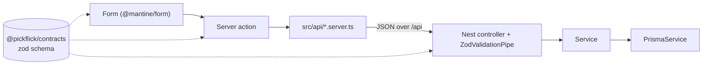

# Add a feature end to end

How to add a feature that crosses every layer: a request schema, a backend endpoint, the frontend
call, a form, and tests. Contact is the worked example throughout; open its files next to this guide.
[ARCHITECTURE.md](../ARCHITECTURE.md) explains why the layers exist.



Before you start, read the business rule the feature implements in the
[Roadmap](../ROADMAP.md#3-business-rules) and its screen in [DESIGN.md](../DESIGN.md).

## 1. Describe the request in contracts

1. Add a zod schema in `packages/contracts/src/<area>/<area>.schema.ts`. Name it `<thing>Schema`
   and export the inferred type as `T<Thing>`:

    ```ts
    export const contactSubmissionSchema = z.strictObject({
        message: multilineText(1, CONTACT_MESSAGE_MAX_LENGTH),
        name: optionalText(singleLineText(1, CONTACT_NAME_MAX_LENGTH)),
        email: optionalText(z.string().trim().toLowerCase().pipe(z.email().max(254))),
    });
    export type TContactSubmission = z.infer<typeof contactSubmissionSchema>;
    ```

2. Use the text helpers in `common/text.ts`; they trim, reject control characters, and treat an empty
   form field as missing.
3. Describe responses as plain interfaces (`IClubSummary`) and conflict causes as a constant list
   (`CLUB_CONFLICT_REASONS`).
4. Export everything from `packages/contracts/src/index.ts`.
5. Add `__tests__/<area>.spec.ts` for the rules the schema encodes.

## 2. Change the database, if the feature stores data

1. Edit `packages/database/prisma/schema.prisma`.
2. Start from a local database with every existing migration applied (`pnpm db:migrate`).
3. Generate the SQL for your change:

    ```bash
    cd packages/database
    pnpm exec prisma migrate diff --from-config-datasource --to-schema prisma/schema.prisma --script
    ```

4. Save the output as `prisma/migrations/<YYYYMMDDHHMMSS>_<name>/migration.sql`. Add any constraint
   Prisma cannot express (partial unique indexes, checks) by hand.
5. Run `pnpm db:migrate`, then run the diff again; it must print an empty migration.
6. Add a case to `src/__tests__/constraints.int.spec.ts` for each new constraint.

Migrations are high-risk: keep them additive, and review them against the running revision (see
[production operations](production-operations.md#review-migration-compatibility)).

## 3. Add the backend module

Copy `apps/backend/src/modules/contact` into `apps/backend/src/modules/<feature>/` and rename.

1. **Controller.** Validate the body with the shared schema; never re-validate in the service:

    ```ts
    @Post()
    @Public()
    @HttpCode(HttpStatus.ACCEPTED)
    @Throttle({ default: { ttl: 10 * 60_000, limit: 5 } })
    submit(@Body(new ZodValidationPipe(contactSubmissionSchema)) submission: TContactSubmission) {
        return this.contactService.submit(submission);
    }
    ```

    Every route requires a session by default. Add `@Public()` only for anonymous use, and read the
    caller with `@CurrentUser()` otherwise.

2. **Service.** Put the rule here and throw Nest exceptions. When the client must tell causes apart,
   pass a reason from contracts: `throw new ConflictException({ reason: 'CLUB_ARCHIVED' })`.
   `ApiExceptionFilter` builds the error envelope; never format errors by hand.
3. **Club data.** Start with `findMembership` from `modules/clubs/club-access.ts`; it answers `404`
   to anyone who is not an active member. Add `assertAdmin` or `assertActive` as the rule needs.
4. **External services.** Inject them behind a token (as `EMAIL_CLIENT` is) so tests can swap them,
   and build them from the validated runtime environment, never from `process.env`.
5. **Module.** Import what you use (`EmailModule`, …); `PrismaService`, storage, and the runtime
   environment are global. Register the module in `apps/backend/src/app.module.ts`.

## 4. Call it from the frontend

1. Add a function to `apps/frontend/src/api/<area>.server.ts`. The file starts with
   `import 'server-only'` and uses `apiRequest`, which forwards the cookie and client address and
   throws `ApiError` for any non-2xx answer:

    ```ts
    export const sendContactMessage = (submission: TContactSubmission): Promise<void> =>
        apiRequest('/contact', { method: 'POST', json: submission });
    ```

2. Add a server action in the route's `actions.ts` (`'use server'`). Validate with the same schema,
   call the API function, and return a `TFormResult` from `@/lib/form-errors`: `{ ok: true }` or a
   message, a tone, and per-field errors. Map `ApiError` statuses and reasons to copy here.
3. Build the form in the route's `_components/<Name>/<Name>.tsx` with `@mantine/form` and the UI kit
   (`TextInput`, `Textarea`, `Button`). Copy `app/(marketing)/contact/_components/ContactForm`: it
   validates on submit, focuses the first invalid field, checks `navigator.onLine`, calls the action
   inside `useTransition`, and shows the result in a `role="status"` region.
4. Keep the route's styles in `page.module.scss` and the component's in `<Name>.module.scss`, using
   tokens only.

## 5. Test each layer

| Layer         | Test                                                                                                                           | Run                     |
| ------------- | ------------------------------------------------------------------------------------------------------------------------------ | ----------------------- |
| Schema        | `packages/contracts/src/<area>/__tests__/*.spec.ts`                                                                            | `pnpm test:unit`        |
| Service       | `modules/<feature>/__tests__/<feature>.service.spec.ts`, with injected fakes (see `contact.service.spec.ts`)                   | `pnpm test:unit`        |
| Endpoint      | `modules/<feature>/__tests__/<feature>.int.spec.ts` with `startTestApi()` and `createUser()` from `src/testing/integration.ts` | `pnpm test:integration` |
| Server action | `app/.../__tests__/actions.spec.ts`, mocking `@/api/*.server`                                                                  | `pnpm test:unit`        |
| Screen        | A Playwright spec in `tests/ui/`, with any new backend answers added to `start-frontend-with-mock-api.ts`                      | `pnpm test:ui`          |
| Journey       | A step in `tests/journeys/` when the feature joins a core flow; it runs the real web app and API                               | `pnpm test:journeys`    |

`startTestApi()` boots the real application against the local database; send
`{ userId }` with a request to act as that User.

## 6. Finish

1. Run `pnpm verify`, `pnpm test:integration`, and `pnpm test:ui`.
2. If you added an environment variable, add it to `.env.example`, `environment.schema.ts` in
   `@pickflick/config`, and the [environment reference](environment.md) in the same change.
3. Update the documents the feature touches: the Roadmap rule, the DESIGN screen status, and
   ARCHITECTURE when a module or interface appears.
