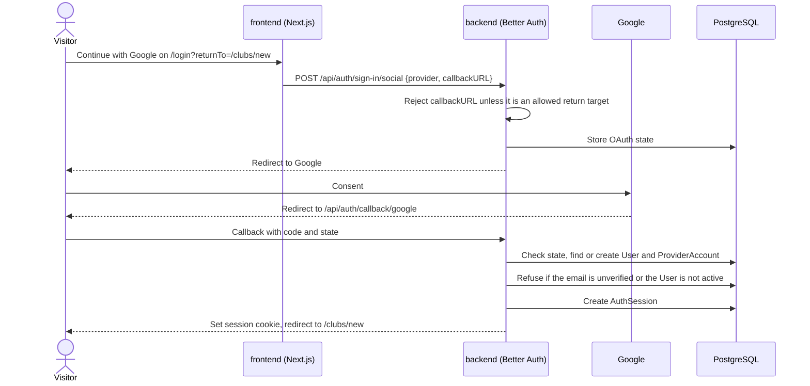
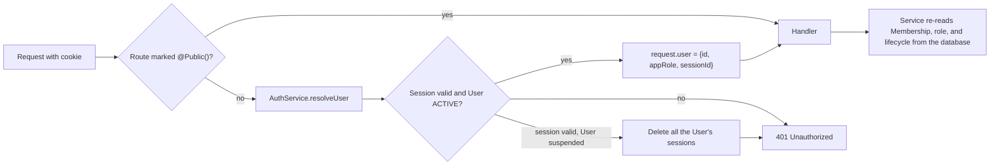

# Authentication and sessions

How PickFlick signs people in, keeps them signed in, and decides what they may do. The decisions
behind it are [ADR-002](decisions/README.md#adr-002--keep-authentication-and-sessions-at-the-api-boundary)
and [ADR-010](decisions/README.md#adr-010--use-better-auth-at-the-api-boundary). Headers, cross-site
request defenses, and the rest of the security model are in [Security](security.md).

## The short version

- The backend owns authentication. [Better Auth](https://better-auth.com/docs) runs inside NestJS,
  mounted at `/api/auth/*`; the frontend never parses a session or makes an authorization decision.
- People sign in only with Google, or Apple once the owner enables it. There are no passwords.
- A session is a row in PostgreSQL (`AuthSession`); the browser holds only an opaque cookie. Deleting
  the row signs the person out everywhere on their next request.
- Every backend route requires a session unless it is marked `@Public()`, and every Club rule is
  re-checked against the database on each request.

## Signing in

The frontend proxies `/api/*` to the backend (a rewrite in `next.config.ts`), so the whole flow runs
on one origin and the cookie is first-party.

Rules the backend enforces during sign-in (`apps/backend/src/modules/auth/auth.config.ts`):

- **Return targets.** `callbackURL` must match `isAllowedAuthReturnTarget` in
  `@pickflick/contracts`: `/app`, `/clubs/new`, a Club's Hub or settings page, or an invitation. Anything
  else is rejected with `INVALID_RETURN_TARGET`, and pages build login links with
  `resolveAuthReturnTarget`, which falls back to `/app`.
- **Identity.** An account is the pair (provider, provider subject), stored in `ProviderAccount`.
  Email is profile data, never the identity key.
- **No implicit linking.** When a signed-out person signs in with a new provider whose email already
  belongs to another User, sign-in fails with `account_not_linked` instead of merging accounts.
  Explicit linking is deferred (see the Roadmap Decision Log), so each User has one provider.
- **Verified email.** A new User is created only when the provider says the email is verified.
- **Active Users only.** No session is created for a suspended User.
- **No provider tokens.** PickFlick needs only the provider subject, so access, refresh, and ID
  tokens are cleared before the account row is written.
- **Scopes.** Google gets `openid email profile`. Apple shares a name only on first consent; when it
  is missing, the display name falls back to the part of the email before `@`.

## Staying signed in

| Property                 | Value                                                                                         |
| ------------------------ | --------------------------------------------------------------------------------------------- |
| Storage                  | `AuthSession` row in PostgreSQL; no stateless or cached sessions                              |
| Lifetime                 | Seven days, extended when used, at most once a day                                            |
| Cookie (UAT, production) | `__Host-pickflick.session_token`: `Secure`, `HttpOnly`, `SameSite=Lax`, `Path=/`, no `Domain` |
| Cookie (local, test)     | `pickflick.session_token`, not `Secure`, so it works on `http://127.0.0.1`                    |
| Trusted origin           | `AUTH_BASE_URL` only                                                                          |

Better Auth answers only the routes the flow uses; `AuthService` returns 404 for every other Better
Auth endpoint:

| Route                                                             | Use                            |
| ----------------------------------------------------------------- | ------------------------------ |
| `POST /api/auth/sign-in/social`                                   | Start Google or Apple sign-in. |
| `GET /api/auth/callback/google`, `…/apple` (and `POST` for Apple) | Provider callbacks.            |
| `GET /api/auth/get-session`                                       | Read the current session.      |
| `POST /api/auth/sign-out`                                         | End the current session.       |

## Authorizing a request

- `AuthGuard` is registered globally, so a new route is protected unless you add `@Public()`.
  Handlers read the User with `@CurrentUser()`.
- `resolveUser` looks up the session, then the User's current status and app role. A suspended
  User's sessions are deleted on the spot, so suspension takes effect on the next request.
- `get-session` runs the same check first, so the frontend stops showing a suspended person as
  signed in.
- Club access is decided in the Clubs service from the database, not from anything the client
  sends. A Club you are not an active member of answers `404`, and App Admin grants no Club rights.
  No route requires the App Admin role yet.

## The frontend side

- `src/api/session.server.ts` asks the backend for the session and returns `authenticated`,
  `anonymous`, or `unavailable`. `unavailable` (timeout, rate limit, outage) is never treated as
  signed out: pages show a retry state instead of silently logging the person out.
- `src/lib/auth-client.ts` holds the Better Auth client and `startSocialSignIn`, which starts sign-in in the browser.
- Server-side API calls (`src/lib/api.server.ts`) forward only the cookie and the client address
  headers; a `401` from the backend sends the page to `/login` with a return target.
- The Apple button appears only when `APPLE_SIGN_IN_ENABLED=true`, the same flag that registers
  Apple on the backend.

## Abuse limits

Better Auth rate-limits its own routes: 60 requests a minute per client, 10 a minute for
`/sign-in/social`, counted in the `AuthRateLimit` table. In UAT and production it identifies the
client by `cf-connecting-ip`; locally it uses `x-forwarded-for`. The rest of the API uses
`@nestjs/throttler` (see [ARCHITECTURE.md](../ARCHITECTURE.md#5-cross-cutting-contracts)).

## Apple Sign In

Apple stays off in every environment until the owner approves Apple Developer Program membership and
a sandbox run. When `APPLE_SIGN_IN_ENABLED=true`, the backend requires `APPLE_CLIENT_ID`,
`APPLE_KEY_ID`, `APPLE_TEAM_ID`, and a valid EC P-256 `APPLE_PRIVATE_KEY`, and signs Apple's client
secret from that key at startup (`apple-client-secret.ts`). An invalid key fails environment
validation instead of crashing later.

## Tests

`apps/backend/src/modules/auth/__tests__/auth.int.spec.ts` runs against the local database
(`pnpm test:integration`) and covers allowed and rejected return targets, reading the signed-in User,
forged cookies, suspension, refused sessions for suspended Users, sign-out, and the 404 for
unexposed routes. `pnpm test:e2e` confirms the built backend starts the Apple flow and that Better
Auth parses request bodies itself.
